<p align="center">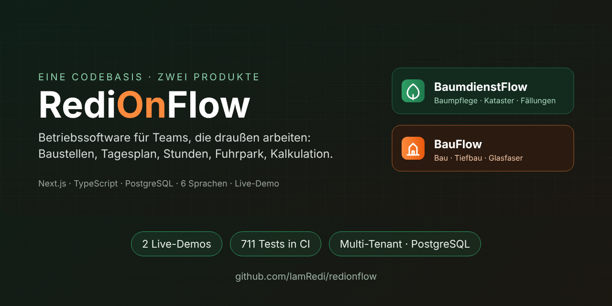</p>

# RediOnFlow

**Operations software for teams that work outdoors.** The owner plans in the office, the crew works on site from their phones, and both see the same state: job sites, tasks, hours, fleet, materials and cost estimates. One codebase ships as two products:

- **BaumdienstFlow** for tree care companies: tree lists with coordinates, removals, crown work, aerial lifts and chippers.
- **BauFlow** for construction and steel fabrication: personal offices, material lists, production, site assembly, warehouse and workshop. In real use at AL-Steel; separate steel and crane sample companies use fictitious data.

Routine checks run locally; [GitHub Actions](https://github.com/IamRedi/redionflow/actions/workflows/ci.yml) runs are reserved for explicitly selected cloud verification.

**[Deutsche Version](README.md)** · **BauFlow samples reviewed: 16 November 2026** · **[Project status and history](docs/PROJEKTSTAND.md)** (German) · **[Verification record](EVIDENCE.md)** (German)

The user interface, the demo data and most documents are in German, because the target market is German-speaking. The app itself supports 6 languages.

## Workshop, warehouse and fleet share one workspace · 16 November 2026

**[BauFlow Musterbau](https://bauflow-production-1344.up.railway.app/muster)** and **[RheinRuhr Kranservice Muster](https://rheinruhr-kran-muster-production.up.railway.app/muster)** now open these areas beneath the same team and icon navigation. Continuous rooms, compact Day/Night glass, expandable search and existing detail cards preserve each company's identity and records.

[PR226](https://github.com/IamRedi/redionflow/pull/226) runs as `d174709`; [PR227](https://github.com/IamRedi/redionflow/pull/227) as `84048b1`. 35 online checks passed across desktop and emulated phone, Light/Night, including search, details, focus, natural footer and denied warehouse access for field staff. AL-Steel, BaumdienstFlow and other demos were not redeployed or changed. [Evidence and limits](docs/MUSTER_OPERATIONS_20261116.md).

Actual online captures with fictional demo data only · 16 November 2026.

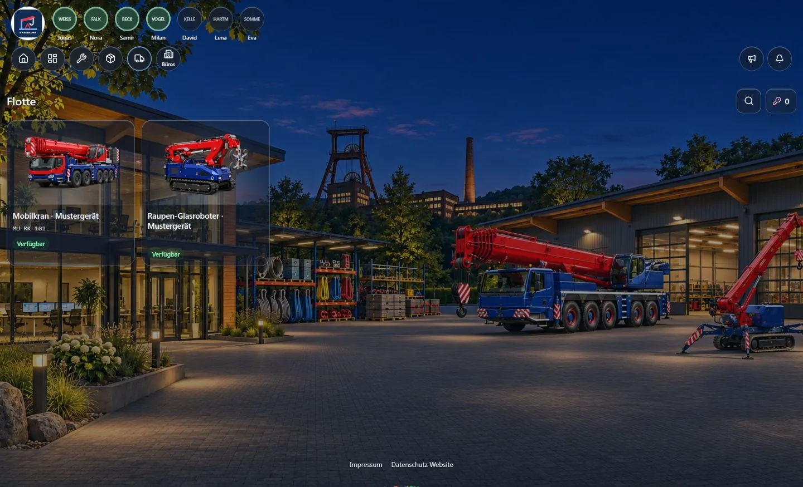

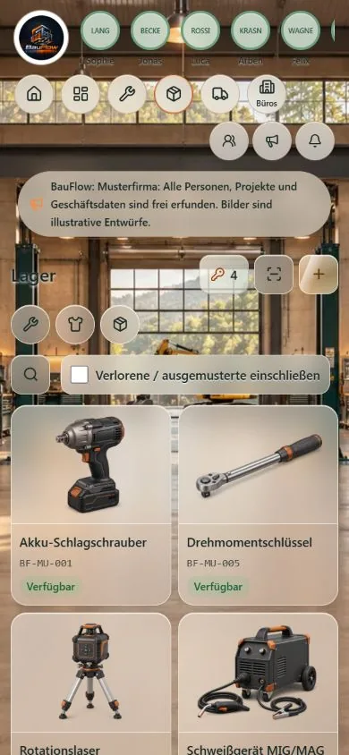

## Separate crane sample company is online · 15.11.2026

**[Open RheinRuhr Kranservice · MUSTER](https://rheinruhr-kran-muster-production.up.railway.app/muster)** — another fictional company from the BauFlow base: seven staff, three lifting jobs, two machines, four tools and three offices. Manufacturing is disabled. Owner, accounting, dispatch, field staff and workshop use distinct accounts and the existing permissions. Changes and documents persist in its own database; use test data only.

PR223 plus [publication adapter PR224](https://github.com/IamRedi/redionflow/pull/224), runtime `a2a5829`: 1,314 unit tests, 36 local and 42 online browser cases passed. An uploaded PDF survived redeployment and was downloaded from an independent employee session. AL-Steel, BauFlow Musterbau and BaumdienstFlow retain their existing independent deployments. AI, email, GPS and engineering lifting-plan approval are not connected here. [Release and exact limits](docs/CRANE_MUSTER.md).

Actual online captures with fictional data · 15 November 2026. The phone viewport is emulated; images are illustrative samples, not technical job approval.

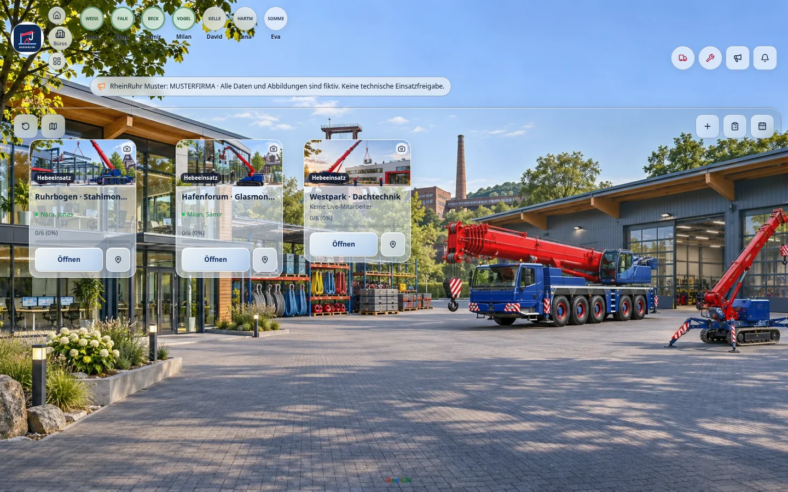

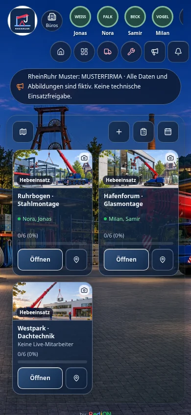

## BauFlow sample company is online · 14.11.2026

The separate **[BauFlow Musterbau · DEMO](https://bauflow-production-1344.up.railway.app/demo)** runs the current steel application with its own original BauFlow identity. Choose owner, accounting, site, factory or workshop at entry. Twelve fictional employees, five offices, three sites, one factory and eleven assets (six vehicles and five tools) share the same connected workflows. Changes persist and are visible to other testers; use test data only. AL-Steel and BaumdienstFlow keep their independent deployments.

[Release, access and verification](docs/BAUFLOW_MUSTER_TEMPLATE.md). Initial PR206 release: `67cd096`; 1,265 unit tests and 45 browser cases passed. The following are actual online captures from 14 November, with fictional data. Phone views are responsive/emulated, not physical-device acceptance.

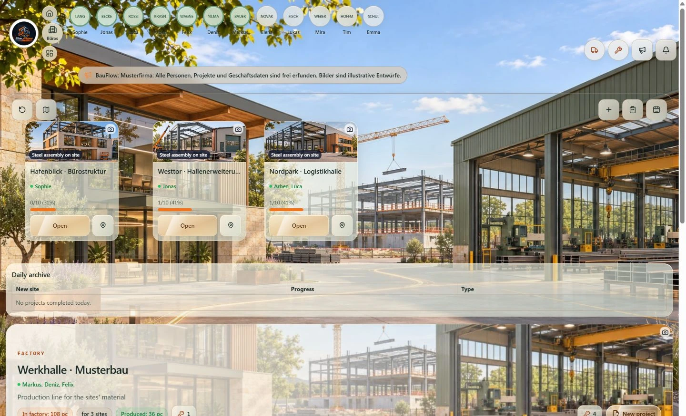

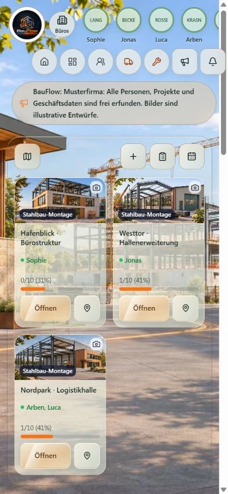

The fleet now uses clear Day/Night glass with six photographed sample vehicles, including a crane truck and site-manager estate car. PR211 is live only on the independent Musterfirma demo. Existing uploaded photos, original vehicle records and repair history are preserved.

Actual online UI with fictional data and illustrative vehicle images · 14 November 2026.

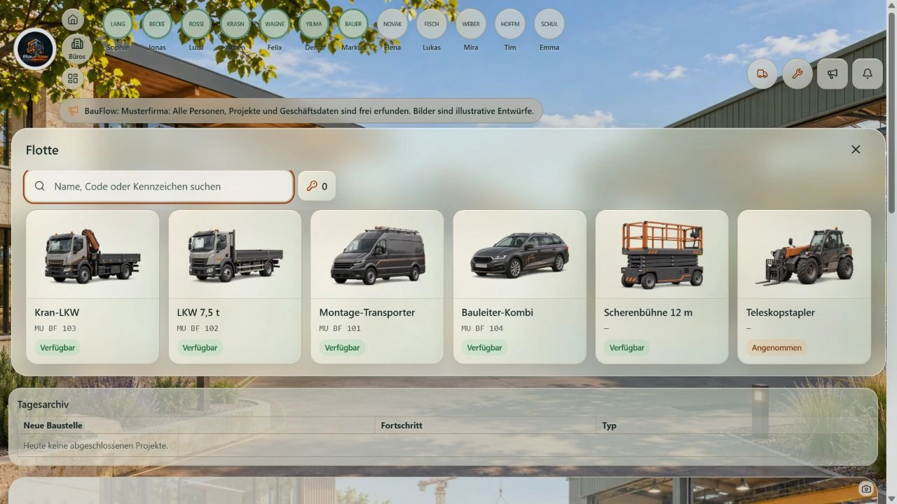

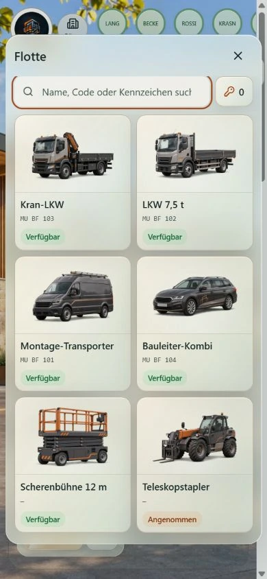

The inventory now shares the compact Day/Night glass cards with five illustrated tools. PR212 is live only on the separate Musterfirma demo; identities, barcodes, custody and the existing repair are preserved.

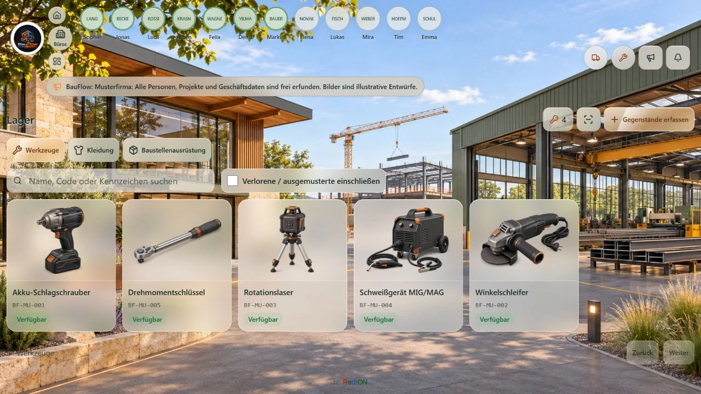

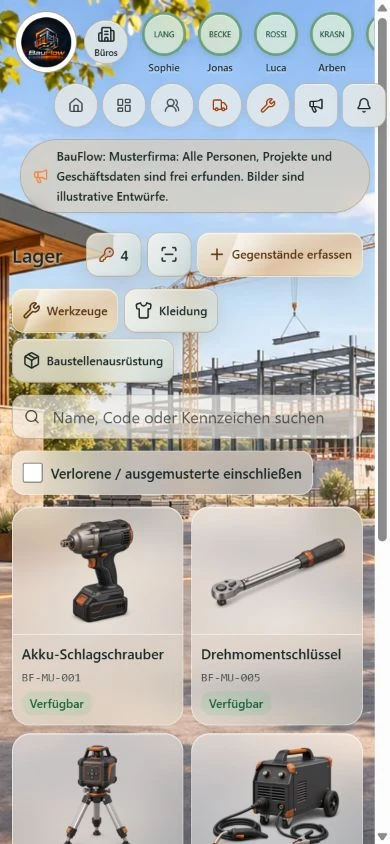

## Musterfirma: photoreal tree references · 15 November 2026

Tree cards keep their fixed size and flip for completion/problem actions. Filters no longer share a decorative white band; scrolling remains available with hidden scrollbar chrome. Cards and the atlas share 26 generated photorealistic summer, autumn and winter species references. These are illustrations of a species, not photographs of individual site trees.

Long tree lists mount a bounded visible window. Large inventory and timber collections use the same approach while retaining existing data limits and workflows. Source and verification: [PR217](https://github.com/IamRedi/redionflow/pull/217). Live on Musterfirma only: source `99c69ee`, Railway `53240831-27cb-4988-aed4-cd733ca44ec8`, SUCCESS/Online. 62 browser flows verified; 727 unit tests and 19 mocked integration cases passed. Existing data and configuration were preserved.

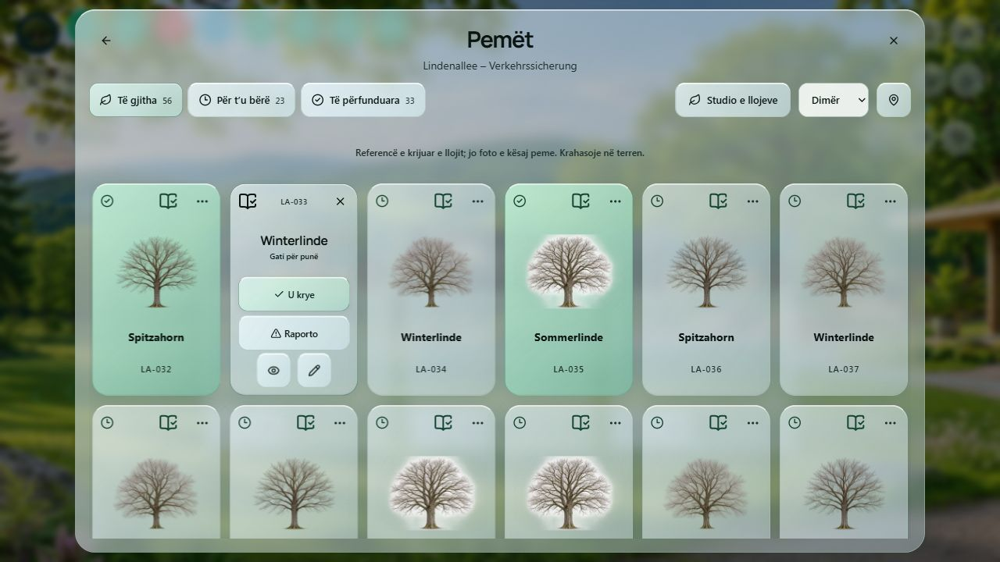

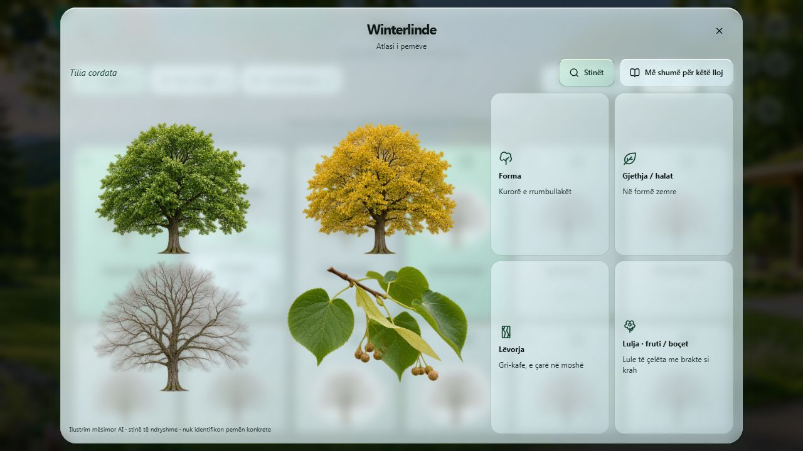

## Musterfirma: glass worksite cards · 14 November 2026

The public BaumdienstFlow Musterfirma demo now opens worksites as glass cards over the existing Workzone, with a centered name, address and site information. An illustrated tree card opens a dedicated view with **All / To do / Completed**, map and species studio. Equipment, crew, safety, photos, processes, documents and instructions open separate views.

[Open the live worksite card](https://redionflow-production.up.railway.app/demo/baustellen/cmw5rbbq1000o2kk19w9m2apf). The current captures below show the demo interface with fictional data. This release preserves the existing records/files and does not change other products' company access. Source: [a7093cf](https://github.com/IamRedi/redionflow/commit/a7093cf57599ccc319a5520fdb92e18c99ece0a4), [PR205](https://github.com/IamRedi/redionflow/pull/205).

Current views from 15 November 2026 use photoreal tree references and the same glass style. The phone capture uses fictional, read-only demo data.

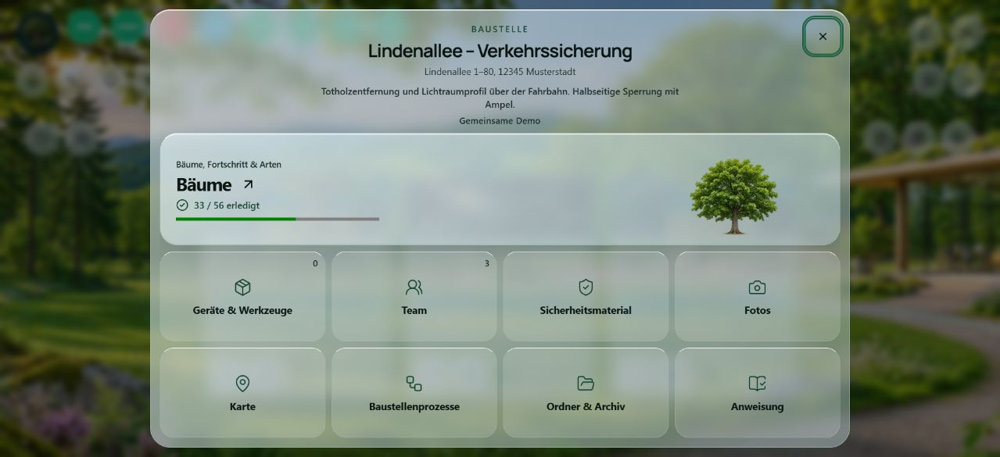

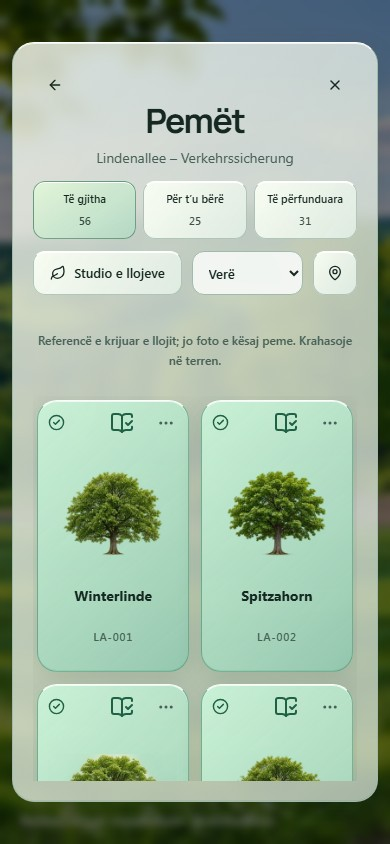

## Product websites and live demos

| Product | Website | Demo | Fictitious company |
|---|---|---|---|
| BaumdienstFlow | **[baumdienstflow.de](https://www.baumdienstflow.de/)** | **[redionflow-production.up.railway.app/demo](https://redionflow-production.up.railway.app/demo)** | Baumdienst Musterstadt GmbH: 8 employees, 3 job sites, 152 trees, 5 machines |
| BauFlow | **[BauFlow website](https://www.baumdienstflow.de/bauflow/)** | **[BauFlow Musterbau](https://bauflow-production-1344.up.railway.app/muster)** | 12 staff, 5 offices, 3 steel assembly sites, one factory, 6 vehicles and 5 tools |
| BauFlow · crane sample | **[BauFlow website](https://www.baumdienstflow.de/bauflow/)** | **[RheinRuhr Kranservice Muster](https://rheinruhr-kran-muster-production.up.railway.app/muster)** | 7 staff, 3 lifting jobs, 3 offices, 2 machines and 4 tools; manufacturing disabled |

BauFlow opens the ordinary steel application through five explicit sample roles. The separate crane sample uses the same base with its own database and manufacturing disabled. Changes are shared within each sample company and persist; there is no nightly reset. The existing BaumdienstFlow entry stays independent. Real company access is set up separately. Use test data only.

Since 1 November 2026 the BaumdienstFlow demo links to the **KiDraht Assistant** of the same fictitious company: a "Company knowledge" button in the top bar and a briefing card on every job site open the owner-approved rules and the safety briefing for that site. Workers sign in there with a PIN.

## BauFlow: connected offices, factory and site · 12 November 2026

**Task journal · 13 November 2026.** Personal crystal cards with title, status,
importance and an optional note; complete, edit and archive from the card.
Opt-in reminders belong only to the person who schedules them and use company
time. The configured server sends through the existing push channel even when
the app is closed. Device permission and network/OS delivery still apply;
correlation of the physical iPhone check with a scheduled reminder remains pending.
Company sign-in is required; this is not enabled in the public demo.
Released in [PR #191](https://github.com/IamRedi/redionflow/pull/191),
[production revision 3b327f8](https://github.com/IamRedi/redionflow/commit/3b327f80132328ff3a69a2d689b3c49bb28fac04).
The existing captures below show the previously accepted 12 November version.

A calendar on the wall, documents in a drawer and an assistant on the monitor. Each team member opens a personal workspace with the tools and information they are allowed to use.

Reception connects the team’s offices. Start/Stop reflects actual working presence. Internal mail with attachments, personal tasks and work assigned by administration. Personal assistants use the employee’s context and permissions; the management assistant stays separate.

Kilograms by day and project, with confirmation evidence. Part cutting, assembly cutting and assembly are separate processes; they are not added together as one steel total.

Owners and administrators manage the company. Engineers work within their role and site permissions; office and field staff see the functions they are authorized to use.

BauFlow is in real operational use at AL-Steel. Screens here use fictitious data; operational access requires a company account. AI, GPS and notifications depend on configuration and device permissions.

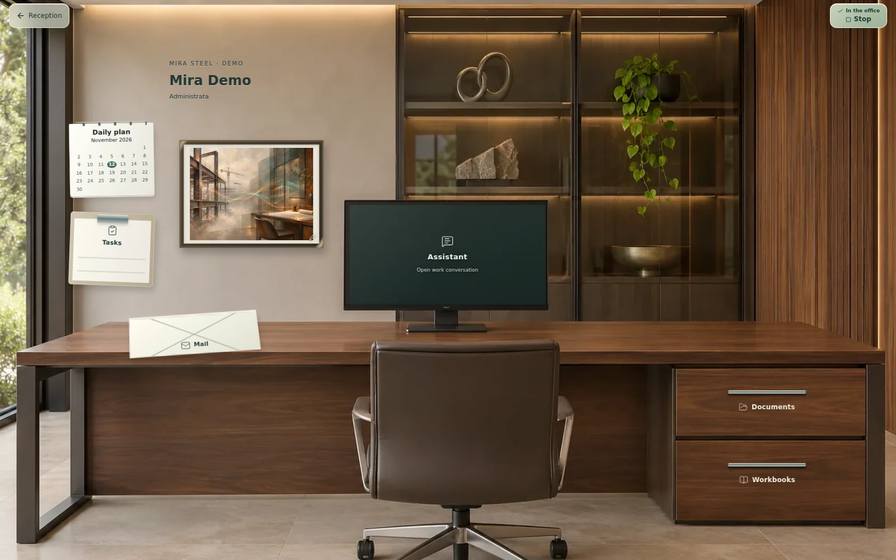

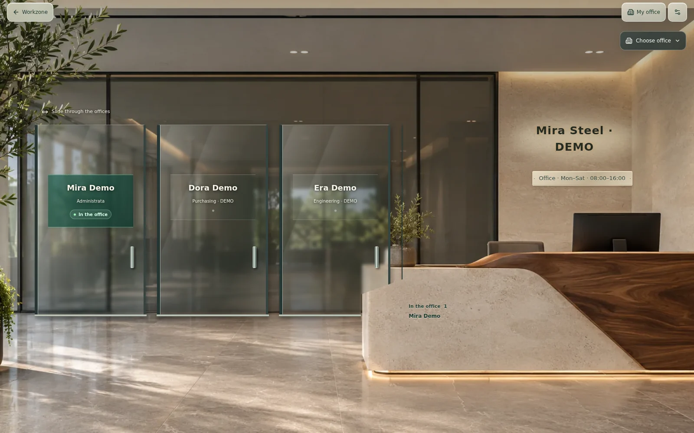

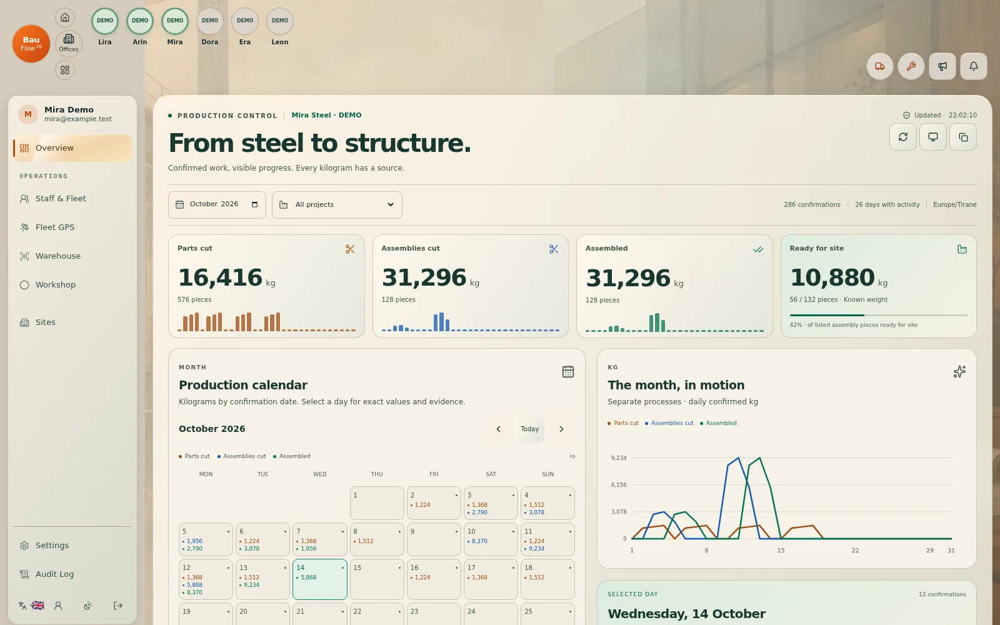

Verified application baseline: [d2846d1](https://github.com/IamRedi/redionflow/commit/d2846d1797f2a91cd5a49af6b483067ca43ce615) · [Product presentation](https://www.baumdienstflow.de/bauflow/about/en.html). The older public fibre-construction demo does not show this office version. External email is not included.


## What is built today

| Status | Meaning and scope |
|---|---|
| **Built and live** | Workzone for the job site (task or tree list, map, time tracking with start, pause and stop, extra work, notes, traffic safety), admin dashboard, staff and fleet, daily plan with versions, barcode inventory with checkout to employees, cost estimating (projects, line items, templates, wage roles, recipes), daily and monthly reports, job site export (ZIP with HTML, CSV, KML), leave requests, admin password login, 6 languages |
| **Documented verification baseline, 1 November** | 711 automated tests (423 unit, 263 integration against real PostgreSQL, 25 end-to-end in the browser), secret scan, Docker demo smoke test, Lighthouse mobile 96/100/100/100. Historical results are in the [verification record](EVIDENCE.md); they are not a new test run for this documentation update. |
| **Built, not active in the demo** | AI assistant (needs an OpenAI key), push notifications (Firebase), file storage for documents and photos (Supabase), subscriptions and invoices in SaaS mode (Stripe), vehicle GPS. The code exists and is tested; the public demo deliberately runs without these services. |
| **In progress** | Offline mode for field actions (browser queue exists, not yet tested in the field), Content Security Policy from report-only to enforcing, a real virus scanner for uploads |
| **Vision** | Pilot companies in both industries, more trades as their own mode, analysis across several seasons |

**Steel production · Released for a real company, 5 November 2026 ([#55](https://github.com/IamRedi/redionflow/pull/55)).** A shared company catalog is live: tasks are enabled per site, while deselection and archiving preserve earlier confirmations. Each material can have its required factory and field processes. Explicitly linked tasks derive progress from confirmed material work. Uploaded photos are stored as small private WebP images. This release requires company sign-in; the public demos remain separate. Verified production source: [6c8b886](https://github.com/IamRedi/redionflow/commit/6c8b88645f8285331fc3654509f44d9458563849).

**AI illustrations:** One production Image API request saved a WebP illustration in the native orange/slate style; its work depiction and persistence after reload were verified ([PR #60](https://github.com/IamRedi/redionflow/pull/60)). Generation remains optional, subject to company provider access and image quotas; uploaded photos take precedence, and an existing image or standard drawing is retained on failure.

**Warehouse, workshop and fleet · Released for a real steel company, 6 November 2026 ([#62](https://github.com/IamRedi/redionflow/pull/62)).** Tools, clothing and site equipment are tracked as individual units with codes and sizes where relevant. Issues and returns require office and worker confirmation; colleague transfers require both colleagues. Loss and retirement remain pending until management decides. Repairs move through reported → received → repairing → ready; release requires a function test and a repair note or evidence. Private photos, invoices and history stay with the original asset. Two compact actions open fleet and workshop; the phone vehicle picker has three columns with names and plates. Verified production source: [c91a95a](https://github.com/IamRedi/redionflow/commit/c91a95ae379a8ed2ac25306001a41f96e7f4c258). Company sign-in is required; this extension is not enabled in the public demos.

## Document handovers and asset codes in BauFlow

Six site phases group documents with download and a share chooser. Active staff
personally confirm receipt with their name and timestamp. New
versions retain previous files and confirmations in history; receiving a document
does not complete a production step.

Factory barcodes and QR payloads retain leading zeroes, case and punctuation.
A shared model code requires choosing the individual unit. Each unit gets a
unique printable label, while existing codes remain valid. Company sign-in is
required. Physical camera and printer acceptance remain separate from local
browser verification.

This capture comes from the local application with entirely synthetic data.
This documentation PR is published with the approved application update; it does
not enable the private workflows in the public demos.

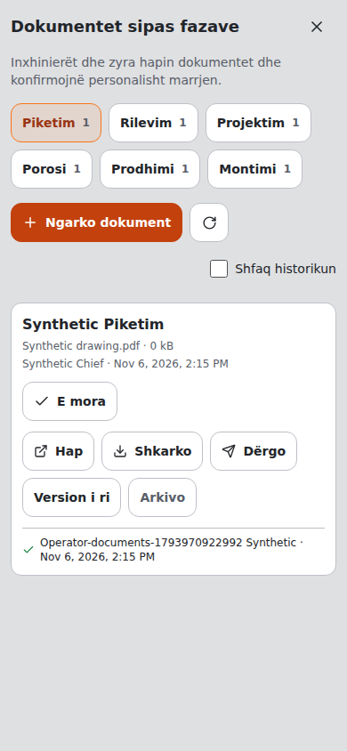

## Site access in BauFlow

Workers read site documents and confirm their own receipt. Office staff upload;
engineers need an explicit upload grant for each site. Management selects them
when creating the site or later under **Access**. Factory and field work keep
their respective engineer roles. Administrators and owners manage the company.
An owner name/PIN login is configured privately inside the signed-in profile.

Local checks cover granting, revocation, competing changes and tenant boundaries.
The image contains only fictional data. Publication and real-account setup follow
the application release approval separately; public demos receive no private data.

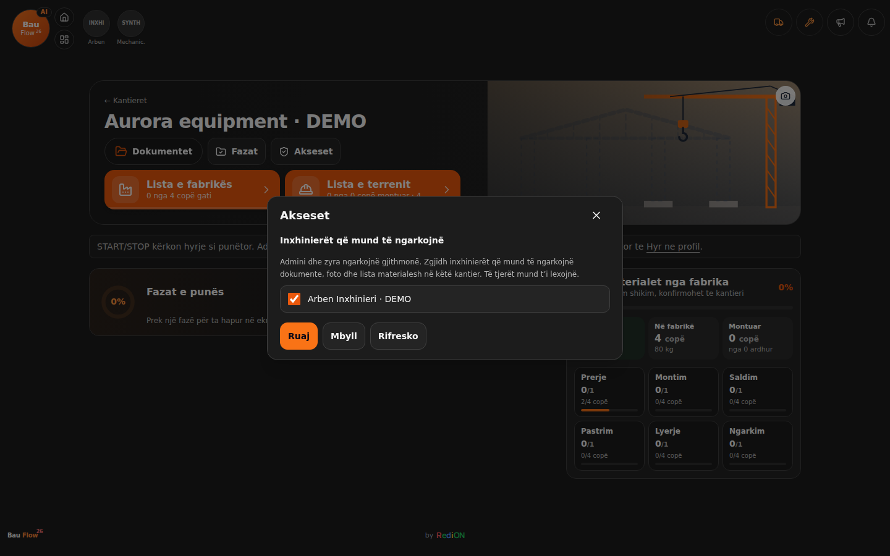

## Why this project?

Small and mid-sized contractors often plan their sites with paper, WhatsApp groups and Excel. What happens outside (who works where, what is done, where safety equipment is missing, who has which tool) reaches the office late or never, and hours get reconstructed from memory at the end of the month. RediOnFlow puts both on one screen: the crew taps two or three times on site, and the office sees it right away.

> **Upgrade humans. Not replace them.** The software takes over paperwork. Deciding, planning and taking responsibility stay with people.

## Inside the app

All images come from the running application with the fictitious demo data. None of them are mockups.

### BaumdienstFlow

| Workzone: all job sites at a glance | Job site with tree list |
|---|---|
| 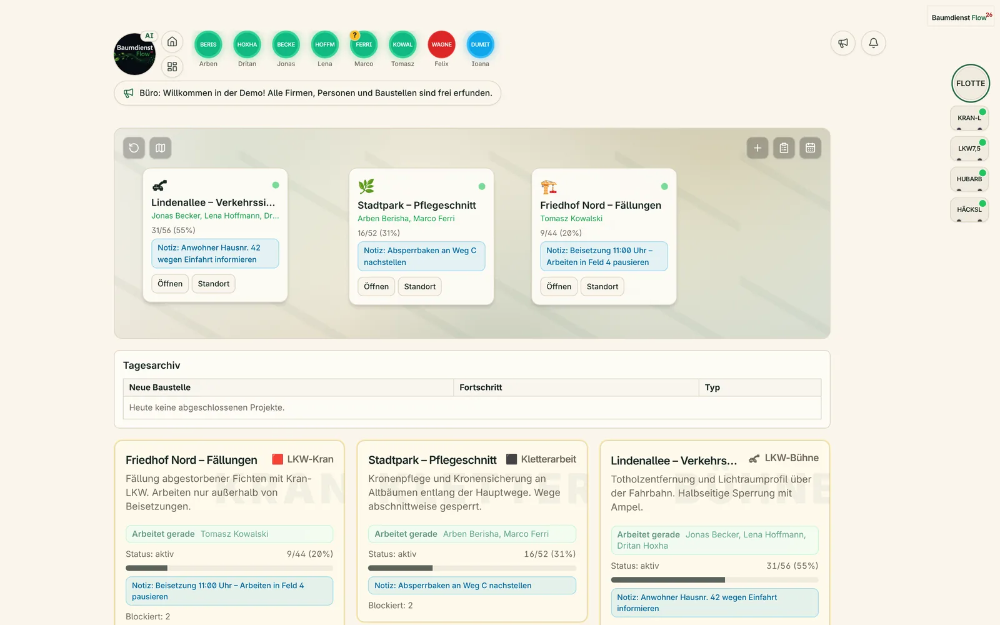 | 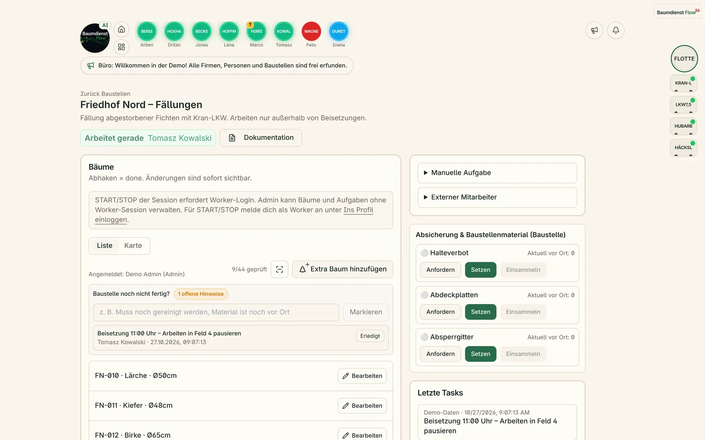 |

| Daily plan for tomorrow | Cost estimate for a quote |
|---|---|
| 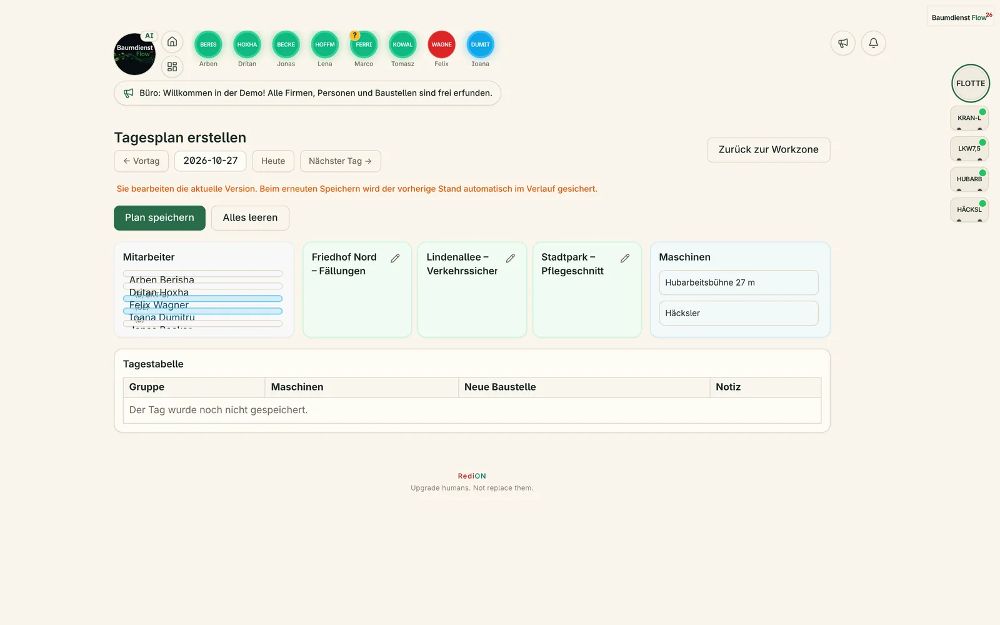 | 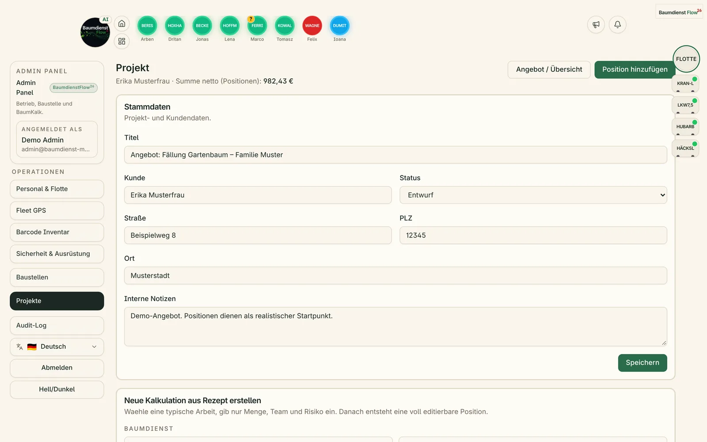 |

### BauFlow (fibre-optic civil works)

| Dashboard for the owner | Barcode inventory with tools and workwear |
|---|---|
| 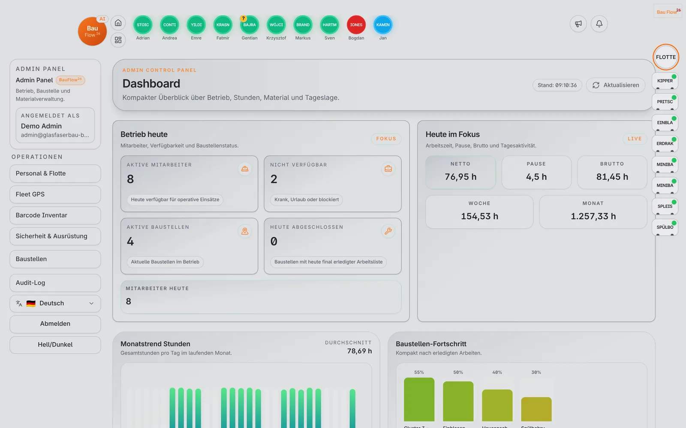 | 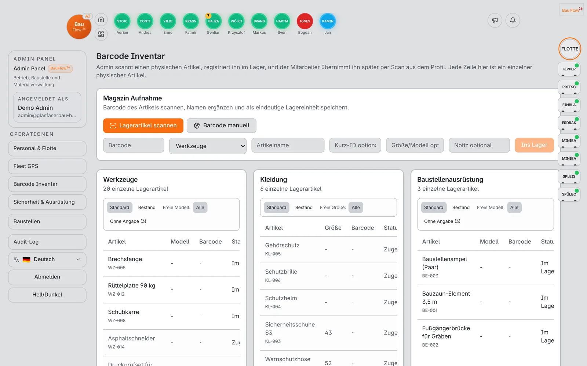 |

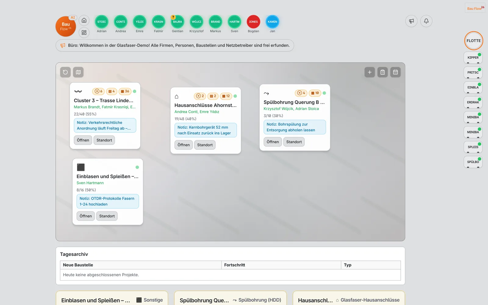

### On site (phone, 390 px)

| BaumdienstFlow: job site | BauFlow: job site | BauFlow: overview |
|---|---|---|
| 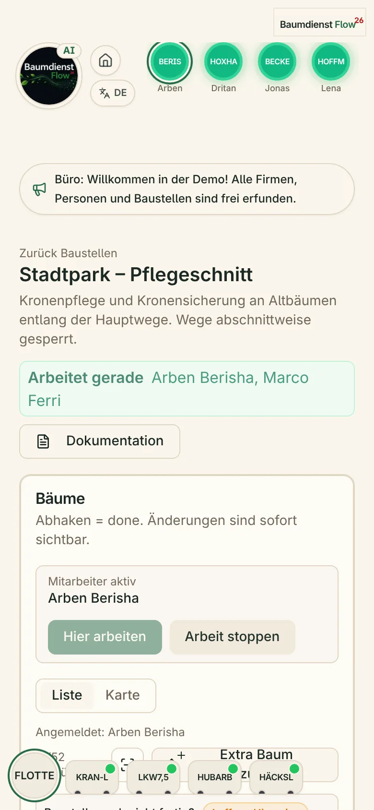 | 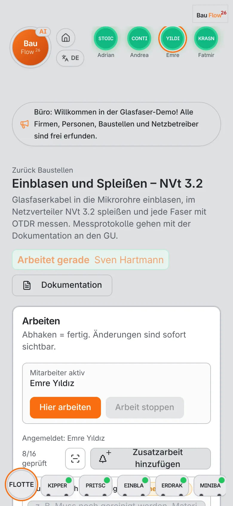 | 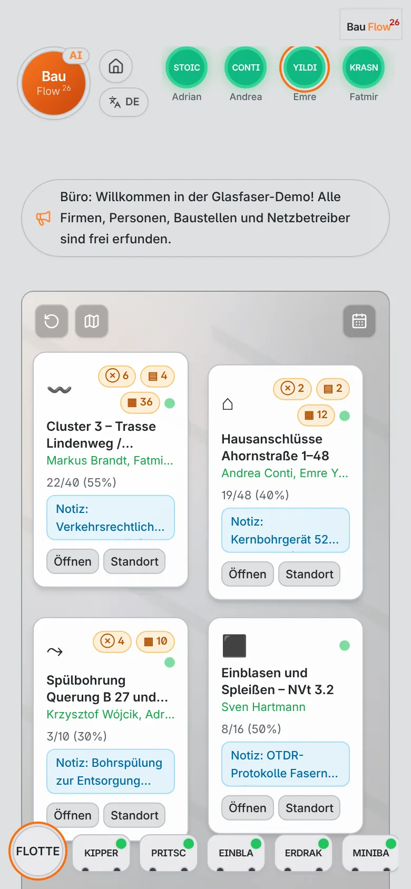 |

### Steel workshop

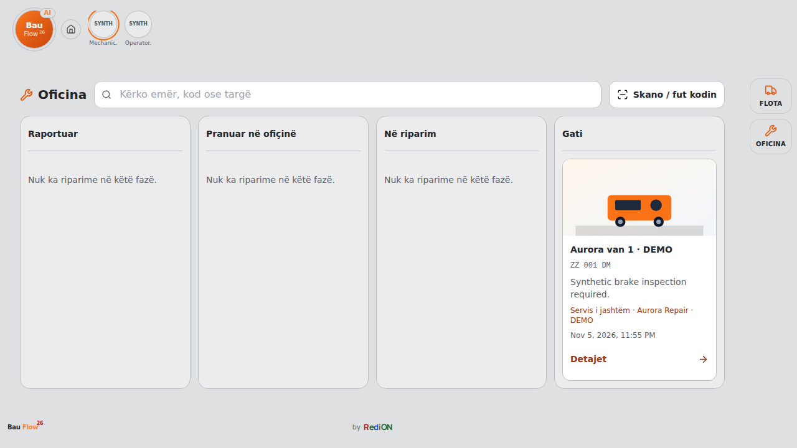

The real local application with fictional test data only. This local capture contains no customer data and does not imply the feature is enabled in the public demo.

## Architecture

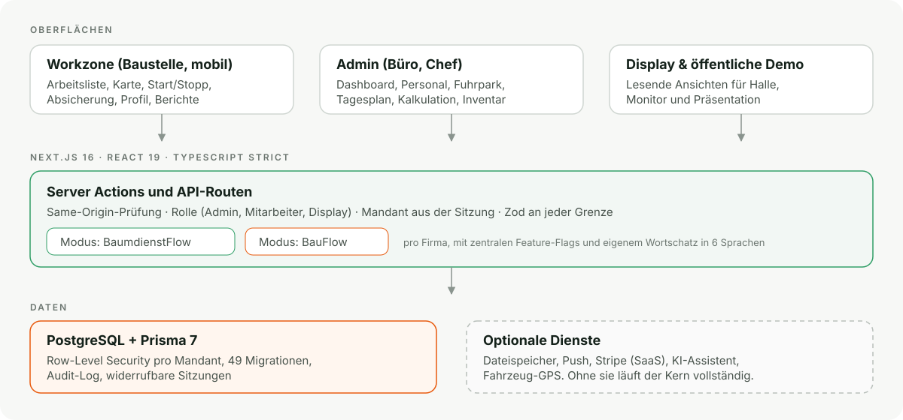

- **One application, two products.** `CompanyProfile.mode` picks BaumdienstFlow or BauFlow per company. Central feature flags hide tree-specific parts, and BauFlow has its own vocabulary in all 6 languages. There are no two codebases drifting apart.
- **Tenant isolation.** Every query is filtered by the company from the session; today that is the effective boundary, including in the live demos. As a second line, PostgreSQL row-level security policies exist for all tenant tables. Enforcement through a restricted database role currently runs as a pilot (job sites and daily plan), tested in CI against a throwaway database; rolling it out to every area is still open. The browser tests check that one tenant cannot see another tenant's data.
- **Two deployment modes.** As SaaS with many companies in one database, or as a dedicated instance for a single customer.
- **Stack:** Next.js 16 (App Router, Server Actions), React 19, TypeScript strict, Prisma 7, PostgreSQL 16, Tailwind CSS, Radix UI, Zod, Vitest, Playwright, GitHub Actions, Docker, Railway.

More in [docs/ARCHITEKTUR.md](docs/ARCHITEKTUR.md) (German).

## Quality and security

- **Local routine verification:** lint with zero warnings, TypeScript strict, unit and integration tests against a throwaway PostgreSQL, production build, browser tests, gitleaks and the Docker demo smoke test remain the checks. The existing cloud workflow runs only through `workflow_dispatch`; every job is preserved. Local and GitHub CI results are reported separately, and required protections remain in place.
- **Security:** passwords and codes hashed with scrypt, login rate limiting, revocable sessions, same-origin checks on every mutation, private files only through a checked route, security headers. Threat model and known residual risks are documented openly in [SECURITY.md](SECURITY.md).
- **Accessibility and speed:** Lighthouse mobile on the landing page: 96 performance, 100 accessibility, 100 best practices, 100 SEO.
- **No real data.** The repository was created as a snapshot without git history from the private production system. Real company and personal data was removed; the demo data is invented.

## Run it yourself

**Demo in three minutes** (requires Docker):

```bash
docker compose up --build                      # BaumdienstFlow demo
docker compose down -v && DEMO_SEED_MODE=glasfaser docker compose up --build   # BauFlow demo
```

Then open `http://localhost:3000/demo`. For the admin area, set `DEMO_ADMIN_PASSWORD='a-long-password'` before starting and sign in at `/admin-login` with `admin@baumdienst-musterstadt.example` (or `admin@glasfaserbau-beispieltal.example`). `DEMO_SEED_MODE=bau` starts a general construction company (paving, signage, drainage). Fresh data: `docker compose exec app npm run demo:reset`.

**Development** (Node.js 22, npm 10, PostgreSQL 16):

```bash
cp .env.example .env
npm ci
npm run db:migrate && npm run db:seed
npm run dev
```

```bash
npm run lint && npm run typecheck && npm test && npm run build
npm run test:integration:local   # needs Docker
npm run test:e2e:local           # needs Docker
```

Operations, auth details and deployment: [docs/OPERATIONS.md](docs/OPERATIONS.md), [docs/DEPLOYMENT.md](docs/DEPLOYMENT.md).

## How this project is built

RediOnFlow is developed by Redion Cekrezi, with AI agents as tools: the human decides what gets built, reviews every result and approves it; the agents write code, tests and documentation in small pull requests. Routine development verification runs locally; review, approval and required protections remain separate prerequisites. How that works in practice and where its limits are: [docs/KI_WORKFLOW.md](docs/KI_WORKFLOW.md) (German).

## About the author

Redion Cekrezi has worked as an arborist and team lead at a tree care company in North Rhine-Westphalia since 2021, after more than 15 years in electronics and technical diagnostics. RediOnFlow grew out of that work: he knows the workflows the software models from the aerial lift and the daily planning, not from a requirements document. Since 2025 he has been building his own software products as a full-stack and applied AI developer.

## Working together

Of interest to tree care, construction, civil works and fibre-optic companies that want to run their job sites digitally, and to partners who want to accompany a pilot. A walkthrough or admin access to the demo is available on request via the **[portfolio](https://www.redioncekrezi.de)** or [GitHub](https://github.com/IamRedi).

**Redion Cekrezi · Full-Stack & Applied AI Developer** · [by RediON](https://www.redioncekrezi.de/)

## BauFlow: vehicle card and service workflow

The vehicle card brings together data editing, photo and document expiry dates. Its workshop action opens defect reporting or the exact service history; the full workspace groups compact cards by repair phase. Mechanics or management progress the work, with evidence and invoices retained for the correct job. This capture and browser verification use synthetic data only. This does not enable the private company workflows in the public demos.

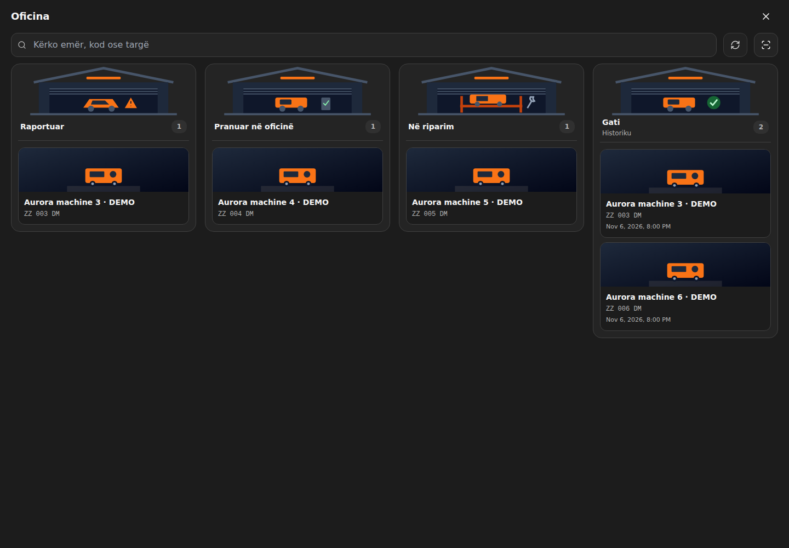


## License

Source-available, all rights reserved. The code may be read and run locally for evaluation, but not used commercially. Details in [LICENSE](LICENSE).
