<p align="center">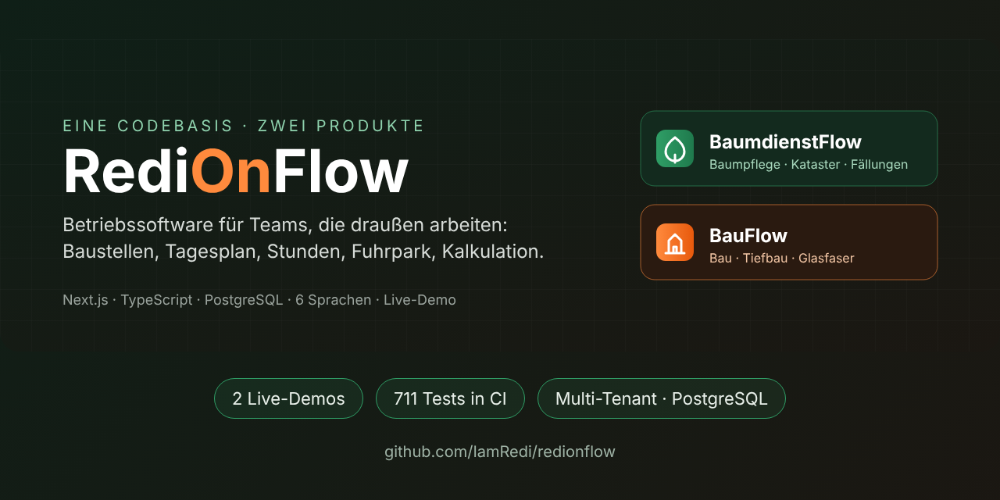</p>

# RediOnFlow

**Operations software for teams that work outdoors.** The owner plans in the office, the crew works on site from their phones, and both see the same state: job sites, tasks, hours, fleet, materials and cost estimates. One codebase ships as two products:

- **BaumdienstFlow** for tree care companies: tree lists with coordinates, removals, crown work, aerial lifts and chippers.
- **BauFlow** for construction, civil works and fibre-optic contractors: task lists instead of trees, trenches, house connections, directional drilling, tools and traffic safety.

[](https://github.com/IamRedi/redionflow/actions/workflows/ci.yml)

**[Deutsche Version](README.md)** · **As of 27 October 2026** · **[Project status and history](docs/PROJEKTSTAND.md)** (German) · **[Verification record](EVIDENCE.md)** (German)

The user interface, the demo data and most documents are in German, because the target market is German-speaking. The app itself supports 6 languages.

## Product websites and live demos

| Product | Website | Demo | Fictitious company |
|---|---|---|---|
| BaumdienstFlow | **[baumdienstflow.de](https://www.baumdienstflow.de/)** | **[redionflow-production.up.railway.app/demo](https://redionflow-production.up.railway.app/demo)** | Baumdienst Musterstadt GmbH: 8 employees, 3 job sites, 152 trees, 5 machines |
| BauFlow | **[BauFlow-Website](https://www.baumdienstflow.de/bauflow/)** | **[bauflow-production-1344.up.railway.app/demo](https://bauflow-production-1344.up.railway.app/demo)** | Glasfaserbau Beispieltal GmbH: 10 employees, 4 fibre-optic job sites, 114 tasks, 8 machines, tool inventory |

The `/demo` pages are read-only and need no login. All names, addresses, licence plates and companies are made up. Both demos reset to their initial state every night at 02:00 UTC. Admin access for evaluation is available on request.

## What is built today

| Status | Meaning and scope |
|---|---|
| **Built and live** | Workzone for the job site (task or tree list, map, time tracking with start, pause and stop, extra work, notes, traffic safety), admin dashboard, staff and fleet, daily plan with versions, barcode inventory with checkout to employees, cost estimating (projects, line items, templates, wage roles, recipes), daily and monthly reports, job site export (ZIP with HTML, CSV, KML), leave requests, admin password login, 6 languages |
| **Verified** | 711 automated tests in CI on every pull request (423 unit, 263 integration against real PostgreSQL, 25 end-to-end in the browser), secret scan, Docker demo smoke test, Lighthouse mobile 96/100/100/100. Details in the [verification record](EVIDENCE.md). |
| **Built, not active in the demo** | AI assistant (needs an OpenAI key), push notifications (Firebase), file storage for documents and photos (Supabase), subscriptions and invoices in SaaS mode (Stripe), vehicle GPS. The code exists and is tested; the public demo deliberately runs without these services. |
| **In progress** | Offline mode for field actions (browser queue exists, not yet tested in the field), Content Security Policy from report-only to enforcing, a real virus scanner for uploads |
| **Vision** | Pilot companies in both industries, more trades as their own mode, analysis across several seasons |

## Why this project?

Small and mid-sized contractors often plan their sites with paper, WhatsApp groups and Excel. What happens outside (who works where, what is done, where safety equipment is missing, who has which tool) reaches the office late or never, and hours get reconstructed from memory at the end of the month. RediOnFlow puts both on one screen: the crew taps two or three times on site, and the office sees it right away.

> **Upgrade humans. Not replace them.** The software takes over paperwork. Deciding, planning and taking responsibility stay with people.

## Inside the app

All images come from the running application with the fictitious demo data. None of them are mockups.

### BaumdienstFlow

| Workzone: all job sites at a glance | Job site with tree list |
|---|---|
| 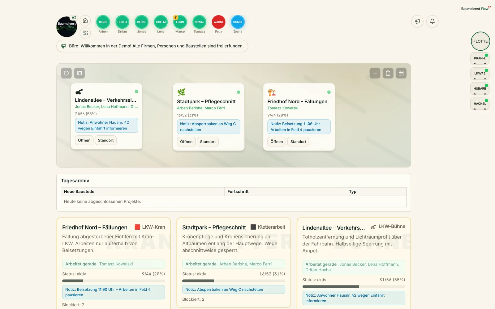 | 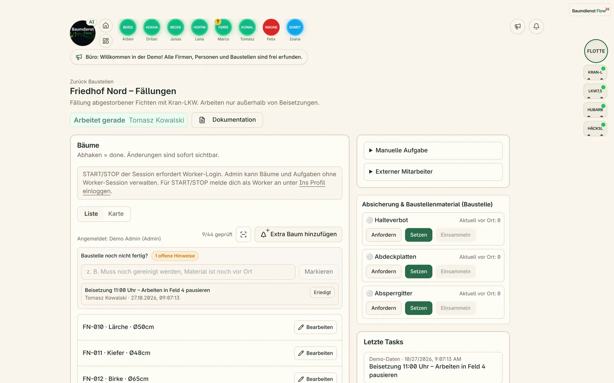 |

| Daily plan for tomorrow | Cost estimate for a quote |
|---|---|
| 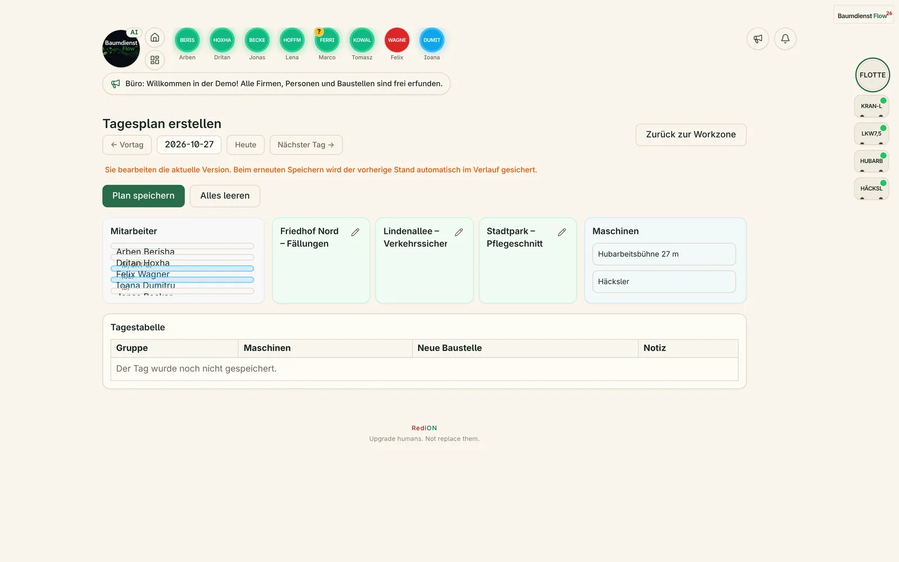 | 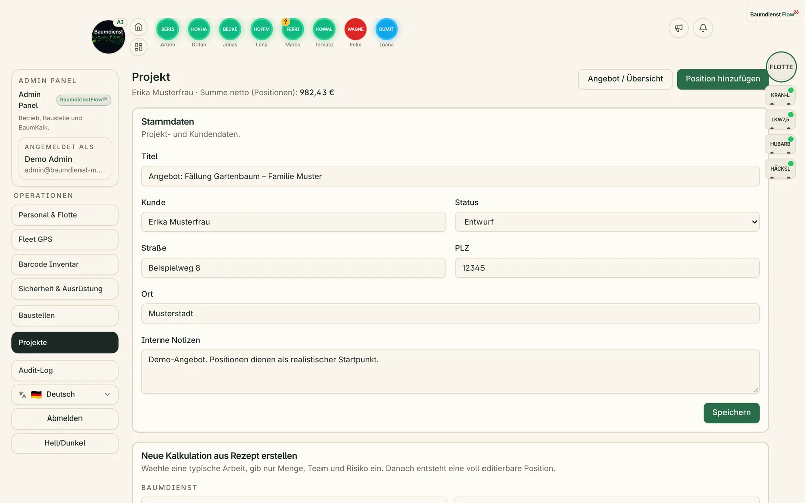 |

### BauFlow (fibre-optic civil works)

| Dashboard for the owner | Barcode inventory with tools and workwear |
|---|---|
| 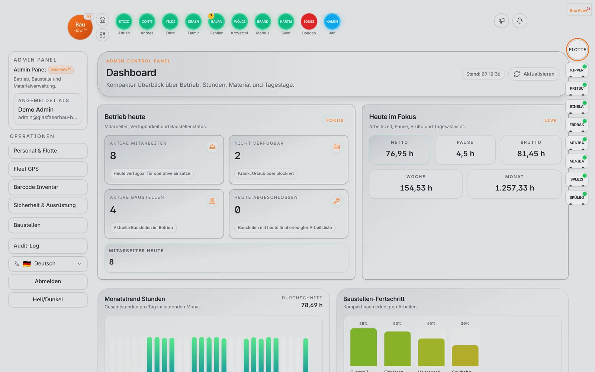 | 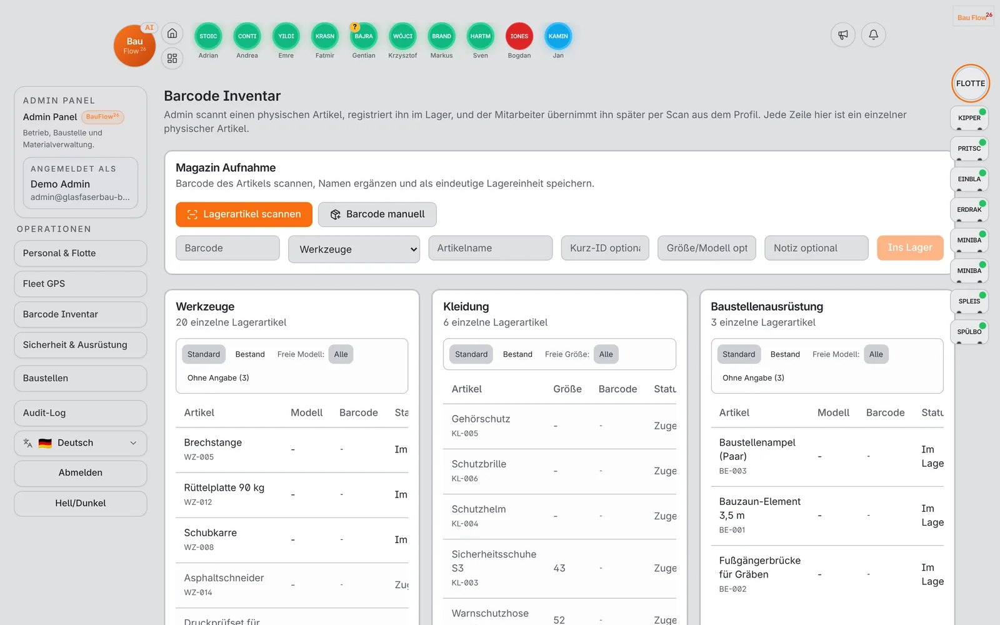 |

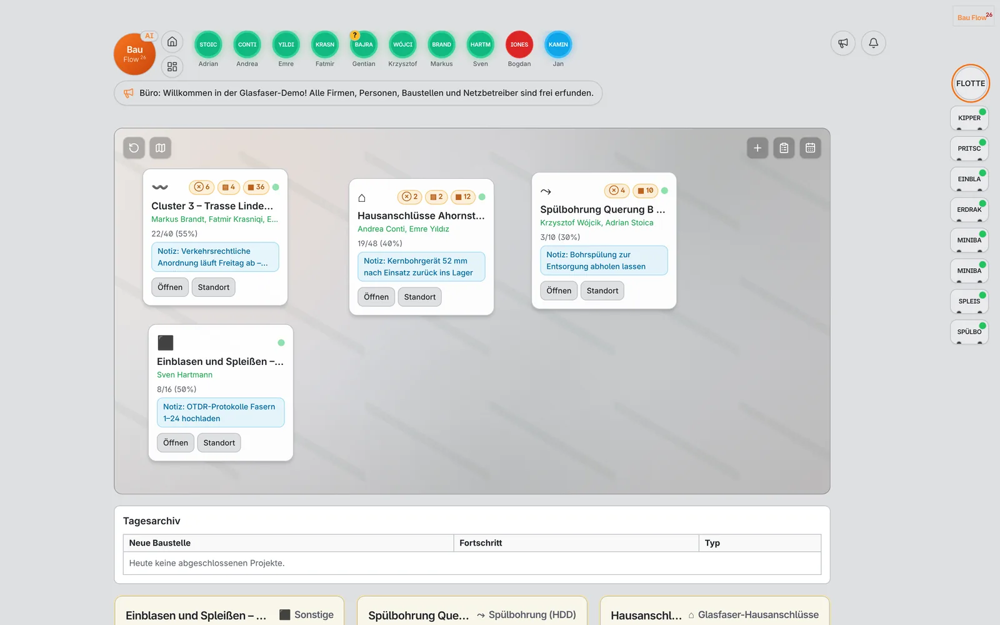

### On site (phone, 390 px)

| BaumdienstFlow: job site | BauFlow: job site | BauFlow: overview |
|---|---|---|
| 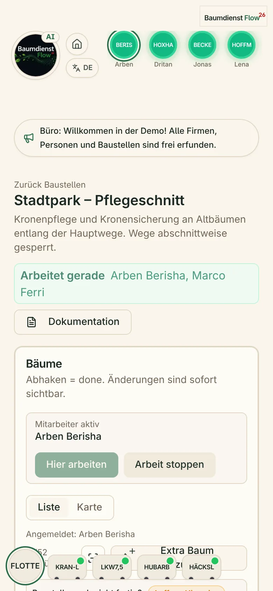 | 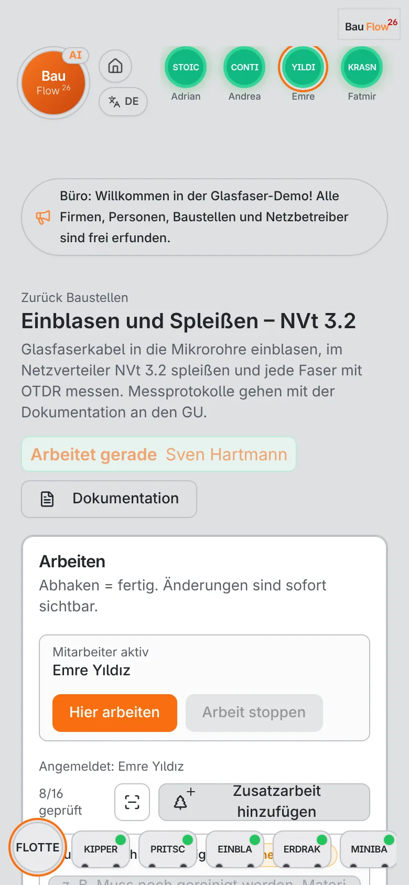 | 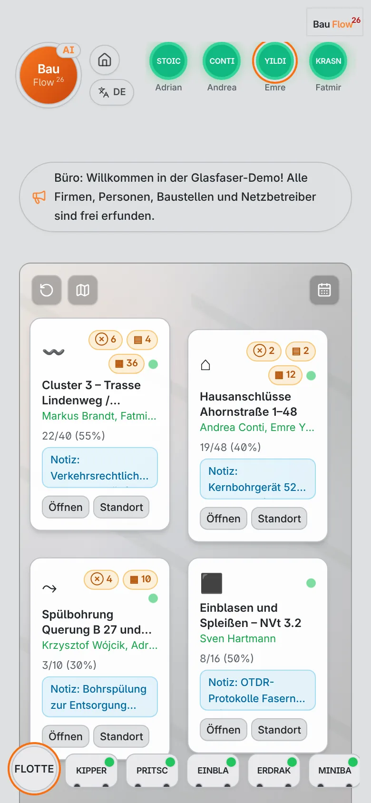 |

## Architecture

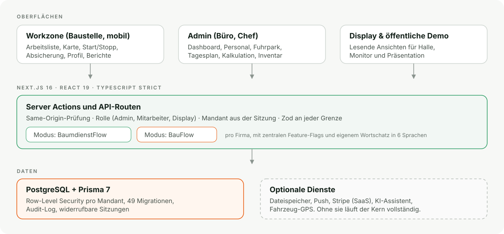

- **One application, two products.** `CompanyProfile.mode` picks BaumdienstFlow or BauFlow per company. Central feature flags hide tree-specific parts, and BauFlow has its own vocabulary in all 6 languages. There are no two codebases drifting apart.
- **Tenant isolation.** Every query is filtered by the company from the session; today that is the effective boundary, including in the live demos. As a second line, PostgreSQL row-level security policies exist for all tenant tables. Enforcement through a restricted database role currently runs as a pilot (job sites and daily plan), tested in CI against a throwaway database; rolling it out to every area is still open. The browser tests check that one tenant cannot see another tenant's data.
- **Two deployment modes.** As SaaS with many companies in one database, or as a dedicated instance for a single customer.
- **Stack:** Next.js 16 (App Router, Server Actions), React 19, TypeScript strict, Prisma 7, PostgreSQL 16, Tailwind CSS, Radix UI, Zod, Vitest, Playwright, GitHub Actions, Docker, Railway.

More in [docs/ARCHITEKTUR.md](docs/ARCHITEKTUR.md) (German).

## Quality and security

- **CI on every pull request:** lint with zero warnings, TypeScript strict, 423 unit tests, 263 integration tests against a throwaway PostgreSQL, production build, 25 browser tests, gitleaks and a Docker smoke test of the demo.
- **Security:** passwords and codes hashed with scrypt, login rate limiting, revocable sessions, same-origin checks on every mutation, private files only through a checked route, security headers. Threat model and known residual risks are documented openly in [SECURITY.md](SECURITY.md).
- **Accessibility and speed:** Lighthouse mobile on the landing page: 96 performance, 100 accessibility, 100 best practices, 100 SEO.
- **No real data.** The repository was created as a snapshot without git history from the private production system. Real company and personal data was removed; the demo data is invented.

## Run it yourself

**Demo in three minutes** (requires Docker):

```bash
docker compose up --build                      # BaumdienstFlow demo
docker compose down -v && DEMO_SEED_MODE=glasfaser docker compose up --build   # BauFlow demo
```

Then open `http://localhost:3000/demo`. For the admin area, set `DEMO_ADMIN_PASSWORD='a-long-password'` before starting and sign in at `/admin-login` with `admin@baumdienst-musterstadt.example` (or `admin@glasfaserbau-beispieltal.example`). `DEMO_SEED_MODE=bau` starts a general construction company (paving, signage, drainage). Fresh data: `docker compose exec app npm run demo:reset`.

**Development** (Node.js 22, npm 10, PostgreSQL 16):

```bash
cp .env.example .env
npm ci
npm run db:migrate && npm run db:seed
npm run dev
```

```bash
npm run lint && npm run typecheck && npm test && npm run build
npm run test:integration:local   # needs Docker
npm run test:e2e:local           # needs Docker
```

Operations, auth details and deployment: [docs/OPERATIONS.md](docs/OPERATIONS.md), [docs/DEPLOYMENT.md](docs/DEPLOYMENT.md).

## How this project is built

RediOnFlow is developed by Redion Cekrezi, with AI agents as tools: the human decides what gets built, reviews every result and approves it; the agents write code, tests and documentation in small pull requests that are merged only with green CI. How that works in practice and where its limits are: [docs/KI_WORKFLOW.md](docs/KI_WORKFLOW.md) (German).

## About the author

Redion Cekrezi has worked as an arborist and team lead at a tree care company in North Rhine-Westphalia since 2021, after more than 15 years in electronics and technical diagnostics. RediOnFlow grew out of that work: he knows the workflows the software models from the aerial lift and the daily planning, not from a requirements document. Since 2025 he has been building his own software products as a full-stack and applied AI developer.

## Working together

Of interest to tree care, construction, civil works and fibre-optic companies that want to run their job sites digitally, and to partners who want to accompany a pilot. A walkthrough or admin access to the demo is available on request via the **[portfolio](https://www.redioncekrezi.de)** or [GitHub](https://github.com/IamRedi).

**Redion Cekrezi · Full-Stack & Applied AI Developer · Produced by RediON**

## License

Source-available, all rights reserved. The code may be read and run locally for evaluation, but not used commercially. Details in [LICENSE](LICENSE).
