<p align="center">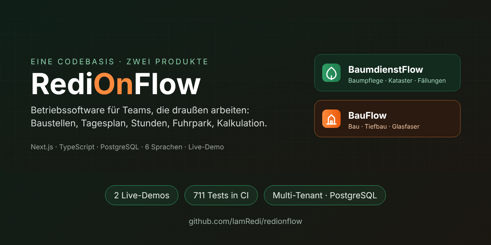</p>

# RediOnFlow

**Betriebssoftware für Teams, die draußen arbeiten.** Der Chef plant im Büro, die Mitarbeitenden arbeiten auf der Baustelle am Handy, und beide sehen denselben Stand: Baustellen, Arbeiten, Stunden, Fuhrpark, Material und Kalkulation. Aus einer Codebasis entstehen zwei Produkte:

- **BaumdienstFlow** für Baumpflege- und Baumdienstbetriebe: Baumlisten mit Koordinaten, Fällungen, Kronenpflege, Hubsteiger und Häcksler.
- **BauFlow** für Bau-, Tiefbau- und Glasfaserbetriebe: Arbeitslisten statt Bäume, Trassen, Hausanschlüsse, Spülbohrung, Werkzeug und Absicherung.

[](https://github.com/IamRedi/redionflow/actions/workflows/ci.yml)

**[English version](README.en.md)** · **Stand: 4. November 2026** · **[Projektstand und Verlauf](docs/PROJEKTSTAND.md)** · **[Prüfprotokoll](EVIDENCE.md)**

## Lokaler BauFlow-Musterbetrieb · 14.11.2026

Der eigenständige Profilkandidat **BauFlow Musterbau · DEMO** verwendet die
bestehenden Stahlbau-Abläufe mit zwölf erfundenen Mitarbeitenden, fünf Büros,
drei Baustellen, einer Werkhalle und neun verbundenen Geräten. Das originale
BauFlow-Logo und passende Day/Night-Campusbilder geben ihm eine eigene Identität.
Es werden keine Kundendaten übernommen. Der Profilkandidat ist nicht die
öffentliche Glasfaser-Demo und wurde nicht in den AL-Steel-Piloten eingespielt.
[Vorbereitung, Datenlogik und aktueller Prüfstand](docs/BAUFLOW_MUSTER_TEMPLATE.md).

Echte Aufnahmen des lokalen Musterkandidaten; noch nicht veröffentlicht.

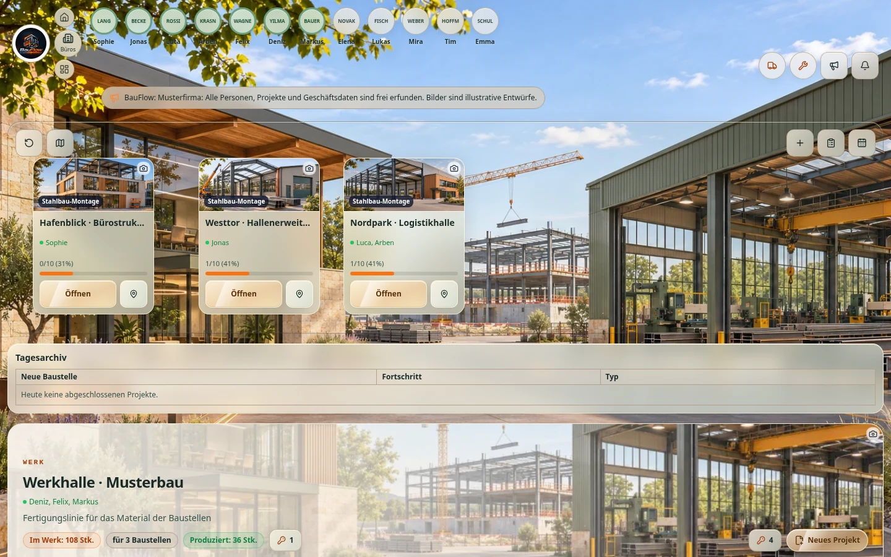

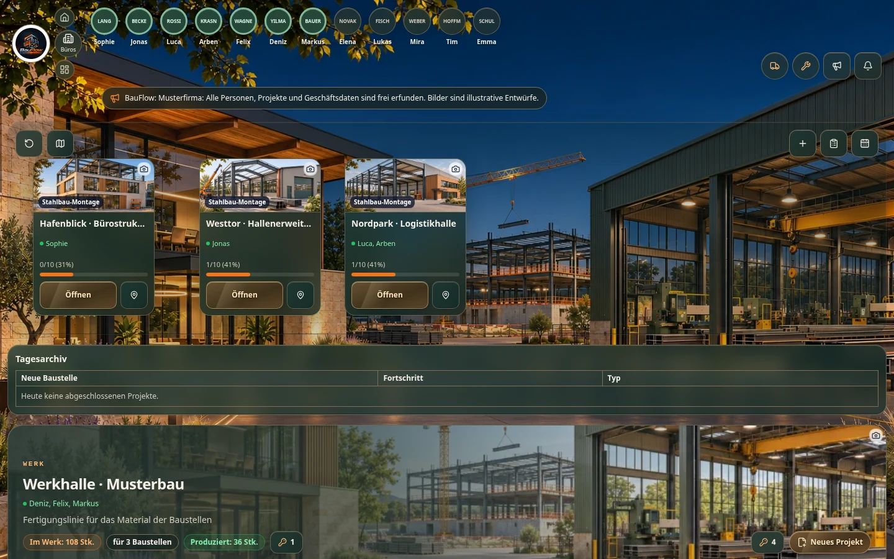

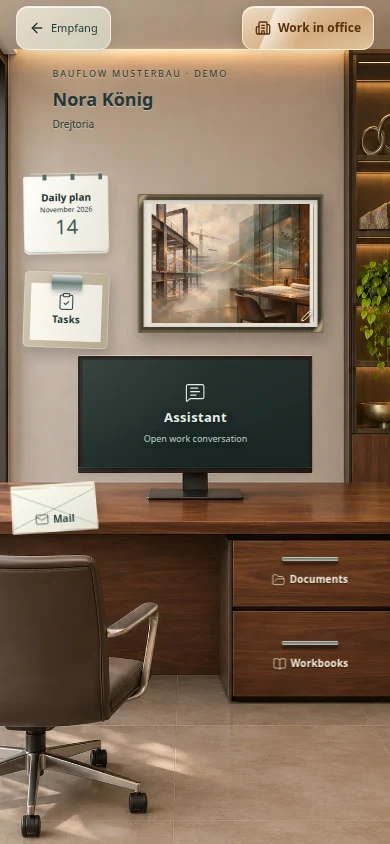

## In Prüfung: Produktionspanel für Stahlbetriebe

Ein Kalender zeigt bestätigte kg pro Tag und Projekt: Teileschnitt,
Baugruppenschnitt und Zusammenbau bleiben getrennt. Dazu kommen Tagesnachweise,
Prozessfortschritt, gespeicherte Bestätigungsgewichte und eine private
Monitoransicht ohne Bearbeitung oder personenbezogene Arbeitsnachweise.

Dieser Erweiterungskandidat ist lokal geprüft und zur Pilotfreigabe vorbereitet.
[Definitionen, Grenzen und Nachweise](docs/STEEL_PRODUCTION_DASHBOARD.md).
Die Aufnahme zeigt ausschließlich eine fiktive Firma mit synthetischer Arbeit.

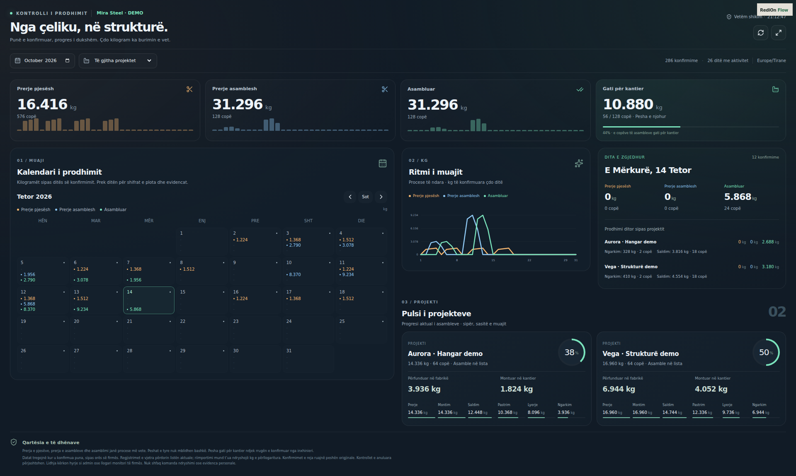

## Pilot-Erweiterung: Flottenkarte, Tankbelege und eigene Fotos

Die Pilot-Erweiterung zeigt bestätigte Fahrzeuge neben Baustellen, öffnet
ihre GPS-Position in Maps und erfasst Original-Tankbelege mit hochladender Person,
tatsächlich tankender Person, Belegzeit und nächster historischer GPS-Meldung
einschließlich Zeitabstand. Lokale OCR schlägt die Uhrzeit vor; der Mensch prüft
und bestätigt sie. Unklare Fahrzeugzuordnungen bleiben beim Chef.

Fahrzeuge, Baustellen und Werkstatt erhalten eigene Fotos über ein kleines
Kamerasymbol: aufnehmen oder auswählen; automatisch WebP, maximal 1024 Pixel
und 180 KB. Fotos bleiben innerhalb der Firma.

Die Basis bestand 559 Unit-, 301 PostgreSQL- und 28 Chromium-Prüfungen. Für die
Foto-Erweiterung wurden nur neue gezielte Prüfungen ausgeführt; die vollständigen
älteren Tests wurden auf Wunsch des Eigentümers nicht wiederholt. Die Abnahme
mit echten GPS-Geräten und Belegen bleibt separat ausstehend.
[Ablauf, Grenzen und Freigabe](docs/FLEET_MAP_FUEL.md). Die folgenden Aufnahmen
zeigen ausschließlich synthetische Daten aus dem lokalen Review-Kandidaten.

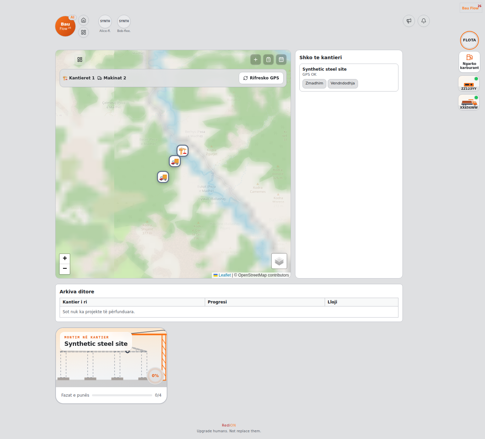

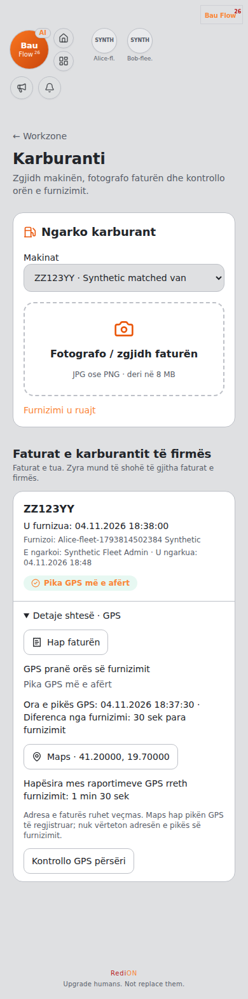

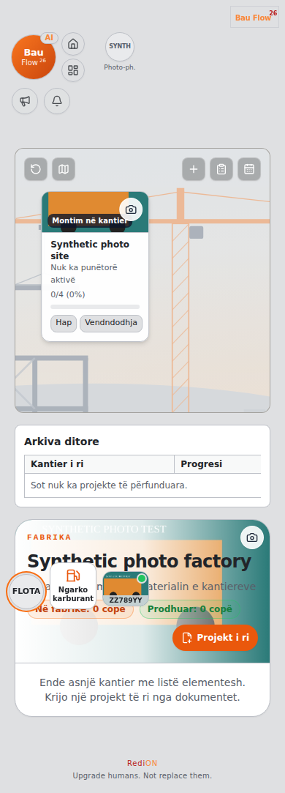

## Websites und Live-Demos

| Produkt | Website | Demo | Fiktive Firma |
|---|---|---|---|
| BaumdienstFlow | **[baumdienstflow.de](https://www.baumdienstflow.de/)** | **[redionflow-production.up.railway.app/demo](https://redionflow-production.up.railway.app/demo)** | Baumdienst Musterstadt GmbH: 8 Mitarbeitende, 3 Baustellen, 152 Bäume, 5 Maschinen |
| BauFlow | **[BauFlow-Website](https://www.baumdienstflow.de/bauflow/)** | **[bauflow-production-1344.up.railway.app/demo](https://bauflow-production-1344.up.railway.app/demo)** | BauFlow Musterbau: 12 Mitarbeitende, 5 Büros, 3 Stahlbau-Baustellen, eine Werkhalle, 30 Baustellenphasen, 9 verbundene Geräte |

Die `/demo`-Seiten sind schreibgeschützt und brauchen kein Login. Alle Namen, Adressen, Kennzeichen und Firmen sind erfunden. Beide Demos werden jede Nacht um 02:00 UTC auf den Ausgangsstand zurückgesetzt. Einen Admin-Zugang zum Ausprobieren gibt es auf Anfrage.

Seit 1. November 2026 ist die BaumdienstFlow-Demo mit dem **KiDraht-Assistenten** derselben fiktiven Firma verknüpft: Ein Knopf „Firmenwissen“ in der oberen Leiste und eine Unterweisungskarte auf jeder Baustelle öffnen die vom Chef freigegebenen Regeln und die Sicherheitsunterweisung für diese Baustelle. Mitarbeitende melden sich dort mit einer PIN an.

## Was heute umgesetzt ist

| Status | Bedeutung und Umfang |
|---|---|
| **Umgesetzt und live** | Workzone für die Baustelle (Arbeitsliste oder Baumliste, Karte, Arbeitszeit mit Start, Pause und Stopp, Zusatzarbeiten, Hinweise, Absicherung), Admin-Dashboard, Personal und Fuhrpark, Tagesplan mit Versionen, Barcode-Inventar mit Ausgabe an Mitarbeitende, Kalkulation (Projekte, Positionen, Vorlagen, Lohnrollen, Rezepte), Tages- und Monatsberichte, Baustellen-Export (ZIP mit HTML, CSV, KML), Urlaub, Admin-Login mit Passwort, 6 Sprachen |
| **Verifiziert** | Frühere CI-Baseline: 711 Tests, Secret-Scan und Docker-Demo-Smoke. Aktuelle lokale Prüfungen und ihre exakte Abgrenzung stehen im [Prüfprotokoll](EVIDENCE.md). Cloud-Verifikation ist auf diesem Branch ausdrücklich wählbar. |
| **Umgesetzt und live (Stahlbau-Pilot)** | Stahlbau-Projekte aus Tekla-Listen: neues Projekt aus Dokumenten mit Adresse auf der Karte, Werksliste und Baustellenliste je Element, Stückzahl je Arbeitsschritt mit Arbeitern, Abschluss mit Route, Werk nur zur Ansicht. [Regeln und Ablauf](docs/STEEL_ELEMENTS.md). |
| **Neu vorbereitet, Freigabe offen** | WanWay/IOPGPS nur lesend: verschlüsselte Zugangsdaten je Firma, Verbindungstest, bestätigte Zuordnung zu vorhandenen Fahrzeugen, manuelle Synchronisierung und letzte Positionsdaten. Nicht in Production oder öffentlicher Demo aktiviert; echter GPS-Test steht aus. [Technik und Grenzen](docs/WANWAY_GPS.md). |
| **Umgesetzt, in der Demo nicht aktiv** | KI-Assistent (braucht einen OpenAI-Schlüssel), Push-Benachrichtigungen (Firebase), Dateispeicher für Dokumente und Fotos (Supabase), Abos und Rechnungen im SaaS-Modus (Stripe), Fahrzeug-GPS. Der Code ist vorhanden und getestet; die öffentliche Demo läuft bewusst ohne diese Dienste. |
| **In Arbeit** | Offline-Modus für Feldaktionen (Warteschlange im Browser ist angelegt, noch nicht im Feld erprobt), Content Security Policy von „Report-Only“ auf „blockierend“, echter Virenscanner für Uploads |
| **Vision** | Pilotbetriebe in beiden Branchen, weitere Gewerke als eigener Modus, Auswertung über mehrere Saisons |

## Warum dieses Projekt?

Kleine und mittlere Betriebe planen ihre Baustellen oft mit Zetteln, WhatsApp-Gruppen und Excel. Was draußen passiert (wer arbeitet wo, was ist erledigt, wo fehlt Absicherung, welches Werkzeug ist bei wem), kommt spät oder gar nicht im Büro an, und Stunden werden am Monatsende aus dem Gedächtnis rekonstruiert. RediOnFlow bringt beides auf einen Bildschirm: Die Mitarbeitenden tippen auf der Baustelle zwei, drei Mal, und das Büro sieht es sofort.

> **Upgrade humans. Not replace them.** Die Software nimmt Schreibarbeit ab. Entscheiden, planen und verantworten bleibt beim Menschen.

## Einblick in die Anwendung

Alle Bilder stammen aus der laufenden Anwendung mit den fiktiven Demo-Daten. Es sind keine Mockups.

### BaumdienstFlow

| Workzone: alle Baustellen auf einen Blick | Baustelle mit Baumliste |
|---|---|
| 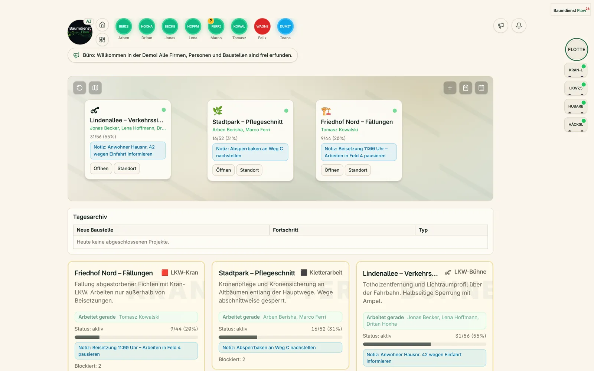 | 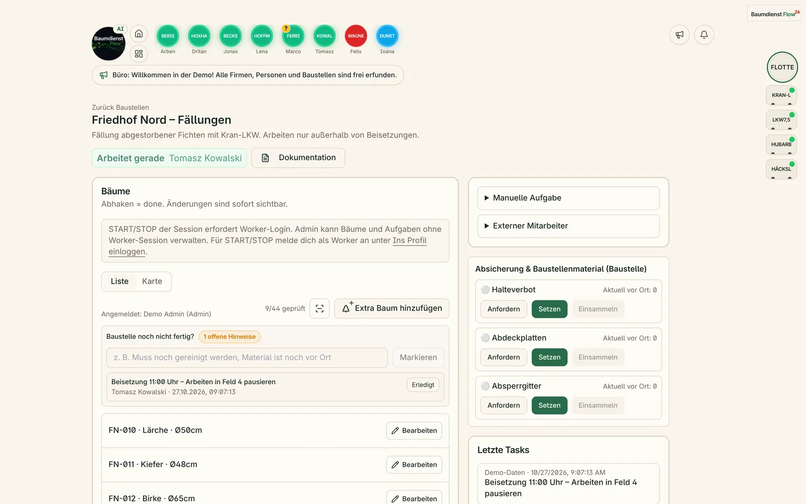 |

| Tagesplan für morgen | Kalkulation eines Angebots |
|---|---|
| 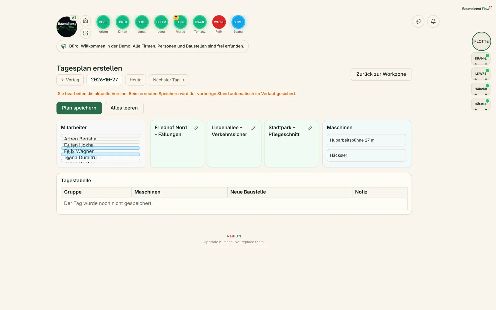 | 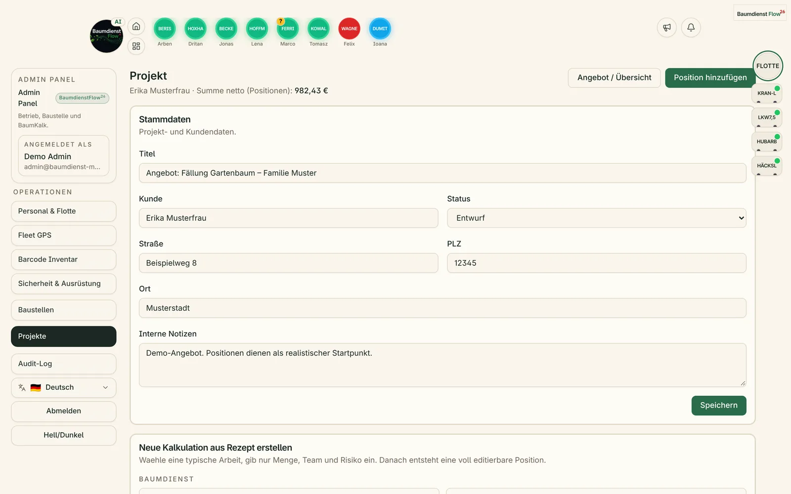 |

### BauFlow (Glasfaser-Tiefbau)

| Dashboard für den Chef | Barcode-Inventar mit Werkzeug und Kleidung |
|---|---|
| 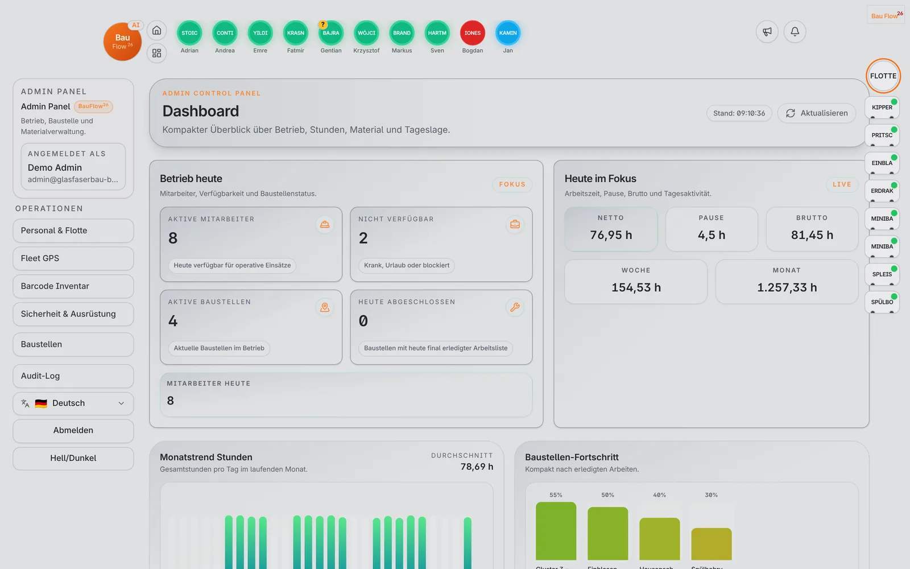 | 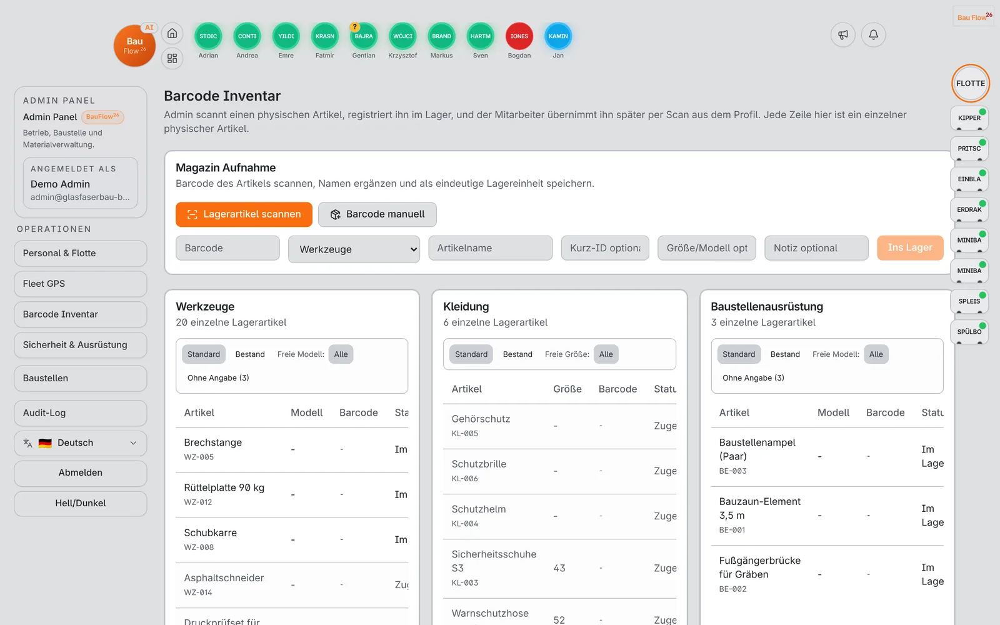 |

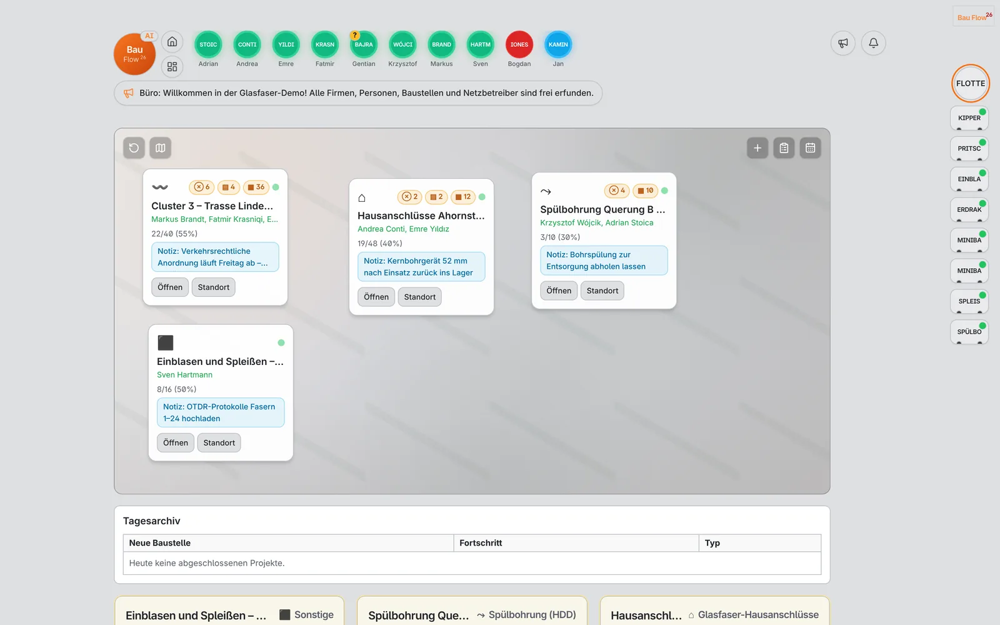

### Auf der Baustelle (Handy, 390 px)

| BaumdienstFlow: Baustelle | BauFlow: Baustelle | BauFlow: Ãœbersicht |
|---|---|---|
| 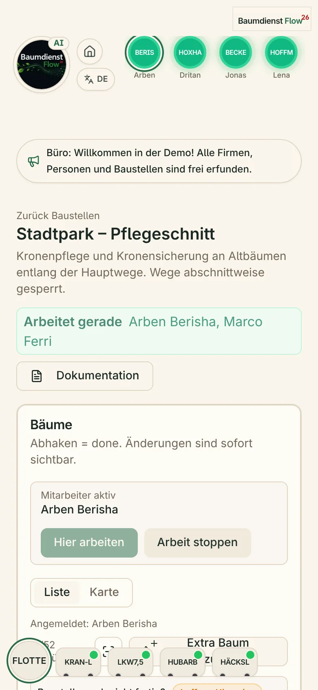 | 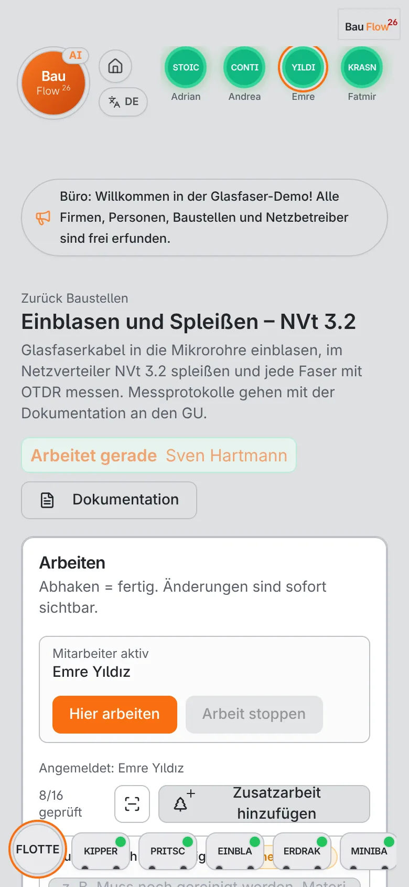 | 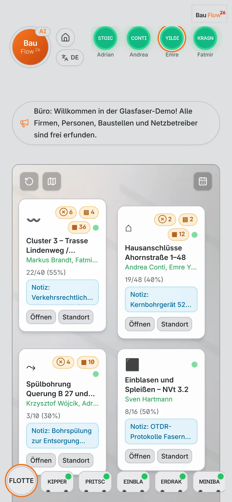 |

## Architektur

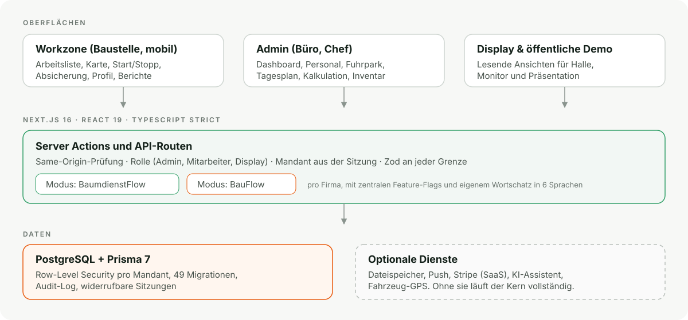

- **Eine Anwendung, zwei Produkte.** `CompanyProfile.mode` entscheidet pro Firma zwischen BaumdienstFlow und BauFlow. Zentrale Feature-Flags blenden baumspezifische Teile aus, und BauFlow hat einen eigenen Wortschatz in allen 6 Sprachen. Es gibt keine zwei Codebasen, die auseinanderlaufen.
- **Mandantentrennung.** Jede Abfrage wird nach der Firma aus der Sitzung gefiltert; das ist heute die wirksame Grenze, auch in den Live-Demos. Als zweite Linie sind PostgreSQL-Row-Level-Security-Policies für alle Mandantentabellen angelegt. Mit einer eingeschränkten Datenbankrolle durchgesetzt wird Row-Level Security bisher in einem Pilot (Baustellen und Tagesplan), der in CI gegen eine Wegwerf-Datenbank läuft; der Ausbau auf alle Bereiche ist offen. Die Browser-Tests prüfen, dass ein Mandant die Daten eines anderen nicht sieht.
- **Zwei Betriebsarten.** Als SaaS mit vielen Firmen in einer Datenbank, oder als eigene Instanz für einen einzelnen Kunden.
- **Stack:** Next.js 16 (App Router, Server Actions), React 19, TypeScript strict, Prisma 7, PostgreSQL 16, Tailwind CSS, Radix UI, Zod, Vitest, Playwright, GitHub Actions, Docker, Railway.

Mehr dazu in [docs/ARCHITEKTUR.md](docs/ARCHITEKTUR.md).

## Qualität und Sicherheit

- **Verifikation:** lokale Gates für Lint, TypeScript, Unit-/PostgreSQL-Integrationstests, Build und Browser-Tests. Cloud-Verifikation nur nach ausdrücklicher Auswahl (`workflow_dispatch`); erforderliche Checks und Merge-Schutz bleiben bestehen. [Regel](docs/LOCAL_CI_POLICY.md).
- **Sicherheit:** Passwörter und Codes mit scrypt, Rate-Limit beim Login, widerrufbare Sitzungen, Same-Origin-Prüfung für jede Änderung, private Dateien nur über eine geprüfte Route, Sicherheits-Header. Bedrohungsmodell und bekannte Restrisiken stehen offen in [SECURITY.md](SECURITY.md).
- **Barrierefreiheit und Tempo:** Lighthouse mobil auf der Startseite 96 Performance, 100 Barrierefreiheit, 100 Best Practices, 100 SEO.
- **Keine echten Daten.** Das Repository wurde als Schnappschuss ohne Git-Verlauf aus dem privaten Produktivsystem erstellt. Echte Firmen- und Personendaten wurden entfernt, die Demo-Daten sind selbst erfunden.

## Selbst starten

**Demo in drei Minuten** (Voraussetzung: Docker):

```bash
docker compose up --build                      # BaumdienstFlow-Demo
docker compose down -v && DEMO_SEED_MODE=glasfaser docker compose up --build   # BauFlow-Demo
```

Danach `http://localhost:3000/demo` öffnen. Für den Admin-Bereich vor dem Start `DEMO_ADMIN_PASSWORD='ein-langes-passwort'` setzen und unter `/admin-login` mit `admin@baumdienst-musterstadt.example` (bzw. `admin@glasfaserbau-beispieltal.example`) anmelden. `DEMO_SEED_MODE=bau` startet eine allgemeine Baufirma (Pflaster, Beschilderung, Entwässerung). Frische Daten: `docker compose exec app npm run demo:reset`.

**Entwicklung** (Node.js 22, npm 10, PostgreSQL 16):

```bash
cp .env.example .env
npm ci
npm run db:migrate && npm run db:seed
npm run dev
```

```bash
npm run lint && npm run typecheck && npm test && npm run build
npm run test:integration:local   # braucht Docker
npm run test:e2e:local           # braucht Docker
```

Betrieb, Auth-Details und Deployment: [docs/OPERATIONS.md](docs/OPERATIONS.md), [docs/DEPLOYMENT.md](docs/DEPLOYMENT.md).

## Wie dieses Projekt entsteht

RediOnFlow wird von Redion Cekrezi entwickelt, mit KI-Agenten als Werkzeug: Der Mensch entscheidet, was gebaut wird, prüft jedes Ergebnis und gibt es frei; die Agenten schreiben Code, Tests und Dokumentation in kleinen Pull Requests, die nur mit grüner CI gemergt werden. Wie das konkret abläuft und wo die Grenzen liegen: [docs/KI_WORKFLOW.md](docs/KI_WORKFLOW.md).

## Dokumentation

| Thema | Dokument |
|---|---|
| Wo das Projekt steht, was bisher passiert ist | [docs/PROJEKTSTAND.md](docs/PROJEKTSTAND.md) |
| Was geprüft wurde und wie | [EVIDENCE.md](EVIDENCE.md) |
| Architektur im Ãœberblick | [docs/ARCHITEKTUR.md](docs/ARCHITEKTUR.md), [SaaS-Architektur](docs/SAAS_ARCHITECTURE.md), [Row-Level Security](docs/RLS.md) |
| Sicherheit | [SECURITY.md](SECURITY.md), [CSP](docs/CSP.md), [Sitzungen widerrufen](docs/SESSION_REVOCATION.md) |
| Entscheidungen | [docs/DECISIONS.md](docs/DECISIONS.md), [ADRs](docs/adr/) |
| Betrieb und Deployment | [docs/OPERATIONS.md](docs/OPERATIONS.md), [docs/DEPLOYMENT.md](docs/DEPLOYMENT.md) |
| Arbeitsweise mit KI | [docs/KI_WORKFLOW.md](docs/KI_WORKFLOW.md) |

## Ãœber den Autor

Redion Cekrezi arbeitet seit 2021 als Baumpfleger und Teamleiter in einem Baumdienst in Nordrhein-Westfalen und hat davor über 15 Jahre in Elektronik und technischer Diagnose gearbeitet. RediOnFlow ist aus dieser Praxis entstanden: Die Abläufe, die die Software abbildet, kennt er vom Hubsteiger und aus der Tagesplanung, nicht aus einem Lastenheft. Seit 2025 entwickelt er eigene Softwareprodukte als Full-Stack- und Applied-AI-Entwickler.

## Zusammenarbeit

Interessant für Baumdienste, Bau-, Tiefbau- und Glasfaserbetriebe, die ihre Baustellen digital führen wollen, und für Partner, die einen Pilotbetrieb begleiten möchten. Eine Vorführung oder einen Admin-Zugang zur Demo gibt es auf Anfrage über das **[Portfolio](https://www.redioncekrezi.de)** oder [GitHub](https://github.com/IamRedi).

**Redion Cekrezi · Full-Stack & Applied AI Developer · Produced by RediON**

## Lizenz

Source-available, alle Rechte vorbehalten. Der Code darf gelesen und zur Bewertung lokal ausgeführt werden, aber nicht kommerziell genutzt werden. Details in [LICENSE](LICENSE).

## Bürooberfläche · 12. November 2026

[PR175](https://github.com/IamRedi/redionflow/pull/175) ist im echten Firmenbetrieb veröffentlicht: Beschriftungen und kleine Linienicons sitzen direkt auf Schubladen und Briefumschlag. Arbeitsfenster nutzen kompaktes Kristallglas in den vorhandenen Farben. Die beiden konfigurierten Büro-Administratoren öffnen ihren bestehenden Firmenassistenten am Monitor statt am Firmenlogo; private Gesprächsarchive und Zugriffsregeln bleiben erhalten. Originalfotos und Berechtigungen wurden beim Deployment unverändert bestätigt. Die folgenden Aufnahmen zeigen ausschließlich fiktive Daten.

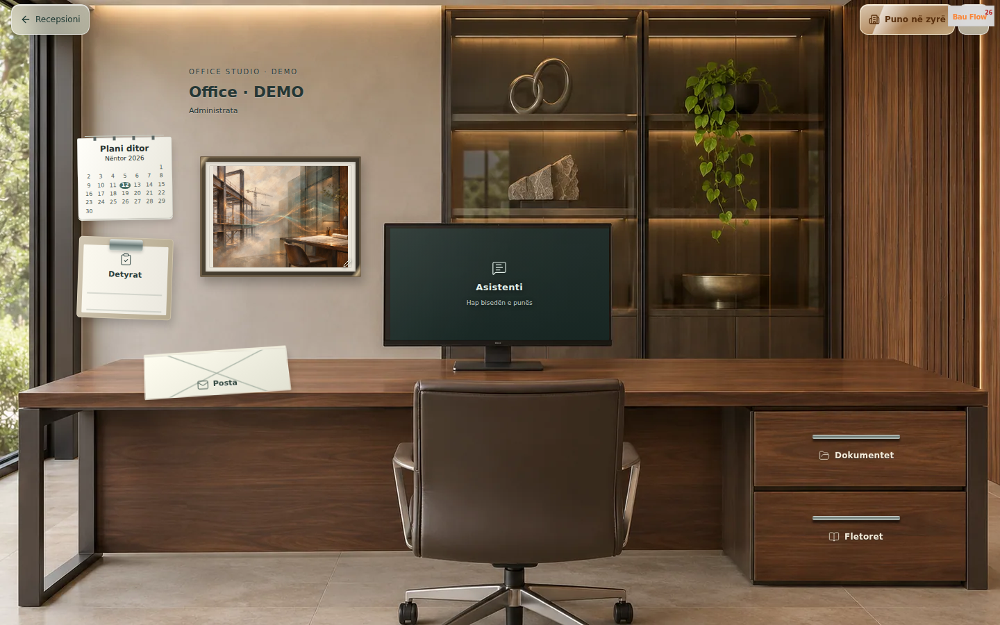

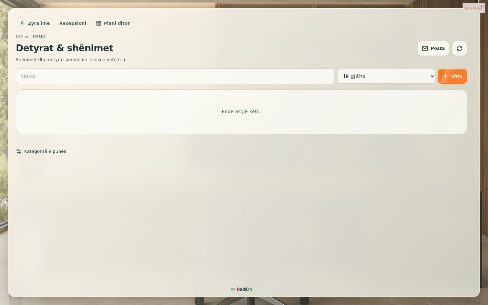
