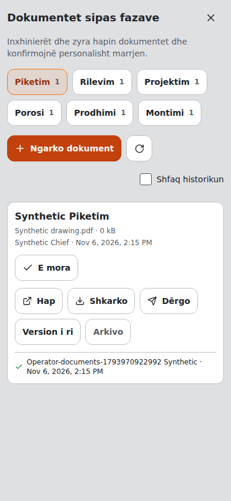
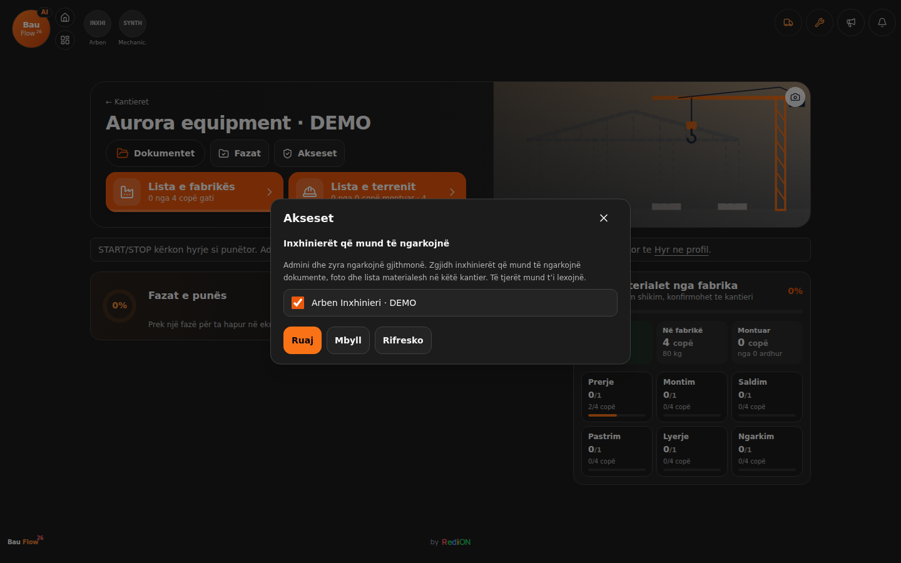
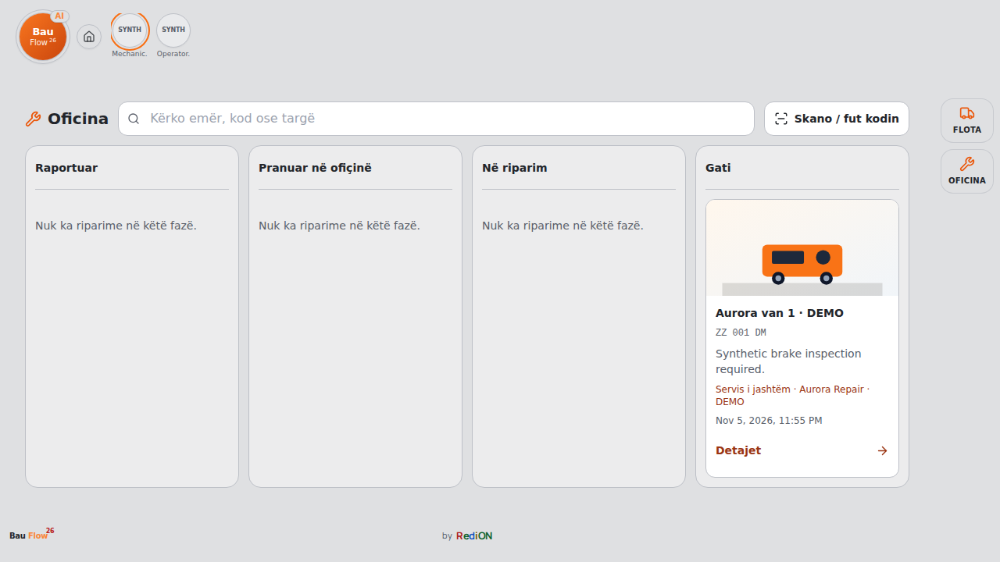
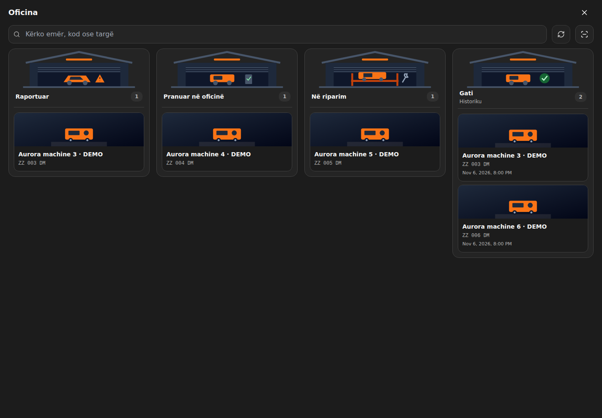
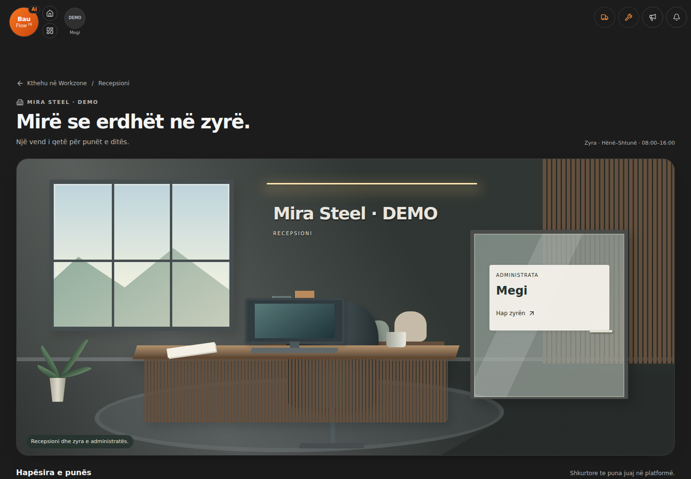
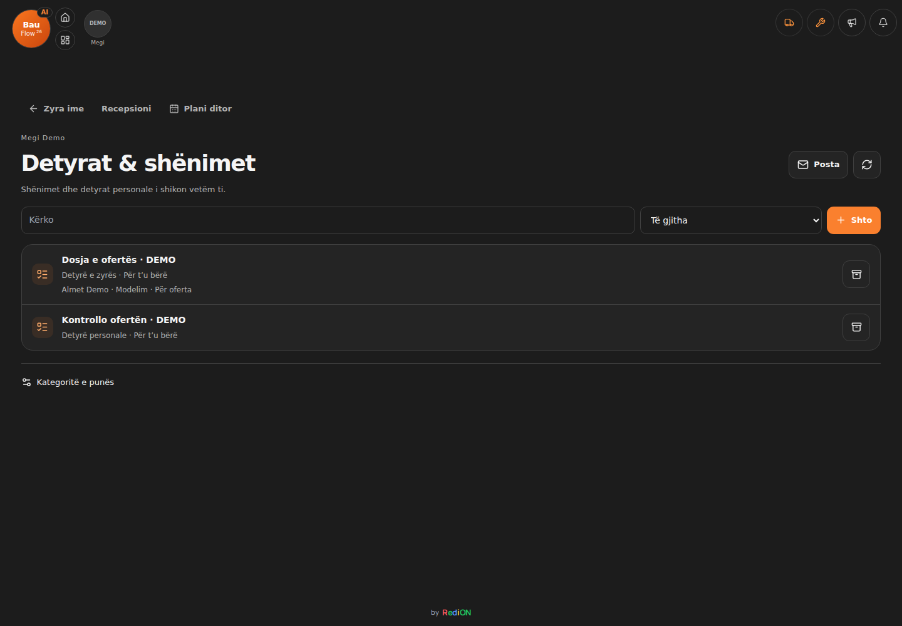

<p align="center"></p>

# RediOnFlow

**Betriebssoftware für Teams, die draußen arbeiten.** Der Chef plant im Büro, die Mitarbeitenden arbeiten auf der Baustelle am Handy, und beide sehen denselben Stand: Baustellen, Arbeiten, Stunden, Fuhrpark, Material und Kalkulation. Aus einer Codebasis entstehen zwei Produkte:

- **BaumdienstFlow** für Baumpflege- und Baumdienstbetriebe: Baumlisten mit Koordinaten, Fällungen, Kronenpflege, Hubsteiger und Häcksler.
- **BauFlow** für Bau-, Tiefbau- und Glasfaserbetriebe: Arbeitslisten statt Bäume, Trassen, Hausanschlüsse, Spülbohrung, Werkzeug und Absicherung.

Routineprüfungen laufen lokal; [GitHub Actions](https://github.com/IamRedi/redionflow/actions/workflows/ci.yml) werden nur für ausdrücklich ausgewählte Cloud-Prüfungen gestartet.

**[English version](README.en.md)** · **Stand: 6. November 2026** · **[Projektstand und Verlauf](docs/PROJEKTSTAND.md)** · **[Prüfprotokoll](EVIDENCE.md)**

## Websites und Live-Demos

| Produkt | Website | Demo | Fiktive Firma |
|---|---|---|---|
| BaumdienstFlow | **[baumdienstflow.de](https://www.baumdienstflow.de/)** | **[redionflow-production.up.railway.app/demo](https://redionflow-production.up.railway.app/demo)** | Baumdienst Musterstadt GmbH: 8 Mitarbeitende, 3 Baustellen, 152 Bäume, 5 Maschinen |
| BauFlow | **[BauFlow-Website](https://www.baumdienstflow.de/bauflow/)** | **[bauflow-production-1344.up.railway.app/demo](https://bauflow-production-1344.up.railway.app/demo)** | Glasfaserbau Beispieltal GmbH: 10 Mitarbeitende, 4 Glasfaser-Baustellen, 114 Arbeiten, 8 Maschinen, Werkzeuginventar |

Die `/demo`-Seiten sind schreibgeschützt und brauchen kein Login. Alle Namen, Adressen, Kennzeichen und Firmen sind erfunden. Beide Demos werden jede Nacht um 02:00 UTC auf den Ausgangsstand zurückgesetzt. Einen Admin-Zugang zum Ausprobieren gibt es auf Anfrage.

Seit 1. November 2026 ist die BaumdienstFlow-Demo mit dem **KiDraht-Assistenten** derselben fiktiven Firma verknüpft: Ein Knopf „Firmenwissen“ in der oberen Leiste und eine Unterweisungskarte auf jeder Baustelle öffnen die vom Chef freigegebenen Regeln und die Sicherheitsunterweisung für diese Baustelle. Mitarbeitende melden sich dort mit einer PIN an.

## Was heute umgesetzt ist

| Status | Bedeutung und Umfang |
|---|---|
| **Umgesetzt und live** | Workzone für die Baustelle (Arbeitsliste oder Baumliste, Karte, Arbeitszeit mit Start, Pause und Stopp, Zusatzarbeiten, Hinweise, Absicherung), Admin-Dashboard, Personal und Fuhrpark, Tagesplan mit Versionen, Barcode-Inventar mit Ausgabe an Mitarbeitende, Kalkulation (Projekte, Positionen, Vorlagen, Lohnrollen, Rezepte), Tages- und Monatsberichte, Baustellen-Export (ZIP mit HTML, CSV, KML), Urlaub, Admin-Login mit Passwort, 6 Sprachen |
| **Dokumentierte Prüfbasis vom 1. November** | 711 automatisierte Tests (423 Unit, 263 Integration gegen echte PostgreSQL, 25 Ende-zu-Ende im Browser), Secret-Scan, Docker-Demo-Smoke-Test, Lighthouse mobil 96/100/100/100. Historische Ergebnisse im [Prüfprotokoll](EVIDENCE.md); sie sind kein neuer Prüflauf dieses Dokumentationsstands. |
| **Umgesetzt, in der Demo nicht aktiv** | KI-Assistent (braucht einen OpenAI-Schlüssel), Push-Benachrichtigungen (Firebase), Dateispeicher für Dokumente und Fotos (Supabase), Abos und Rechnungen im SaaS-Modus (Stripe), Fahrzeug-GPS. Der Code ist vorhanden und getestet; die öffentliche Demo läuft bewusst ohne diese Dienste. |
| **In Arbeit** | Offline-Modus für Feldaktionen (Warteschlange im Browser ist angelegt, noch nicht im Feld erprobt), Content Security Policy von „Report-Only“ auf „blockierend“, echter Virenscanner für Uploads |
| **Vision** | Pilotbetriebe in beiden Branchen, weitere Gewerke als eigener Modus, Auswertung über mehrere Saisons |

**Stahlfertigung · Am 5. November 2026 für einen realen Betrieb veröffentlicht ([#55](https://github.com/IamRedi/redionflow/pull/55)).** Ein gemeinsamer Firmenkatalog ist im Produktivbetrieb: Arbeiten werden je Baustelle aktiviert; Abwahl und Archivierung erhalten bisherige Bestätigungen. Pro Material lassen sich die nötigen Fabrik- und Baustellenschritte festlegen. Explizit verknüpfte Aufgaben übernehmen den Fortschritt aus bestätigten Materialarbeiten. Eigene Fotos werden als kleine private WebP gespeichert. Dieser Stand erfordert die Firmenanmeldung; die öffentlichen Demos bleiben getrennt. Verifizierter Produktionsstand: [6c8b886](https://github.com/IamRedi/redionflow/commit/6c8b88645f8285331fc3654509f44d9458563849).

**KI-Illustrationen:** Ein Image-API-Aufruf im Produktivbetrieb speicherte eine WebP-Illustration im bestehenden Stil in Orange und Schiefergrau; Arbeitsdarstellung und Fortbestand nach erneutem Laden wurden geprüft ([PR #60](https://github.com/IamRedi/redionflow/pull/60)). Die optionale Funktion setzt den eingerichteten Firmenzugang und verfügbare Bildkontingente voraus; eigene Fotos haben Vorrang, bei Fehlern bleibt ein vorhandenes Bild oder die Standardzeichnung erhalten.

**Lager, Werkstatt und Fuhrpark · Am 6. November 2026 für einen realen Stahlbetrieb veröffentlicht ([#62](https://github.com/IamRedi/redionflow/pull/62)).** Werkzeuge, Kleidung und Baustellenausrüstung werden als einzelne Einheiten mit Code und gegebenenfalls Größe geführt. Ausgabe und Rückgabe brauchen Büro- und Mitarbeiterbestätigung; einen Kollegenwechsel bestätigen beide Beteiligten. Verlust und Ausmusterung bleiben bis zur Entscheidung der Leitung offen. Reparaturen durchlaufen gemeldet → angenommen → in Reparatur → einsatzbereit; die Freigabe erfordert Funktionsprüfung und Reparaturnotiz oder Beleg. Private Fotos, Rechnungen und Verlauf bleiben beim jeweiligen Betriebsmittel. Zwei kompakte Aktionen öffnen Flotte und Werkstatt; die Fahrzeugauswahl zeigt am Handy drei Spalten mit Namen und Kennzeichen. Verifizierter Produktivstand: [c91a95a](https://github.com/IamRedi/redionflow/commit/c91a95ae379a8ed2ac25306001a41f96e7f4c258). Die Firmenanmeldung ist erforderlich; diese Erweiterung ist in den öffentlichen Demos nicht freigeschaltet.

## Dokumentübergabe und Gerätecodes in BauFlow

Sechs Baustellenphasen bündeln Dokumente mit Download und Teilen-Dialog.
Aktive Mitarbeitende bestätigen den Empfang persönlich mit Name und Zeitpunkt.
Neue Dateiversionen behalten die alten Dateien und Bestätigungen im Verlauf;
eine Empfangsbestätigung schließt keinen Produktionsschritt ab.

Hersteller-Barcodes und QR-Codes bleiben lesbar, auch mit führenden Nullen,
Groß-/Kleinschreibung und Satzzeichen. Ein gemeinsamer Modellcode verlangt die
Auswahl des einzelnen Geräts. Jedes Gerät erhält eine eigene druckbare Etikette;
bisherige Codes bleiben gültig. Firmenanmeldung erforderlich. Kamera und Drucker
am realen Gerät werden getrennt von der lokalen Browserprüfung abgenommen.

Die Aufnahme stammt aus der lokalen Anwendung mit ausschließlich synthetischen
Daten. Diese Dokumentations-PR wird erst mit der freigegebenen App-Erweiterung
veröffentlicht; sie schaltet die privaten Abläufe nicht in den öffentlichen Demos frei.



## Baustellenrechte in BauFlow

Mitarbeitende lesen Baustellendokumente und bestätigen ihren eigenen Empfang.
Das Büro lädt Dokumente hoch; Ingenieure brauchen dafür eine explizite Freigabe
je Baustelle. Die Leitung wählt sie beim Anlegen oder später unter **Zugriff**.
Fabrik- und Baustellenschritte folgen weiterhin der jeweiligen Ingenieurrolle.
Administratoren und Inhaber verwalten den Betrieb. Ein eigener Name/PIN-Zugang
für Inhaber wird privat im angemeldeten Profil eingerichtet.

Die lokale Prüfung deckt Erteilung, Entzug, konkurrierende Änderungen und
Mandantengrenzen ab. Das Bild zeigt ausschließlich fiktive Daten. Veröffentlichung
und Einrichtung realer Konten erfolgen getrennt nach Freigabe der App-Version;
die öffentlichen Demos erhalten dadurch keine privaten Firmendaten.



## Warum dieses Projekt?

Kleine und mittlere Betriebe planen ihre Baustellen oft mit Zetteln, WhatsApp-Gruppen und Excel. Was draußen passiert (wer arbeitet wo, was ist erledigt, wo fehlt Absicherung, welches Werkzeug ist bei wem), kommt spät oder gar nicht im Büro an, und Stunden werden am Monatsende aus dem Gedächtnis rekonstruiert. RediOnFlow bringt beides auf einen Bildschirm: Die Mitarbeitenden tippen auf der Baustelle zwei, drei Mal, und das Büro sieht es sofort.

> **Upgrade humans. Not replace them.** Die Software nimmt Schreibarbeit ab. Entscheiden, planen und verantworten bleibt beim Menschen.

## Einblick in die Anwendung

Alle Bilder stammen aus der laufenden Anwendung mit den fiktiven Demo-Daten. Es sind keine Mockups.

### BaumdienstFlow

| Workzone: alle Baustellen auf einen Blick | Baustelle mit Baumliste |
|---|---|
|  |  |

| Tagesplan für morgen | Kalkulation eines Angebots |
|---|---|
|  |  |

### BauFlow (Glasfaser-Tiefbau)

| Dashboard für den Chef | Barcode-Inventar mit Werkzeug und Kleidung |
|---|---|
|  |  |


### Auf der Baustelle (Handy, 390 px)

| BaumdienstFlow: Baustelle | BauFlow: Baustelle | BauFlow: Übersicht |
|---|---|---|
|  |  |  |

### Werkstatt im Stahlbetrieb



Echte lokale Anwendung mit ausschließlich erfundenen Testdaten. Das lokal aufgenommene Bild enthält keine Kundendaten und zeigt keine Freischaltung der Funktion in der öffentlichen Demo.

## Architektur


- **Eine Anwendung, zwei Produkte.** `CompanyProfile.mode` entscheidet pro Firma zwischen BaumdienstFlow und BauFlow. Zentrale Feature-Flags blenden baumspezifische Teile aus, und BauFlow hat einen eigenen Wortschatz in allen 6 Sprachen. Es gibt keine zwei Codebasen, die auseinanderlaufen.
- **Mandantentrennung.** Jede Abfrage wird nach der Firma aus der Sitzung gefiltert; das ist heute die wirksame Grenze, auch in den Live-Demos. Als zweite Linie sind PostgreSQL-Row-Level-Security-Policies für alle Mandantentabellen angelegt. Mit einer eingeschränkten Datenbankrolle durchgesetzt wird Row-Level Security bisher in einem Pilot (Baustellen und Tagesplan), der in CI gegen eine Wegwerf-Datenbank läuft; der Ausbau auf alle Bereiche ist offen. Die Browser-Tests prüfen, dass ein Mandant die Daten eines anderen nicht sieht.
- **Zwei Betriebsarten.** Als SaaS mit vielen Firmen in einer Datenbank, oder als eigene Instanz für einen einzelnen Kunden.
- **Stack:** Next.js 16 (App Router, Server Actions), React 19, TypeScript strict, Prisma 7, PostgreSQL 16, Tailwind CSS, Radix UI, Zod, Vitest, Playwright, GitHub Actions, Docker, Railway.

Mehr dazu in [docs/ARCHITEKTUR.md](docs/ARCHITEKTUR.md).

## Qualität und Sicherheit

- **Lokale Routineprüfung:** Lint ohne Warnungen, TypeScript strict, Unit- und Integrationstests gegen eine wegwerfbare PostgreSQL, Produktionsbuild, Browser-Tests, gitleaks und Docker-Demo-Smoke-Test bleiben die Prüfungen. Der bestehende Cloud-Workflow ist nur über `workflow_dispatch` startbar; alle Jobs bleiben erhalten. Lokale Ergebnisse und GitHub-CI-Ergebnisse werden getrennt ausgewiesen; erforderliche Schutzregeln bleiben bestehen.
- **Sicherheit:** Passwörter und Codes mit scrypt, Rate-Limit beim Login, widerrufbare Sitzungen, Same-Origin-Prüfung für jede Änderung, private Dateien nur über eine geprüfte Route, Sicherheits-Header. Bedrohungsmodell und bekannte Restrisiken stehen offen in [SECURITY.md](SECURITY.md).
- **Barrierefreiheit und Tempo:** Lighthouse mobil auf der Startseite 96 Performance, 100 Barrierefreiheit, 100 Best Practices, 100 SEO.
- **Keine echten Daten.** Das Repository wurde als Schnappschuss ohne Git-Verlauf aus dem privaten Produktivsystem erstellt. Echte Firmen- und Personendaten wurden entfernt, die Demo-Daten sind selbst erfunden.

## Selbst starten

**Demo in drei Minuten** (Voraussetzung: Docker):

```bash
docker compose up --build                      # BaumdienstFlow-Demo
docker compose down -v && DEMO_SEED_MODE=glasfaser docker compose up --build   # BauFlow-Demo
```

Danach `http://localhost:3000/demo` öffnen. Für den Admin-Bereich vor dem Start `DEMO_ADMIN_PASSWORD='ein-langes-passwort'` setzen und unter `/admin-login` mit `admin@baumdienst-musterstadt.example` (bzw. `admin@glasfaserbau-beispieltal.example`) anmelden. `DEMO_SEED_MODE=bau` startet eine allgemeine Baufirma (Pflaster, Beschilderung, Entwässerung). Frische Daten: `docker compose exec app npm run demo:reset`.

**Entwicklung** (Node.js 22, npm 10, PostgreSQL 16):

```bash
cp .env.example .env
npm ci
npm run db:migrate && npm run db:seed
npm run dev
```

```bash
npm run lint && npm run typecheck && npm test && npm run build
npm run test:integration:local   # braucht Docker
npm run test:e2e:local           # braucht Docker
```

Betrieb, Auth-Details und Deployment: [docs/OPERATIONS.md](docs/OPERATIONS.md), [docs/DEPLOYMENT.md](docs/DEPLOYMENT.md).

## Wie dieses Projekt entsteht

RediOnFlow wird von Redion Cekrezi entwickelt, mit KI-Agenten als Werkzeug: Der Mensch entscheidet, was gebaut wird, prüft jedes Ergebnis und gibt es frei; die Agenten schreiben Code, Tests und Dokumentation in kleinen Pull Requests. Verifikation läuft im normalen Entwicklungsablauf lokal; Review, Freigabe und erforderliche Schutzregeln bleiben eigenständige Voraussetzungen. Wie das konkret abläuft und wo die Grenzen liegen: [docs/KI_WORKFLOW.md](docs/KI_WORKFLOW.md).

## Dokumentation

| Thema | Dokument |
|---|---|
| Wo das Projekt steht, was bisher passiert ist | [docs/PROJEKTSTAND.md](docs/PROJEKTSTAND.md) |
| Was geprüft wurde und wie | [EVIDENCE.md](EVIDENCE.md) |
| Architektur im Überblick | [docs/ARCHITEKTUR.md](docs/ARCHITEKTUR.md), [SaaS-Architektur](docs/SAAS_ARCHITECTURE.md), [Row-Level Security](docs/RLS.md) |
| Sicherheit | [SECURITY.md](SECURITY.md), [CSP](docs/CSP.md), [Sitzungen widerrufen](docs/SESSION_REVOCATION.md) |
| Entscheidungen | [docs/DECISIONS.md](docs/DECISIONS.md), [ADRs](docs/adr/) |
| Betrieb und Deployment | [docs/OPERATIONS.md](docs/OPERATIONS.md), [docs/DEPLOYMENT.md](docs/DEPLOYMENT.md) |
| Arbeitsweise mit KI | [docs/KI_WORKFLOW.md](docs/KI_WORKFLOW.md) |

## Über den Autor

Redion Cekrezi arbeitet seit 2021 als Baumpfleger und Teamleiter in einem Baumdienst in Nordrhein-Westfalen und hat davor über 15 Jahre in Elektronik und technischer Diagnose gearbeitet. RediOnFlow ist aus dieser Praxis entstanden: Die Abläufe, die die Software abbildet, kennt er vom Hubsteiger und aus der Tagesplanung, nicht aus einem Lastenheft. Seit 2025 entwickelt er eigene Softwareprodukte als Full-Stack- und Applied-AI-Entwickler.

## Zusammenarbeit

Interessant für Baumdienste, Bau-, Tiefbau- und Glasfaserbetriebe, die ihre Baustellen digital führen wollen, und für Partner, die einen Pilotbetrieb begleiten möchten. Eine Vorführung oder einen Admin-Zugang zur Demo gibt es auf Anfrage über das **[Portfolio](https://www.redioncekrezi.de)** oder [GitHub](https://github.com/IamRedi).

**Redion Cekrezi · Full-Stack & Applied AI Developer** · [by RediON](https://www.redioncekrezi.de/)

## BauFlow: Fahrzeugkarte und Serviceablauf

Die Fahrzeugkarte bündelt Datenbearbeitung, Foto und Dokumentfristen. Die Werkstattaktion am Fahrzeug öffnet Defektmeldung oder den genauen Serviceverlauf; die Vollansicht zeigt kompakte Karten nach Reparaturphase. Mechanik oder Leitung schalten weiter, Belege und Rechnungen bleiben beim jeweiligen Auftrag. Die Aufnahme und Browserprüfung nutzen ausschließlich synthetische Daten. Die privaten Firmenabläufe werden damit nicht in den öffentlichen Demos freigeschaltet.



## Empfang und Bürozugang · 11. November 2026

BauFlow bietet einen Empfang und ein Verwaltungsbüro für ausdrücklich freigeschaltete Konten im realen Firmenbetrieb ([PR150](https://github.com/IamRedi/redionflow/pull/150)). Der Raum öffnet den bestehenden Tagesplan, Baustellenakten und das Dashboard am Rechner und Handy. Besucher erhalten keine privaten Kollegendaten; andere Administratoren erhalten nicht automatisch Zugang. [PR153](https://github.com/IamRedi/redionflow/pull/153) ergänzt interne Post mit Anhängen, private Notizen, persönliche Aufgaben und kategorisierte Firmenaufgaben für freigeschaltete Konten. Direkte Rückwege verbinden Post, Aufgaben, Büro, Empfang und Tagesplan. Bürozeit-Kontext und externe E-Mail gehören nicht zu dieser Veröffentlichung. Die öffentlichen Demos bleiben unverändert.

Die Aufnahme stammt aus der lokalen fiktiven Mira Steel DEMO, nicht aus Kundendaten.





## Lizenz

Source-available, alle Rechte vorbehalten. Der Code darf gelesen und zur Bewertung lokal ausgeführt werden, aber nicht kommerziell genutzt werden. Details in [LICENSE](LICENSE).
