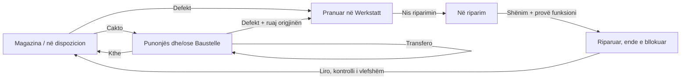

# BaumdienstFlow: Werkstatt-Demo und UX-Abgleich

## AKTUALE — 13.11.2026 / Dosjet e seksioneve dhe komanda minimale

Vetëm Musterfirma BaumdienstFlow. Rreshti kryesor ka tetë hyrje: Workzone, Paneli i kontrollit, Zyrat, Dashboard view, Punëtoria e drurit, Werkstatt, Inventari dhe Flota. Dokumentet, Pjesët rezervë dhe Historiku nuk përsëriten si seksione kryesore. Një buton Dosja e seksionit në Werkstatt, Flotë dhe Inventar hap listën e seksionit, Dokumentet, Raporte & historiku ose Pjesët rezervë. Në telefon butoni është ikonë 44px me emër të aksesueshëm; menuja përdor të njëjtin Radix ice glass, Light/Night, fokus dhe kufij të ekranit si filtri i inventarit.

Konteksti përdor URL-në ekzistuese, jo gjendje ose magazinë të re: tab=orders|fleet|tools për listat dhe section=orders|fleet|tools&tab=documents|history|parts për dosjet. Titulli, sfondi dhe hyrja aktive ndjekin seksionin pronar; asset/site/worker ruhen dhe detail pastrohet gjatë kalimit. Flota filtron pajisjet me kind=fleet. Dosja e Werkstatt-it lidhet me pajisjet që kanë riparime dhe dokumentet që kanë jobId; ngarkimi këtu kërkon zgjedhjen e riparimit që skedari të mos mbetet jashtë pamjes. Inventari përmban të njëjtat pajisje të firmës, përfshirë mjetet, me identitetet/skedarët origjinalë. Lidhjet historike pa section ruajnë pamjen e plotë të mëparshme. Lidhja Dokumente nga karta e pajisjes hap dosjen e Flotës ose Inventarit sipas llojit. Filtrat e kantierit/punonjësit përdorin historikun ekzistues për dokumentet dhe ngjarjet.

Raporte & historiku paraqet ngjarjet ekzistuese të pajisjeve dhe lëvizjet e pjesëve të lidhura me kontekstin. Nuk shtohet motor i ri raportesh financiare/PDF. Eksporti i plotë ekzistues mbetet te shpjegimi i demos. Pjesët rezervë kanë vetëm një stok të përbashkët dhe një regjistër lëvizjesh; kjo thuhet qartë në pamje, edhe kur hapen nga seksione të ndryshme. Asnjë transferim, dokument, riparim ose gjendje stoku nuk kopjohet. Numëruesit e tri fazave shfaqen vetëm te lista e Werkstatt-it; Regjistro/Defekt/Skano vetëm te listat përkatëse, jo mbi dosjet ku nuk kanë kuptim.

KiDraht dhe Light/Night janë dy komanda minimale të dukshme djathtas. Flota ka një hyrje të vetme në navigim. Njoftimet dhe Profili janë pranë ekipit; brenda Profilit ruhen roli/gjuha. Hiqet lista e dytë e katër makinave nga menuja Më shumë. Të gjitha detajet origjinale të mjeteve mbeten te lidhja Dosja e mjetit në Service & Details të kartës së Flotës/Inventarit: përdoret ID-ja e makinës nga leximi ekzistues, me përputhje unike të targës; identitetet e paqarta nuk krijojnë lidhje. Nuk ndryshohet rrjedha e targës/barkodit opsional, regjistrimit/kamerës/NFC, fotove, konfirmimeve, roleve ose API-ve.

Ruhet app-i fiks me scroll brenda listës, komandat touch, Day/Night, ikonat, fotografitë, footer-i natyral pa shell dhe një by RediON. Nuk ka migrime, varësi të reja, thirrje AI ose ndryshim kufijsh. AL Steel, demot e tjera, portofoli dhe çështja e veçantë e logos/PWA #194 mbeten jashtë scope. Portofoli OWNER_HOLD/PENDING_PUBLICATION.

Burimi 935ad7932ab876135093a418266e6532323cdf1d (bazë af02edb), 19 skedarë identikë me manifestin e testuar: 698 unit, 5 integrime AI të simuluara, 50 browser, tri profile izolimi, lint/types/build production dhe Gitleaks PASS. Prova e dokumentit riparues kontrollon të njëjtin fileId në dosjet e Flotës dhe Inventarit, pa kopje ose ndryshim stoku. Gjashtë gjuhët, dy temat, desktop/telefon, landscape, tekst i zmadhuar, fokus, NFC i simuluar, folder/kërkim, deep-link-et, footer-i natyral dhe ruajtja e state/revision mbulohen. Seria fillestare 46/49 ruhet te evidence/pre-refinement: kontrasti i folder-it transparent, emri i hapësit të kartës dhe pritja e butonit primar në dosjet u korrigjuan në provat e ndërfaqes, duke ruajtur assertions e gjendjes. Folder-i glass nuk llogaritet si sfond i zi nga RGB-ja transparente; pragu 4.5 i butonave primarë mbetet. Seria finale 50/50 kaloi mbi burim të pandryshuar. Scan-i i direktorisë u ndal sepse përfshinte material të rigjenerueshëm; Gitleaks për commit-in kaloi. Nuk deklarohet kontroll fizik telefoni/kamere/NFC.

Kontrolli vizual lokal dhe online: 1440×900 dhe 390×844, Light/Night, dosja Inventar/Werkstatt/Flota, dokumentet/historiku/stoku, profili/rolet/gjuha dhe footer-i. Tetë hyrje dhe një dosje; scroll i jashtëm 0, pa overflow horizontal. Viewport-i u rikthye dhe demoja mbeti Night/admin. 25 faqe online HTTP200 dhe 17 asete statike identike. Nuk u ndryshuan regjistrime live nga kontrollet.

LIVE vetëm Musterfirma: release/baumdienst-section-935ad79-20261113; deployment 127892f7-486e-4f8e-bd99-079c791ac322 SUCCESS 2026-11-13T19:35:01.337Z UTC. Patch bdd7a1b4-5814-464b-ac25-7e6274bb9f61 ndryshoi vetëm source.branch/commitSha. API-ja zyrtare environmentPatchCommitStaged, përmes Railway CLI dhe miratimit ekzistues, publikoi patch-in e rishikuar pa përsëritur dështimin teknik të miratimit të lidhësit. Konfigurimi tjetër, 20 emrat e variablave dhe pesë deployment-et fqinje mbeten identikë; pa staged/pending, pa lexuar vlera sekretesh. PR187 draft, pa merge në main/pilot. Kthimi: 3b09f51 / df7d2d58-647b-4868-9c3e-96ce41fbad64.

Ruajtja online: inventari revision 70→70, të 16 skedarët origjinalë identikë sipas SHA-256, druri dhe planet të pandryshuara. Zyrat revision 2→2; tetë IDs të punonjësve, rolet/të dhënat dhe biseda e ruajtur identike, duke përjashtuar vetëm kohën asOf/orët live nga krahasimi. AI tekst 1/20 i pandryshuar; gjashtë figura ready dhe zero legacy ruhen; zero thirrje AI me pagesë. Vetëm job-i baum-section-studio-20261113 dhe fixture e tij sintetike me ID/label të verifikuar u mbyllën. Receipt exit 0; cache-t e rigjenerueshme, fixture dhe tuneli i detyrës u hoqën, burimi/konfigurimi/diagnostikat ruhen dhe dependencies lokale nuk u prekën.

Google Doc ekzistues u përditësua dhe u rilexua: titulli, e gjithë historia e mëparshme, tabela native 10×2 dhe shënimi i hapur #194 identikë; vetëm një AKTUALE. Burimi/evidenca: outputs/baum-section-source-proof.json, baum-section-boundary-report.json, baum-section-preservation-final.json dhe baum-section-doc-proof.json. Portofoli OWNER_HOLD/PENDING_PUBLICATION; asnjë publikim prezantimi/README/showcase. Pas release-it ndryshon vetëm ky dokument teknik.

## HISTORIKE — 13.11.2026 / Një navigim dhe komanda sipas nevojës

Vetëm Musterfirma BaumdienstFlow. Korrigjimi i pronarit: një rresht kryesor Workzone, Paneli, Zyrat, Dashboard view, Punëtoria, Werkstatt, Inventari, Flota, Pjesët, Dokumentet dhe Historiku. Gjashtë hyrjet e dyta të Werkstatt-it hiqen nga toolbar-i; Flota është në rreshtin kryesor edhe në desktop. Paneli nuk përsërit më të njëjtat hyrje: ruan planin/kalendarin, ekipin, kantieret, logon dhe cilësimet/rregullat. Hyrjet aktuale të planit/hartës/TV, të drejtat dhe veprimet ruhen. Në telefon rreshti lëviz horizontalisht dhe ikona aktive sillet brenda tij, pa lëvizur dokumentin. Në ndërrimin e tab-eve ruhen asset/site/worker të URL-së; heqja e filtrit asset pastron edhe URL-në, pa ridalin të dhënat e filtrit të fshehur.

Lupa është komandë 44px: hap kërkimin ekzistues, fokuson fushën dhe e mbyll me Escape/X/lupën. Mbyllja pastron kërkimin që asnjë filtër i padukshëm të mos fshehë regjistrime. E njëjta hyrje kompakte përdoret te druri. Rifreskimi manual nuk shfaqet në gjendjen normale; sinkronizimi ekzistues vazhdon dhe retry shfaqet vetëm në gabim lidhjeje. Administratori hap Regjistro pajisje dhe zgjedh emër/barkod të ri, kamerë ose NFC; kërkimi me kod për një pajisje ekzistuese mbetet brenda. Punonjësi ruan skanimin e drejtpërdrejtë. Kodet e panjohura kalojnë te i njëjti formular regjistrimi; kodet e njohura hapin të njëjtën kartë. Targat, barkodi opsional, UUID/revision, duplicate protection, fotot, printimi dhe konfirmimet nuk ndryshojnë. Ndërrimi i dialogëve ruan fokusin te komanda fillestare; lexuesit ndalen kur mbyllen.

Filtri i Inventarit përdor Select-in ekzistues Radix me një portal ice glass, tekst/zgjedhje/fokus sipas Light/Night, touch 44px dhe kufij të viewport-it; nuk përdor më dropdown-in e bardhë të sistemit me tekst të bardhë. Select-et native të formularëve marrin gjithashtu color-scheme dhe ngjyrat e option-eve vetëm brenda Musterfirma-s. Pamja e shpejtë e flotës ruhet te Më shumë, me fotografitë, statusin dhe lidhjet ekzistuese; nuk ka hapës tjetër flotë që mbulon faqen. Karta e saj është e kufizuar në viewport dhe detajet lëvizin brenda kur duhet.

Footer-i ndryshon sipas korrigjimit të fundit të pronarit: ligjor, privatësi, një by RediON dhe marka BaumdienstFlow në një rresht kompakt në fund të përmbajtjes, pa shell dhe pa pozicion fixed/sticky. Në ekran tepër të ngushtë lejohet wrap i arritshëm. Destinacionet ligjore, fonti/paleta e autorit, 44px touch dhe rendi natyral i listës ruhen. Ky është përjashtimi i shprehur i pronarit nga rregulli i mëparshëm me dy rreshta. RediOnFooter i përbashkët dhe markat e produkteve të tjera nuk ndryshojnë.

Burimi final 3b09f51d1cbff6c8b158e6b34927d024af411af9, bazë 37f2c91: 26 skedarët runtime/prova përputhen me manifestin/build-in. 695 unit, 5 integrime AI të simuluara, 48 browser, tri profile izolimi, lint/types/build production dhe Gitleaks PASS. Provat mbulojnë navigimin unik, ikonën aktive në telefon, kërkimin/fokusin/Escape pa filtër të padukshëm, menunë glass në dy tema, tri hyrjet e regjistrimit, NFC të simuluar me ndalim në mbyllje, ruajtjen e kontekstit site/worker/asset, quick-view brenda viewport-it dhe footer-in në një rresht. Rrjedhat dhe assertions e plota të gjendjes/revision mbeten.

Job-i i kufizuar baum-navcompact-studio-20261113 përdori fixture sintetike të vetën. Gabimi fillestar UTF-8 dhe nisja e script-it me CRLF ruhen veçmas, pa u quajtur PASS. Seria e parë 48/48 ruhet para hollësive të quick-view/ikonës aktive. Për burimin final, të gjitha gates e kodit kaluan, por seria e parë browser doli 47/48: GET-i fillestar i provës së flotës mori HTTP503/PrismaClientKnownRequestError dhe before.state ishte undefined. Pas mbylljes së shfletuesit vizual paralel, e gjithë seria browser u përsërit e izoluar në të njëjtin burim dhe kaloi 48/48, bashkë me tri boundary. Nuk u ndryshua kod ose assertion për këtë përsëritje; shkaku i saktë i gabimit të përkohshëm nuk deklarohet i provuar. Trace/receipt-i i dështuar ruhet te evidence/transient-read. Slot-et DEFERRED_BUSY pritën pa ndërprerë punën e agjentëve të tjerë.

LIVE vetëm Musterfirma: release/baumdienst-navcompact-3b09f51-20261113, deployment df7d2d58-647b-4868-9c3e-96ce41fbad64 SUCCESS 2026-11-13T18:41:24.629Z UTC. Patch i rishikuar 7511b82b-5a1c-4c0f-86db-62903daa6b71 ndryshoi vetëm source.branch/commitSha të shërbimit redionflow/production. Lidhësi accept-deploy ktheu gabim teknik miratimi; CLI environment edit raportoi pa ndryshime sepse vlerat ishin tashmë staged. API-ja zyrtare environmentPatchCommitStaged, përmes Railway CLI dhe autorizimit ekzistues, kreu vetëm patch-in e kontrolluar. Konfigurimi tjetër, 20 emrat e variablave dhe pesë deployment-et fqinje janë identikë; pa staged/pending. Nuk u lexuan vlera sekretesh. PR187 draft, pa merge në main/pilot. Kthimi: 8642ecf / bc3f5c1c-e989-4ff3-825d-5f76cc89529e.

Readback online: 16 rrugë HTTP200 dhe 17 sfondet/logo me hash identik. Desktop/telefon Light/Night u kontrolluan vizualisht: menuja ka tekst të zi Light dhe të çelët Night, të njëjtin gradient ice si kartat; regjistrimi ka tri mënyrat në një dialog, kërkimi mbyllet duke pastruar filtrin. Navigimi ka 11 hyrje dhe nuk përsëritet poshtë Inventarit. Footer-i në telefon është 44px, me të tre grupet në të njëjtën y=800 në viewport 390×844; në desktop arrihet në fund të listës, ndërsa main.scrollTop=0. Viewport override u hoq, roli shefi/preferenca Night u ruajtën dhe demoja u la e hapur. Pamjet janë outputs/baum-navcompact-online-*.jpg; provat lokale të Panelit, drurit, menusë, regjistrimit dhe quick-view janë preview-*.jpg me të njëjtin prefix.

Ruajtja: inventari revision 70→70, zyra 2→2, druri/planet, 16 origjinalet dhe gjashtë ilustrimet ekzistuese identike (pesë pajisje + logo galerie). Të dhënat/identitetet e tetë punonjësve, biseda e asistentit dhe AI 1/20→1/20 ruhen; vetëm asOf/orët provizore që varen nga ora përjashtohen nga krahasimi strikt i zyrës. Pa mutacion biznesi në kontrollin online, pa kërkesë/gjenerim real AI, migrim, provider/dependency ose kuotë të re.

Mbyllja: runner mini-PC 4CPU/4GiB, fixture loopback 1CPU/512MiB/tmpfs256MiB, receipt final exit_status=0 më 2026-11-13T18:36:58Z. Vetëm cache-t node_modules/.next të job-it, fixture-i me ID/label të verifikuar, tuneli/serveri dhe arkivi i rigjenerueshëm 33,361,920 byte u mbyllën; source/evidence/diagnostikat ruhen dhe varësitë e laptopit nuk u ndryshuan. Provat: outputs/baum-navcompact-{source-proof,boundary-report,cleanup,local-cleanup,office-preservation,preservation-final}.json dhe tests/. Telefoni fizik, kamera/NFC reale, tastiera reale dhe audit i plotë kontrasti mbeten NOT_VERIFIED/PENDING_RECHECK.

AL Steel, demot e tjera dhe portofoli mbeten jashtë; prezantimi/public showcase/portofoli OWNER_HOLD/PENDING_PUBLICATION. Paketa e re logo/PWA #194 mbetet punë tjetër e hapur. Google Doc-i ekzistues u përditësua në vend; readback verifikoi titullin, historikun e plotë, një AKTUALE, shënimin aktiv #194 dhe tabelën native 10×2 të pandryshuar (outputs/baum-navcompact-doc-proof.json). Hapi pasues është vlerësimi i pronarit në demon online; ky korrigjim nuk deklaron pranim fizik ose readiness të re marketingu.

## HISTORIKE — 13.11.2026 / Punëtoria fikse dhe titujt pa shell

Vetëm Musterfirma BaumdienstFlow. Korrigjimi i pronarit: glass-i përdoret te veprimet dhe kartat që mbajnë të dhëna; titujt, përmbledhjet dhe statuset informative nuk mbulohen nga shirita drejtkëndorë. Te Inventari/Werkstatt, titulli dhe tre numrat mbeten në vend, por command bar-i nuk ka sfond, border, blur ose hije paneli. Teksti merr një hije/halo të lehtë sipas Day/Night dhe ruan ngjyrat e produktit. Butonat kanë gjerësi nga përmbajtja dhe target touch minimum 44px; në telefon tab-et me ikona janë 44px secili, pa zgjatje në kolona bosh.

Punëtoria e drurit, /demo/wood, përdor të njëjtën strukturë app fiks si Inventari: header/navigim të arritshëm dhe vetëm wood-scroll-region për listën. Katër pamjet Prodhimi, Pranimi, Stoku dhe katalogu Punë & faza mbeten, me filtrat wood/site, kërkimin, arkivën dhe veprimet e roleve. Titulli/konteksti janë tekst pa shell; krijimi është komandë kompakte sipas pamjes. Ndërrimi i pamjes ose llojit fillon listën sipër, ndërsa rifreskimet/ruajtjet e vogla nuk e rivendosin. Në ekran shumë të ulët ose tekst të zmadhuar, toolbar-i ka fallback të arritshëm dhe lista ruan hapësirën e vet.

Kartat e prodhimit/pranimit/stokut kanë gjerësi të kufizuar 260–320px në desktop dhe dy kolona në telefon; katalogu ruan rrjetën ekzistuese. Mënyra ekzistuese object-cover për foto dhe object-contain për ilustrime ruhet; origjinalet e ngarkuara nuk ndryshojnë. Filtrat ekzistues përdoren edhe për gjendjen bosh: asnjë rezultat jep tekst të qartë pa panel në të katër pamjet. Shpjegimet scope/ruajtje/njësi/rrjedhë dhe ndihma e katalogut ruhen te Detaje pas listës. Butoni i disclosure-it merr vetëm gjerësinë e përmbajtjes; teksti i hapur ka gjerësi të lexueshme deri në 48rem dhe nuk shton panel të zbrazët. Footer-i ekzistues i lokalizuar kalon nga serveri si slot në fund të listës, pa shell ose rresht permanent; është vetëm një kopje. Për lista të shkurtra/bosh, një flex flow me min-height:100% e vendos në fund të hapësirës, ndërsa për lista të gjata ai lëviz me përmbajtjen. Kërkimi ka kufi të arsyeshëm 420px në desktop dhe mbush gjerësinë e nevojshme në telefon, që glass-i të mos zërë pamjen kot.

Dialogët e hapur në Inventar/Werkstatt/Flotë/Punëtori përdorin të njëjtin --baum-glass si kartat, me blur 12px dhe ngjyrat ekzistuese të tekstit, në vend të materialit pothuajse opak. Statuset semantike mbeten me ngjyra/tekst/ikona, por pa badge drejtkëndor. Kontrollet, formularët dhe përmbajtja që kërkon strukturë mbeten karta crystal. Fallback-et reduced transparency/forced colors, fokusimi dhe madhësitë touch ruhen. Zyrat/Workzone/paneli/TV nuk marrin këtë ndryshim të dialogëve.

Përpunimi, fazat e redaktueshme, fotografitë/AI sipas veprimit, lidhjet me kantierin/inventarin, sasitë/njësitë, marrja e materialit, paketimi, shitja/dorëzimi, rolet, UUID/revision, ruajtja dhe API-të nuk ndryshojnë. Pa migrim, dependency/provider/kuotë të re, pa gjenerime ose kërkesa reale AI. Kthimi i sigurt i publikimit mbetet release 76f7429 / deployment b0343121-ef3f-4b1a-869c-8801a3e043a8.

Verifikimi final lokal: 695 unit, 5 integrime AI të simuluara, 47 browser dhe tri profile izolimi PASS, bashkë me lint/types/build production. Provat kontrollojnë titujt pa sfond/border/blur paneli, hije teksti, statuset pa badge, materialin identik të kartës/dialogut me blur 12px, katër pamjet e drurit, filtrat bosh, footer-in në fund, 44px touch, text zoom, focus dhe ruajtjen e plotë të gjendjes. Asnjë assertion të dhënash ose guard aplikacioni nuk u hoq.

Job-i i kufizuar mini-PC baum-woodcompact-studio-20261113 përdor fixture sintetike të vetën. Lock-u i një prove tjetër aktive e shtyu nisjen, pa e ndërprerë atë. Seria fillestare 47/47 ruhet te evidence/pre-polish; review-i u ndërpre që kërkimi/disclosure/footer-i të përfundoheshin. Një tentativë finale u nis para përfundimit të kopjimit dhe doli 127, pa kryer teste; receipt-i ruhet si preparation-start-receipt dhe nuk deklarohet PASS. Burimi u kopjua/verifikua i plotë dhe të gjitha gates u kryen sërish për versionin final. Burimi, manifesti dhe provat ruhen me prefix outputs/baum-woodcompact-.

LIVE vetëm Musterfirma: source 8642ecfd9a576f5406647a7608c78cb44a46cfc4, release/baumdienst-woodcompact-8642ecf-20261113, deployment bc3f5c1c-e989-4ff3-825d-5f76cc89529e SUCCESS 2026-11-13T17:28:42.096Z UTC. Patch 950de61f-d239-4e54-8511-1905e51d9d02 i rishikuar ndryshoi vetëm source.branch/commitSha të redionflow/production, përmes Railway CLI/API zyrtare me autorizimin ekzistues. Konfigurimi tjetër, 20 emrat e variablave dhe pesë deployment-et fqinje janë identikë; staged/pending bosh. Njëmbëdhjetë skedarët runtime/prova përputhen me build-in dhe release-in; pas gates ndryshojnë vetëm shënimet. PR187 mbetet draft, pa merge në main/pilot. Referenca e kthimit është source 76f7429 / deployment b0343121-ef3f-4b1a-869c-8801a3e043a8.

Readback online: 16 rrugë HTTP200 dhe 17 sfondet/logo me byte/hash identik. Marker-i fixedWood është vetëm te /demo/wood, fixedWorkshop vetëm te gjashtë tab-et; Workzone, zyrat, paneli/TV ruajnë strukturën e tyre. Desktop dhe telefon Light/Night u kontrolluan vizualisht, përfshirë kartën e hapur të porosisë së drurit: glass-i i dialogut përputhet me kartën dhe blur është 12px. Titujt/statuset janë pa sfond/border/blur paneli. Lista dhe footer-i janë të arritshëm, main.scrollTop=0 dhe dokumenti nuk ka overflow vertikal/horizontal; viewport override u hoq dhe preferenca Night/roli shefi u ruajtën. Pamjet: outputs/baum-woodcompact-online-{desktop,phone}-{light,night}.jpg, online-dialog-light.jpg dhe online-inventory-{desktop-light,phone-light,phone-night}.jpg. Ilustrimi simbolik i fazës Trocknen & prüfen është fallback-u i saj ekzistues; nuk është humbur fotografi dhe nuk u gjenerua figurë e re.

Ruajtja pas kontrollit: inventari revision 70→70, zyra 2→2, druri/planet, 16 origjinalet dhe gjashtë ilustrimet ekzistuese identike (pesë pajisje dhe logoja e galerisë). Identitetet dhe të dhënat e tetë punonjësve, historia e asistentit dhe AI 1/20→1/20 ruhen; vetëm asOf/orët provizore që llogariten nga ora përjashtohen nga krahasimi strikt i zyrës. Nuk u ruajtën porosi/site/oferta/inventar, nuk u dërgua pyetje reale AI ose gjenerim figure. Kontrata barcode/NFC/targë dhe konfirmimet mbeten të pandryshuara.

Mbyllja lokale: runner 4CPU/4GiB, fixture loopback 1CPU/512MiB/tmpfs256MiB, receipt final exit_status=0 më 2026-11-13T17:24:34Z. Vetëm tuneli/serveri, fixture-i me ID/label të verifikuar dhe cache-t node_modules/.next të job-it u mbyllën. Arkivi bazë i rigjenerueshëm 33,341,440 byte u hoq pas verifikimit në GitHub; source/evidence/diagnostikat dhe junction-i i përbashkët i laptopit mbeten. Provat: outputs/baum-woodcompact-{source-proof,boundary-report,closure-proof,office-preservation,preservation-final}.json. Telefoni fizik, tastiera reale dhe një audit i plotë i kontrastit mbeten NOT_VERIFIED/PENDING_RECHECK.

Prezantimi publik/showcase/portofoli mbeten OWNER_HOLD/PENDING_PUBLICATION; ky korrigjim UI nuk autorizon publikim marketingu ose rritje readiness. AL Steel dhe demot e tjera nuk ndryshohen. Google Doc-i ekzistues u përditësua në vend; readback verifikoi titullin, historikun e plotë, një AKTUALE, shënimin aktiv të punës tjetër dhe tabelën native 10×2 të pandryshuar (outputs/baum-woodcompact-doc-proof.json). Hapi pasues është vlerësimi i pronarit në demo; zëvendësimi i paketave të reja të logos/PWA (#194) është punë më vete dhe nuk kryhet ose mbyllet këtu.

## HISTORIKE — 13.11.2026 / Inventari dhe Werkstatt-i si workspace kompakt

Vetëm Musterfirma BaumdienstFlow, /demo/workshop dhe gjashtë tab-et ekzistuese: Riparimet, Flota, Inventari, Pjesët, Dokumentet dhe Historiku. Ky hap stabilizon pjesën e tyre të përbashkët; Workzone, druri, paneli/TV dhe zyrat ruajnë sjelljen ekzistuese dhe vlerësohen veçmas në hapin e ardhshëm. AL Steel, demot e tjera dhe portofoli mbeten jashtë ndryshimit.

Faqja është një app me lartësinë e viewport-it. Header-i transparent me ekipin/navigimin ruhet. Titulli dhe veprimet janë një command bar crystal kompakt; tre statuset janë një përmbledhje semantike dl me ikona dhe numra, jo tre panele të mëdha ose butona të rremë. Regjistro/Defekt, Skano dhe Rifresko ruajnë të njëjtët handler-a dhe target-e touch 44px. Tab-et përdorin gjerësinë e nevojshme, me kërkimin/filtrin pranë tyre kur ka vend; në telefon janë gjashtë hyrje me ikona, me emra të aksesueshëm dhe gjendjen e zgjedhur. Titulli tregon seksionin aktual.

Workspace-i i jashtëm nuk lëviz. Vetëm lista workshop-scroll-region përdor hapësirën e mbetur dhe ka scroll kur përmbajtja është më e gjatë; komandat nuk zhduken pas punonjësve. CSS flex/min-height:0 dhe madhësitë nga viewport-i zëvendësojnë lartësitë arbitrare. Në ekran shumë të ulët ose tekst të zmadhuar, toolbar-i mund të lëvizë brenda kufirit të vet për të mbajtur edhe listën edhe komandat të arritshme. Ky është fallback i aksesueshmërisë, jo prerje/overflow:hidden e përmbajtjes.

Lidhja ekzistuese nga Paneli i kontrollit me #custody-policy hap automatikisht të dy disclosure-t pas hidratimit. Efekti dëgjon edhe hashchange, ruan rolin admin, scroll-on vetëm listën dhe fokuson summary-n pa lëvizur shell-in. Nuk ndryshon checkbox-in ose politikën me këtë vizitë; prova kontrollon ruajtjen e plotë të inventarit.

Shpjegimi i demos, eksporti, sinkronizimi dhe rregullat ekzistuese të dorëzimit ruhen në disclosure-in e përbashkët pas listës. Footer-i ekzistues lokalizohet në server dhe kalon si slot te lista, vetëm një herë; legal/by RediON janë pa shell, në fund të përmbajtjes, dhe lëvizin normalisht me të. Nuk rezervohet rresht permanent për branding. Kërkimi/filtrat, scope site/worker, dialogët, barcode/targa/NFC, custody, riparimet, pjesët, dokumentet, fotografitë, API-të dhe namespace-t nuk ndryshojnë. Nuk ka migrim, provider/dependency të ri ose thirrje AI.

Prova e parë lokale: toolbar 117px në 1440×900 dhe 159px në 390×844; lista përkatësisht rreth 630px dhe 526px. Glass ice, sfondet e magazinës/oficinës/oborrit Day/Night, tekstet e zeza Light, ikonat dhe kartat kompakte ruhen. Verifikimi përfundimtar lokal në mini-PC: 695 unit, 5 integrime AI me provider të simuluar, 46 browser dhe tri profile izolimi PASS, bashkë me lint/types/build production. Gjashtë tab-et, gjashtë gjuhët, Light/Night, desktop/telefon, ekranet e ulëta, 200% tekst, 44px touch, fokus, footer-i në fund dhe pozicioni pas një ruajtjeje të vogël mbulohen nga provat. Kalimi nga Paneli i kontrollit te rregullat hap disclosure-t, fokuson summary-n dhe lë shell-in në scrollTop 0, pa ndryshuar inventarin.

Seria e parë 44/46 ruhet me trace: eksporti tashmë kërkon hapjen e disclosure-it dhe matja e kartës në ekran të ulët bëhet pasi ajo hyn në listën e dukshme, me hit-test në të njëjtin frame. Seria pasuese 46/46 kaloi, por kontrolli vizual gjeti lidhjen e fshehur #custody-policy; faza e review-it u ndërpre, pa e quajtur mbyllje PASS dhe pa humbur cache/evidence. Pas korrigjimit u ribënë të gjitha gates për burimin e fundit. Provat janë outputs/baum-workspacecompact-tests dhe manifestet source-revision/build-source; nuk u dobësua asnjë guard ose assertion të dhënash. Nuk u bë kërkesë reale AI.

LIVE vetëm Musterfirma: source 76f74295e32995fd4d9de7eba8749620120e7a0d, release/baumdienst-compact-76f7429-20261113, deployment b0343121-ef3f-4b1a-869c-8801a3e043a8 SUCCESS 2026-11-13T16:37:34.650Z UTC. Patch i rishikuar d8f909b1-2606-4ade-8c92-7f836b631df9 ndryshoi vetëm source.branch/commitSha të shërbimit Musterfirma, përmes Railway CLI/API zyrtare dhe autorizimit ekzistues. Konfigurimi tjetër, 20 emrat e variablave dhe pesë deployment-et fqinje janë identikë; asgjë staged/pending. PR187 mbetet draft, pa merge në main/pilot. Referenca e rikthimit: release 12f8b4f / deployment 81f35b19-28ce-4c5b-b22a-144377983210.

Readback online: 16 rrugë HTTP200, marker-i fixedWorkshop vetëm te gjashtë tab-et dhe 17 figura/logo me hash identik. Desktop/telefon Light/Night u kontrolluan vizualisht, duke përfshirë Werkstatt-in dhe hyrjen Paneli i kontrollit → Rregullat e dorëzimit. Footer-i arrihet me Control+End brenda listës, ndërsa main mbetet scrollTop 0. Politika nuk ndryshohet nga vizita; checkbox-i real mbetet false. Pamjet: outputs/baum-workspacecompact-online-{desktop,phone}-{light,night}.jpg dhe online-policy-light.jpg. Night dhe shefi ruhen; override-i i viewport-it u hoq dhe demoja u la e hapur për provë.

Ruajtja: inventari revision 70→70, zyra 2→2, druri/planet, 16 origjinalet dhe gjashtë ilustrimet ekzistuese identike (pesë pajisje dhe logoja e galerisë). Historia e asistentit dhe AI 1/20→1/20 ruhen; identitetet e tetë punonjësve janë të njëjta. Vetëm asOf/orët provizore nga ora përjashtohen nga krahasimi strikt. Nuk u bë mutacion real inventari/zyre/produkti, pyetje AI ose gjenerim figure.

Ekzekutimi përfundimtar: mini-PC, job baum-workspacecompact-studio-20261113, runner 4CPU/4GiB, fixture sintetike loopback 1CPU/512MiB/tmpfs256MiB. Receipt final exit_status=0 më 2026-11-13T16:35:18Z. Vetëm serveri/tuneli, fixture-i me ID/label të verifikuar dhe node_modules/.next e job-it u mbyllën. Arkivi bazë i rigjenerueshëm 33,331,200 byte u hoq pas verifikimit në GitHub; source/evidence/diagnostikat dhe junction-i i përbashkët i laptopit ruhen. Provat: outputs/baum-workspacecompact-{source-proof,boundary-report,closure-proof,office-preservation,preservation-final}.json. Telefoni fizik, tastiera reale dhe një audit i plotë i kontrastit nuk deklarohen të certifikuar.

Prezantimi publik/showcase/portofoli: OWNER_HOLD/PENDING_PUBLICATION; ky korrigjim i dendësisë nuk autorizon publikim marketingu ose rritje readiness. Google Doc-i ekzistues u përditësua në vend; readback verifikoi titullin, historikun e plotë, një AKTUALE dhe tabelën native 10×2 të pandryshuar (outputs/baum-workspacecompact-doc-proof.json).

## HISTORIKE — 13.11.2026 / Asistenti pranë monitorit dhe logoja origjinale

Vetëm Musterfirma BaumdienstFlow. Asistenti hapet në një panel crystal të ngushtë pranë monitorit, sipas modelit të AL Steel të lexuar vetëm në burimin ffcfc3f. Nuk ndryshon asnjë kod, konfigurim, të dhënë apo punë aktive e pilotit. Paneli ka titull/rol/mbyllje kompakte, kuotën ekzistuese, pyetjet dhe përgjigjet si mesazhe të dallueshme, një zonë scroll për historikun dhe fushën e shkrimit gjithmonë poshtë. Burimet dhe shpjegimi i plotë i privatësisë janë në disclosure-in OpenAI, pa hequr tekstin ekzistues. Biseda mbetet private e rolit dhe e ruajtur në të njëjtin namespace/API.

Vendosja përdor drejtkëndëshin real të monitorit: në desktop, maksimum 420×680px, 16px pranë ekranit kur ka hapësirë; përndryshe qendrohet brenda viewport-it. Në telefon ka 12px hapësirë në anë dhe lart/poshtë. Eventet resize/scroll të visualViewport-it rillogarisin gjerësinë, lartësinë dhe offset-in kur hapësira ndryshon. Kontrollet kryesore janë 44px; teksti përdor rem dhe fusha bazë 1rem. Escape/mbyllja rikthejnë fokusin te monitori kur ende është në DOM. Historia shkon poshtë kur shtohet ose përfundon një kërkesë; një rifreskim me të njëjtat ID/status nuk ndryshon pozicionin e leximit. Reduced motion/transparency dhe forced colors kanë fallback. Dialogët e tjerë dhe skena pa scroll të zyrave ruhen.

Composer-i çaktivizon dërgimin bosh, gjatë kërkesës, kur AI është jashtë funksionit ose kuota ka mbaruar. Fusha çaktivizohet gjatë kërkesës që teksti i ri të mos humbasë kur përfundon përgjigjja. Dështimi tregon gabimin e serverit dhe ruan pyetjen; Rifresko lexon gjendjen dhe nuk dërgon një kërkesë tjetër me pagesë. Controller-i ekzistues ruan UUID/revision/intent-et e pasigurta. Nuk ndryshojnë modeli, provider-i, guard-et, kuotat 20 tekst/ditë dhe 20 imazhe/ditë, ruajtja ose logjika e backend-it. Nuk nevojitet pyetje e re reale për testimin e këtij ndryshimi.

Vetëm te /demo/workzone, logoja lart përdor sërish markën origjinale /branding/logo-256.webp, pa badge AI ose zëvendësim automatik nga figura AI e galerisë. Navigimi, madhësia kompakte dhe lidhja Workzone ruhen. Header-at e moduleve të tjera dhe recepsioni ruajnë zgjedhjet e tyre ekzistuese; nuk fshihet foto/figurë, preferencë ose histori medie. Nuk preken AppBrand i përbashkët, AL Steel, demot e tjera ose portofoli.

Burimi i publikuar 12f8b4f2811cdb90a86b8bc9971b1fb2e72e46d1, bazë d74eaf2: 695 unit, 5 integrime AI me provider të simuluar, 46 browser, tri profile izolimi, lint/types/build production dhe Gitleaks PASS. Nëntë skedarët e ndryshimit përputhen me commit/manifest; pesë skedarët runtime janë identikë me build-in. Pas build-it ndryshuan vetëm provat: matjet e dy kartave bëhen në të njëjtin frame dhe prova e logos përdor një ngarkim real sintetik, duke respektuar ID-në e veçantë të receipt-it dhe skedarit. Lint/types dhe e gjithë seria 46 browser/tri boundary kaluan përsëri; prova e fokusuar e logos kaloi edhe veçmas. Nuk hiqet asnjë assertion ose validim aplikacioni.

Seritë 44/46 dhe 45/46 ruhen me trace: logoja e parë e simuluar kishte URL jashtë kontratës së fotografive, dhe matjet në dy çaste kapnin animacionin e të njëjtit prind. Më pas prova e ngarkimit supozonte gabimisht se requestId ishte fileId; API-ja ruan saktë dy identitete të ndryshme. Prova finale gjen origjinalin e ri nga përgjigjja e serverit, verifikon byte-t para/pas dhe ruajtjen e fotografive/preferencave. Ndryshimet janë te testet; backend-i nuk u dobësua. Paneli u testua në dy tema × 1440×900,390×844,320×700,740×360 dhe 390×360, me historik të gjatë të simuluar, dështim të simuluar pa humbje pyetjeje, mbyllje/focus dhe 200% tekst. Nuk u bë pyetje reale me pagesë ose gjenerim i ri figure.

LIVE vetëm Musterfirma: release/baumdienst-officechat-12f8b4f-20261113, deployment 81f35b19-28ce-4c5b-b22a-144377983210 SUCCESS 2026-11-13T13:33:19.900Z UTC. Patch 3495012c-a30e-400a-921c-2b5a3b2d3ffb i rishikuar ndryshoi vetëm source.branch/commitSha te redionflow/production përmes Railway CLI/API zyrtare dhe autorizimit ekzistues. Referenca e kthimit 13ff185 / e6e88997-e914-4953-ad89-ac9bcbe6a2f8. Konfigurimi tjetër, 20 emrat e variablave dhe deployment ID-të e pesë shërbimeve fqinje identikë; pa staged/pending. PR187 mbetet draft, pa merge në main/pilot.

Readback online: 16 rrugë HTTP 200 dhe 17 figura me hash identik (16 sfondet ekzistuese plus logoja origjinale). Desktop/mobil Light/Night: paneli qëndron pranë monitorit kur ka hapësirë, fusha e shkrimit është e arritshme, vizita private dhe dialogët e tjerë ruhen, mbyllja rikthen fokusin. Workzone shfaq /branding/logo-256.webp pas snapshot-it të gatshëm, pa badge AI; fotografia AI vazhdon në galeri. Pamjet: outputs/baum-officechat-online-{desktop,phone}-{light,night}.jpg dhe workzone-{phone-light,desktop-night}.jpg. Preferenca Night dhe roli shefi u ruajtën; viewport override u hoq. Matja pas rikthimit të ekranit normal konfirmon panelin brenda 1280×529.

Ruajtja: inventari revision 70→70, zyra 2→2, druri/planet, 16 origjinalet dhe 6 ilustrimet ekzistuese (përfshirë logon AI të ruajtur në galeri) identike. Biseda e06a68ba-b45c-437c-a518-ae29414f15e0 dhe AI 1/20→1/20 ruhen; identitetet kanonike të punonjësve janë të njëjta. AsOf/orët provizore nga ora përjashtohen nga krahasimi strikt. Nuk u dërgua pyetje ose u ruajtën site/oferta/arkiva/inventar gjatë kontrollit online.

Ekzekutimi: job i vetëm baum-officechat-studio-20261113, runner 4CPU/4GiB, fixture loopback 1CPU/512MiB/tmpfs256MiB, port 18769. Receipt final exit_status=0 më 2026-11-13T13:29:15Z. Vetëm serveri/tuneli, fixture-i me ID/label të verifikuar dhe cache-t e job-it u mbyllën; source/evidence dhe junction-i i përbashkët mbeten. Provat janë outputs/baum-officechat-tests, source-proof.json, boundary-report.json, closure-proof.json, office-preservation.json dhe preservation-final.json me prefix baum-officechat-. Telefoni fizik, tastiera reale dhe auditi i plotë i kontrastit nuk deklarohen të certifikuar.

Prezantimi/public showcase/portofoli mbeten OWNER_HOLD/PENDING_PUBLICATION; ky korrigjim UI nuk shton aftësi biznesi dhe nuk mbyll detyrimet e mëparshme të publikimit. Specifikimi dhe Google Doc-i ekzistues përditësohen në vend, pa humbje historie ose tabelash.

Google Doc-i ekzistues u përditësua në vend; titulli, historiku, një AKTUALE dhe tabela native 10×2 u verifikuan të ruajtura (outputs/baum-officechat-doc-proof.json).

## HISTORIKE — 13.11.2026 / Zyrat si ambient 2.5D në një ekran

Vetëm Musterfirma BaumdienstFlow. Referenca e pronarit është zyra 2.5D e AL Steel; burimi më i ri ffcfc3f u lexua vetëm për modelin e ndërveprimit, pa ndryshuar checkout-in aktiv të pilotit, të dhënat ose konfigurimin e tij. Ambienti i Baumdienst ruan lisin, drurin, gjelbërimin, identitetin fiktiv dhe materialet crystal të veta. Katër figura të reja japin të njëjtat mobilie Day/Night në kompozim desktop dhe kompozim vertikal telefoni. Të pesë rolet ndajnë këtë ambient të qëndrueshëm; emri, funksioni, të drejtat dhe të dhënat personalizohen nga roli, jo nga llogari ose inventar i dytë.

### Veprimet janë pjesë e ambientit

| Objekti | Veprimi ekzistues |
| --- | --- |
| Kalendari në mur | Plani ditor /demo/plan; data reale në Europe/Berlin |
| Blloku i detyrave | Detyrat/shënimet private të rolit, statuset dhe arkivimi |
| Monitori | Asistenti i atij roli, biseda e ruajtur dhe kufiri ekzistues |
| Zarfi në tavolinë | Gjendja e emailit: ende pa lidhje inbox; nuk dërgon mesazhe |
| Sirtari Dokumentet | Dosjet, origjinalet private/ndarja e shprehur dhe lidhjet me kantieret |
| Sirtari Fletoret | Veprimet e lejuara të rolit: personel/orë, kantier, kërkesa dhe oferta/kalkulatori |

Butoni i vogël Puno në zyrë është hyrje e drejtpërdrejtë te i njëjti grup veprimesh, që të mos varen nga gjetja e një objekti në pamje. Nuk hiqet asnjë funksion i versionit të parë. Receta e të drejtave, API-të, ruajtja baumdienst-offices:v1, UUID/revision/fingerprint, burimi kanonik i orëve, arkivi pa dublim dhe lidhjet e kantierit mbeten siç dokumentohen më poshtë. Nuk ndryshon schema, migration, dependency, provider, secret apo kuotë. Teksti AI mbetet 20 kërkesa të shkurtra/ditë gjithsej dhe imazhet 20/ditë veçmas. Nuk nevojitet gjenerim i ri nga çelësi i aplikacionit për këtë stilim.

Recepsioni ripërdor çiftin ekzistues office-reception-{day,night}.webp. Emrat dhe funksionet vendosen mbi dyert fizike të xhamit; hyrja e recepsionistes është mbishkrim mbi tavolinën e pritjes. Logoja përdor kopertinën ekzistuese të firmës kur është e disponueshme, me SVG peme rezervë. Nuk sajohet prani online ose sensorë zyrash. Në telefon panorama lëviz horizontalisht me prekje/keyboard; fillimi vendoset pranë dyerve, jo në një skaj bosh. Cilësimet kanë edhe listën e plotë të pesë zyrave për hyrje të drejtpërdrejtë.

### Layout dhe privatësia e pamjes

Marker-at server data-office-scene=reception/room aktivizojnë vetëm rrugët e zyrave. Shell-i i zakonshëm i punonjësve/navigimit/flotës fshihet vetëm aty, padding hiqet dhe main zë viewport-in pa scroll vertikal. Kthimi Recepsioni/Workzone mbetet sipër. Modulet e tjera ruajnë header-in, scroll-in dhe footer-in ekzistues. Në këtë sipërfaqe native, rreshti ligjor dhe një by RediON janë vetëm në fundin e dialogut të cilësimeve; nuk ka footer të ngjitur ose vend të rezervuar në skenë.

Objektet dhe fotografia ndajnë të njëjtin plan koordinatash: desktop 1672×941, telefon 992×1586. CSS cover ruan aspektin dhe hitbox-et me min 44px; sirtarët dhe zarfi kufizohen brenda ekranit të ngushtë. Për ekran horizontal të shkurtër kalendari tregon datën kompakte dhe objektet ripozicionohen pa mbivendosje. Dialogët e punës mbeten me scroll të tyre kur përmbajtja është e gjatë; skena pas tyre nuk lëviz. Theme Light/Night dhe gjuha përdorin kontrollet ekzistuese, pa store të ri. Ky ndryshim nuk zbaton ende Auto/theme profile sync.

Vizita në zyrën e tjetrit tregon ambientin/emrin dhe hyrjen te zyra vetjake, pa objekte private ose dialog arkivi. Kushti own kontrollon edhe actor===room gjatë navigimit, për të mos shfaqur përkohësisht kontrolle nga snapshot-i i dhomës së kaluar. Ndërrimi i rolit pret konfirmimin e serverit; dështimi shfaqet dhe nuk raportohet si ndërrim i kryer. Rrugët dhe API-të ruajnë guard-in requireWorkshopDemo/kompaninë fiktive. Demoja publike mbetet për të dhëna fiktive; zgjedhësi i roleve nuk është autentikim për firma reale.

Të gjitha objektet janë Link/Button realë me emra të lexueshëm, SVG, tastierë, focus të dukshëm dhe target minimal 44px. Letra ka ngjyra të lexueshme në të dy temat; monitori mbetet ekran i errët, identiteti Light përdor bojë të errët. Reduced motion, reduced transparency, forced colors dhe print kanë fallback; figura dekorative nuk pretendon të dhëna pune. Kalendari ka numra me kuptim real; nuk shtohen numërime dekorative.

### Burimi i figurave dhe verifikimi

Saktësisht katër thirrje built-in image_gen: wide Day, edit Night, portrait Day, edit Night. Modeli i saktë NOT_EXPOSED. Origjinalet: outputs/imagegen/office-room-{wide,portrait}-{day,night}.png; promptet outputs/baum-office25-prompts.json dhe manifesti outputs/baum-office25-assets.json. Sharp 0.35.5 ekzistues bën vetëm transkodimin WebP quality 85/effort 6. Skedarët e rinj në public/baumdienst-studio-v1: wide-day 185718 byte, wide-night 143518, portrait-day 147388, portrait-night 113614. SVG-ja botanike mbi mur ripërdor /api/demo/baumdienst/art/tree-oak. Asnjë foto e ngarkuar apo origjinal dokumenti nuk zëvendësohet.

Burimi i publikuar 13ff185a0009e18a88c0d9be95a57e8733213307: 17 skedarë kodi/testi/dokumentimi/figurash përputhen me manifestin dhe commit-in. Kaluan 695 teste unit, 5 integrime AI me provider të simuluar, 44 prova shfletuesi, lint i plotë, TypeScript, production webpack build, tri profile izolimi dhe Gitleaks. Pas build-it ndryshoi vetëm riprovimi i kufizuar i një GET-i në testin e atlasit; të 13 skedarët runtime/figurë mbeten identikë me build-in. Lint/types dhe e gjithë seria 44 browser plus tri boundary u ripërsëritën mbi testin final. Nuk u dërgua pyetje e re te AI reale.

Testet mbulojnë tetë kombinime madhësi/temë 1440×900,390×844,320×700 dhe740×360, targetet 44px dhe kufijtë e objekteve, pa scroll të jashtëm ose të skenës, background-in e duhur wide/portrait Day/Night, vizitën private dhe refuzimin e ndërrimit të rolit, footer-in transparent vetëm në cilësime, rikthimin e detyrës pas reload-it dhe 200% tekst. Rrjedhat e inventarit, Werkstatt-it, drurit, hartës/planit, dokumenteve/orëve/ofertave dhe kufijtë e serverit mbeten të testuara në të njëjtën seri. Dy seri jo të pranuara ruhen: 42/44 dhe 43/44. U korrigjuan footer-i i portalit dhe matja gjatë animacionit të kartave; një GET vetëm-lexim riprovohet maksimumi një herë vetëm për ECONNRESET të socket-it idle. Dështimet HTTP dhe kushti i historikut nuk shmangen; nuk ka retry të ri mutacionesh ose AI-je.

LIVE vetëm Musterfirma: deployment e6e88997-e914-4953-ad89-ac9bcbe6a2f8, SUCCESS 2026-11-13T12:39:18.906Z UTC; release/baumdienst-office25-13ff185-20261113 dhe SHA 13ff185. Patch 8af45b1e-b09d-4300-a868-24d08297892c i rishikuar ndryshon vetëm source.branch/commitSha te shërbimi redionflow në production. Railway CLI/API zyrtare përdor autorizimin ekzistues; nuk ndryshon asnjë variabël. Referenca e kthimit 077b690 / f70ebab6-e7ba-4d5e-bba6-de5d6f56ace1. PR187 mbetet draft, pa merge në main/pilot; AL Steel dhe demot e tjera nuk shkruhen.

Readback online: 16 rrugë HTTP 200 me marker-at e saktë dhe 16 sfondet me hash identik, përfshirë katër figurat e reja. Chrome desktop/telefon Light/Night, gjashtë pamje outputs/baum-office25-online-*.jpg: recepsioni dhe zyra Day/Night desktop, zyra Day/Night 390px. Emrat/logoja janë mbi pamjen; monitori hap bisedën e ruajtur, vizita fsheh objektet private, financa hap të tetë profilet/orët nga Puno në zyrë dhe nuk ka krijim kantieri. Footer-i ka background transparent dhe një by RediON; skena është pa scrollbar. Preferencat përfundimtare të kontrollit rikthehen Night/shefi, viewport override hiqet. Nuk u ruajtën site/oferta/arkiva/inventar gjatë kontrollit online.

Ruajtja: inventari revision 70→70, zyra revision 2→2, druri/planet dhe origjinalet e 16 skedarëve identikë; të gjashtë figurat e pajisjeve ruhen. Biseda e mëparshme e06a68ba-b45c-437c-a518-ae29414f15e0 mbetet e lexueshme dhe AI 1/20→1/20. Identitetet kanonike të punonjësve dhe gjendja/historiku i zyrës janë identikë; vetëm asOf dhe orët provizore të llogaritura nga ora përjashtohen nga krahasimi strikt. Konfigurimi jashtë source-it, 20 emrat e variablave dhe deployment ID-të e pesë shërbimeve fqinje janë identikë; nuk ka patch/work pending.

Ekzekutimi: mini-PC, runner 4CPU/4GiB, fixture sintetike loopback 1CPU/512MiB/tmpfs256MiB. Porti ekzistues 8765 u la i paprekur; preview/testi/tuneli përdorën 18768 me Origin të njëjtë. Receipt final exit_status=0 më 2026-11-13T12:36:52Z. U mbyllën vetëm serveri/tuneli, fixture-i me ID/label të provuar dhe cache-t e job-it; source/evidence/receipt dhe origjinalet PNG ruhen. Junction-i aktiv i laptopit dhe puna e agjentit tjetër nuk pastrohen. Provat: outputs/baum-office25-tests, source-proof.json, boundary-report.json, closure-proof.json, office-preservation.json dhe preservation-final.json me prefix baum-office25-. Prova responsive nuk certifikon telefon fizik, NFC/kamerë, tastierë reale telefoni ose audit të plotë kontrasti.

Prezantimi/portofoli dhe public showcase mbeten OWNER_HOLD/PENDING_PUBLICATION sipas kërkesës së pronarit. Nuk rritet readiness dhe nuk pretendohet PRESENTATION_PASS. Ky është hap i UI-së së zyrave, jo publikim në portofol.

Google Doc-i ekzistues u përditësua në vend: https://docs.google.com/document/d/1M5EpzTuyldT1J8n73VBY4Xls4xr3bQ04Er_ovk3MTiY . Readback verifikon titullin, historikun e plotë, vetëm një AKTUALE dhe tabelën native 10×2 të pandryshuar (outputs/baum-office25-doc-proof.json).

## HISTORIKE — 13.11.2026 / Inventari kompakt dhe zyrat e Musterfirma-s

Zbatimi i parë i zyrave është vetëm për BaumdienstFlow Musterfirma. Inventari përdor të njëjtin komponent kompakt si Flota: foto 4:3 me objektin e plotë, gjerësi desktop 196–220 px dhe dy kolona në telefon. Lista mbetet një inventar i vetëm me mjete dhe vegla, jo dy regjistra. Emri, identiteti, mbajtësi/vendi, fotoja dhe hyrja 44 px te detajet ruhen. Targat mbeten identiteti kryesor i mjeteve; barkodi është shtesë opsionale. Marrja, konfirmimet, transferimet, defektet dhe historiku i Werkstatt-it nuk ndryshojnë.

Referenca AL Steel u lexua vetëm në burim në 0742429, pa të dhëna klientësh, pa variabla dhe pa ndryshim të pilotit. Përshtatja ruan hyrjen recepsion → zyra ime, vizitën pa dokumente private, veprimet sipas rolit dhe përdorimin e regjistrave ekzistues. Nuk kopjohet skema e llogarive të AL Steel dhe nuk krijohen pesë punonjës/llogari të dyta. Lisa Weber, Martin Keller, Anna Schneider, Daniel Fischer dhe Julia Wagner janë persona fiktivë të demonstrimit.

| Zyra | Dosje, detyra dhe AI e vet | Kërkesa klientësh | Punonjës/orë | Krijim kantieri | Oferta |
| --- | --- | --- | --- | --- | --- |
| Recepsioni | Po | Po | Jo | Jo | Jo |
| Shefi | Po | Po | Lexim | Po | Krijim/lexim |
| Financa & personeli | Po | Jo | Lexim | Jo | Lexim |
| Organizimi | Po | Po | Jo | Po | Jo |
| Klientët & ofertat | Po | Po | Jo | Jo | Krijim/lexim |

Këto janë role të zgjedhshme në një demo publike, jo autentikim operacional ose konfidencialitet real ndërmjet vizitorëve. Një vizitor mund ta provojë secilin rol nga recepsioni. Cookie-ja e veçantë e nënshkruar bdf_demo_office është HttpOnly/SameSite Strict, me path vetëm te API-ja e zyrave; nuk jep UserRole të ri dhe nuk ndryshon identitetin e punonjësit. Worker-i i simulimit ekzistues refuzohet nga API-të private të zyrave. Cookie e pranishme por e pavlefshme refuzohet, pa rikthim të heshtur si shef. Hyrja e zyrave shfaqet në navigimin kryesor vetëm kur aktori demo i gatshëm është shefi.

Rolet, skedarët dhe të gjitha mutacionet kalojnë requireWorkshopDemo, profilin opt-in baumdienst-workshop, modalitetin demo dhe kompaninë fiktive të saktë. Rrugët janë /demo/offices, /demo/offices/{reception,manager,finance,operations,clients}; API-të janë nën /api/demo/baumdienst/offices. Nuk ka payload privat SSR në faqen e dhomës. Leximi dhe çdo veprim serveri verifikojnë sërish kufijtë; tri konfigurime jashtë Musterfirma-s japin404, përfshirë SaaS edhe me flag-un e workshop-it.

Ruajtja përdor namespace-in e ri baumdienst-offices:v1 në BaumdienstDemoWorkspace dhe tabelat ekzistuese BaumdienstDemoFile/Mutation. Nuk ka schema, migration, dependency, inbox ose store të dytë punonjësish. Çdo veprim ka UUID, revision dhe fingerprint të rolit/përmbajtjes. Advisory lock dhe një transaksion lidhin ndryshimin, historikun dhe receipt-in. Riprovimi i të njëjtit UUID kthen rezultatin pa dyfishim; rol/përmbajtje tjetër ose revision e vjetër refuzohet409. Klienti ruan intent-in e pasigurt gjatë sesionit të hapur dhe e riprovon me të njëjtin UUID. Kjo nuk është premtim për rikuperimin e një formulari të paruajtur pas mbylljes së shfletuesit.

Dosjet, detyrat/shënimet dhe biseda janë të vetë rolit; edhe shefi nuk merr shënime ose biseda të zyrave të tjera. Detyrat kanë Offen/In Bearbeitung/Erledigt dhe arkivim/rikthim. Dokumenti ngarkohet privat si parazgjedhje; ndarja me zyrat e tjera kërkon zgjedhje të shprehur gjatë ngarkimit. Dosja e arkivuar hiqet nga zgjedhësi aktiv; dokumentet arkivohen individualisht dhe mbeten të gjetshme nga pronari. Folder i dyfishtë me normalizim emri dhe skedar identik për të njëjtin rol/emër/MIME/hash refuzohen. Dokumenti i arkivuar nuk shtohet në kantier të ri, por një lidhje historike ekzistuese e kantierit ruhet.

Ngarkimet ripërdorin validimin ekzistues: PDF/TXT deri 1 MB, foto raster deri 12 MB hyrje dhe dalje WebP e kufizuar pa metadata. Maksimumi i zyrave është200 skedarë/30 MB,100 dosje,500 detyra,300 kërkesa,300 drafte ofertash,200 kantiere të krijuara,2000 tentativa AI,5000 ngjarje dhe JSON 4 MB. Mutacionet kufizohen në 60/minutë për namespace-in. API-të kontrollojnë Origin-in e saktë, trupat e kufizuar dhe skema strict pa actor të furnizuar nga klienti. Shkarkimet kanë no-store/nosniff, Content-Disposition të sigurt dhe sandbox; origjinali ruhet një herë.

Kërkesa e klientit regjistrohet në recepsion/zyrat e lejuara dhe mund të zgjidhet nga shefi ose organizimi gjatë krijimit të kantierit. Krijohet një Baustelle reale e kompanisë fiktive me emër, adresë, përshkrim, metodën ekzistuese CLIMBING/TRUCK_PLATFORM/TRUCK_CRANE dhe pa pemë të shpikura. Emri i normalizuar i dyfishtë dhe shndërrimi i përsëritur i së njëjtës kërkesë refuzohen. UUID/receipt-i ruan ID-në e krijuar. Dokumentet e përzgjedhura kërkojnë pëlqim që t’i shohë ekipi; ruhet lidhja me të njëjtin fileId, pa blob të dytë. Kantieri e hap origjinalin përmes një lidhjeje të kufizuar me atë siteId; një ID tjetër nuk e hap arkivin privat. Workzone dhe karta ekzistuese e kantierit e përdorin të njëjtin rekord.

Metadata e krijimit të kantierit ruhet edhe në namespace-in e qëndrueshëm. Pas reset-it të natës të kompanisë bazë, restoreOfficeSites rikrijon vetëm ID-të e ruajtura që mungojnë, në kompaninë Musterfirma. Regjistrat ekzistues fitojnë gjithmonë; nuk mbishkruhen editime, pemë, koordinata ose caktime. Ky është rikthim i identitetit dhe fushave fillestare të krijimit, jo backup i çdo ndryshimi të mëvonshëm të tabelave bazë. Prova fshin vetëm një kantier sintetik, rikthen të njëjtën ID dhe kontrollon se një editim ekzistues nuk mbishkruhet. Reset-i dhe tabelat e pilotit nuk ndryshohen.

Financa dhe shefi lexojnë Worker/WorkSession ekzistuese të së njëjtës kompani, me profilin origjinal, pozicionin, lejen vjetore dhe orët sipas muajit Europe/Berlin. Ripërdoren monthRange, isReportableSession dhe effectiveSessionHours: sesionet triviale përjashtohen, orët e mbyllura merren nga totalHours dhe sesionet e hapura shënohen provizore. Ndryshimi i muajit nuk shfaq rreshta të muajit të vjetër nën etiketën e re. Nuk shkruhen paga, listëpagesa, orë, mungesa apo llogari të reja. Kufijtë e leximit janë 200 punonjës/20000 sesione për muaj, me gabim të qartë në tejkalim.

Ofertat ripërdorin calculatePositionTotals me cent, jo aritmetikë të re. Kostot e punës/mjeteve/materialeve/shërbimeve dhe përqindjet e shpenzimeve/rrezikut/fitimit/TVSH-së janë të editueshme; vlerat shembull janë15/10/3/5/19%. Totali llogaritet në server dhe UI me të njëjtën logjikë. Ruajtja krijon vetëm draft: nuk dërgon, pranon apo faturon një ofertë. Shumat e ruajtura dhe lidhja opsionale me kërkesën ruhen mes pajisjeve; financa lexon, por nuk krijon oferta.

Asistenti i çdo zyre përdor lidhjen ekzistuese OpenAI të Musterfirma-s, të autorizuar shprehimisht nga pronari për 20 kërkesa të shkurtra teksti/ditë gjithsej dhe vetëm të dhëna fiktive. Flag-u i ri BAUMDIENST_OFFICE_AI_ENABLED është false si parazgjedhje dhe aktivizohet vetëm në këtë shërbim demo. Lexohet vetëm BAUMDIENST_IMAGE_OPENAI_API_KEY ekzistues i kësaj demoje; nuk rilexohen ose kopjohen variabla AL Steel. Kufiri i tekstit është veçmas nga kufiri ekzistues 20/ditë i fotove. Shënimet e vjetra të privatësisë 5/50 u korrigjuan të përshkruajnë kodin ekzistues 20/ditë; kodi/ledger-i i fotove nuk ndryshon.

Modeli fiks është gpt-6-luna, sipas dokumentacionit zyrtar të verifikuar më 13.11.2026; modeli i vjetër i referencës AL Steel nuk kopjohet. Burim: https://developers.openai.com/api/docs/models/gpt-6-luna . Nuk shtohet SDK/provider/dependency ose fallback i heshtur. Endpoint fiks Responses, store:false, reasoning:none, maksimum 700 output tokens,32 KB input/system,30s, pa tools/redirects/retries me pagesë. Konteksti përmban vetëm përzgjedhje të kufizuar dhe të shënuar si e pjesshme të burimeve të lejuara për rolin dhe deri tri biseda të mëparshme. Dokumentet dërgojnë vetëm emra/MIME; nuk lexohet përmbajtje, foto, OCR ose email. Pagat nuk nxirren nga orët. AI propozon, por nuk krijon kantier, ndryshon orë, dërgon email ose pranon ofertë.

Rezervimi i tentativës AI bëhet atomikisht para thirrjes dhe numëron edhe dështimet/tentativat e pasigurta për ditën UTC. Një tentativë pending për rol, maksimum 20 për të pesë zyrat; UUID i përfunduar ripërdor përgjigjen pa pagesë tjetër, kurse pending/error nuk nis thirrje tjetër. Pending i vjetër mbi 2 min shënohet dështim gjatë rezervimit pasues. Pyetja, konteksti dhe rezultati maskojnë çelësin ekzakt dhe modelet sk-. Përgjigjet lexohen me kufi100 KB dhe pranohen vetëm si output_text i përfunduar. Historiku ruhet në Railway, pa afat automatik fshirjeje. UI/privatësia shpjegojnë dërgimin te OpenAI dhe kufijtë e simulimit; store:false nuk pretendohet si mungesë e çdo ruajtjeje nga ofruesi.

Recepsioni përdor saktësisht dy figura built-in image_gen: Day dhe edit Night i së njëjtës hapësirë, me dru, xham, katër dyer, pemë dhe oborr. Modeli i imazhit NOT_EXPOSED. Dhomat përdorin çiftin ekzistues control-office Day/Night. Origjinalet: outputs/imagegen/office-reception-{day,night}.png; promptet outputs/baum-office-prompts.json; manifesti outputs/baum-office-assets.json. Sharp 0.35.5 vetëm transkodon në WebP: Day 1672×941/272530 byte SHA256 3aa908c5efcf37e4451d66405f808457b11af5b88f99a30d3518a9ee0952e481; Night 1671×941/227540 byte SHA256 c08b38c8149f5c03bce6f4a93ad6c37830e5bf7d669d10ddfe4ce5f96966372d. Pa gjenerim në refresh dhe pa prekje të fotove ekzistuese të pajisjeve.

UI përdor token-at ekzistues forest-crystal-v1, glass ice, bojë Light të zezë, ikonat SVG Lucide ekzistuese, kontrolle minimum44 px dhe footer transparent vetëm tekst/linke me një by RediON. Ka një scroll kryesor me min-width/min-height0, outer document të palëvizshëm dhe përmbajtje që vazhdon pas header-it transparent pa prerje. Ambienti reception shtohet vetëm te Musterfirma; zyrat ripërdorin control. Focus/Escape i dialogëve, dark/light, forced colors, reduced transparency dhe print ruhen. Kopja e re e plotë e zyrave është SQ/DE/EN; emrat e roleve janë në gjashtë gjuhë dhe veprimet e IT/PL/RO kanë fallback anglisht. Privatësia për zyrat është në të gjashta.

Emaili është vetëm plan i dukshëm: lidhje e ardhshme e postës së biznesit me pëlqim të veçantë, lexim i mesazhit dhe kontroll njerëzor para kthimit në kërkesë, draft oferte me kalkulatorin ekzistues ose kantier. Identiteti i mesazhit/origjinalit do të ruhet si referencë për të shmangur dublimet. Nuk ka OAuth, kredenciale, inbox, dërgim emaili ose lidhje pune aktive në këtë zbatim.

Burimi i testuar është e185a97899ad13deb6a45b5e57cc82c5d9b170ee,36 skedarë identikë me manifestin e testimit. PASS:695 unit, 5 integrimi AI me provider të simuluar,43 browser, lint, TypeScript, production webpack build, tri profile izolimi dhe Gitleaks. Testet e reja mbulojnë role/privatësi, origjinalet/hash-et dhe pa blob të dyfishtë, ndarjen eksplicite me kantierin, CSRF/actor injection, receipts, dublimet, orët e muajit nga një sesion real sintetik, kalkulimin 130,90€, rikthimin pas reset-it, UI save/reload, temat,1440/390/320/740 px,200% tekst, target-et dhe footer-in. Dështimet e para ishin kodimi/selektorët e testit dhe supozimi që dy veglat e para janë në të njëjtin rresht edhe kur lista ka mjete përpara. U korrigjuan testet pa dobësuar kontrollet; provat/traces ruhen. Seria finale e plotë43/43 është PASS.

Ekzekutuesi: runner i kufizuar në mini-PC 4 CPU/4 GiB; Postgres sintetik 1 CPU/512MiB/tmpfs256MiB në loopback. Receipt exit_status=0; serveri/tuneli, fixture me ID/label të verifikuar dhe cache-t e këtij job-i mbyllen. Burimi, provat dhe receipt ruhen. Junction-i i node_modules dhe workspace-et aktive të laptopit nuk pastrohen.

LIVE final: deployment f70ebab6-e7ba-4d5e-bba6-de5d6f56ace1, SUCCESS 2026-11-13T11:28:59.166Z UTC, release/baumdienst-office-vat-077b690-20261113, SHA 077b6901d0d3d70e89eb1d4d4cd8baf04b2ffe08. Zyrat u publikuan fillimisht në e185a97 /baa2c8aa-0893-48f1-9f7e-50287383ea5b, SUCCESS 11:16:53.072Z UTC. Patch-i fillestar 0e4a05a0-f1a9-42fb-b87a-2d93d598c842 ndryshon vetëm source.branch/commitSha dhe flag-un e tekstit të shërbimit redionflow/production. Referencë kthimi22ff3b8 /0b139067-23b7-41a6-8553-9a203884da3a. PR187 mbetet draft, pa merge në main ose pilot. Korrigjimi final 077b690 heq vetëm shenjën e përqindjes nga etiketa e shumës TVSH; fusha e përqindjes dhe kalkulatori nuk ndryshojnë. Ka lint, TypeScript dhe production build të freskët me receipt0; nuk ripërsëriten testet e pandryshuara të biznesit për një etiketë. Patch d04319db-dfe5-42da-9fbe-d0b651f565c7 ndryshon vetëm degën/SHA e të njëjtit shërbim. Manifesti final përputhet me 36 skedarë të 077b690. Readback final: 16 faqe 200, 12 sfondet identike me hash, inventari 70→70, 16 origjinale/6 figura, druri dhe planet të pandryshuara. Konfigurimi jashtë source-it identik, 19 variablat e mëparshme ruhen dhe shtohet vetëm flag-u i tekstit; ID-të e pesë shërbimeve të tjera identike, pa patch pending. Chrome desktop/mobile Light/Night verifikon të pesë rolet, vizitën pa të dhëna private, formularët pa ruajtur, fundin pa shell dhe tekstin Light rgb(10,21,18), pa overflow/gabime JavaScript. Tema Night dhe roli manager rikthehen, viewport override pastrohet. Në ofertë100€ pune jep136,63€ neto/25,96€ TVSH/162,59€ bruto me parametrat ekzistues; forma mbyllet pa ruajtur.

AI real: saktësisht një pyetje e autorizuar nga UI, e përfunduar me gpt-6-luna. Counter 0→1/20 dhe një turn completed ruhen në Railway; një klient i ri pa cookie e lexon përgjigjen e njëjtë. Përgjigjja shpjegon kufijtë e rolit dhe shënon orët e hapura si provizore, pa kryer veprime. Nuk ka gjenerime fotosh ose pyetje të tjera AI gjatë kontrollit. Ledger-i i fotove mbetet veçmas. Prova tjetër e kuotës/riprovimeve përdor vetëm provider të simuluar. Vetëm kjo bisedë fiktive ndryshon gjendjen e re të zyrave gjatë kontrollit online.

Provat janë te outputs/baum-office-tests, baum-office-source-proof.json/baum-office-final-source-proof.json, baum-office-online-*, baum-office-preservation-final.json dhe baum-office-cleanup.json. Specifikimi ekzistues dhe Google Doc kanonik ruajnë historikun/tabelën native 10×2, me një gjendje aktive. Prezantimi vendas/public showcase/portofoli kanë ndryshim përmbajtjeje të nevojshëm për zyrat: PENDING_PUBLICATION/OWNER_HOLD sipas ndalimit të pronarit, pa PR/merge/publikim të portofolit dhe pa pretendim PRESENTATION_PASS ose rritje readiness. Pranimi njerëzor i ambientit, telefoni fizik, kamera/NFC, OSK dhe audit i plotë kontrasti mbeten të dalluara nga provat responsive në shfletues. Hapi pasues është rishikimi i pronarit i Inventarit dhe zyrave; lidhja e emailit nuk fillon automatikisht.

## HISTORIKE — 13.11.2026 / Flota kompakte, HU/SP/UVV dhe zyra Panel/TV

Vetëm Musterfirma BaumdienstFlow. Kartat e Flotës kanë gjerësi desktop 196–220px, foto 4:3 me objektin të plotë, dy kolona në telefon, tekst të përmbledhur dhe hyrje me shigjetë 44px. Emri, targa, disponueshmëria dhe personi/vendi ruhen; datat e kontrolleve nuk mbushin kartën. Kartat e Inventarit dhe të profileve nuk ndryshohen. Fotot ekzistuese nuk rigjenerohen, zëvendësohen ose zvogëlohen si skedarë.

HU/SP/UVV: një projekcion vetëm për lexim i Machine.tuvDate/spDate/uvvDate, marrë nga query ekzistues i layout-it dhe i lidhur me targë unike të normalizuar. FleetInspectionProvider nuk shton DOM, fetch, store apo API. Mungesë/invaliditet/përputhje e dyfishtë → gri; afat më larg se 30 ditë → jeshile; sot deri në 30 ditë përfshirë → portokalli; ditë e kaluar → e kuqe. Llogaritja përdor ditët kalendarike Europe/Berlin, pa gabim DST/orësh. Korrigjimi i ngjyrës së vlefshme në kërkesën kontradiktore të pronarit u sqarua përpara punës. Datat/statuset e plota janë brenda Servisi dhe detajet; titujt dhe aria-label shpjegojnë dritat. Në forced colors ka edhe shenja +/!/×/?; mungesat nuk paraqiten si kontrolle të vlefshme. Nuk shtohen afate në DB publike dhe nuk ndryshon bllokimi operacional ekzistues i inspektimit/riparimit.

Paneli i kontrollit dhe Dashboard view marrin të njëjtën zyrë planifikimi arboristësh Day/Night: dru, xham, pemë dhe oborr, dritë ditore ose ndriçim i ngrohtë me jashtë blu. Menutë e Panelit janë 52px, grupime të vogla glass ice, logo më kompakte dhe tekst Light i zi. Të gjitha hyrjet e punës, planit, kalendarit, drurit, Werkstatt-it, ekipit, kantiereve dhe cilësimeve mbeten. TV ruan pamjen pa header/nav/butona, refresh 60s dhe handler-in ekzistues të fullscreen gjatë klikimit; nuk shtohen kontrolle Kthehu/Workzone. Native fullscreen nuk konfirmohet nga emulimi me viewport override; pamja e pastër e plotë e viewport-it është verifikuar. TV merr padding që përdor gjerësinë e plotë pa rezervë flotash anësore, dhe filmin glass të scoped Muster mbi dashboard-in ekzistues. Pa ndryshim të dashboard-it AL Steel.

Izolimi dhe scroll: requireWorkshopDemo/forest-crystal-v1, marker-ë server control/monitor dhe provider vetëm në degën workshopEnabled. Ambientet wood/repair/inventory/fleet, rrjedhat e targave/etiketave opsionale dhe inventar/dorëzime/riparime ruhen. Një main me viewport të plotë, outer document i palëvizshëm, pa prerje në header-in transparent; footer vetëm tekst/linke në fundin natyral, një by RediON. Fallback-et reduced-transparency/forced-colors/print ruhen. Nuk ndryshojnë schema, migrations, dependencies, API, provider, kredenciale apo kuotat AI.

Provenienca: saktësisht dy thirrje built-in image_gen, Day dhe Night; modeli i saktë NOT_EXPOSED. Origjinalet outputs/imagegen/control-office-{day,night}.png; promptet outputs/baum-compact-prompts.json; manifesti outputs/baum-compact-assets.json. Sharp 0.35.5 ekzistues bën vetëm WebP 1672×941: Day 230938 byte SHA256 09ae9e46d0c1b4f5635baa48a68983e6fe8b928566edeff4de4118c17b15853e; Night 165192 byte SHA256 1920db698addada00f47e0a2d3f3b2bb95869b8c56df9c251e3a5c505e5b3007. Dy ambiente funksionale ndajnë të njëjtin çift, pa gjenerim në refresh ose shpenzim nga çelësat e aplikacionit. Figurat janë ilustrime, jo prova operative.

Burimi 22ff3b8dfffc5237749d581bf8e33ae1d9ac186f: 692 unit, 40 browser, lint, TypeScript, production webpack build, tri profile izolimi dhe Gitleaks PASS. 19 skedarët përputhen me manifestin e normalizuar dhe commit-in. Testet e reja mbulojnë kufijtë e afateve/DST/targa të dyfishta, integrimin me Machine, tri ngjyra plus mungesat, detajet, layout-in në 1440/390/320/740px dhe dy tema, Panel/TV/footer pa overflow dhe state/revision të pandryshuar. Afatet sintetike vendosen vetëm te DB loopback e mbrojtur dhe rikthehen në finally. Runner mini-PC 4CPU/4GiB, DB 1CPU/512MiB/tmpfs256MiB; exit_status=0 dhe pastrim vetëm i fixture-it me ID/label, serverit/tunelit dhe cache-ve të job-it. Burimi/provat/receipt ruhen; workspace-et aktive dhe junction-i i laptopit nuk pastrohen.

Kontrolli i parë pati 39/40 browser PASS: një GET fillestar i workshop-it dha503/PrismaClientKnownRequestError dhe butoni i medias së drurit ishte aktiv para snapshot-it gati. WoodMediaActions tani çaktivizon heqje/rikthim/kopertinë derisa hydrated dhe status ready, duke ruajtur logjikën e konfirmimit. Prova ekzistuese simulon503 fillestare, verifikon pritjen dhe pastaj heqjen/rikthimin real pa ndryshim historie. Log-et dhe trace i dështimit ruhen; vetëm seria finale e plotë numërohet PASS.

LIVE vetëm Musterfirma: deployment 0b139067-23b7-41a6-8553-9a203884da3a, SUCCESS 2026-11-13T09:38:59.857Z UTC, dega release/baumdienst-compact-22ff3b8-20261113, SHA 22ff3b8dfffc5237749d581bf8e33ae1d9ac186f. Patch 0b6ec192-c4d3-4a09-82e7-e4d20f14db0b ndryshon vetëm source.branch/commitSha të shërbimit redionflow në production, përmes CLI/API zyrtare Railway dhe autorizimit ekzistues. Referencë kthimi 97a06d6 / 825f9bec-7c86-4d50-a940-c9048bb084f9. Pa merge në main/pilot; PR187 mbetet draft. AL Steel, demot e tjera dhe portofoli/PR53 nuk shkruhen.

Readback: 10 faqe HTTP200 me marker-in e saktë dhe 10 sfondet me hash identik me burimin. Chrome desktop/narrow Light/Night për Flotën, Panelin dhe TV-në, scroll/fund/footer dhe detajet vetëm për lexim; pa overflow ose gabime JavaScript. Live HU/SP/UVV dalin gri aty ku DB ekzistuese nuk ka data. Revision inventari 70→70, inventari/druri/planet të pandryshuara; 16 origjinale dhe 6 figura pajisjesh të ruajtura. plans.today është fushë e llogaritur në GET. Konfigurimi jashtë source-it, 19 emrat e variablave dhe deployment ID-të e pesë shërbimeve fqinje identikë, pa patch pending. Prova responsive në shfletues nuk është provë telefoni fizik/NFC/kamere apo audit i plotë kontrasti.

Provat: outputs/baum-compact-tests, baum-compact-source-proof.json, baum-compact-preview-proof.json, baum-compact-online-*, baum-compact-preservation-final.json dhe baum-compact-cleanup.json. Specifikimi dhe Google Doc ekzistues ruajnë historikun dhe tabelën native 10×2. Prezantimi/portofoli: aftësitë dhe URL-të NO_CONTENT_CHANGE; media PENDING_PUBLICATION/OWNER_HOLD, pa rritje readiness/PRESENTATION_PASS. Rishikimi i pronarit vjen para stilimit të ambientit tjetër; Auto/profile sync/PWA/telefoni fizik mbeten ndaras.

## HISTORIKE — 13.11.2026 / Flota me oborr Day/Night

Vetëm Musterfirma BaumdienstFlow: skeda Flota merr një oborr arboristësh Day/Night, me mjete jeshile, grirëse, vinç të palosur, ndërtesë druri/xhami dhe pemë. Night ruan të njëjtin kompozim me drita të ngrohta dhe qiell blu. Glass ice, teksti Light rgb(10,21,18), pesha bazë 500, kontrollet kompakte me target kryesor minimum 44px dhe footer-i transparent ndjekin familjen ekzistuese. Në telefon crop-i 85% ruan kamionin dhe oborrin; crop-et e ambienteve të tjera nuk ndryshojnë.

Arkitektura: requireWorkshopDemo dhe forest-crystal-v1 mbeten guard-et. Wrapper-i ekzistues i /demo/workshop zgjedh inventory për tab=tools, fleet për tab=fleet, repair për katër skedat e tjera. Marker-i server ruan ambientin gjatë loading/error. CSS e Flotës shtohet në të njëjtën familje token-ash, kontrollesh, formularësh portal, footer-i dhe fallback-esh reduced-transparency/forced-colors/print; vetëm dy lidhjet e sfondit janë të reja. Nuk krijohet flotë, regjistrim, store, efekt ose API e dytë. Nuk ndryshon schema, dependency, modeli/provider-i, kuota AI apo logjika e biznesit.

Scroll-i i miratuar ruhet pa ndryshim implementimi: main mbulon viewport-in nga y=0, me hapësirë fillestare sa header-i i matur; kartat vazhdojnë pas zonës transparente. Header-i dhe kontrollet mbeten sipër, një scroll kryesor dhe dokument i jashtëm i palëvizshëm. Footer-i vetëm tekst/linke vjen në fundin e vërtetë. Targat, etiketat shtesë opsionale, fotot, inventari, dorëzimet dhe lidhjet e riparimeve mbeten në rrjedhat ekzistuese. Workzone, Puntoria, Inventari dhe Werkstatt-i ruajnë sfondet e tyre.

Provenienca: saktësisht dy thirrje built-in image_gen, Day dhe edit vetëm për ndriçimin Night; modeli i saktë NOT_EXPOSED. Pa lexim çelësash apo gjenerim në refresh. Origjinalet: outputs/imagegen/fleet-yard-{day,night}.png; promptet: outputs/baum-fleet-prompts.json; manifesti: outputs/baum-fleet-assets.json. Sharp 0.35.5 ekzistues bën vetëm WebP, 1672×941: Day 463344 byte SHA256 fb8c697cd6ecf257317c05546f51a73710e387e8f29aae45205627f31d4c9ffd; Night 361836 byte SHA256 e4317517f075fb08c8b95bda86159a369da7fdbcd71880bd4fccd51af7e960e5. Sfondet janë ilustrime, jo foto prove operative.

Burimi 97a06d61bc8c382f3aa9d9f301152e035951ee84: 689 unit, 39 browser, build production webpack, TypeScript, lint, tri profile izolimi dhe Gitleaks PASS. Gjashtë skedarët e kodit/testit/figurave përputhen me manifestin dhe commit-in. Testi i scroll-it tani mbulon pesë module × dy tema × katër madhësi; kontrollon initial clearance, clip y=0 dhe paint/hit të përmbajtjes pas header-it. Testi i workspace-it përfshin edhe Flotën për footer-in natyral, overflow dhe reachability. Assertions ekzistuese të të dhënave dhe sigurisë ruhen. Runner mini-PC 4CPU/4GiB dhe DB sintetike e kufizuar veçmas; exit_status=0. Vetëm fixture me ID/label të verifikuar, serveri/tuneli dhe cache-t e këtij job-i mbyllen; burimi, provat dhe receipt ruhen.

LIVE vetëm Musterfirma: deployment 825f9bec-7c86-4d50-a940-c9048bb084f9, SUCCESS 2026-11-13 09:27:50 Berlin (2026-11-13T08:27:50.087Z UTC), release/baumdienst-fleet-97a06d6-20261113, SHA 97a06d6. Patch dd72a5bf-b718-4a31-bb9e-7d5547b1f546 ndryshon vetëm source.branch/commitSha të redionflow/production, përmes Railway CLI/API zyrtare dhe autorizimit ekzistues. Referencë kthimi: 4437e5a / d417f9dd-5356-4208-941d-b8033c6561b7. PR187 draft/pa merge; main/piloti, AL Steel, demot e tjera dhe portofoli nuk shkruhen.

Readback: 10 faqe HTTP 200, marker fleet vetëm te tab=fleet dhe tetë sfondet me hash identik. Chrome desktop/390px Day/Night, fillim/scroll/fund, formularë dhe detaje pa ruajtur, kontrolli i flotës anësore dhe footer pa shell; pa overflow ose gabime JavaScript. Kjo nuk është provë telefoni fizik, NFC/kamere apo certifikim i plotë kontrasti. Revision inventari 70→70; inventari, druri dhe planet të pandryshuara; 16 origjinale dhe 6 figura pajisjesh ruhen. plans.today krahasohet veçmas sepse llogaritet në GET. Konfigurimi jashtë source-it, emrat e variablave dhe deployment ID-të e pesë shërbimeve fqinje identikë, pa patch pending.

Provat: outputs/baum-fleet-tests, baum-fleet-source-proof.json, baum-fleet-online-*, baum-fleet-preservation-final.json dhe baum-fleet-cleanup.json. Dokumenti dhe specifikimi ekzistues përditësohen; tabela native 10×2 dhe historiku ruhen. Prezantimi: funksionet/URL-të NO_CONTENT_CHANGE, media vizuale PENDING_PUBLICATION/OWNER_HOLD; pa rritje readiness ose pretendim PRESENTATION_PASS. Pronari rishikon Flotën përpara ambientit tjetër; Auto/profile sync/PWA dhe telefoni fizik mbeten veçmas.

## HISTORIKE — 13.11.2026 / Inventari Day/Night dhe scroll pa prerje

Vetëm Musterfirma BaumdienstFlow: Inventari merr magazinën e vet të veglave, me rafte jeshile, pajisje arboristësh, bankë dorëzimi dhe dritare drejt pemëve. Day ka dritë natyrale; Night ruan të njëjtën dhomë me ndriçim të ngrohtë dhe blu jashtë. Glass ice, teksti Light i zi/më i theksuar, kontrollet kompakte me target kryesor minimum 44px dhe footer-i vetëm tekst/linke ndjekin stilin e pranuar të Puntorisë/Werkstatt-it.

Arkitektura: requireWorkshopDemo dhe opt-in forest-crystal-v1 mbeten. Wrapper-i ekzistues i /demo/workshop zgjedh data-baum-environment=inventory vetëm kur tab=tools; pesë skedat e tjera ruajnë repair. Nuk krijohet Inventar i dytë. Tre ambientet përdorin të njëjtët token-a të glass-it, bojës, butonave, formularëve portal, footer-it dhe fallback-eve; vetëm lidhjet e figurave ndryshojnë. Dark ekzistues ndërron pamjen; pa gjenerim në refresh, API/store/efekt/dependency/migrim/provider/kuotë të re. Fotot e pajisjeve dhe përmasat e kopertinave mbeten.

Korrigjimi i scroll-it zëvendëson vendimin historik të grid row 2: ai e priste përmbajtjen në fundin e header-it transparent. Main tani shtrihet në të gjithë viewport-in me clip nga y=0 dhe padding fillestar sa lartësia e matur e header-it. Përmbajtja nis poshtë ekipit, por gjatë scroll-it vazhdon natyrshëm pas zonës transparente. Z-index 0 i main-it mban fushën/hartën/kartat poshtë header-it z-10; vetëm kontrollet reale të header-it kapin klikimet. Dialogët portal dhe flota ruajnë shtresat e tyre. Një scroll kryesor, dokumenti i jashtëm i palëvizshëm, footer-i në fundin e vërtetë; small-save ruan pozicionin. Sfondi i çdo faqeje qëndron i pandërprerë; Workzone ruan panoramën pyll–terren–zyrë, hartën, planin dhe kalendarin. Ndryshimi i CSS module zbatohet vetëm kur layout-i aktivizon Musterfirma-n.

Figura: saktësisht dy thirrje built-in image_gen, Day dhe edit për Night; modeli i saktë nuk ekspozohet. Pa çelësa/kuota të app-it. PNG origjinale te outputs/imagegen/tool-warehouse-{day,night}.png; promptet te outputs/baum-inventory-prompts.json, manifesti te outputs/baum-inventory-assets.json. Sharp 0.35.5 ekzistues bën vetëm WebP: 1672×941, Day 292542 byte SHA256 2783eadb987324292277aca079b2a541e0c6032218bc920d52f835f72c6dd5fc; Night 285706 byte SHA256 9246616ee2839f9ff6ef3583f16a8684cf8e8e787ff7dbb462a2ccc4bb90ae36. Crop-i 75% në telefon ruan bankën e veglave. Ilustrim dekorativ, jo foto prove inventari.

Verifikimi i burimit 4437e5a22c2cb9d3aaf831d7227012fda95deb02: 689 unit, 39 browser, production webpack build, TypeScript, lint, tri profile izolimi dhe Gitleaks PASS. Tetë skedarët përputhen me manifestin/hash-et e burimit të testuar. Prova e re kontrollon paint/hit pas header-it në katër module × dy tema × katër madhësi; dy assertion-e të vjetra row-2 zëvendësohen me hapësirën fillestare dhe clip y=0 sipas korrigjimit të pronarit. Assertions e të dhënave/sigurisë nuk dobësohen. Runner mini-PC 4CPU/4GiB, DB sintetike me kufij veçmas; exit_status=0, vetëm serveri/tuneli/fixture me ID-label të verifikuar dhe cache-t e këtij job-i mbyllen. Burimi, provat dhe receipt ruhen.

LIVE vetëm Musterfirma: d417f9dd-5356-4208-941d-b8033c6561b7, SUCCESS 13.11.2026 00:52:05 Berlin (12.11 23:52:05 UTC); release/baumdienst-inventory-4437e5a-20261113, SHA 4437e5a. Patch 6b07bedf-76cd-4a78-bbcf-b5c344951129 ndryshoi vetëm source.branch/commitSha të shërbimit redionflow/production, me CLI/API zyrtare dhe autorizimin ekzistues. Referencë kthimi: cfa8c60 / a8b27788-2cb2-4f41-b7af-802c277f8c58. PR187 draft/pa merge; main/piloti, AL Steel, demot e tjera dhe portofoli nuk shkruhen.

Readback online: 10 faqe HTTP 200 me marker-at vetëm në rrugët e synuara; gjashtë sfondet me hash identik. Chrome desktop/390px Light/Night, fillim/scroll/fund, formular pa ruajtur, kontrolle/hartë/plan dhe footer pa shell; pa overflow të dokumentit ose gabime JavaScript. Kjo nuk është provë telefoni fizik/NFC/kamere apo certifikim i plotë kontrasti. Revision inventari 70→70, inventari/druri/planet të pandryshuara, 16 skedarë origjinalë dhe 6 figura pajisjesh të ruajtura. plans.today krahasohet veçmas sepse llogaritet në çdo GET, pa u ruajtur. Konfigurimi jashtë source-it, emrat e variablave dhe deployment ID-të e pesë shërbimeve fqinje të pandryshuara; pa patch pending.

Provat: outputs/baum-inventory-tests, baum-inventory-source-proof.json, baum-inventory-online-*, baum-inventory-preservation-final.json, baum-inventory-cleanup.json. Prezantimi: aftësitë/URL-të NO_CONTENT_CHANGE; media/përputhja vizuale e prezantimit PENDING_PUBLICATION/OWNER_HOLD, pa pretendim PRESENTATION_PASS ose përfundim të gjithë platformës. Rishikimi i këtij ambienti nga pronari paraprin ambientin tjetër. Auto/profile sync/PWA/telefoni fizik mbeten veçmas. Tabela native 10×2 dhe historiku i Doc-it ruhen.

## HISTORIKE — Werkstatt Day/Night dhe shkrime Light më të qarta

Kërkesa e pronarit: vazhdimi i stilit të Puntorisë te Werkstatt-i, vetëm Musterfirma, plus tekst Light më i zi dhe më i theksuar në të dy ambientet. Oficina është e njëjta dhomë Day/Night: automjet arboristësh, grirëse, bankë veglash dhe dollapë jeshilë, dru natyral dhe dritare drejt pemëve. Day ka dritë natyrale; Night të njëjtën skenë me llamba të ngrohta dhe blu jashtë. Në telefon crop-i 75% ruan bankën e veglave. Sfondi është ilustrim dekorativ, jo foto prove riparimi.

Arkitektura: requireWorkshopDemo ruhet në server; /demo/workshop merr data-baum-environment=repair për gjashtë skedat ekzistuese (riparime, flotë, inventar, pjesë, dokumente, histori). data-baum-studio=forest-crystal-v1 mbetet guard-i i Musterfirma-s. Wood/repair ndajnë një familje glass ice, kontrolle, footer dhe grid; vetëm katër lidhjet e figurave Day/Night janë të veçanta. Nuk shtohet store, efekt, endpoint, migrim, dependency ose rrjedhë e dytë. Klasa ekzistuese dark dhe fallback-et opake/forced-colors/reduced-transparency/print ruhen.

Light: teksti kryesor është rgb(10,21,18), dytësori rgb(29,47,43), peshë bazë 500 me titujt 600/700; theksi mbetet jeshile pylli. Night ruan tekstin e çelët rgb(237,244,235). Placeholder-at në formularët portal kanë të njëjtën bojë dhe opacity 1; ikonat e kërkimit qëndrojnë sipër stacking context-it të blur-it. Ngjyrat semantike të urgjencës/statusit nuk zëvendësohen. Kjo u verifikua online edhe te Puntoria.

Header-i i app-it dhe të dy shtresat e footer-it janë pa shell, me ligjoret/linket/produktin dhe vetëm një by RediON në fundin natyral. Workspace-i i Werkstatt-it zë rreshtin poshtë ekipit, me një scroll kryesor. Titulli/veprimet janë më kompakte; grupi i titullit dhe veprimeve mbështillet kur hapësira e vogël ose zmadhimi e kërkon. Tri veprimet kryesore maten 44×44px në telefon. Gjashtë skedat janë pill glass me gjendje aktive të qartë. Kolonat e procesit kanë strukturë transparente dhe karta/kapakë glass pa film të dyfishtë. Ilustrimi i veçuar në hero u zëvendësua nga ambienti i plotë dhe CSS i tij i papërdorur u hoq; skedarët origjinalë dhe fotot e pajisjeve ruhen. Skanimi, konfirmimet/transferimet, targat/barkodet, lidhjet me kantierin/drurin, riparimet, pjesët dhe dokumentet nuk ndryshojnë.

Provenienca: vetëm 2 thirrje built-in image_gen, Day dhe edit ndriçimi i së njëjtës skenë Night; modeli i saktë nuk ekspozohet. Nuk u lexuan çelësa, ndryshuan kuotat/provider-i ose bënë gjenerime inventari. Sharp 0.35.5 ekzistues konvertoi vetëm WebP, pa resize/edit përmbajtjeje. repair-workshop-day.webp: 1672×941, 321248 byte, SHA256 d7f44308dd238ebcc3e20c862023d1c6de5c155b0bfaecb1c624bdf73193295c. Night: 1672×941, 258898 byte, SHA256 afbb1ba7b0187acc0363730e63f1759cccf1c25d06f4b25549b39c67976b7abe. Finalet: public/baumdienst-studio-v1/repair-workshop-{day,night}.webp; PNG origjinale outputs/imagegen/repair-workshop-{day,night}.png; promptet/manifesti outputs/baum-repair-prompts.json dhe baum-repair-assets.json.

Verifikimi final cfa8c6084609d985dad18ee872626411eb26de1a: 689 unit, 38 browser, production build webpack, TypeScript, lint, tri profile izolimi dhe Gitleaks PASS. Shtatë skedarë përputhen me manifestin dhe commit-in pas normalizimit të fundrreshtave; asnjë assertion nuk u hoq/dobësua. Testi ekzistues i workspace-it tani kontrollon që Werkstatt/inventari nuk mbivendosen me ekipin në desktop, telefon dhe landscape. Runner mini-PC 4CPU/4GiB, DB sintetike e kufizuar veçmas; ekzekutimi i plotë përfundoi exit_status=0. Serveri, tuneli, DB me ID/label të verifikuar dhe cache-t e job-it u mbyllën; burimi/provat/receipt ruhen.

LIVE vetëm Musterfirma: deployment a8b27788-2cb2-4f41-b7af-802c277f8c58 SUCCESS më 13.11.2026 00:04:58 Berlin (12.11 23:04:58 UTC), release/baumdienst-repair-cfa8c60-20261112, SHA cfa8c60. Patch 0eea5985-da30-424e-977d-d559ae4e4da8 ndryshoi vetëm source.branch/commitSha për redionflow/production, me CLI/API zyrtare dhe autorizimin ekzistues. PR187 draft/pa merge; pa main/pilot. Referencë kthimi: b9bd626 / 9340e262-0fbb-4fac-af44-a4d4c8041c23.

Readback: 10 faqe HTTP 200; marker-i repair vetëm te gjashtë skedat e Werkstatt-it, wood vetëm te Puntoria. Katër sfondet online kanë hash identik me burimin; dy figurat e Puntorisë nuk ndryshuan. Chrome 1440×900 dhe 390×844, Light/Night, inventar/pjesë/dokumente/histori, formularë pa ruajtur, footer natyral dhe konsolë pa gabime; pa overflow. Kjo nuk është provë telefoni fizik, NFC/kamere reale ose certifikim i plotë kontrasti. Revision inventari 70→70, inventari/druri identikë, 16 skedarë origjinalë dhe 6 figura pajisjesh të ruajtura. Planet kanë të njëjtën përmbajtje/versione/drejtori; i vetmi ndryshim raw JSON ishte plans.today 12→13 nëntor gjatë mesnatës lokale. plan-store.ts:28 e llogarit sot në çdo GET, pa e ruajtur. Raporti raw false dhe diff-i ruhen; raporti final dallon plansContentUnchanged=true nga plansRawResponseUnchanged=false. Konfigurimi jashtë source-it, emrat e variablave dhe deployment ID-të e pesë shërbimeve fqinje identikë; asnjë patch pending. AL Steel/demot e tjera nuk u shkruan.

Provat: outputs/baum-repair-tests, baum-repair-source-proof.json, baum-repair-online-*, baum-repair-preservation-final.json, baum-repair-plan-diff.json dhe baum-repair-cleanup.json. Prezantimi/portofoli: aftësitë dhe URL-të NO_CONTENT_CHANGE; media/përputhja e plotë vizuale PENDING_PUBLICATION/OWNER_HOLD, pa rritje gatishmërie ose pretendim PRESENTATION_PASS. Vazhdimi i vetëm është rishikimi i Werkstatt-it para ambientit tjetër; Auto/profile sync/PWA/telefoni fizik mbeten veçmas. Tabela native 10×2 dhe historiku i Doc-it ruhen.

## HISTORIKE — glass ice, header dhe footer transparent, 12 nëntor 2026

Korrigjim i pronarit: footer-i ka vetëm tekst/linke mbi ambient, pa shell; fusha pas punonjësve/navigimit është transparente. Kjo vlen vetëm për ambientin wood të Musterfirma-s; AL Steel, demot e tjera dhe portofoli nuk u shkruan. CSS ruan opt-in forest-crystal-v1 + data-baum-environment=wood, pa ndryshim shërbimi, modeli, kuote, dependency, fotoje ose logjike biznesi.

Header-i nuk ka sfond, border ose backdrop blur; ruan rreshtin e vet mbi workspace dhe ulet 16px. Emrat e ekipit marrin ink dhe hije të lehtë për lexueshmëri sipas temës. Të dy shtresat e footer-it, përfshirë RediOnFooter, janë transparente/pa border/shadow; ligjoret, produkti dhe një by RediON me ngjyrat e veta mbeten tekst dhe linke native në fundin natyral. Nuk ndryshohen destinacionet ligjore ose semantika e fokusit.

Glass Day ka nuancë ice me opacitet rreth 40–56% në vend të 75–80%; Night merr një film të kthjellët petrol/ice. Placeholder-i bosh përdor vetëm glass-in e kartës prind, pa shtresë të dyfishtë. Fusha e kërkimit ndjek të njëjtin material, me placeholder të lexueshëm dhe ikonë sipër stacking context-it të blur-it. Overlay-t e formularëve dhe fallback-et e aksesueshmërisë ruajnë variantin e lexueshëm.

Hapësirat vertikale 20→16px, padding-u i header-it të faqes 20→16px në desktop, Detaje 56→44px dhe padding-u anash i kontrolleve 12px / gap 6px. Butonat kryesorë ruajnë minimum 44px lartësi/gjerësi, përfshirë + në telefon; pa hequr asnjë veprim. Ndryshohen vetëm baumdienst-studio.css dhe wood-workspace.tsx; figurat Day/Night dhe origjinalet ruhen.

Verifikimi final b9bd626ac3155047c82ef826adea36fbd837b45e: 689/689 unit, 38/38 browser, production build webpack, TypeScript, lint, tri profile izolimi dhe Gitleaks PASS. Dy skedarët e ndryshuar përputhen me manifestin dhe burimin e provuar. Testet/assertions mbeten të paprekura. Kontrolli paraprak u ndal për touch width/glass të dyfishtë; një gabim quoting në skriptin e përgatitjes u korrigjua. Vetëm ekzekutimi i plotë final numërohet si PASS. Runner mini-PC 4CPU/4GiB përfundoi exit_status=0; DB sintetike me ID/label, serveri, tuneli dhe node_modules/.next e job-it u mbyllën. Burimi/provat/receipt ruhen. Nuk u prek workspace aktiv ose DB reale.

Publikuar vetëm Musterfirma: deployment 9340e262-0fbb-4fac-af44-a4d4c8041c23 SUCCESS 22:20:49 UTC, release/baumdienst-ice-b9bd626-20261112, SHA b9bd626. Patch 548408af-dcb0-40ec-849c-31e01669c15a ndryshoi vetëm source.branch/commitSha, me rrugën zyrtare Railway CLI/API dhe autorizimin ekzistues. Pa merge në main/pilot; PR187 mbetet draft. Referencë kthimi: 33efdbd / c7c853fb-1c22-4e79-a270-d0d4ea52db64.

Readback online: 6 faqe HTTP 200; figura Day/Night me hash identik. Chrome responsive 1440×900 dhe 390×844 në Day/Night, footer natyral pa panel, header pa sfond/blur, një by RediON, + 44×44px, pa overflow dhe pa gabime konsolë. Prova nuk është telefon fizik ose certifikim i plotë kontrasti. Revision 70→70, inventari/planet/druri identikë, 16 origjinale dhe 6 figura pajisjesh të ruajtura. Konfigurimi jashtë source-it, emrat e variablave dhe deployment ID-të e pesë shërbimeve fqinje identikë; asnjë patch pending. Provat: outputs/baum-ice-tests, baum-ice-source-proof.json, baum-ice-online-*, baum-ice-preservation-final.json dhe baum-ice-cleanup.json.

Portofoli/mediat e prezantimit mbeten OWNER_HOLD/PENDING_PUBLICATION; aftësitë/URL-të NO_CONTENT_CHANGE. Vazhdimi i vetëm: rishikimi i këtij rafinimi te Puntoria para ambientit tjetër. Seksioni më poshtë ruhet historik; tabela native 10×2 nuk ndryshon.

## HISTORIKE — Puntoria e drurit si ambient i plotë Day/Night, 12 nëntor 2026

Pronari kërkoi që ambientet të marrin figura kontekstuale dhe që fillimisht të përsoset vetëm Puntoria e drurit. `/demo/wood` tani e mbush të gjithë viewport-in me të njëjtën fabrikë druri: ditën me dritë natyrale, natën me llamba të ngrohta dhe pyll blu jashtë dritareve. Makineritë jeshile, trarët e drurit, trungjet dhe paketat mbeten në të njëjtat vende mes varianteve. Karta, butona, fusha, navigimi dhe placeholder-at marrin crystal glass të familjes ekzistuese, me film të lexueshëm sipas temës. Nuk nis automatikisht puna në ambientet e tjera.

Arkitektura: `requireWorkshopDemo` ruan guard-in në server; wrapper-i `data-baum-environment=wood` brenda opt-in-it ekzistues `data-baum-studio=forest-crystal-v1` zgjedh vetëm këtë ambient. Token-at dhe CSS të kufizuara qëndrojnë në `baumdienst-studio.css`; klasa ekzistuese `dark` ndërron figurën dhe filmin. Nuk shtohet state, store, API, provider, efekt ose gjenerim në refresh. Workzone, harta dhe modulet e tjera nuk marrin figurën e fabrikës. Reduced transparency, forced colors, mungesa e backdrop-filter dhe printimi kanë fallback pa figurë dekorative dhe me sipërfaqe opake.

Header-i tani zë rreshtin e vet; workspace-i i drurit fillon poshtë tij në grid row 2. Kjo korrigjon mbivendosjen e titullit me avatarët që tregonte screenshot-i i pronarit. Dokumenti i jashtëm qëndron 100dvh dhe përmbajtja përdor një scroll vertikal; footer-i me linket ligjore dhe një by RediON është në fundin natyral. Navigimi horizontal ka scrollbar të hollë. Titulli/rrjedha pranimi → prodhimi → stoku janë në një kartë glass; banner-i ilustrues i ngushtë u zëvendësua nga ambienti i plotë. Njoftimi i ilustrimit ruhet te Detaje dhe artwork-u origjinal nuk fshihet.

`WoodWorkspace` përdor metadata të primitives ekzistuese për kontrollet; filtrat, arkivi, kalimi dru/kantier, katalogu/fazat dhe veprimet e shefit mbeten. `WoodVisual` shënon vetëm image/empty për të bërë glass placeholder-in; fotot reale, përmasat, prioriteti dhe zgjedhja e tyre nuk ndryshojnë. Panelet e fazave dhe formularët ndjekin të njëjtët token-a. Nuk ka ndryshim të rrjedhës së pranimit, ekipit, fazave, inventarit, paketimit, stokut, shitjes ose riparimeve.

Provenienca e figurave: dy thirrje built-in `image_gen`, një Day dhe një edit i së njëjtës skenë për Night; modeli i saktë nuk ekspozohet nga mjeti dhe nuk i atribuohet model 2.6. Pa tekst, logo të shpikura ose etiketa AI. PNG-të ruhen te `outputs/imagegen/wood-factory-{day,night}.png`, promptet te `outputs/baum-wood-studio-prompts.json`, manifesti te `outputs/baum-wood-studio-assets.json`. Sharp 0.35.5 ekzistues bëri vetëm konvertimin WebP, pa dependency ose edit përmbajtjeje. Nuk u lexuan çelësa të app-it dhe nuk u ndryshuan kuotat/modeli/provider-i ose figurat e inventarit.

- `public/baumdienst-studio-v1/wood-factory-day.webp`: 1672×941, 288458 byte, SHA256 `e4b00440f00c392a4e77a37056c765195c4aabe7bfa1abc446987c8014ab18e4`.
- `public/baumdienst-studio-v1/wood-factory-night.webp`: 1672×941, 273886 byte, SHA256 `e21f6da33b36c8bacba82e29f38132a2c215363c0dd484044680714d45e91a48`.

Pranimi vizual kapi tekst sekondar Night të dobët mbi reflektimet e ndritshme të dyshemesë, edhe pasi testet e para kaluan. Filmi glass dhe teksti muted u forcuan; mostrat e kufizuara të sfondit pranë tekstit u përmirësuan në p10 7.8 për titullin dhe 6.27/6.13 për burimin/ekipin Night; Day 10.12/6.89/7.35. Këto janë mostra screenshot-i, jo audit/certifikim i plotë WCAG. Pamja mbeti transparente; kontrolli final përfshiu desktop/telefon, Day/Night, formular pa ruajtur, footer-in dhe mungesën e mbivendosjes. Chrome responsive nuk është provë telefoni fizik.

Verifikimi final i commit-it `33efdbd9cb28bc5ea31d1c90800b580df3cdcba8`: 689/689 unit, 38/38 browser, build production webpack, TypeScript, lint, tri profile izolimi dhe Gitleaks PASS. Asnjë assertion nuk u hoq ose dobësua; u shtua kontrolli i pozicionit të workspace-it poshtë header-it në desktop/390/320/landscape për të dy temat. Shtatë skedarët e kodit/testit/figurave përputhen me burimin e provuar; testi ka vetëm normalizim CRLF→LF nga Git, i provuar veçmas me hash-et raw/normalized. Manifestet/log-et: `outputs/baum-wood-studio-source-revision.json`, `baum-wood-studio-test-eol-proof.json`, `baum-wood-studio-tests`. Runner-i mini-PC u kufizua në 4 CPU/4GiB me rezerva hosti. Job-i mbaroi exit_status=0; serveri/tuneli, DB-ja sintetike me ID/label të verifikuar dhe cache-t node_modules/.next të këtij job-i u mbyllën; burimi/provat/receipt u ruajtën. Paralajmërimet ekzistuese të npm mbeten pa upgrade të runtime-it/dependencies.

Publikuar vetëm te Musterfirma: dega `release/baumdienst-wood-studio-33efdbd-20261112`, deployment `c7c853fb-1c22-4e79-a270-d0d4ea52db64` SUCCESS, 21:45:49 UTC, SHA e saktë `33efdbd`. Patch-i i rilexuar `d8d55224-39cb-4e87-902b-4006f0bee050` ndryshonte vetëm source.branch/commitSha të shërbimit redionflow në production. U përdor CLI/API zyrtare me autentikimin ekzistues dhe autorizimin e pronarit; pa ndryshim lejesh, sekretesh ose konfigurimi tjetër. Referenca e kthimit është publikimi `c80d7eb`/`43ee554b-1dc7-4c64-b2cf-a09638e2324f` më poshtë. PR187 mbetet draft/pa merge; dokumentimi vijues nuk ndryshon release branch-in.

Readback online: gjashtë faqet kryesore HTTP 200, marker-i wood vetëm te `/demo/wood`, dy WebP-të me SHA256 identik. 1440×900 dhe 390×844 Day/Night u kontrolluan online; dokumenti pa overflow, header-i jashtë përmbajtjes, footer-i i arritshëm në fund dhe konsola pa gabime. Pas publikimit/kontrollit: revision 70→70, inventari/planet/druri identikë, 16 skedarë origjinalë dhe 6 figura pajisjesh të ruajtura. Konfigurimi jashtë source-it, emrat e variablave dhe deployment ID-të e pesë shërbimeve fqinje identikë; asnjë patch pending. AL Steel, demot e tjera dhe portofoli nuk u shkruan.

Prezantimi: qëllimi/aftësitë/URL-të mbeten NO_CONTENT_CHANGE; media dhe përputhja vizuale e prezantimit mbeten PENDING_PUBLICATION/OWNER_HOLD. Nuk pretendohet PRESENTATION_PASS ose përfundim i gjithë platformës. Vazhdimi i vetëm: pronari rishikon Puntorinë e publikuar përpara ambientit tjetër; plani për pemët/proceset dhe Auto/profile sync/PWA/telefon fizik mbetet i veçantë.

## HISTORIKE — sfondet pyll–terren–zyrë, Day/Night, 12 nëntor 2026

Pronari pranoi kartat glass dhe kërkoi rafinim vetëm të sfondit. Fusha Workzone tani ka një panoramë koherente të pyllit europian, terrenit dhe zyrës moderne me lidhje digjitale të lehta. Day: mëngjes sage/mint dhe dritë e ngrohtë. Night: i njëjti kompozim në pyll/petrol, me ndriçim të butë të zyrës. Sfondi kryesor i app-it përdor gradiente statike mint/sage/aqua dhe reflektime të lehta të ngrohta/lilac, me variante më të errëta natën. Materiali i kartave, ngjyrat semantike, ikonat, përmasat e kopertinave dhe proceset mbeten të pranuarat.

Implementimi qëndron te `baumdienst-studio.css` dhe opt-in ekzistues `data-baum-studio=forest-crystal-v1`. Një pseudo-element dekorativ, pa pointer events, vendos figurën pas kartave vetëm te `workzone-canvas`. Klasa ekzistuese `dark` zgjedh variantin; nuk ka state/store, gjenerim në refresh ose shërbim të ri. Dy data attributes identifikojnë shtresat abstrakte të vjetra, të fshehura vetëm në Musterfirma. Klasiku/AL Steel nuk marrin këto rregulla. Harta nuk ka këtë shtresë; layout/pozicionet e ruajtura mbeten njësoj. Në telefon fokusi 70% ruan pikën pyll–terren–zyrë. Forced colors, reduced transparency dhe printimi heqin dekorimin, duke ruajtur fallback-in e lexueshëm.

Provenienca: dy thirrje built-in `image_gen`, Day dhe edit i së njëjtës skenë për Night. Mjeti nuk ekspozon model të saktë; nuk pretendohet model 2.6 ose benchmark. Nuk u lexuan çelësa të app-it dhe nuk ndryshuan adapteri/provider/model/kuota AI. PNG-të e zgjedhura dhe promptet ruhen në workspace `outputs/imagegen` dhe `outputs/baum-background-prompts.json`; asnjë referencë produkti nuk mbetet në cache të Codex. Sharp ekzistues bëri vetëm konvertimin WebP, pa ndryshim përmbajtjeje dhe pa dependency të re.

- `public/baumdienst-studio-v1/connected-landscape-day.webp`: 2172×724, 400184 byte, SHA256 `0260c1d8cedd463065af02f89b533cd5355a2a1da9d3d5646ac13c88ef7db5fb`.
- `public/baumdienst-studio-v1/connected-landscape-night.webp`: 2172×724, 293116 byte, SHA256 `13caa27a12ebf8522a043f9a0fef38667de429293068849dae086e9cba8fbe08`.

Publikuar: `c80d7eb1e10316900f3436d080da004eb6d26428`, dega `release/baumdienst-landscape-c80d7eb-20261112`, deployment `43ee554b-1dc7-4c64-b2cf-a09638e2324f` SUCCESS, 20:39:38 UTC. Vetëm source branch/pin i Musterfirma-s ndryshoi, përmes rrugës zyrtare CLI/API pas rileximit të patch-it `7f4fbff8-2cbf-4bb6-abd1-7531058c8b92`. Nuk ka patch pending, merge në main/pilot ose ndryshim të portofolit. Referenca e kthimit është publikimi i hapit 1 më poshtë; dega e dokumentimit nuk ndryshon runtime-in e fiksuar.

Verifikimi i ri i këtij burimi: 689 unit, 38 browser, build webpack, TypeScript, lint dhe tri profile izolimi PASS në runner-in e kufizuar mini-PC; Gitleaks PASS. Katër skedarët e prekur përputhen me manifestin SHA256 të burimit të provuar. Asnjë test/assertion nuk u hoq ose dobësua. Pamjet para/pas u kontrolluan në 1440×900 dhe 390×844, Light/Dark, me karta të lexueshme, pa overflow horizontal; hartë/plan dhe hyrjet e planifikimit mbeten funksionale. Gjashtë faqet online janë HTTP 200, WebP-të online kanë hash-et e mësipërme, konsola e tab-it final pa gabime. Këto janë prova responsive në Chrome, jo verifikim fizik i telefonit.

Pas publikimit/kontrollit vizual: revision 70→70, 10 pajisje, inventari/planet/druri identikë, 16 skedarë origjinalë me hash identik dhe 6 figura pajisjesh të ruajtura. Konfigurimi jashtë source-it, emrat e variablave dhe deployment ID-të e pesë shërbimeve fqinje mbetën identike. AL Steel/demot e tjera nuk u shkruan. Job-i përfundoi exit 0; serveri, tuneli dhe DB sintetike me ID/label të verifikuar u mbyllën. Vetëm node_modules/.next e gjeneruar u hoqën; burimi/provat/receipt u ruajtën. Provat: `outputs/baum-background-tests`, `baum-background-online-*`, `baum-background-preservation-final.json` dhe `baum-background-assets.json`.

Prezantimi/portofoli: qëllimi, aftësitë dhe URL-të mbeten të sakta (NO_CONTENT_CHANGE për to); rifreskimi i mediave/përputhja e plotë vizuale e prezantimit mbetet PENDING_PUBLICATION/OWNER_HOLD. Nuk pretendohet PRESENTATION_PASS i plotë dhe nuk ndryshohet gatishmëria. Një vazhdim: vlerësimi i pronarit për sfondet e publikuara; plani i mëparshëm për kartat/pemët/proceset mbetet veçmas. Auto/profile sync/PWA dhe telefoni fizik mbeten të paverifikuara në këtë ndryshim.

## UI premium — shqyrtimi dhe plani i parë, 12 nëntor 2026

Kërkesa e re e pronarit autorizon përshtatjen e stilit aktual të AL Steel/BauFlow te Baumdienst, me ngjyrat dhe fushën e vet. Ky është redesign i kërkuar, jo ndryshim i firmës/pilotit. Referenca para ndryshimit është ded02052d46a1d40fddfd36f7975d546a8ab9d79 (18 commit-e më e re se kopja e mëparshme lokale, të ruajtura me fast-forward). Runtime-i i ri dhe publikimi i verifikuar përshkruhen më poshtë. AL Steel është referencë read-only në degën claude/project-thread-an04j1, 42081ea32b2058888f7c3f814e99c0c007f929e6.

Avancimet e 10–12 nëntorit: Workzone me materiale stone/copper/crystal, hapësirë e saktë për ekipin, foto me kontrolle të qeta, site/process interiors, planifikim/dashboard (PR179), profile/notebooks/factory (PR180), magazina (PR182), flota/paneli (PR184) dhe Werkstatt-i clear glass me pak blur e pa korniza bosh (PR185). Arkitektura i mban materialet në steel-studio.css, primitives të përbashkëta dhe data-attributes të kufizuara; rrjedhat/role/tenant/read models mbeten veç stilit. Nuk kopjojmë module zyre ose logjikë prodhimi çeliku në Baumdienst.

RediON Connect u lexua nga burimi canonical plugin-source, përfshirë UI Identity Lock (12.11), ui-experience dhe workspace-lifecycle (11.11). Paketa e instaluar këtu është 0.10.29; burimi dhe ngarkimi në këtë sesion janë prova të veçanta nga shpërndarja te agjentët e tjerë. Nuk u kërkua reload/ndalim i ndonjë agjenti ose publikim i plugin-it.

### UI Identity — një burim për këtë produkt

Scope: vetëm template-i Baumdienst Musterfirma, data-demo-shell=muster, me data-baum-studio=forest-crystal-v1. Status: OWNER_REQUESTED_REDESIGN; hapi 1 është VERIFIED/PUBLISHED me miratimin e pronarit, pjesët e tjera të UI-së mbeten në plan. Materiali: clear forest crystal me blur 2px, rim/reflektim statik, sipërfaqe të qarta me kontrast dhe overlay më opak për dialogët. Ngjyrat janë jeshile pylli/petrol dhe neutral i ngrohtë; nuk merret portokallia industriale e AL Steel. Fonti/ikonat outline ekzistuese, StudioIcon/StudioArt dhe fotot origjinale ruhen. Token-at dhe variantet banojnë vetëm te src/components/demo/baumdienst-studio.css; shell-i merret me përmasat/scroll-in, jo me një stil të dytë kartash.

Primitives: Button/Card ekzistuese marrin vetëm metadata semantike për stilimin e kufizuar; jashtë Musterfirma-s nuk kanë ndryshim CSS/sjelljeje. Kartat ekzistuese përdorin të njëjtën familje përmes selector-ëve të kufizuar. Portalët e dialogëve marrin të njëjtat token-a vetëm kur shell-i Muster është në dokument. Grafikët, harta, foto/atlas dhe printimi janë përjashtime funksionale; ngjyrat status/danger nuk zëvendësohen me accent. Fallback për reduced transparency, forced colors dhe mungesë backdrop-filter është opak/i lexueshëm.

### Zhvillimi me radhë

- **Hapi i parë, tani:** themeli visual në Light/Dark, materiale të përbashkëta për karta/kontrolle/dialogë, navigim aktiv nga URL-ja ekzistuese, inventari i dukshëm, ekipi pa mbivendosje nga Më shumë, 44px veprime kryesore dhe prezencë e qetë pa lëkundje të kartave. Pa hequr funksione, ndryshuar përmasa kopertinash, të dhëna ose rrjedha. Testohen Workzone, Werkstatt/inventari, druri, paneli, dashboard-i dhe dialogët.
- **Pas këtij pranimi:** rafinim i përmbajtjes së kartave Baustelle/pemë dhe proceseve, grupim i detajeve sekondare me aksione të qëndrueshme; asnjë ndryshim i heshtur në inventar/riparime.
- **Më pas:** harmonizim i plotë i profileve/raporteve/planifikimit dhe app-experience: Auto/Light/Dark me preferencën ekzistuese, rendi locale/profile/browser dhe PWA e sigurt. Gjendja aktuale e Baumdienst ka toggle Light/Dark dhe browser locale fallback; Auto/profile cross-device/PWA mbeten PENDING_RECHECK, jo pretendim ALREADY_COMPLIANT. Nuk shtohet cache autentikimi ose preference store paralel.

Provat: fixture sintetike dhe ekzekutim me runner-in ekzistues në mini-PC, 4 CPU/4GiB dhe rezerva hosti; DB Docker e veçuar me CPU/RAM/port loopback të vet. Laptopi kishte rreth 41GiB të lira në preflight; nuk fshihen workspace të tjera ose ndalen shërbime/agjentë. Rruga e ruajtjes dhe rezultatet e sakta plotësohen pas kontrollit. Nuk gjenerohen foto me pagesë ose ndryshohen modele/provider/dependencies.

Verifikimi i hapit 1: commit b8a6bbc9bb872aae4db758aa958ac118d7fcda8c / PR187 draft. 689 unit PASS pa skip në mini-PC Linux, production build webpack / TypeScript / lint PASS; 38/38 rrjedha browser PASS, tri profile të përjashtuara PASS; Gitleaks dhe lint i shprehur i skedarëve të prekur PASS në laptop. Runtime/test sources u verifikuan me SHA256 kundrejt commit-it. Light/Dark, dialogë në portal me fokus, kontrast 4.5+, forced colors, 390/1440px, landscape/200% tekst, footer/fullscreen dhe rrjedhat ekzistuese u mbuluan. Kontrasti/opaciteti u rregulluan para setit final; një dështim nga media sintetike e mbetur në fixture u diagnostikua dhe seti i plotë kaloi në DB të pastër, pa ndryshuar assertions. OCR test-only u shpaketua brenda job-it; asnjë instalim global ose shërbim tjetër i ndalur.

HISTORIKE — publikimi i hapit 1, 12.11.2026: pas riautorizimit të qartë, commit b8a6bbc9bb872aae4db758aa958ac118d7fcda8c u publikua te https://redionflow-production.up.railway.app/demo/workzone. Deployment 56cf3da1-4fa2-4b21-a175-90babb912408 ishte SUCCESS (20:00:04 UTC), me degën release/baumdienst-crystal-b8a6bbc-20261112. Runtime-i aktual cfa8c60 përfshin edhe këtë themel dhe përshkruhet te seksioni AKTUALE më sipër. Pa merge në main/pilot dhe pa publikim në portofol.

Incident BAUM-DEPLOY-20261112: rollout-i është RESOLVED me fallback te CLI/API zyrtare Railway, autentikimi ekzistues dhe patch-i i rilexuar vetëm për këtë shërbim/mjedis. Lidhësi i chat-it anulonte accept-deploy para nisjes së deploy-t megjithëse pronari kishte miratuar; shkaku i brendshëm mbetet UNKNOWN/PENDING_RECHECK. Nuk u ndryshuan lejet, kredencialet ose cilësimet e sigurisë. Patch-i i parë 62c86c72-a48d-46de-859d-a44121350b76 u zbatua me environmentPatchCommitStaged. Metadata e build-it tregoi kreun f6a0865, i ndryshëm nga b8a6bbc vetëm në dokumentacion; ai build 3408f968-bd5f-4f99-8da1-e08209e62b15 u anulua gjatë BUILDING. Dega e veçantë në b8a6bbc dhe patch-i i dytë 014aa8d4-71d4-4dd3-bfaa-350714b77181 (vetëm source.branch) hoqën paqartësinë; metadata e deploy-t final konfirmon SHA-n e saktë. Vetëm branch/pin i Musterfirma-s ndryshoi; konfigurimi tjetër, emrat e variablave dhe deployment ID-të e pesë shërbimeve të tjera mbetën identike. Asnjë punë e agjentëve/shërbimeve të tjera nuk u ndal.

Abnahme online: gjashtë faqet Workzone, inventar, Werkstatt, druri, panel dhe Dashboard view japin HTTP 200 me marker-at Musterfirma/forest-crystal-v1. Chrome responsive 1440×900 dhe 390×844, Light/Dark, navigimi, dialogu i regjistrimit pa ruajtur dhe kopertinat u kontrolluan vizualisht. Dokumenti nuk ka overflow horizontal; tab-i final nuk ka gabime në konsolë. Dark dhe viewport-i normal u restauruan. Revision 70→70, 10 pajisje, planet/druri identikë, 16 skedarë me hash identik dhe 6 figura aktive pas publikimit e kontrollit vizual. Nuk u krijua pajisje, histori prove ose figurë AI. Provat 689 unit/38 browser mbeten te b8a6bbc; nuk pretendohet një ekzekutim i dytë pas deploy-t. Pamjet/readback: outputs/baum-crystal-online-* dhe baum-crystal-preservation-final.json. Paralajmërimet ekzistuese npm për engine/deprecations u ruajtën si kufizim; nuk u ndryshua runtime/lockfile gjatë publikimit.

Provat lokale janë te outputs/baum-crystal-tests (7 log-e/manifest kompakte) dhe pamjet outputs/baum-crystal-preview-*. Job-i përfundoi me exit_status=0; node_modules/.next e gjeneruar dhe DB Docker sintetike e identifikuar me ID/label u hoqën, burimi/provat/receipt u ruajtën dhe tuneli i këtij testi u mbyll. Përshkrimi funksional/URL/About i prezantimit mbetet i saktë; rifreskimi vizual/mediat mbeten PENDING_OWNER_REVIEW/PENDING_PUBLICATION gjatë HOLD-it, jo një PASS i sajuar. Hapi 1 është publikuar/verifikuar; një vazhdim aktiv është hapi 2 i planit (kartat Baustelle/pemë/procese) në vazhdimin e autorizuar të punës. Kufizimi i lidhësit Railway është follow-up i veçuar dhe nuk bllokon më këtë rollout. Auto/profile cross-device/PWA/telefon fizik mbeten të shënuara si të paverifikuara në plan.

Publikimi i portofolit mbetet OWNER_HOLD. AL Steel/piloti dhe demot e tjera janë jashtë shkrimit. Pamja native e prezantimit/README/portofoli shqyrtohen në mbyllje, me prova veçmas nga kodi dhe demoja. Ky seksion zëvendëson si pikë vazhdimi statusin historik më poshtë; nuk e shpall të gjithë UI-n të përfunduar.

## HISTORIKE — korrigjimi i pronarit, 7 nëntor 2026

Dashboard view hap statistikat direkt në fullscreen nga klikimi i hyrjes. Nuk ka toolbar, kthim, ndërrues Workzone/Dashboard, rifreskim manual ose buton tjetër fullscreen brenda monitorit. Rifreskimi 60 sekonda vazhdon në prapavi. Kërkesa native kryhet gjatë klikimit dhe navigimi Next ruan të njëjtin dokument. URL direkte mbush viewport-in; shfletuesi kërkon gjest përdoruesi për fullscreen native. Rruga e zakonshme /demo/dashboard ruan funksionet ekzistuese.

Kopertinat e Baustelle-ve mbushin kornizën ekzistuese me object-cover. Nuk ndryshohen përmasat e kartave ose skedarët origjinalë. Pajisjet/logot mbeten të plota me contain.

Formati caktohet në server: kopertinë kantieri 1536×512 (3:1); fazë druri 1536×1024 (3:2); pajisje/logo 1024×1024 (1:1). Prompt-i dhe verifikimi i raportit ndjekin formatin. Cache përfshin formatin dhe ruan fallback për figurat e mëparshme. Fotot e ngarkuara kanë përparësi; kompresimi, modeli, provider-i dhe stili petrol mbeten ekzistues; nuk ka retry automatik me pagesë.

Kuota Baumdienst është 20 tentativa gjenerimi/ditë UTC, e përbashkët për pajisje, kopertina, logo dhe faza. Ky vendim i ri zëvendëson 5/ditë dhe tavanin e vjetër provë 50 gjithsej. Dështimet numërohen; cache dhe ngarkimet nuk shpenzojnë gjenerim. Ledger-i nuk zerohet.

Përjashtimi i vetëm i autorizuar për AL Steel është kuota e figurave: 20/kompani dhe 20/përdorues në ditë UTC; kompania mbetet tavani i përbashkët. Kufijtë 2/kompani dhe 1/përdorues për dritare 10-minutëshe, autentikimi/tenant-i dhe asistenti tekstual nuk ndryshojnë. Ndryshimi përgatitet veçmas nga Baumdienst. Tre teste ekzistuese marrin vetëm portabilitet të rrugëve/quoting për Windows, duke ruajtur assertions.

Nuk bëhen gjenerime me pagesë për këto prova. Verifikimi përdor provider sintetik, PostgreSQL lokal të izoluar dhe pamje desktop/telefon. Vetëm Musterfirma merr UI-n e ndryshuar. Demot e tjera nuk preken. Portofoli PR53 mbetet OWNER_HOLD; vlerësimi i prezantimit është NO_CONTENT_CHANGE për këtë korrigjim. Seksioni historik më poshtë nuk është logjika aktuale.

Verifikim lokal në laptopin Windows, 07.11.2026: 688 unit PASS, 1 skip ekzistues; 14 integrime PASS në PostgreSQL të izoluar (përfshirë 20/ditë, tentativa e 21-të, dita pasuese, arkivi pa tavan 50 dhe ruajtja e fotove); 35/35 rrjedha shfletuesi PASS, duke përfshirë hyrjen reale fullscreen pa butona, kopertinat cover, telefon/desktop/landscape/200% tekst, inventar/Werkstatt, planet dhe historikun. TypeScript, production build me webpack, ESLint dhe Gitleaks i staged diff PASS. Prova fillestare lokale u ndal dhe u përsërit me APP_BASE_URL të saktë loopback; kontrollet same-origin nuk u dobësuan. Build-i standard Turbopack nuk zgjidh junction-in lokal node_modules; webpack është rruga lokale e verifikuar, pa ndryshim konfigurimi/lockfile në produkt. Publikimi dhe kontrolli vizual online regjistrohen veçmas më poshtë.

Publikim dhe readback online: Baumdienst SHA `f2bbe984b097a9935dd79a7c1b0b93d3fcb5df2f`, deployment `1a5571c5-4520-4588-b027-455521976ad0` SUCCESS; health 200. Pamjet reale 1440×1000 dhe 390×844 konfirmuan cover në të tre kopertinat, skedarë të ngarkuar dhe pa overflow; përmasat desktop para/pas identike 238.67×79.33 CSS px në canvas. Monitori online ka 0 butona dhe 0 nav. Screenshot-et: `outputs/correction-workzone-online-desktop.png`, `correction-workzone-online-phone.png`, `correction-dashboard-online-desktop.png`, `correction-dashboard-online-phone.png`. Fullscreen native u verifikua nga testi real lokal Playwright; URL direkte ka kufirin e gjestit të shfletuesit të shpjeguar më sipër.

Ruajtja pas rollout-it: revision 64 → 64; inventari me 10 pajisje, planet dhe përpunimi i drurit të pandryshuar; 15 skedarë/origjinale me SHA256 identik; 5 figura të gjeneruara aktive të ruajtura. `outputs/correction-preservation-after.json` është evidenca e leximit pa shkrime testuese online.

AL Steel u publikua veçmas nga PR76: merge `e1c6f40114faced73c17b10dde3970cb8197ca1a`, deployment `f8f018a5-a7fc-4a91-b486-7762d8f5eb57` SUCCESS, health 200. Kuota e figurave 20/ditë është delta e vetme e sjelljes; tri teste Windows dhe dy nënshkrime page props plus thirrja e testit janë korrigjime kompatibiliteti pa ndryshim UI/rrjedhash. 1087 unit PASS / 1 skip ekzistues, 18 integrime PASS, TypeScript/build webpack/lint/Gitleaks PASS. Dega/konfigurimi i shërbimit dhe emrat e 28 variablave mbetën identikë. Nuk u lexuan sekrete ose shkruan të dhëna biznesi për testim.

Shënimi aktual u shtua në Google Doc-in ekzistues me revision guard dhe seksioni i mëparshëm u shënua historik; tabela native 10×2 ruhet. PR75 mbetet draft për rishikim, jo merge në main/pilot; PR53 i portofolit u verifikua OPEN/draft/pa merge në OWNER_HOLD. Ky korrigjim nuk e shpall platformën gati. Pikë vazhdimi: pronari rishikon korrigjimin, pa rigjenerime, seed ose publikim promocional.

Burime zyrtare të lexuara: MDN Element.requestFullscreen/Fullscreen API për aktivizimin e përdoruesit; OpenAI Images API për formatet. Rezultatet dhe SHA e publikimit plotësohen pas verifikimit.

## Historik — figurat, kopertinat dhe Dashboard view — 7 nëntor 2026

**Vetëm Musterfirma; portofoli PR53 mbetet OWNER_HOLD.** Korrigjimi i ri i pronarit zëvendëson kërkesën e mëparshme për dy hyrje Dashboard/TV: mbetet një buton **Dashboard view**, që hap `/demo/tv?view=dashboard` në skedë tjetër. Brenda ruhen statistikat, Workzone, rifreskimi, fullscreen dhe kthimi. `/demo/dashboard` mbetet rrugë e vlefshme për pajtueshmërinë; nuk ka dy hyrje të njëjta në menu/panel. Paneli i kontrollit, plani/harta/kalendari, ekipi, inventari dhe të dyja punëtoritë mbeten.

### Një familje figurash

`baumdienst-studio-petrol-v2` ruan adapterin OpenAI, modelin ekzistues `gpt-image-2.6-flare` dhe parametrat e kufizuar. Pajisje reale në formë/proporcione, jeshile pylli, metale/gomë natyrale, detaje portokalli dhe sfond studio petrol `#0c2b35`; pa tekst ose logo të shpikura mbi pajisje. Ndryshimi i versionit të stilit ndan cache-in e ri nga pesë figurat e vjetra me sfond të bardhë. Lexuesi ruan fallback të lexueshëm për V1 deri te krijimi i V2; origjinalet V1 nuk fshihen. Parametrat dhe çmimi për thirrje nuk rriten. U lexua dokumentacioni zyrtar i Images API më 07.11.2026; nuk u zgjodh provider/model tjetër dhe nuk u shtua varësi aplikacioni.

Etiketa e mbivendosur “AI” hiqet nga kartat dhe miniaturat. Prejardhja mbetet në galeri dhe në ledger-in e gjenerimit. Ilustrimi nuk bëhet foto e njësisë reale ose provë riparimi. Fotot reale të ngarkuara kanë përparësi dhe ruhen pa editim gjenerativ.

“Krijo me AI” është veprim i shprehur i shefit në galerinë e pajisjes, kopertinën e kantierit, logon/emblemën e Musterfirma-s te paneli dhe figurën e fazës së drurit. Emblema përdor një target të rezervuar, jo një pajisje ose firmë të dytë; header-i lexon të njëjtën zgjedhje. Dërgohen vetëm përshkruesit vizualë të lejuar; kantieri përdor emrin fiktiv, jo adresë/shënime/ekip. Kopertinat dhe emblema përdorin të njëjtin adapter, lease dhe ledger **5 tentativa/ditë UTC, 50 gjithsej** me pajisjet/fazat. Dështimet mbeten të numëruara. Nuk ka gjenerim në refresh ose retry automatik me pagesë. Cache-i ripërdor të njëjtin subjekt; një figurë e hequr mund të rikthehet pa pagesë. Ngarkimet aktive bllokojnë gjenerimin, përfshirë një foto të mbërritur gjatë tij.

### Menaxhimi dhe ruajtja

Galeritë kanë **Vendos si kopertinë**, **Hiq figurën** dhe **Rikthe figurën**. E njëjta zgjedhje përdoret në inventar, miniaturat e riparimeve, kantier, header-in e logos dhe fazat/porositë/hyrjet e drurit. “Hiq” e largon figurën nga pamja aktive, ndërsa origjinali mbetet te “Figurat e hequra”; është rikthim brenda produktit, jo fshirje e pakthyeshme. URL-të/origjinalet dhe historiku nuk fshihen. Kuotat e skedarëve/AI nuk zerohet duke hequr një figurë. Preferencat kanë kufij 500 targete, 200 referenca të fshehura/target dhe 2000 ngjarje; tejkalimi dështon atomikisht.

Përdoret modeli ekzistues PostgreSQL `BaumdienstDemoWorkspace`, me një rresht të versionuar **`baumdienst-media:v1`** vetëm për referenca pamjeje, kopertinën, figurat e fshehura dhe auditin person/kohë/veprim. Nuk ka bazë/shërbim të ri, migrim Prisma, kopje inventari ose rrjedhë të dytë biznesi. Inventari mbetet V4. Shkruesit e mëparshëm të inventarit nuk i heqin preferencat, sepse nuk rishkruajnë rreshtin e pamjes. GET nuk krijon këtë rresht. Reset-i ekzistues i të dhënave bazë nuk e prek.

Shkrimet përdorin kyçjen ekzistuese të inventarit, revision, UUID dhe receipt me aktor/përmbajtje. Ngarkimet e drurit mbajnë të njëjtin rend kyçjesh me inventarin. Ndryshimi i pamjes përditëson revision-in e inventarit për ETag/polling; sasia, pronari, riparimet, planet dhe historiku i përpunimit nuk ndryshojnë. Pajisje, kantier dhe porosi riparimi kanë targete të ndara; fotot e një riparimi nuk kthehen pa dashje në kopertinë të pajisjes. Të gjithë targetet/ID-të verifikohen në server; nuk pranohen URL arbitrare ose referenca të firmave të tjera. Menaxhimi i figurave është veprim shefi; ngarkimet ruajnë lejet ekzistuese. Në TV nuk ka këto veprime shkrimi.

Një ngarkim i ri zgjedh foton e vet si kopertinë. E njëjta foto e përpunuar, me të njëjtin target dhe SHA-256, ripërdoret edhe kur riemërtohet; nuk shton skedar, foto-event ose pajisje të dyfishtë. Zgjedhja/rikthimi auditohen. Ngarkimi në një target tjetër mbetet veprim i veçantë. JPG/PNG/WebP vazhdojnë validimin dhe heqjen e metadatave, 12 MB input dhe 1024px/180KB output. Dokumentet ruajnë rrjedhën e tyre dhe nuk fshihen nga ky kontroll.

### Pranimi i korrigjimit

Kontroll lokal në laptopin Windows: 685 unit PASS / një skip ekzistues; 14 integrime PostgreSQL PASS, plus katër integrimet e prekura të ripërsëritura pas filtrit përfundimtar të targetit. Build/TypeScript dhe lint i plotë/i shprehur për skedarët demo PASS. Tri profile jashtë scope-it kthejnë 404, edhe për POST `/api/demo/baumdienst/media`. Provat e gjenerimit përdorin provider të simuluar; nuk shpenzojnë kuotë reale.

Prova fillestare unit nën ngarkesë pati dy timeout-e; seti i plotë me ngarkesë të kufizuar kaloi pa ndryshuar timeout/assertions. Provat e reja UI u përshtatën me tekstin real gjerman dhe me Radix që fsheh sfondin nga lexuesi gjatë modalit; logoja verifikohet pasi mbyllet modali. Galeria ekzistuese ruan provën e prejardhjes me etiketat e reja, dhe kontrollon mungesën e badge-it mbi imazh. Refuzimi automatik i ndryshimit të kredencialit të fixture-it nuk u aplikua; provat u kryen me rolin/autentikimin ekzistues, pa ndryshim aksesi.

**Pranimi i shfletuesit:** 34 PASS në setin e plotë dhe rasti i figurës së gjeneruar PASS në riprova pas përshtatjes së dy teksteve të galerisë. 35 rastet mbulojnë ruajtjen në pajisje të pavarura, kopertinë/heqje/rikthim, mosduplikimin, logon, fazat e drurit, gjashtë gjuhë, të dyja temat, desktop/telefon/landscape/tekst 200%, role, Barcode/NFC, riparime, plan/hartë, stok dhe skedarë. Assertions për origjinalet, përparësinë e fotos dhe prejardhjen nuk u hoqën. Telefon fizik/NFC/kamera/printeri mbeten provë më vete.

**Publikuar dhe kontrolluar online më 07.11.2026:** commit `3c86921d2676cba1ff5e9ed0b6e58b2bbccb00b4`, Railway `3f22a254-7986-46b7-8e98-a2836b43577a` SUCCESS. Ndryshoi vetëm pin-i i source commit-it te shërbimi ekzistues Musterfirma; staged changes pas publikimit: zero. Emrat e 19 variablave mbetën të njëjtë, pa shkrim në vlerat/sekretet e tyre. Asnjë shërbim, degë piloti, main ose demo tjetër nuk u ndryshua nga kjo punë. PR75 mbetet draft mbi PR72; PR53 në portofol mbetet HOLD, draft dhe pa merge.

U krijuan **saktësisht pesë variante reale V2**, nga një për Akku-Heckenschere, Akku-Freischneider, Motorsäge, Stangensäge dhe Laubbläser. Pesë kërkesa me receipt unik, pesë ready/HTTP 200, pa prova me pagesë ose retry. Ruhen në databazën e demos dhe shihen nga pajisjet e tjera. Origjinalet V1 ruhen dhe URL-të e tyre vazhdojnë të shërbehen. Kufijtë 5/ditë UTC dhe 50 gjithsej kontrollohen nga i njëjti ledger; nuk u resetua kuota. Për Kran-LKW u zgjodh shprehimisht si kopertinë figura e saktë ekzistuese `equipment-crane`, sepse ngarkimi ishte një logo e palidhur me mjetin. Origjinali i ngarkuar mbetet në galeri; kjo zgjedhje e auditueshme nuk kushtoi gjenerim. Përparësia automatike e fotos ka këtë përjashtim të qëllimshëm kur shefi zgjedh një kopertinë tjetër.

Krahasimi i pavarur para/pas publikimit: V4/r49 → V4/r49, inventari/planet/druri identikë dhe **15 skedarë origjinalë byte-identikë**. Pas pesë gjenerimeve dhe një zgjedhjeje kopertine: V4/r60, e njëjta gjendje biznesi dhe 15 hash-et identike. Rritja e revision-it është dy faza ledger-i për çdo gjenerim + një zgjedhje kopertine. Janë pesë figura aktive V2 dhe zero fallback aktive V1. Nuk u shtua pajisje, riparim, dokument, ngjarje pune ose sasi stoku.

Kontrolli online konfirmoi kartat, stilin petrol, mungesën e badge-ve, galerinë me veprimet e reja, menunë me një Dashboard view dhe përmasat 1440×1000 / 390×844 pa overflow horizontal ose scroll të dokumentit të jashtëm. Pamjet ruhen lokalisht te `outputs/media-inventory-online-desktop.png` dhe `outputs/media-inventory-online-phone.png`; receipt-et dhe hash-et te `media-petrol-generation-receipts.json` / `media-preservation-final.json`. Nuk u publikua media në portofol.

Përmbledhja e këtij korrigjimi u ruajt dhe u lexua mbrapsht në Google Doc-in ekzistues: teksti i ri aktual u verifikua, seksioni i mëparshëm u shënua historik dhe tabela native 10×2 mbeti e pandryshuar.

**Pikë e vetme vazhdimi:** pronari rishikon këtë korrigjim në Musterfirma. Mos përsërit gjenerimet, seed-in ose zgjedhjen e kopertinës së Kran-LKW. Dokumenti Google ekzistues merr të njëjtën përmbledhje dhe readback; nuk krijohet dokument tjetër. Vetëm korrigjimi i kësaj kërkese; demoja mbetet në rishikim. Portofoli dhe niveli i gatishmërisë nuk rriten. Vlerësim prezantimi: NO_CONTENT_CHANGE për faqen native dhe portofolin gjatë këtij korrigjimi; mesazhet ekzistuese për Musterfirma/AI mbeten të sakta, ndërsa publikimi promocional është në HOLD të pronarit.

## Historike — korrigjimi i navigimit dhe targës, 6 nëntor 2026

**Korrigjimi është online vetëm te Musterfirma; demoja mbetet në rishikim nga pronari dhe portofoli në HOLD.** Pronari kërkoi të mos publikohet prezantimi në portofol, sepse demoja ende nuk është në nivelin e kërkuar. PR53 shoqëruese është shënuar HOLD dhe nuk është bashkuar/publikuar. Miratimi i vjetër për PR38 nuk vlen për PR53. Pretendimi i mëparshëm “demo DONE” zëvendësohet nga ky kontroll i rihapur; mbetet në vlerësim nga pronari.

Korrigjimi: optimizimi duhet të ruajë hyrjet dhe rrjedhat, jo t'i fshehë. Dashboard është përsëri buton më vete; Paneli i kontrollit dhe Hap në TV janë të dukshme jashtë menusë More. More mban vetëm përzgjedhjen e rolit demo, gjuhën, temën dhe hyrjen ekzistuese KiDraht. Nuk hiqen fusha/harta, plani, kalendari, profili i punonjësit, flota, inventari, riparimet ose punëtoria e drurit.

### Hyrjet dhe burimi i logjikës

| Hyrja | Sjellja në Musterfirma |
| --- | --- |
| Dashboard | I njëjti `/demo/dashboard`, me statistikat dhe progresin ekzistues të pemëve. |
| Paneli i kontrollit | `/demo/control` lidh drejtpërdrejt rrjedhat ekzistuese: Workzone, Dashboard, plan/kalendari, të dyja punëtoritë, flotë, vegla, pjesë, dokumente/histori dhe po ato profile punonjësish/kantieresh. Nuk ka databazë, punonjës ose inventar të dytë. Cilësimi i dorëzimeve hap kontrollin ekzistues me të njëjtat leje. |
| Hap në TV | `/demo/tv` hapet në skedë të veçantë. Workzone dhe Dashboard lexohen nga implementimet ekzistuese, jo nga llogaritje të kopjuara. Përzgjedhje pamjeje, rifreskim manual/çdo 60 sekonda kur skeda është e dukshme dhe ekran i plotë. Header-i operacional dhe flota lundruese fshihen vetëm në TV; karta, navigimi i hartës dhe footer-i natyral ruhen. Në TV nuk riorganizohet/tërhiqet fusha dhe nuk shfaqet krijimi i planit. Dalja kthen te Workzone. |
| Hyrjet e tjera | Ruajnë rrugët, identitetet, rolet dhe veprimet ekzistuese; kontrolli i ri nuk lidhet me `/app` ose `/display` të pilotit dhe nuk anashkalon hyrjen e firmave reale. |

Krahasimi është bërë me burimin origjinal Workzone/FlowTopBar, navigimin e administrimit dhe kontrollin TV të AL Steel. Dega e pilotit në kontrollin read-only mbeti `claude/project-thread-an04j1`, HEAD `cc386f5`. Ky korrigjim nuk deklaron se financat, administrimi i klientëve ose çdo modul i firmës reale është kopjuar në demo. Këto kërkojnë vlerësim të mëtejshëm të pronarit; nuk zëvendësohen me butona pa funksion.

### Targa dhe barkodi opsional

Mjetet me targa identifikohen me **targën**. `plate` është fusha e dukshme e mjetit; `barcode` është etiketë shtesë opsionale. Veglat vazhdojnë të përdorin kodin/barkodin ekzistues. ID e regjistrimit, riparimet, dokumentet, fotografitë, dorëzimet dhe lidhjet e punës mbeten të njëjta. Fusha `code` e regjistrimeve ekzistuese mbetet çelës teknik për pajtueshmërinë dhe lidhjen e flotës; nuk printohet automatikisht si barkod për mjetet.

Regjistrimi i mjetit kërkon targë. Nuk krijon barkod automatik. Shefi mund ta shtojë/gjenerojë shprehimisht një kod shtesë ose ta heqë atë në editim. Targa nuk pranohet si barkodi i vetvetes. Kërkimi dhe leximi i etiketës hapin të njëjtin asset ID; normalizohen germat/hapësirat dhe refuzohen përplasjet mes targave, barkodeve të veglave dhe etiketave shtesë. Ndryshimi i targës ka audit para/pas dhe nuk e kthen targën e vjetër në identifikim të ri aktiv. Shënimet/specifikimet nuk futen të plota në audit të dyfishuar; nuk tejkalohet kufiri i historikut.

Karta e mjetit shfaq Targa dhe, vetëm nëse ka, Barkod opsional. Pa etiketë shtesë, faqja e printimit kthen 404; nuk prodhon barkod nga targa. Veglat ruajnë printimin dhe rrjedhën Barcode/NFC. Lista e flotës, plani, punëtoria dhe lidhjet e pajisjes përdorin të njëjtin identifikim të dukshëm. Fotografitë e ngarkuara dhe gjenerimet e ruajtura nuk preken.

Formati JSON i inventarit kalon në **V4** me të njëjtin rresht `baumdienst-workshop:v1`. Për një V3 të vlefshëm, tranzicioni ruan përmbajtjen dhe ndryshon vetëm versionin, me një revision shtesë; kryhet nën kyçjen ekzistuese dhe është idempotent. Nuk ka migrim Prisma ose seed/reset. Versionet e vjetra me parser V3 e refuzojnë V4, që një shkrues i vjetër të mos heqë fushat e targës/barkodit gjatë një ruajtjeje tjetër. Rollback përdor build të pajtueshëm me V4 ose migrim të shprehur, jo ulje të heshtur të versionit. Rreshtat e planeve dhe të drurit nuk migrohen.

### Pranimi i këtij korrigjimi

Pranimi lokal i build-it V4: **685 unit PASS / një skip ekzistues, 10 integrime Postgres PASS dhe 32 rrjedha shfletuesi PASS**. Build/TypeScript, lint i plotë, lint i shprehur për skedarët demo dhe tri profilet e përjashtuara: PASS. Katër rrjedhat e reja verifikojnë hyrjet e dukshme, TV pa ndryshim gjendjeje, targën pa etiketë automatike dhe regjistrimin/shtimin e shprehur të barkodit në formularin touch. Prova e migrimit kontrollon përmbajtjen e plotë dhe revision-in vetëm një herë. Provat ekzistuese ruajnë dorëzimet, rolet, skanimin, pemët, hartën, planin, drurin, fotot dhe dokumentet.

Prova e parë e tri rrjedhave të reja u ndal nga guard-i i fixture-it: procesi i testit nuk kishte DATABASE_URL të bazës së izoluar; nuk u krye reset në një bazë tjetër. Mungonte edhe çelësi kalimtar lokal i nënshkrimit të rolit; u gjenerua vetëm në memorien e procesit të provës, pa lehtësuar asnjë kontroll ose ndryshuar sekretet online. Një pritje e vjetër e testit për “version i panjohur 4” u zhvendos te versioni i panjohur 5, duke ruajtur refuzimin. Gabimi real në tekst 200% ishte header-i që konsumonte viewport-in: kontrollet ruajnë përmasa CSS 44px dhe navigimi mund të scroll-ojë vetëm kur tejkalon 48dvh, ndërsa përmbajtja mbetet zona kryesore. More i hapur nuk pritet nga ky kufi. U përsërit i gjithë seti dhe kaloi pa hequr assertions ose rritur timeout-et.

Miratimi automatik i origjinës lokale dështoi teknikisht (`Bad Request`); pronari autorizoi më pas shprehimisht `http://127.0.0.1:8765`. Kontrolli vizual lokal u krye pas këtij miratimi. Telefon 390/320px, desktop 1440px, landscape, tekst 200%, tema, fokus dhe footer natyral janë pjesë e pranimit. Telefoni fizik/NFC/kamera/printeri mbeten provë më vete. Editimi i metadatave nuk e ka gjenerimin AI të përzgjedhur si parazgjedhje; regjistrimet e reja ruajnë zgjedhjen ekzistuese. Nuk bëhet publikim në portofol ose gjenerim me pagesë për këtë korrigjim.

Pas setit të plotë u përfundua një korrigjim i kufizuar për galerinë TV: fotot hapen/shkarkohen, por kamera, input-et e ngarkimit dhe gjenerimi nuk shfaqen atje. `demoPhotoReadOnly` ka parazgjedhje false dhe aktivizohet vetëm nga Musterfirma në monitor; ngarkimi në Workzone normale ruhet. Build/TypeScript dhe lint i skedarëve të prekur PASS. Tri rrjedhat e prekura (TV me galeri vetëm shikim, fusha/harta normale dhe foto/dokumente ndërmjet dy shfletuesve) u përsëritën dhe kaluan. Nuk u përsëritën teste të tjera pa ndryshime përkatëse.

Publikimi i parë i korrigjimit `be11f6f5e74a386f49983de474fbf659a4ce8f3f`, Railway `54699ad2-e8fc-4102-a6d0-44f088bd7e8c`, ishte SUCCESS. Kontrolli online konfirmoi V3→V4 dhe revision 45→46, me të gjithë inventarin identik përveç versionit; 14 hash-e skedarësh identike, planet revision 1 dhe druri revision 2 të pandryshuar. Përfshin katër fotot e ngarkuara, dokumentin binar, pesë figurat e ruajtura AI dhe katër figurat e drurit. Dokumenti tjetër inline mbulohet nga krahasimi i plotë i JSON-it. U kontrolluan online butonat e dukshëm dhe karta me targë në desktop/telefon.

**Readback përfundimtar, 7 nëntor 2026:** runtime i pin-uar `146cb4c2f2b3bd30ba6b42d576e2518952018095`, Railway `b8665f62-08dc-4981-abf6-6571b2a20687` SUCCESS. I njëjti krahasim i pavarur kaloi sërish: V4/r46, inventari i ruajtur, 14 hash-et identike, planet dhe druri të pandryshuar. Në TV galeria e Stadtpark-ut ruajti tri foto/shkarkime, me vetëm butonin Mbyll dhe zero input-e ngarkimi. Hyrjet Dashboard/Panel/TV dhe targa me barkod opsional janë të dukshme online. Nuk u krye mutacion prove online, gjenerim me pagesë, shkrim në AL Steel ose në demo tjetër. Source pin-i ishte i vetmi ndryshim Railway; variablat/sekretet nuk ndryshuan. Commit-et e mëvonshme vetëm të dokumentimit nuk publikohen automatikisht.

**Pikë e vetme vazhdimi:** pronari rishikon Musterfirma-n dhe përcakton korrigjimet e tjera. PR75 mbetet draft mbi PR72, pa merge në main/pilot. Portofoli PR53 mbetet OWNER_HOLD; nuk vazhdohet automatikisht me publikim. Përmbledhja, korrigjimi i pronarit dhe ky readback u ruajtën në Google Doc-in ekzistues, duke ruajtur tabelën native 10×2. Mos përsërit seed-in/gjenerimet ose klikime që krijojnë historik të ri vetëm për të riprodhuar këtë provë. Rollback i UI-së te `be11f6f` ruan pajtueshmërinë V4; nuk rikthehet pa migrim një shkrues V3.

## Punëtoria e drurit dhe ekipi — 6 nëntor 2026

**Publikuar dhe kontrolluar online vetëm te Musterfirma.** Runtime `b894b20c8313abca956fa505d885ab0ff08820c0`, Railway `a53e6bf6-db80-4080-bfe1-49f67f274330` SUCCESS, [Draft PR75](https://github.com/IamRedi/redionflow/pull/75) mbi PR72. [Punëtoria online](https://redionflow-production.up.railway.app/demo/wood). Vetëm Musterfirma fiktive `Baumdienst Musterstadt GmbH`. AL Steel është referencë vetëm për lexim; nuk bashkohet kodi i pilotit dhe nuk kopjohen punonjës, klientë apo adresa reale.

### Krahasimi me AL Steel dhe kufiri i përshtatjes

Burimi i lexuar: dega aktive e AL Steel `claude/project-thread-an04j1`, runtime/source `d6289f218422f7301d2782592ab8c4d11cce90dc` (header-i kompakt, PR71). Worktree referencë detached, pa shkrime. U kontrollua edhe Workzone-ja reale për strukturën vizuale; përmbajtja private nuk hyn në media/dokumentet publike.

| Rrjedha e referencës | Përshtatja në Musterfirma |
| --- | --- |
| Header kompakt dhe WorkerIconStrip | Rikthehet komponenti ekzistues i ekipit, me profile `/demo/workers`, kontrolle 44px dhe gjendjet e disponueshmërisë. Role, gjuhë e temë grupohen te menuja More. Hiqet blloku i madh prezantues i Workzone-s. |
| Fusha e lirë, harta, plani dhe kalendari | Ruhet integrimi i PR72, pa një sistem të dytë planifikimi. |
| Fabrika / përmbledhja e prodhimit | `Holzwerkstatt` / Punëtoria e drurit në `/demo/wood` dhe përmbledhje në Workzone. Oficina ekzistuese e riparimeve mbetet veçmas. |
| Katalogu i përbashkët i punëve/fazave | Një katalog për përpunimin e drurit dhe punët e kantierit. Shto/ndrysho emër, udhëzime dhe ikonë; arkivo në vend të fshirjes. Emrat e barabartë pas normalizimit nuk regjistrohen dy herë, as kur janë arkivuar. |
| Zgjedhja dhe renditja e proceseve | Çdo porosi zgjedh e rendit deri në 20 faza. Ruhet një snapshot i përkufizimeve, jo një listë që ndryshon kur redaktohet katalogu. |
| Motorri i fazave të fabrikës | Ripërdoret funksioni ekzistues `applyStepCommand`: pritje, në punim, kryer, problem. Nuk kopjohen fazat e çelikut, kg apo tonët. |
| Materiali i lidhur me kantierin | Ngarkesa e drurit lidhet me identitetin e qëndrueshëm të Baustelle-s ose me një burim tjetër të emërtuar; nuk krijohet Baustelle e dytë për punëtorinë. |
| Foto, figurë AI dhe ikonë e procesit | Foto e ngarkuar → figurë AI e ruajtur → figurë editoriale e kuruar → SVG. Nuk kryhet gjenerim gjatë hapjes së faqes. |

Kjo është përshtatje e rrjedhave për Baumdienst, jo deklarim se të gjitha modulet administrative/financiare të AL Steel janë kopjuar.

### Identitetet dhe modeli i ruajtjes

Moduli ruhet në rreshtin e veçantë `baumdienst-wood:v1` të tabelës ekzistuese `BaumdienstDemoWorkspace`. Nuk ndryshohet skema Prisma, V3 i inventarit, rreshti i planeve apo reset-i i natës. Rreshti nuk ka FK me punonjësit/kantieret që rikrijohen nga seed-i; lidhjet përdorin `demoSiteKey`/`demoWorkerKey` ekzistues. Pajisja mbetet po ai asset ID i inventarit, me po atë barkod/NFC dhe histori dorëzimi. Druri, ngarkesat, porositë, paketat dhe daljet kanë identitete materiale të veçanta dhe nuk shndërrohen në pajisje.

GET inicializon vetëm një herë shembujt fiktivë: një ngarkesë, dy porosi druri, një proces kantieri, tre paketa shembull dhe një dalje shembull. Asnjë gjendje e ruajtur nuk zëvendësohet në hapje apo deploy. Shembujt kanë aktor/kohë dhe shënim të dallueshëm fiktiv. Nuk futen pajisje të dyfishta.

Çdo mutacion ka UUID kërkese, revision optimist dhe receipt të qëndrueshëm. Riprovimi i së njëjtës kërkesë nuk krijon ngarkesë, dalje, stok apo foto tjetër; ripërdorimi me përmbajtje/aktor tjetër refuzohet. Kur humbet përgjigjja, klienti ruan kërkesën/UUID-n origjinale në memorie dhe e ripërdor në riprovimin manual, përfshirë foton me fingerprint të përmbajtjes. Nuk deklarohet pa konfirmim se ruajtja dështoi; para veprimit tjetër sqarohet kërkesa e pasigurt. Rreshti i punëtorisë dhe V3 i inventarit kyçen në rend të qëndrueshëm gjatë kontrollit/shkrimit. Revision i vjetër kthen 409 dhe UI ngarkon gjendjen e fundit pa bërë mbishkrim të heshtur. Kufij: 80 shkrime/minutë, JSON 4 MB, katalog 160, ngarkesa/porosi/dalje prodhimi nga 1000, dalje stoku 4000 dhe histori 12000 ngjarje. Kufiri nuk pret historikun fshehurazi; shkrimi refuzohet.

### Pranimi → prodhimi → paketimi → dalja

1. Shefi regjistron llojin e drurit, origjinën, sasinë e matur dhe njësinë; shënimi/fotoja janë plotësuese.
2. Një porosi rezervon sasi nga ngarkesa. Sasia e lirë është pranimi minus rezervimet aktive. Nuk lejohet tejkalim, sasi negative apo rezervim i dyfishtë nga kërkesa konkurruese. Anulimi lejohet vetëm pa nisur asnjë fazë dhe e liron rezervimin; regjistrimi/historiku nuk fshihen.
3. Shefi zgjedh/rendit fazat dhe ekipin/pajisjet. Parazgjedhja përfundon me paketimin; përgatitja për ngarkim mbetet fazë zgjedhore. Vetë një fazë nuk e zbret stokun. Lëvizja fizike për shitje/dërgesë regjistrohet te dalja e stokut.
4. Punonjësi i caktuar ose shefi nis/përfundon fazën e radhës. Nuk anashkalohen fazat e mëparshme. Një problem kërkon shënim dhe zgjidhje të shprehur para vazhdimit. Rihapet vetëm faza e fundit e përfunduar pa punë të prekur më tej. Çdo veprim ruan aktorin, kohën, fazën dhe shënimin.
5. Pas përfundimit të të gjitha fazave, shefi regjistron produktin, numrin e paketave dhe vëllimin e matur për paketë. Dalja e prodhimit regjistrohet një herë. Ajo e kyç rrjedhën e përfunduar, që rihapja të mos krijojë stok të dytë ose të ndryshojë historikun e materialit.
6. Shitja ose dërgesa zbret paketa të plota nga ai output ID, me marrës/referencë, aktor dhe kohë. Nuk lejohet stok negativ. Nuk ka faturim, çmim, TVSH ose regjistrim pagese në këtë modul.

Vëllimet ruhen si numra të plotë në të mijtat e njësisë. Fm, Rm dhe Srm janë tri baza matjeje të ndryshme: masë e plotë druri, dru i stivuar me boshllëqe dhe dru i hedhur lirshëm me boshllëqe. Nuk mbledhen si një total i vetëm dhe nuk konvertohen me faktor të fshehtë. Dalja e matur veçmas nuk është konvertim automatik i hyrjes. Burim: [Bayerische Landesanstalt für Wald und Forstwirtschaft – Bereitstellung und Verkauf von Scheitholz](https://lwf.bayern.de/forsttechnik-holz/holzverwendung/051664/index.php).

### Lidhjet me njerëzit, inventarin dhe pemët

Porosia dhe profili i punonjësit kanë lidhje kthimi te e njëjta punë; po kështu karta e pajisjes dhe procesi që e përdor. Karta e Baustelle-s përmbledh proceset dhe ngarkesat që vijnë prej saj. Shefi mund ta ndryshojë ekipin me histori para/pas. Pajisjet ndryshohen vetëm kur nuk ka fazë aktive; përfundimi i bllokuar/raportuar ruan provën e veprimit.

Zgjedhja në porosi është referencë planifikimi, jo dorëzim pajisjeje. Para nisjes/vazhdimit/përfundimit kontrollohet sërish që pajisja nuk është në riparim, nuk ka kontroll të skaduar, nuk po përdoret në fazë aktive të një porosie tjetër dhe nuk ka dorëzim të pakonfirmuar. Duhet t’i jetë dorëzuar një anëtari të ekipit ose të jetë caktuar në atë kantier. Në magazinë ose te një ekip tjetër, përdoret rrjedha ekzistuese e skanimit/dorëzimit me konfirmime. Hapja e kartës ose zgjedhja e pajisjes nuk e kalon pronësinë automatikisht.

Fazat e kantierit mund të kërkojnë përfundimin e të gjitha pemëve. Ky kusht është aktiv për shembujt e kujdesit/prerjes/Hecke-s dhe kontrollon TreeItem + mbivendosjen V3 ekzistuese. Nuk krijohet një flamur i dytë “pema u krye”. Konfirmimi i fazës është ngjarje historike; nëse më pas rihapet një pemë, UI shfaq sërish paralajmërimin dhe historiku i mëparshëm nuk rishkruhet.

### Foto, AI, ikona dhe privatësi

Katër figura të reja origjinale: ambienti i përpunimit, sharra e mbrojtur, çarësi hidraulik dhe paleta e paketuar. Stili vazhdon familjen ekzistuese Baumdienst/KiDraht: petrol, jeshile pylli, dru natyral, materiale mat dhe dritë studio. Manifesti `assets/baumdienst-wood/v1/manifest.json` ruan promptet dhe SHA-256 të PNG/WebP. Origjinalet PNG ruhen veçmas; konvertimi vetëm optimizon formatin WebP, pa ndryshime krijuese. Mjeti i integruar nuk ekspozon zgjedhje modeli, prandaj nuk i atribuohet një model i caktuar API.

Nëntë simbole SVG të reja vazhdojnë familjen vendore me viewBox/stroke të njëjtë. Figurat janë referenca ilustruese, jo fotografi të punës së kryer dhe jo udhëzime sigurie të certifikuara. Fotografitë reale të ngarkuara kanë përparësi; nuk mbishkruhen nga AI.

Gjenerimi i fazave përdor të njëjtin adapter/provider dhe **të njëjtin ledger 5 tentativa/ditë UTC, 50 gjithsej**, bashkë me pajisjet. Dështimet numërohen; cache dhe lease parandalojnë pagesa të përsëritura; nuk ka retry automatik me pagesë. Nuk krijohet çelës i dytë, provider i ri apo kuotë e dytë. Jashtë aplikacionit dërgohen vetëm emri/kategoria/ikona e fazës, jo shënime, klientë, punonjës, inventar ose adresa. Janë të dhëna të pasigurta brenda promptit dhe nuk trajtohen si udhëzime. Gjenerimi aktivizohet shprehimisht nga shefi.

Foto JPG/PNG/WebP kalojnë përmes validimit/stripimit të metadatave ekzistues, me kufi hyrjeje 12 MB dhe konvertim të kufizuar në proces. Ruhen në workspace-in e drurit me target të emërtuar `phase:`, `job:` ose `intake:` dhe shërbehen vetëm nga rruga e tij; lloji teknik raster ekzistues mbetet `asset`, pa migrim/check-constraint të ri. Kufij: 160 foto / 22 MB për këtë modul. Galeria e porosisë ruan fotot e mëparshme.

### Siguria dhe pranimi

Të gjitha UI/API/art/files kërkojnë kombinimin e njëjtë demo + profil opt-in + SaaS joaktiv + saktësisht një firmë fiktive. Komandat nuk pranojnë kompani, aktor, kohë apo gjendje të plotë nga klienti. Shkrimet kontrollojnë same-origin, trup të kufizuar dhe skemë strikte. Shefi menaxhon katalogun, hyrjet, rezervimet, stokun dhe ekipin; punonjësi i caktuar konfirmon punën dhe ngarkon foto të porosisë. Role-demo nuk është autentikim i punonjësve realë.

Gjendja e biznesit ruhet në server dhe UI rifreskohet ndërmjet pajisjeve; nuk mbështetet në localStorage. Pozicionet e fushës së Workzone-s mbeten preferencë e shfletuesit si më parë. Header/footer, modalet dhe scroll-i ruajnë kontratën e mëparshme: një zonë kryesore vertikale, footer në fund të përmbajtjes, 44px për prekje, tastierë/fokus dhe tema të lexueshme. Përkthime të reja pune DE/SQ/EN; prezantimi i ri DE/SQ/EN/IT. Gjuhët e tjera përdorin fallback të shënuar, jo pretendim për përkthim të plotë.

Pranimi lokal në laptopin Windows: **679 unit PASS / 1 skip ekzistues, 9 integrime Postgres PASS dhe 28 prova shfletuesi PASS** në build-in Production. U ruajtën kontrollet e riparimeve, dokumenteve, skanimit, etiketave, konfirmimeve, planit, hartës, atlasit, temave/gjuhëve dhe ruajtjes në disa pajisje. Provat e drurit shtojnë paketimin/daljen, katalogun, rolet, pemët dhe një përgjigje të humbur pas commit-it me vetëm një ngarkesë të krijuar. Një nisje nën ngarkesë shkaktoi timeout në provën ekzistuese të zonave kohore; i gjithë seti u përsërit pa ndryshuar timeout/assertions dhe kaloi. Katër selektorë të testeve u përshtatën për menunë e grupuar. Zilja e njoftimeve mbetet e dukshme me badge; roli/gjuha/tema janë në More.

U kontrolluan desktop 1440px, telefon 390/320px, landscape 740×360, tekst 200%, të dyja temat, fokus, footer natyral dhe mungesa e scroll-it horizontal. Rregullimi përfundimtar i fushës e pret gjerësinë e matur para montimit të kartave Musterfirma, që hapja e parë të mos i animojë nga një grumbull në kënd; hartë→fushë rilidh matjen. Sjellja pa `demoPhotoKey` ruhet. Faqja ekzistuese e privatësisë përshkruan tani edhe drurin dhe përshkruesit e fazës që dërgohen në AI, në gjashtë gjuhët e saj.

Build/TypeScript dhe lint i plotë dhe i shprehur për demo: PASS; Gitleaks pa gjetje. Profilet pa opt-in, profil tjetër dhe SaaS: 404 edhe për wood API/art/files/images. Pas dy korrigjimeve të fundit të kufizuara u përsëritën build-i, dy prova të prekura të shfletuesit (PASS), kufijtë e tri profileve dhe kontrolli vizual i privatësisë në desktop/telefon. Kamera/NFC/tastiera fizike në telefon nuk deklarohen nga një viewport desktop.

**Prova online:** në 1440×1000 dhe 390×844 u kontrolluan ekipi, header-i/zilja, porositë, rrjedha me katër faza dhe pamja e procesit. Te porosia fiktive `wood-sample-active` u konfirmua Spalten dhe u rihap; API e pavarur konfirmon revision 2 dhe dy ngjarje, me statusin fillestar aktiv të rikthyer. Nuk u krijua sasi prodhimi/dalje shtesë dhe nuk u fshi historiku. Pas rifreskimit në pamjen telefon të dhënat dalin sërish nga serveri. Të katër WebP-të online përputhen byte për byte me SHA-256 të manifestit. Nuk u përdor gjenerim prove me pagesë në API-n e demos.

**Ruajtja e gjendjes:** V3 mbeti revision **45 → 45**, me dhjetë pajisje, gjashtë riparime dhe dy dokumente; JSON identik. Katër fotot e ngarkuara, dokumenti binar dhe pesë figurat AI japin dhjetë hash-e identike para/pas; dokumenti tjetër inline mbulohet nga krahasimi i JSON-it. Plani mbeti revision 1, me të njëjtën përmbajtje. Konfigurimi i Railway ndryshoi vetëm degën dhe pin-in e commit-it të shërbimit Musterfirma. Asnjë variabël/sekret, shërbim tjetër, bazë të dhënash apo reset nuk u ndryshua.

**Referenca AL Steel:** gjatë kësaj pune rrjedha e veçantë e pilotit publikoi vetë runtime `cc386f508340cf3229e7e6a69294b032bfc1ec1d`, deployment `2a606edd-6ac2-4aa6-b0ff-f0e46d292dbe`. Dega e tij mbeti `claude/project-thread-an04j1`; në këtë punë nuk u kryen shkrime në atë shërbim/dege. Kjo lëvizje e jashtme regjistrohet veçmas nga prova e ruajtjes së Musterfirma-s dhe nuk u kthye mbrapsht.

**Prezantimi:** seksioni vendor i Holzwerkstatt-it është online në katër gjuhë. README-t përditësohen në PR75 me pamjen reale online. About/website/topics dhe maturiteti i përgjithshëm i repos mbeten të saktë (NO_CONTENT_CHANGE); moduli i drurit mbetet shembull fiktiv, pa pretendim përdorimi nga klient real. [PR53 shoqëruese e portofolit](https://github.com/IamRedi/redion-portfolio-/pull/53), source `9a50ee6e10af201d90893f22828e3a41a65c1f49`, ruan PR52 të publikuar ndërkohë. Lint, TypeScript, testet e plota të përmbajtjes/prezantimeve, build/SSR/izolimi publik, GitHub sync dhe Gitleaks PASS. Karta SQ/EN dhe galeria u kontrolluan në desktop/telefon. Production i portofolit mbetet **PENDING_PUBLICATION**, pa merge të ri. Biblioteka ka 41 figura të mëparshme plus katër të drurit: 45 gjithsej.

**Pikë vazhdimi:** puna e demos është e publikuar dhe e verifikuar; mos e përsërit seed-in, gjenerimet ose klikimet e provës. PR75/PR72 janë të hapura, të grumbulluara dhe pa merge në main. Hapi i mbetur i prezantimit është miratimi/merge i PR53 dhe kontrolli i Production pas atij publikimi. Pranimi në telefon fizik me NFC/kamerë/printer mbetet PENDING_RECHECK veçmas nga responsive viewport. Përmbledhja dhe kjo pikë vazhdimi ruhen në Google Doc-in ekzistues të projektit; logjika e plotë teknike mbetet këtu.

## Workzone, harta dhe plani — 6 nëntor 2026

**Publikuar dhe kontrolluar online vetëm te Musterfirma.** Runtime `8527efcf7d12ce8475f8ea66f814e5e72e2e5282`, Railway `d7abd753-d944-4175-9338-ee3c4f0bf7c0` SUCCESS, [Draft PR72](https://github.com/IamRedi/redionflow/pull/72) mbi PR63. Pa merge në main/pilot dhe pa shkrim në shërbime të tjera.

Rikthim vetëm te template-i Baumdienst Musterfirma, dega `fix/baumdienst-workzone-plan-20261106`, mbi PR63. Paneli i kartave të zakonshme kishte zëvendësuar gabimisht `WorkzoneMissionControl`; tani përdoret sërish komponenti origjinal, me fushën e lirë, tërheqjen e kartave, riorganizimin, kalimin fushë/hartë dhe indeksin e kantiereve në hartë. Lidhjet e detajeve mbeten në `/demo/baustellen`. Fotografitë, identiteti i inventarit dhe progresi i pemëve lexohen nga i njëjti profil i përbashkët. Vetëm kartat me identitetin e Musterfirma-s marrin përmasat responsive dhe kontrollet 44 px; parametrat e parazgjedhur operacionalë ruhen. Vetëm vendosja e lirë e kartave ruhet në shfletues sipas pamjes desktop/telefon; planet dhe historiku ruhen në server.

**Rrjedha e planit:** ikona e planit hap `/demo/plan`; ikona e kalendarit hap datën dhe versionet. Shefi shtyp “Bëj planin”, zgjedh punonjësin/pajisjen dhe pastaj kantierin, ose përdor tërheqjen ekzistuese. Një element caktohet vetëm një herë për ditë; zhvendosja e heq nga kantieri i mëparshëm. Dita e re mund të marrë draftin e ditës së mëparshme, duke ruajtur identitetet e qëndrueshme. Shënimet janë për kantier dhe ditë. “Ruaj planin” krijon version vetëm kur përmbajtja ndryshon. Pastrimi heq draftin dhe ruan versionet e mëparshme. Kalendari i shfaq si karta. Punonjësi lexon versionet e ruajtura; shkrimi kontrollohet në server vetëm për rolin Shefi. Përmbledhja e planit të ruajtur shfaqet në kartën përkatëse të Workzone-s, e dalluar nga punëtorët live.

**Lidhja me inventarin:** pajisjet vijnë nga regjistri i inventarit, me të njëjtën ID/kod, jo si kopje të flotës. Një riparim i hapur ose kontroll i skaduar bllokon caktimin dhe ruajtjen; kontrollohet përsëri në transaksion kur ruhet plani. Punonjësi jo në dispozicion ose me pushim kërkon konfirmim të shprehur, si në bordin origjinal. Lejet dhe kërkesat e automjeteve lexohen nga të dhënat e kompanisë. Një plan nuk ndryshon dorëzimin, konfirmimet, vendndodhjen reale, stokun, punën e pemëve apo provat e riparimit. Për marrjen reale vazhdon rrjedha ekzistuese e inventarit.

**Ruajtja dhe izolimi:** përdoret një rresht i veçantë `baumdienst-plans:v1` në tabelën ekzistuese të demos, pa migrim dhe pa ndryshuar JSON-in V3 të Werkstatt-it. Rreshti mbijeton reset-in e të dhënave bazë; kantieret dhe punonjësit përdorin çelësat e qëndrueshëm të regjistrit. Endpoint-i `/api/demo/baumdienst/plans` përdor të njëjtin kontroll të mbyllur të profilit/kompanisë, origjinën e njëjtë, trup të kufizuar, revision optimist, receipt idempotent, 80 shkrime/minutë dhe cache private/no-store. Plani dhe Werkstatt-i kyçen gjatë shkrimit për të shmangur garën me raportimin e defektit. Kufij prove: 90 ditë plani, 20 versione për ditë dhe 2 MB; kur plotësohen refuzohet shkrimi, nuk fshihet historiku. Refresh-i nuk gjeneron figura AI dhe kufijtë ekzistues AI mbeten të pandryshuar.

**Verifikimi përfundimtar:** build/TypeScript, lint, kontrolli i detyruar i komponentëve demo dhe Gitleaks PASS; 665 unit PASS dhe një skip ekzistues, me 10 raste të reja të planit. Të 24 rrjedhat e shfletuesit në Production-build PASS. Pas ndryshimit të navigimit të datës, kontrastit dhe paletës u përsëritën vetëm dy rrjedhat e prekura, me kontrolle të reja për lartësinë 44 px. Tri konfigurimet e përjashtuara kthejnë 404 edhe për planin. Në online u verifikuan fusha/harta me pllaka harte të ngarkuara, desktopi dhe madhësia e telefonit. Plani bosh i sotëm u përgatit dhe mbeti i ruajtur pas rifreskimit: revision 1, një ditë, zero caktime. V3 revision 45, 10 pajisje, 6 riparime, të katër hash-et e fotove të ngarkuara dhe figurat AI ekzistuese mbetën identike me bazën para publikimit. Butonat e fushës kanë kontrast sipas temës; paletat kanë rreshta 44 px dhe hapësirë 8 px, pa mbivendosjen që u pa në planin bosh. Madhësitë lokale 1440/390/320, të dyja temat, kalendari gjatë ndryshimit të datës, roli vetëm lexim, konflikti dhe retry idempotent u verifikuan. Pranimi në telefon fizik/NFC/kamerë/printer mbetet i ndarë.

**Prezantimi dhe portofoli:** README-t përditësohen në këtë PR. Prezantimi vendor dhe karta e publikuar në portofol mbeten të sakta për aftësitë e platformës, atlasin dhe historikun e përbashkët; rikthehet një rrjedhë ekzistuese, pa ndryshim identiteti ose pretendim të ri për firmë reale (NO_CONTENT_CHANGE për këto sipërfaqe dhe GitHub About). PR38 i portofolit u publikua me miratim të pronarit më 6 nëntor 2026; nuk kërkohet një publikim tjetër i portofolit për këtë rikthim të kufizuar.

## Ausgangsstand — Artenatlas

Stand: 6. November 2026. **Artenatlas und 41 kuratierte Originalillustrationen ausschließlich in der Musterfirma online.** Runtime `2d7c645ce0dcf49aff9fd02831cc1a1ac814aff0`, Railway `ff77b18b-ba22-41b4-b065-a09e1c84b1c6` SUCCESS, [Draft PR63](https://github.com/IamRedi/redionflow/pull/63), gestapelt auf PR61. Kein Main-/Pilot-Merge.

Verifiziert: 15 fokussierte Unit-Fälle, zwei Studio-Browserfälle am Production-Build, drei ausgeschlossene Profile, Build/TypeScript/lint/Gitleaks. Nach der letzten Galerievereinfachung wurde nur deren betroffener Browserfall auf beiden Viewports wiederholt. Tatsächliche Online-Ansichten bei 390×844 und 1440×1000, lokale helle/dunkle und kurze Querformatansicht, Zoom-Ausschnitte und Fokusrückgabe geprüft. Nativer Browser-Textzoom blieb NOT_VERIFIED; physische Kamera/NFC/Druck-Abnahme bleibt separat. V3/r43 blieb identisch: zehn Geräte, sechs Aufträge, zwei Dokumente, drei hochgeladene Foto-Hashes und fünf gespeicherte KI-Gerätebilder unverändert. Der online gelieferte Lärchen-WebP entspricht bytegenau dem gebauten Asset. Andere Servicequellen und Deployments wurden nur gelesen; keine Schreiboperation außerhalb der Musterfirma.

Die native Musterfirma-Präsentation und README/English README beschreiben den Atlas. GitHub About, bestehende Projektlinks und Produktreife bleiben inhaltlich korrekt (NO_CONTENT_CHANGE). Der Portfolio-Begleitstand wurde am 6. November 2026 nach ausdrücklicher Eigentümerbestätigung über PR38 veröffentlicht; Production-Commit `84f929cc9b79dc701b585cda6d634d0df76b24f9`.

## Atlasi me lupë dhe biblioteka editoriale — 6 nëntor 2026

Vetëm template-i fiktiv Baumdienst Musterfirma. AL Steel, SaaS dhe demot e tjera nuk marrin këtë ndërfaqe. Nuk ka ndryshim skeme, migrim, reset inventari, konfigurim çelësi apo ndryshim kufijsh të gjenerimit.

**Biblioteka e përfunduar:** 41 figura origjinale të krijuara me mjetin e integruar image_gen: 26 pllaka botanike, shtatë motive për Werkstatt/Inventar/Baustelle/Flotte/pjesë/dokumente/ekip dhe tetë kategori pajisjesh. KiDraht u lexua vetëm si referencë stili: editorial 3D realist, materiale mat, petrol/navy, dritë e butë dhe thekse portokalli. Baumdienst ruan jeshilen e pyllit, sipërfaqet, tipografinë dhe komponentët e vet. Skedarët përfundimtarë WebP 1536×1024 zënë 11.13 MB gjithsej; një pllakë ngarkohet kur hapet referenca. PNG-të burim mbeten të paprekura. `assets/baumdienst-studio/v1/manifest.json` ruan promptin, emrin e origjinalit, dimensionet dhe SHA-256 për çdo figurë. Një korrigjim i vetëm i synuar rregulloi strukturat e polenit të Eibe-s; nuk u bënë gjenerime provë në endpoint-in publik.

**Pema dhe lupa:** kartat mbajnë dy kolona në telefon dhe gjashtë në laptop. Pema dhe gjethja SVG u zmadhuan; Lärche merr halat në tufa dhe paletën e verdhë të vjeshtës, në vend të figurës së përgjithshme. Prekja hap po ato veprime U krye/Raporto; mbajtja ose menuja hap detajet. Lupa e vogël në krye ka objektiv prekjeje 44×44 dhe hap kartën informuese të llojit. Mbyllja kthen fokusin te lupa dhe ruan pemën e hapur.

**Atlasi:** pamja Blueprint tregon formën e plotë, gjethen/halat, lëvoren dhe lulet/frutat ose boçet. Katër butona hapin zmadhimin përkatës nga i njëjti origjinal. Ndarjet reale të secilës pllakë u matën dhe ruhen në `atlas-crops.ts`, që zmadhimi të mos kapë panelin fqinj dhe të mos shtrembërojë formën. “Më shumë për këtë lloj” hap dallimet specifike, çfarë të krahasosh në terren dhe burimin botanik. Shpjegimet janë në DE/SQ/EN/IT/PL/RO. Kurora e krasitur si Hecke dallohet nga specia; lulet ose frutat mund të mungojnë pas krasitjes. Pllakat ilustrojnë struktura nga stinë të ndryshme dhe nuk identifikojnë pemën reale nga foto.

**Zgjedhja sipas emrit:** `resolveAtlas` përdor lista emrash të kontrolluar, jo hamendësim AI gjatë hapjes. Mbulohet i gjithë katalogu dhe të gjitha llojet e tre Baustelle-ve ekzistuese, përfshirë Winterlinde/Sommerlinde, Spitzahorn/Bergahorn dhe Lärche. Një emër grupi si Linde, Birke apo Kiefer shënohet shprehimisht si shembull; emra të tjerë të saktë si Acer palmatum ose Salix caprea, Kirschlorbeer, Hecke dhe emra të panjohur nuk marrin pllakën e një specieje tjetër. Skica e përgjithshme dhe shpjegimi i mungesës mbeten të përdorshëm.

**Identiteti i pajisjes dhe fotot:** përparësia është foto e ngarkuar → figura AI ekzistuese e pajisjes → ilustrimi i kuruar i kategorisë → SVG. Fotoja e ngarkuar nuk mbishkruhet dhe asnjë ilustrim katalogu nuk regjistrohet si foto reale apo provë riparimi. Kartat dhe dialogu i porosisë përdorin të njëjtin identitet të pajisjes; fotoja e porosisë ka përparësi, më pas pamja e pajisjes. Fotot e raportit mbeten të lidhura me porosinë e tyre. Pajisjet e plota përdorin object-contain që kamioni, platforma ose vegla të mos priten në kartat e ngushta. Ngarkimi i fotos, barkodet, NFC, konfirmimet dhe historiku nuk ndryshojnë.

**Ruajtja dhe kufijtë:** biblioteka statike versionohet bashkë me aplikacionin dhe shërbehet nga `/api/demo/baumdienst/art/[id]`, vetëm pas kontrollit të profilit demo dhe kompanisë së vetme Baumdienst Musterstadt GmbH. ID-të janë një allowlist; nuk lexohen rrugë të dhëna nga përdoruesi. Përgjigjet janë WebP me nosniff, CORP same-origin dhe cache private. Nuk ka gjenerim AI gjatë GET, hapjes së lupës, sezonit apo zmadhimit. Gjeneruesi publik i pajisjeve vazhdon me konfigurimin ekzistues dhe 5 tentativa/ditë UTC, 50 gjithsej; krijimi i kësaj biblioteke të kuruar nuk përdori ose anashkaloi atë endpoint. Të dhënat e inventarit dhe fotot e ngarkuara mbeten në ruajtjen e përbashkët ekzistuese.

**Kontrolli vizual dhe korrigjimet:** ndërfaqja ruan temën Baumdienst, veprimet touch, ikonat SVG origjinale dhe footer-in ekzistues. Galeria e katalogut fsheh edhe kutinë e zbrazët “Ende pa foto”, ndërsa galeria e fotove të porosisë dhe e Baustelle-s ruan dallimin e fotove reale. U korrigjuan lartësia zero e figurave rezervë dhe prerja e panelit fqinj në zmadhim. Në versionin për publikim u gjet një import i hartës që kërkonte window gjatë hapjes së drejtpërdrejtë të Baustelle-s; vetëm komponenti MusterSite tani e ngarkon hartën në klient kur hapet seksioni. Komponenti operacional i hartës nuk u ndryshua.

Burimet botanike lidhen në secilën kartë: Woodland Trust, RHS, Kew, European Commission JRC dhe burime universitare të dendrologjisë. Figurat janë origjinale të gjeneruara, jo riprodhime të fotografive të burimeve.

Historischer Stand: 5. November 2026. **AI-Studiobilder und botanische Referenzen der Musterfirma online.** Runtime `dbf58ce63c3ba62fd8afcea1f963dc2c361c7fa1`, Branch `feat/baumdienst-ai-botanical-studio-20261105`, [Draft PR61](https://github.com/IamRedi/redionflow/pull/61), gestapelt auf PR56. Railway `6ef59b42-73eb-4ede-880e-7bdc395d4d66`: SUCCESS seit 20:49:43 UTC, eine Replica. Kein Main-/Pilot-Merge. Der vorherige Runtime-Stand `4ac289f` lieferte die erste tatsächlich generierte und gespeicherte Geräteillustration; frühere Releases sind unten als Historie erhalten.

## Studio AI dhe referencat botanike — 5 nëntor 2026

Ky zgjerim zbatohet vetëm te profili `baumdienst-workshop` me një kompani të vetme `Baumdienst Musterstadt GmbH`. AL Steel është referencë vetëm për mënyrën e ruajtjes së figurave dhe përparësinë e fotos; nuk kopjohen paleta industriale, të dhënat apo rrjedhat e pilotit. Modeli i inventarit V3, barkodi, konfirmimet, origjina e riparimit dhe dokumentet ekzistuese ruhen pa reset.

**Pajisja regjistrohet përpara figurës.** Formulari i shefit ka opsionin aktiv si parazgjedhje për të krijuar figurën kur nuk ngarkohet foto. Krijimi vazhdon veçmas, pa bllokuar skanimin, lëvizjet ose riparimet. Për pajisjet ekzistuese shefi hap kamerën/fotot dhe zgjedh figurën studio. Hapja e faqeve, polling-u dhe vizitorët nuk nisin gjenerime automatike; nuk ka backfill masiv. Dështimi i AI nuk humbet pajisjen e regjistruar.

**AI e vërtetë për rasterin, SVG të kontrolluara për botanikën.** Pajisjet përdorin OpenAI Images API, model të fiksuar `gpt-image-2.6-flare`, një figurë 1024×1024, cilësi medium, kompleksitet low dhe dalje WebP. Stili `baumdienst-studio-v1`: objekt i plotë, kënd treçerekësh, materiale reale, detaje jeshile të përmbajtura, metal/gomë, sfond studio i çelët dhe dritë e butë; pa tekst, njerëz ose logo të shpikura. Kontrata aktuale u kontrollua te [OpenAI Images](https://developers.openai.com/api/reference/resources/images/methods/generate), [modeli](https://developers.openai.com/api/docs/models/gpt-image-2.6-flare) dhe [çmimet](https://developers.openai.com/api/docs/pricing). Pagesa reale varet nga tokenët; kufijtë më poshtë janë tentativa, jo një garanci monetare.

**Privatësia dhe përparësia.** Dërgohen vetëm emri, kategoria, prodhuesi dhe modeli i pajisjes. Seriali, barkodi, shënimet, punonjësit, Baustelle-t, historiku dhe fotot e ngarkuara nuk i dërgohen këtij funksioni. Emrat trajtohen si të dhëna, jo udhëzime. Ilustrimi shënohet si AI dhe nuk pretendohet si foto e njësisë reale. Fotoja e përdoruesit ka gjithmonë përparësi, përfshirë kur ngarkohet gjatë gjenerimit. Ndryshimi i emrit/modelit krijon identitet të ri pamor pa fshirë figurën ose fotot e vjetra.

**Cache dhe regjistri i pagesës.** Identiteti përbëhet nga emri/kategoria/prodhuesi/modeli i normalizuar + versioni i stilit + modeli AI. Figurat me identitet të njëjtë ripërdoren në inventar, flotë dhe Werkstatt. Tabela e re `BaumdienstDemoImageGeneration` ruan fingerprint, ID të kërkesës, pajisjen nismëtare, aktorin, modelin/stilin, kohët, gjendjen, kodin e sigurt të gabimit dhe rasterin. Nuk ndryshohen tabelat operative ose skedarët ekzistues. RLS aktiv, pa policy për role të zakonshme të tenantëve. Shtesa nuk ndryshon JSON V3 dhe mbijeton reset-in e kompanisë bazë.

**Kufij të miratuar:** maksimumi 5 tentativa për ditë UTC dhe 50 gjithsej në këtë workspace, përfshirë dështimet. Kufijtë janë server-side, të përbashkët për çdo shfletues/rol dhe nuk mund të rriten nga klienti. Vetëm një gjenerim aktiv; rezervimi i tentativës bëhet nën të njëjtën row-lock të workspace-it përpara thirrjes së ofruesit. ID-ja e përsëritur kthen të njëjtën tentativë dhe nuk paguan përsëri. Nuk ka retry automatik të thirrjes me pagesë. Timeout 90 sekonda, rezervimi vjetrohet pas 180 sekondash; një retry i ri i shprehur numërohet sërish. Shumë figura të njëjta përdorin cache pa pagesë. 50 rastere × 180KB kufizojnë këtë shtesë në maksimum rreth 9MB.

**Përpunimi dhe gabimet.** Pranohet vetëm një raster base64 nga endpoint-i fiks OpenAI; URL-të e jashtme, SVG/XML dhe rezultatet e shumëfishta nuk renderohen. Përgjigjja kufizohet në 8MB, dekodohet/rivlerësohet me Sharp dhe ruhet WebP deri 1024px/180KB pa EXIF/GPS. Ka kode të qarta për mungesë konfigurimi, kufi, zënie, dështim dhe timeout. As çelësi, as prompt-i i plotë, as trupi privat i gabimit të ofruesit nuk shkruhen në log. Leximi i imazhit ka `nosniff`, CSP restrictive dhe CORP same-origin. ETag përfshin edhe figurat dhe konfigurimin; pajisjet e tjera shohin të njëjtën figurë pas sinkronizimit. Çelësi i veçantë server-side `BAUMDIENST_IMAGE_OPENAI_API_KEY` nuk aktivizon asistentin e përgjithshëm; funksioni kërkon edhe `BAUMDIENST_IMAGE_AI_ENABLED=true`.

**Pemë dhe Hecke.** SVG-të origjinale ruajnë identitetin Baumdienst: formë e kurorës, trung/degë, masë gjethore me dritë/hije, gjethja/halat në afërsi dhe vula e vogël Musterfirma. Platane ndahet nga Ahorn; Hainbuche nga Buche; Eberesche nga Esche; Fichte/Tanne/Kiefer dhe Eibe/Thuja kanë forma të ndryshme halash/luspash. Rotbuche ka gjethe jeshile në verë; Blutbuche trajtohet veçmas. E kuqja e Photinia tregon filizat, ndërsa ngjyrat e vjeshtës zgjidhen shprehimisht dhe nuk nënkuptojnë gjendjen reale të bimës në kantier.

Studioja ka 24 referenca pemësh/gardhesh me emër gjerman dhe emër botanik, filtër pemë/Hecke, pamje të kurorës dhe gjethes dhe verë/vjeshtë. Hecke është formë mbajtjeje, jo specie. Emri i përgjithshëm “Hecke” jep formë gardhi me gjethe të papërcaktuara; emra të paqartë nuk marrin identifikim të rremë. Referencat janë orientuese sipas emrit të regjistruar, jo identifikim i një bime nga foto. Hapja e studios nuk shton pemë të shpikura në Baustelle dhe nuk ndryshon historikun.

Bazë botanike: [Woodland Trust — format dhe gjethet](https://www.woodlandtrust.org.uk/trees-woods-and-wildlife/british-trees/how-to-identify-trees/), [RHS — gjethet](https://www.rhs.org.uk/education-learning/school-gardening/resources/curriculum-linked/how-to-identify-trees-by-their-leaves), [RHS — gardhet](https://www.rhs.org.uk/plants/types/hedges/choosing), [RHS — Photinia](https://www.rhs.org.uk/plants/photinia/growing-guide). Skicat janë origjinale, jo kopje të fotove të këtyre burimeve.

**UI:** ruhen dy kolona në telefon dhe gjashtë në laptop, prekja për veprime dhe mbajtja/detajet për kartën e plotë. Referenca botanike qëndron e grupuar brenda detajeve; studioja hapet kur kërkohet. Foto/AI mbetet te i njëjti kontroll i kamerës. Ruhen theme-t, komponentët, fokusi, aksionet 44px, lëvizja e reduktuar dhe footer-i natyral. Privatësia dhe prezantimi vendor përditësohen në gjashtë/katër gjuhët ekzistuese.

**Prova dhe publikimi:** 652 teste unit kaluan, një skip i vjetër mbeti; katër teste me PostgreSQL lokal provuan rezervimin/parallelitetin, cache, kufijtë, fotot gjatë gjenerimit dhe lejet. Të 22 rastet e browser-it kaluan, përfshirë 2/6 kolona, gjashtë gjuhë, theme, 200% tekst, landscape, inventar/Werkstatt dhe dy shfletues të pavarur. Pas thjeshtimit të dialogut, të dy rastet e prekura dhe build/TypeScript/lint kaluan përsëri. Profilet e përjashtuara japin 404 edhe për endpoint-et e reja. Gitleaks pa sekrete. Nuk u nisën Actions në cloud.

Prova reale online regjistroi `DEMO · Akku-Heckenschere`, `BF-FCBA715C`, më 20:34:34 UTC. Ilustrimi ishte gati më 20:34:39 UTC dhe lexohet pa gjendje shfletuesi si WebP 1024×1024, 26634 bytes, pa EXIF. V3/r31 → r34 ruan të nëntë pajisjet ekzistuese dhe krejt historikun e dorëzimeve, gjashtë porositë, stokun, dy dokumentet dhe hash-et e dy fotove. Shtohet vetëm pajisja fiktive dhe figura e saj. Rollout-i i fundit ndryshoi vetëm commit-pin të të njëjtit web-service; figura mbeti pas rollout-it. Asnjë reset. Tabelat e reja/çelësi janë additive: rollback në e85/4ac mbetet i mundshëm pa fshirë ledger-in ose skedarët.

Pamjet reale online në `docs/assets/screenshots/baum-studio-equipment-online.jpg` dhe `baum-tree-grid-online.jpg` tregojnë pajisjen AI dhe pemët. U panë 390×844 dhe 1440×900/1000, dark/light; Hecke dhe gjethja u kontrolluan veçmas. Asnjë overflow horizontal apo scroll i dytë i jashtëm. Dialogu final u rifreskua online: rasteri ngarkohet, nuk ka mesazh bosh fotosh apo buton të përsëritur; konsola e kontrollit të ri është pa gabime. Provat janë responsive në shfletues, jo pranim i një telefoni fizik/NFC/printeri.

Çelësi i veçantë i Musterfirma-s u vendos vetëm pas miratimit të shprehur për kopjimin në memorie të lidhjes ekzistuese OpenAI. Nuk u ruajt në repo, artefakte ose chat. AL Steel u lexua si referencë, pa shkrim konfigurimi/sekreti/deploy. Disa deploy të pilotit nga puna paralele mbeten jashtë këtij rollout-i. Shërbimet e tjera demo/reset/DB ruajnë deployment-ID-të e kontrolluara. About-i ekzistues i repo-s mbetet i saktë: NO_CONTENT_CHANGE. README-t dhe prezantimi vendor përditësohen; përputhja e portofolit përgatitet në draft PR38, pa merge ose Production promotion. Seksionet e mëposhtme ruajnë historinë e release-ve të mëparshme; kufizimi i mëparshëm “AI jo e lidhur” zëvendësohet vetëm nga ky zgjerim i konfiguruar dhe prova reale e dokumentuar.

## Visuelle Online-Abnahme und begrenzte UI-Korrekturen

Der neue Auftrag schließt den früheren offenen Online-Rendernachweis. Runtime `23e8ea0a4af9dd949e214e876d82d03c2e062950`, Deployment `59bd090f-98a0-41e7-82b5-10238ec077f2`: SUCCESS. Zuvor veröffentlichte dieser Auftrag `3d33c746c1a6f087273abf6d04b14182d67641be` / `b36feaa0-9590-4cda-8ba1-f1acc14f66f3` für themed scrollbars und den Barcode-Disclosure. Beide überprüften Railway-Patches betrafen ausschließlich den Commit-Pin desselben Baumdienst-Webdienstes, jeweils genau ein nicht destruktives Feld. Branch, Flags, Datenbank-/Reset-Dienste, AL Steel/BauFlow, Domains und Tarife wurden nicht geändert. Kein Main-/Pilot-Merge.

Online geprüft wurden 1440×900 Desktop und 390×844 Telefon, helle/dunkle Materialien, fokussierbare Aktionen, Inventar/Flotte, Baustelle und Mitarbeiter sowie der Dialog mit Barcode. Der Linkkontrast im dunklen Dialog beträgt 4,54:1; Hauptaktionen sind mindestens 44px hoch. Kein horizontaler Overflow und kein zweiter äußerer Vertikal-Scroller. Das natürliche Seitenende zeigt eine legale Zeile und genau eine zentrierte 44px-Autorenverknüpfung. Die neue Aufnahme `docs/assets/screenshots/baum-inventory-online.jpg` ist eine tatsächliche Online-Aufnahme; weitere Telefon-, Filter- und Baustellenbilder liegen in den Task-Outputs. Die zuvor lokalen Bilder und der frühere Browser-Block bleiben unten als Historie erhalten.

Behoben: weiße native Scrollleisten im dunklen Template → lokale color-scheme-/Scrollbar-Token; nicht erkennbar aufklappbarer Barcode → native summary mit SVG-Chevron und Tastaturfokus; zu enges Suchfeld bei aktivem Asset-Filter → Umbruch der Filteraktion, Suchbreite online 190px bei 390px Viewport. Die Korrektur verwendet nur die vorhandenen Module/Materialien und verändert keine Serverkommandos oder Datenstrukturen.

Tatsächlicher fiktiver Ablauf: WG-103 aus Jonas Becker/Stadtpark wurde angenommen (r14), gestartet (r15), mit Arbeitsnotiz/Funktionsprüfung repariert und blieb gesperrt (r16), ausdrücklich nach Lager freigegeben (r17) und von der Baustelle erneut Jonas/Stadtpark zugeordnet (r18). Die Herkunft blieb im Auftrag erhalten; die aktive Baustellenliste war nach Freigabe leer. Unabhängiger GET ohne Browserzustand bestätigt r18, acht Geräte, fünf Aufträge, alle alten Dokument-/Foto-/Auftrags-IDs und unveränderten Ersatzteilbestand. Mitarbeiterprofil zeigt denselben Laubbläser; die Flotte enthält genau vier Fahrzeuge. Unbekannter Code meldet Fehler; `wg-103` öffnet dasselbe Gerät ohne Mutation. Die funktionalen Kommandos blieben dabei gegenüber `aaa5afc` unverändert; der finale Build wurde online erneut gelesen und visuell geprüft. Es wurde kein Testdatensatz zurückgesetzt oder gelöscht.

Neue Checks: Produktionsbuild/TypeScript nach beiden UI-Deltas, vollständiges und explizites Owned-Lint ohne Fehler/Warnungen, drei ausgeschlossene Runtime-Profile mit 404, Gitleaks ohne Funde, Vorher/Nachher-Render lokal und online. Die unveränderte fachliche Baseline bleibt 600 Unit PASS / ein bestehender Skip und 16 Browserfälle plus sechs finale Checks PASS; dies ist kein behaupteter neuer Gesamtlauf. Short/Landscape wurde am lokalen Build gesehen. Die zusätzliche lokale Workspace-Prüfung ist nun ebenfalls frisch PASS: 32 Kombinationen aus Seiten/Größen/Themes, 200% Textzoom, natürlicher Footer, Fokus und erhaltene kleine Save-Scrollposition (ein Test, 52,4 Sekunden). Der erste Versuch scheiterte vor Assertions am nicht mehr aktiven lokalen Fixture; ein neuer isolierter Cluster unter 127.0.0.1:55435/baumdemo_test wurde mit synthetischen Seeds aufgebaut und der unveränderte Test wiederholt. Die öffentliche Demo war dabei unerreichbares Testziel. Es wurde keine Assertion entfernt. Physische NFC-/Kamera-/Bildschirmtastaturabnahme bleibt ebenfalls separat. Transiente CUA-Selektor-/Reload-Timeouts wurden durch frische AX-Zustände und native Aktionen aufgelöst; sie waren kein nachgewiesener Anwendungsfehler. Die finale Inventarseite meldete keine Console-Warnungen/-Fehler.

Die vollständige Logik steht im folgenden albanischen Referenzabschnitt und im bestehenden Google Doc, einschließlich nativer Aktionstabelle. Native Präsentation: NO_CONTENT_CHANGE für Fähigkeiten/Identität; README und Portfolio-Draft PR38 erhalten die echte Online-Aufnahme und passenden viersprachigen Bildtexte. Kein Portfolio-Production-Push; dessen früheres separates React-#418-Thema bleibt offen. Aktueller Status dieses Moduls: ONLINE_VISUAL_VERIFIED für die genannten Viewports/Flows, physische Hardware separat ausstehend; der neue lokale 200%-Textlauf ist PASS.

## Früherer Inventar-Release: aaa5afc

Railway-Deployment `ca3927e6-0327-429e-91a5-68b5787f675a` ist seit 5. November 2026, 13:32:41 UTC SUCCESS mit einer gesunden Replica. Geprüft und übernommen wurden genau zwei nicht destruktive Source-Felder des einen Baumdienst-Webdienstes: Branch und Commit-Pin. Keine Variablen, Datenbank-/Reset-Dienste, Domains oder Tarife wurden geändert. AL Steel behält seine unabhängige Pilot-Branch; während dieser Arbeit wurde dort unabhängig ein weiterer Pilot-Release veröffentlicht. Er ist kein Bestandteil dieses Patches.

Öffentliche API-Abnahme: Version 1/Revision 11 wurde zu Version 2/Revision 12. Alle vorherigen Geräte-/Auftrags-IDs, Dokumente, Fotos und Ereignisse einschließlich Zeit/Notiz blieben erhalten. Danach wurde der fiktive Laubbläser Jonas Becker und Stadtpark zugeordnet (Revision 13). Identische Receipt-Wiederholung erhöhte die Revision nicht; ein unabhängiger GET ohne Browserzustand zeigt dieselben beiden Beziehungen. Kein Live-Reset. Die Online-HTML-Seite und API sind erreichbar; neue UI-Abnahme bleibt **PENDING_RECHECK**, weil Computer Use die aktuelle Windows-Browser-URL nicht sicher bestimmen konnte und beendet wurde. Keine weitere Browsersteuerung wurde versucht. Die neue Aufnahme `docs/assets/screenshots/baum-inventory-local.png` stammt ausdrücklich aus dem lokal geprüften Produktionsbuild, nicht aus einer neuen Online-Aufnahme. Physische Kamera/NFC/Bildschirmtastatur sind ebenfalls nicht als abgenommen dargestellt.

### Folgeauftrag: ein Inventar für Geräte, Flotte und Baustellen

Der veröffentlichte Folgeauftrag liegt auf `feat/baumdienst-inventory-flow-20261105`. Das bestehende gemeinsame Werkstattmodell wird zum einzigen Geräte-Inventar dieser Musterfirma: vier Fahrzeuge und vier einzelne Werkzeuge, mit unveränderten IDs/Codes. Die Flottenansicht filtert dieselben Einträge. Der alte `Motorsägen-Set`-Datensatz ist eine Planungsgruppe und wird nicht als fünftes Fahrzeug oder zweite Motorsäge ausgegeben. Ersatzteile behalten ihr getrenntes Mengen-/Kostenbewegungsbuch. Operative CompanyInventory-/WorkerAsset-/Planungstabellen anderer Firmen werden nicht beschrieben.

Zuordnungen wählen einen bestehenden Mitarbeiter, eine aktive Baustelle oder beides. Der Server löst die stabilen Schlüssel ausschließlich im streng geprüften Musterfirmen-Verzeichnis auf; Namen, fremde Firmen-IDs und komplette Client-Zustände sind keine Schreibparameter. Aktuell nicht verfügbare Mitarbeiter werden ausgeschlossen. Jeder Geräte-Datensatz hat genau eine aktuelle Zuordnung; ein bewusstes Umsetzen protokolliert vorherigen und neuen Ort. Konkurrenz und wiederholte Requests verwenden weiterhin Zeilensperre, Revision und Receipt.

Baustellenkarte, Baustellendetail, Mitarbeiterprofil, Flotte und Inventar lesen denselben gemeinsamen Stand. Bei Defektannahme wird die aktuelle Ausgabe beendet und ihre Herkunft im Auftrag und Ereignisverlauf aufbewahrt. Das Gerät erscheint an der Herkunft weiter als in Werkstatt und bleibt gesperrt, auch nach Reparatur bis zur bewussten Freigabe. Freigabe stellt es ins Lager; eine erneute Baustellen-/Mitarbeiterzuordnung ist eine eigene Aktion. Frühere Orts-/Mitarbeiterhistorie bleibt nach Rücknahme, Transfer und Freigabe erreichbar. Nacht-Reset-IDs werden nicht als dauerhafte Zuordnung verwendet; aktuelle Links kommen aus dem Verzeichnis. Dessen Änderungen invalidieren den ETag unabhängig von der Werkstattrevision.

Ein Code identifiziert immer denselben Inventareintrag. Barcode-Etiketten verwenden das bestehende Code-39-SVG. Kamera, manuelle Eingabe/externes Lesegerät und lesbare NFC-NDEF-Text-/URL-Tags öffnen diesen Eintrag, ohne Ausgabe, Rücknahme oder Bestandsbuchung auszulösen. Unbekannte Codes und Links anderer Origins erzeugen keine Geräte. Kamera wird erst nach Klick geladen; NFC wird abgebrochen, wenn Dialog/Ansicht geschlossen wird. Keine automatische Tag-Programmierung und keine behauptete Unterstützung beliebiger NFC-UIDs. Grundlage: [Chrome Web NFC](https://developer.chrome.com/docs/capabilities/nfc) und vorhandene ZXing-Integration. Physische Kamera-/Tag-/Bildschirmtastaturabnahme bleibt separat; die NFC-Ereignisse wurden im Browser simuliert.

Der JSON-Zustand wechselt atomar von Version 1 auf 2, ohne vorhandene Geräte, Aufträge, Teile, Ereignisse, Dokumente, Datei-Bytes oder Receipt-IDs zu ersetzen. Genau ein Revisionsschritt wird für die einmalige Übernahme verwendet. Alte Version-1-Writer scheitern anschließend geschlossen, statt neue Zuordnungen stillschweigend zu entfernen. **Nach dieser Übernahme nur einen Version-2-kompatiblen Build als Rollback verwenden; der frühere 61dc-Build ist dann kein schreibfähiges Rollback-Ziel.** Es gibt keine neue SQL-Migration und keinen Reset.

Die Telefonansicht hat eine kompaktere Navigation und Einleitung, Suche und Geräteart statt zweier überlappender Gerätefilter, sowie mindestens 44px große Hauptaktionen. Die Inventarkarte ersetzt im Muster-Mitarbeiterprofil die leere alte Inventartabelle. Das bisherige Layout anderer Profile bleibt der Default. Natürlicher Footer, Produktmaterialien, SVG-Familie, Sprachen und Reduced Motion bleiben erhalten. Native Information wurde auf die neue Inventar-/Scan-Fähigkeit abgestimmt; der begrenzte öffentliche Rollout ist oben dokumentiert, die neue visuelle Online-Abnahme bleibt separat offen.

Lokale Prüfbasis: vollständige Unit-Suite 600 PASS / ein bestehender Skip; vollständige 16 Browserfälle PASS, danach sechs finale betroffene Browserprüfungen nach Korrektur der Telefonfilter PASS. Enthalten sind Mehrgeräte-Zuordnung, Herkunft/Retoure/Reparatur/Freigabe, konkurrierende Zuordnungen, NFC-/Barcode-Auflösung ohne Mutation, Upgrade mit erhaltenen Dateien, Verzeichnis-ETag, alle sechs Sprachen, Themes und natürlicher Footer. Vollständiges Lint ohne Fehler; explizites Demo-Lint hat keine neuen Fehler, die bekannten fünf Hardcoded-Text-Warnungen der bestehenden DemoTopBar bleiben separat ausgewiesen. Der erste lokale Cache-Build scheiterte an vollem Datenträger; erfolgreicher Produktionsbuild nutzt `BDF_LOCAL_BUILD_NO_CACHE=1`, ausschließlich lokal. Ohne diese Variable besitzt die Next-Konfiguration keinen zusätzlichen Webpack-Hook; Provider-Build, Abhängigkeiten und Tarif bleiben unverändert.

## Logjika e inventarit dhe Werkstatt-it — referencë e plotë

Kjo pjesë dokumenton sjelljen aktuale të template-it publik Musterfirma. Burimi i së vërtetës është serveri; kartelat, flota, Baustelle dhe profili i punonjësit janë pamje të të njëjtit inventar. Nuk ka kopje të pajisjes për secilin modul. Katër automjete dhe katër vegla identifikohen nga ID/kodi i pandryshuar; pjesët rezervë janë stok sasior, jo pajisje individuale.

### Gjendjet dhe veprimet

| Veprimi | Kushti dhe rezultati |
| --- | --- |
| Cakto / ndrysho caktimin | Zgjidhet të paktën një punonjës ose Baustelle ekzistuese. Serveri zgjidh emrat nga çelësat e lejuar; refuzon punonjësin pa status AVAILABLE, Baustelle joaktive ose çelës të huaj. Nuk lejohet pajisje në Werkstatt ose me kontroll të skaduar. Ka vetëm një caktim aktual; transferimi ruan vendin e vjetër → të ri. Caktimi identik refuzohet. |
| Kthe në magazinë | Kërkohet caktim/mbajtës aktual. Regjistrohet kthimi, pastrohet caktimi dhe vendndodhja bëhet Lager. Nuk fshihet historiku. |
| Prano defekt | Nuk lejohet porosi tjetër e paliruar për të njëjtën pajisje. Kërkohet përshkrim; ruhen prioriteti/përgjegjësi dhe snapshot-i i origjinës. Caktimi përfundon, pajisja kalon në Werkstatt dhe krijohen ngjarjet e kthimit/pranimit. |
| Nis riparimin | Lejohet vetëm nga Pranuar, me përgjegjës jo bosh. |
| Përfundo riparimin | Lejohet vetëm nga Në riparim, me përshkrim të punës dhe provë funksioni të konfirmuar. Ruhet koha e përfundimit. Pajisja ende nuk është e disponueshme. |
| Liro për punë | Kërkohet Riparuar, provë funksioni, porosi ende e paliruar dhe kontroll jo i skaduar. Ruhet koha e lirimit dhe pajisja kthehet në Lager. Caktimi i origjinës nuk rikthehet automatikisht. |
| Regjistro kontroll | Data duhet të jetë sot ose në të ardhmen, me shënim. Përditëson afatin dhe shton ngjarje; nuk riparon ose liron automatikisht pajisjen. |
| Përdor pjesë | Vetëm gjatë riparimit; sasi e plotë 1–10000 dhe stok i mjaftueshëm. Ulet stoku, ruhet lëvizja dhe sasia/emri/çmimi i atëhershëm në porosi. Kostoja është shuma e këtyre rreshtave. |
| Plotëso stokun | Sasi e plotë 1–10000; stoku përfundimtar maksimumi 100000. Ruhet lëvizje e veçantë. |

Disponueshmëria kontrollohet me këtë përparësi: porosi e paliruar → Werkstatt; ndryshe kontroll i skaduar → bllokim; ndryshe caktim/mbajtës → në përdorim; përndryshe në dispozicion. Datat e kontrollit dhe paraqitja e kohës përdorin Europe/Berlin. Aktori i historikut është Demo: ky template publik nuk identifikon një operator real.

### Lidhjet dhe historiku

Baustelle/punonjësi shfaqin caktimin aktual ose origjinën e porosisë aktive. Pas lirimit pajisja largohet nga lista aktive e origjinës; historiku dhe dokumentet mbeten të arritshme me filtrat e origjinës. Kartela e pajisjes hap porosinë aktive me veprim të veçantë. Flota filtron vetëm automjetet e inventarit; grupi i vjetër i planifikimit Motorsägen-Set nuk bëhet automjet i pestë.

Çelësi i Baustelle-s rrjedh nga emri/adresa dhe ai i punonjësit nga emri/mbiemri, me SHA-256 të shkurtuar. ID-të aktuale të DB-së përdoren vetëm për lidhjet. Kështu reset-i që rikrijon ID-të ruan marrëdhëniet kur identiteti i të dhënave bazë mbetet i njëjtë. Riemërtimi ndryshon çelësin; nuk bëhet bashkim me hamendje. Origjina/emrat historikë ruhen. Dy identitete me të njëjtin çelës bllokojnë leximin e direktoriumit (503), në vend të lidhjes së gabuar.

### Skanimi, ruajtja dhe gabimet

Barkodi është Code 39 SVG. Teksti manual/lexuesi si tastierë, kamera ZXing dhe NFC NDEF zgjidhin të njëjtin kod. Pranohet edhe URL e të njëjtit origin në /demo/workshop me asset të njohur. Kodet tekst normalizohen me trim/uppercase; kod bosh, i gjatë mbi 2048, i panjohur, i dykuptimtë ose URL e huaj nuk krijon pajisje. Skanimi nuk bën caktim, kthim ose konsum. NFC lexon tekst/URL, nuk shkruan tag dhe nuk lidh UID të çfarëdoshëm. Kamera ngarkohet pas veprimit të përdoruesit; burimet ndërpriten kur dialogu/faqja mbyllet ose fshihet. Lejet dhe pajisjet fizike mbeten provë e veçantë.

Klienti dërgon vetëm komandën e lejuar, UUID të kërkesës dhe revision aktual. Serveri merr row lock për workspace-in, kontrollon receipt-in/fingerprint-in, revision-in dhe kushtet, pastaj ruan gjendjen + receipt + versionin e ri në një transaksion. Kërkesa identike e përsëritur nuk regjistrohet dy herë. E njëjta UUID me përmbajtje tjetër ose version i vjetër jep 409; klienti rifreskon gjendjen. Pas përgjigjes së humbur mbahet kërkesa e pakonfirmuar për riprovim me të njëjtën UUID. Nuk ka ruajtje offline/localStorage të versionit të ri dhe provat e vjetra lokale nuk importohen vetë.

Ka një cache të përbashkët në faqe, rifreskim çdo 8 sekonda vetëm kur faqja duket, si dhe në focus/online. ETag përfshin revision-in dhe hash-in e direktoriumit. Loading/pending/connection tregohen dhe veprimet e shkrimit bllokohen gjatë pritjes ose pa lidhje. 400 tregon veprim/të dhëna të pavlefshme; 404 modul/objekt të palejuar; 409 konflikt; 413 madhësi/kuotë; 429 ngarkesë; 503 lidhje ose direktorium i paqartë. Ndryshimet kontrollohen për të njëjtin origin dhe JSON pranohet deri në 12000 byte. Kufiri është 80 mutacione/minutë për workspace, gjendje JSON deri 4 MB dhe transaksion deri 15 sekonda. Ky mekanizëm nuk zëvendëson autentikimin e një firme reale.

### Dokumentet, fotot dhe izolimi

Dokumenti lidhet me pajisjen dhe opsionalisht me porosinë e saj; serveri kontrollon që lidhja përputhet. Fotoja lidhet me pajisjen ose me çelësin e Baustelle-s; foto pajisjeje mund të lidhet edhe me porosinë. Skedarët/byte-t ruhen në DB-në e demos me ID/URL të qëndrueshme. Emrat pastrohen. PDF/TXT deri 1 MB kontrollohen për format/UTF-8; JPEG/PNG/WebP deri 12 MB dekodohen me kufi 24 megapikselë, orientohen, hiqen EXIF/GPS dhe zvogëlohen në WebP deri 180 KB. SVG dhe animacionet nuk pranohen si foto. Maksimumi dy konvertime njëherësh, 160 skedarë/22 MB gjithsej; dokumentet kanë edhe kufirin 80/10 MB. Kuota, skedari, ngjarja dhe revision ruhen atomikisht: dështimi nuk lë regjistrim të pjesshëm.

Moduli kërkon shprehimisht profilin baumdienst-workshop në demo, SaaS joaktiv dhe saktësisht një firmë me emrin Baumdienst Musterstadt GmbH e mode baumdienst. Jashtë këtij kombinimi UI/API/files kthejnë 404. Nuk shkruhen tabelat operative të inventarit, CompanyInventory/WorkerAsset, AL Steel, BauFlow ose shërbimet e reset-it. Tabelat e workspace-it nuk kanë FK me firmën bazë që rikrijohet natën. Upgrade-i v1→v2 bëhet vetëm një herë nën lock, ruan gjendjen/skedarët/receipts dhe rrit një revision; rollback duhet të jetë v2-compatible.

### Vendimet e ndërfaqes dhe provat

Ngjyrat, tipografia, sipërfaqet dhe SVG-të ekzistuese ruhen. Ka një scroll kryesor, dialog të kufizuar nga viewport-i, veprime kryesore të paktën 44px, fokus të dukshëm, lëvizje Reduced Motion dhe footer natyral me ligjore + një by RediON. Korrigjimi vizual i këtij vijimi kufizohet te skrollet që ndjekin temën, filtri aktiv që kalon në rresht tjetër kur kërkimi do të ngushtohej nën 140px, dhe treguesi SVG i hapjes/mbylljes së barkodit; përdoret native details/summary që punon edhe me Enter/Space. Nuk ndryshon komandat ose skemën.

Burimet zbatuese: src/lib/workshop/demo-model.ts, inventory-flow.ts, shared-contract.ts, shared-store.ts, shared-files.ts; src/components/demo/workshop/use-workshop-demo.ts, inventory-scanner.tsx, inventory-scope.tsx dhe workshop-demo.tsx; src/app/api/demo/baumdienst. Provat ekzistuese mbulojnë tranzicionet, konkurrencën/riprovimin, skedarët/kuotat, upgrade/reset, gjuhët/temat dhe rrjedhën në telefon. Pranimi i ri online dhe identiteti i deployment-it janë regjistruar sipër; prova fizike NFC/kamera/tastierë nuk deklarohet nga një viewport telefoni në desktop.

## Vorheriger gemeinsamer Release: 61dc1b5

[Werkstatt online](https://redionflow-production.up.railway.app/demo/workshop). Railway-Deployment `2cffb9f3-63a8-4115-a512-78c20a940455` war seit 5. November 2026, 11:09:12 UTC **SUCCESS**, eine gesunde Replica. Nur der vorhandene Baumdienst-Webdienst `c5ba03e9-2e72-48a7-bd24-262a8d1b322a` wurde damals auf die geprüfte Branch/Revision gesetzt. Die bestehende Demo-Profilkonfiguration blieb erhalten. Die additive Migration wurde erfolgreich angewendet; vorhandene Basisdaten wurden nicht zurückgesetzt. Spätere Dokumentations-/Mediencommits verändern den Runtime-Pin nicht.

Im tatsächlichen öffentlichen Browser geprüft: einen ausdrücklich fiktiven Kran-LKW-Auftrag annehmen, Reparatur starten, eine Arbeitsleuchte verwenden (Bestand 4 → 3), öffentliche DEMO-Grafik und TXT-Protokoll hochladen, Funktionskontrolle dokumentieren, reparieren und bewusst freigeben. Eine weitere DEMO-Grafik wurde an der Baustelle Stadtpark gespeichert. Ein Reload und eine unabhängige HTTP-Abfrage ohne Browserzustand zeigen denselben freigegebenen Auftrag, das Dokument, beide Foto-URLs und den verminderten Bestand (Revision 8). Die Werkstatt-Galerie decodiert das tatsächliche hochgeladene WebP mit 512px. Die fiktiven Testvorgänge bleiben nachvollziehbar erhalten; kein öffentlicher Reset wurde durchgeführt. Online-Ansichten wurden bei 1440×900 und 390×844 geprüft. Aufnahme: `docs/assets/screenshots/baum-workshop-shared-online.jpg`. Die zusätzlichen unabhängigen Desktop-/Telefon-Kontexte und tatsächlichen Datei-Downloads wurden lokal gegen dieselbe Release-Revision geprüft.

Provider-Readback: AL Steel behält Branch `claude/project-thread-an04j1` und Deployment `dca7ccaf-26c7-4320-971e-8bc6f1a4b808`; BauFlow behält `f829b6a0-7ac5-45d3-adb9-7b50854e4edf`. Beide Reset-Dienste und beide Demo-Datenbankdienste behalten ebenfalls ihre vorher erfassten Deployment-IDs. Keine fremden Variablen, Quellkonfigurationen, Domains, Cron-Regeln oder Tarife wurden geändert; kein offener Provider-Patch. Alle drei Health-Endpunkte antworten HTTP 200. Die neue Werkstatt-API und UI sind nur bei Baumdienst HTTP 200; bei AL Steel und BauFlow HTTP 404.

Die tatsächlich laufende Reset-Revision `ce13ead44842715a071fd8e702c023e3c4223e51` verwendet eine feste Liste bestehender Tabellen; die drei neuen Tabellen fehlen darin und haben keine kaskadierende Company-/Site-Verknüpfung. Der Erhalt wurde zusätzlich im isolierten Transaktionstest geprüft. Der frühere Web-Release `854f2d12-fb2a-40f4-99b1-29c27a616a91` / `a919133` bleibt als Rollback-Nachweis erhalten. Ein Rollback der App löscht die additiven gemeinsamen Tabellen nicht.

Abnahme: **596 Unit-Tests bestanden, 1 bestehender Skip; 12 Browser-Tests bestanden**, Produktionsbuild/TypeScript und vollständiges sowie explizites Demo-Lint ohne Fehler/Warnungen. Echte physische Telefonkamera und Bildschirmtastatur bleiben `PENDING_RECHECK`; Responsive-/Upload-/Mehrgeräteprüfungen ersetzen diese Hardwareabnahme nicht. README und [Portfolio-Draft PR 38](https://github.com/IamRedi/redion-portfolio-/pull/38) sind auf die verifizierte gemeinsame Demo abgestimmt; die Portfolio-Production wird durch diese Aufgabe nicht veröffentlicht. Produktreife und Repository-About bleiben unverändert.

## Gemeinsame Werkstatt, Dateien und Baumdienst-Gestaltung

Der Folgeauftrag ersetzt die browserlokale Probe durch eine auf allen Geräten gemeinsam nutzbare, öffentliche Baumdienst-Demo. Reparaturen, Werkzeugausgabe, Prüfungen, Freigaben, Dokumente und Teilebuchungen werden in der vorhandenen Baumdienst-Datenbank gespeichert. Kein neuer Provider, kein Tarifwechsel und keine neue Abhängigkeit. Die Bedienoberfläche verwendet die bestehende grün/cremefarbene Baumdienst-Identität, Lucide-SVG-Icons, eigene passende SVG-Szenen und Gerätezeichnungen, Prozesskarten und zurückhaltende Animationen mit Reduced-Motion-Unterstützung.

Das Opt-in `DEMO_PROFILE=baumdienst-workshop`, öffentlicher Demo-Modus und deaktivierter SaaS-Modus bleiben zwingend. Schreib- und Datei-Routen prüfen zusätzlich genau eine Firma mit Modus `baumdienst` und dem bestehenden fiktiven Namen `Baumdienst Musterstadt GmbH`. Die API nimmt keine Firmen-ID, Akteur-, Zeit- oder vollständigen Zustandsüberschreibungen an. Alle anderen Profile bleiben ausgeschlossen.

Die additive Migration `20261105100000_baumdienst_demo_workspace` erstellt ausschließlich `BaumdienstDemoWorkspace`, `BaumdienstDemoFile` und `BaumdienstDemoMutation`. Sie haben bewusst keine Fremdschlüssel zu den nachts zurückgesetzten Company-/Baustellen-Tabellen. Stabile logische Geräte- und Baustellenschlüssel erhalten die Zuordnung nach dem bestehenden Reset, ohne dessen Dienste oder Regeln zu verändern. RLS ist auf den neuen Tabellen aktiv; es gibt keine normalen Tenant-Policies darauf. Der dedizierte Demo-DB-Owner bedient ausschließlich die zusätzlich profilgeprüften Demo-Routen.

Typisierte Befehle werden serverseitig gegen die aktuellen Zustandsregeln geprüft. Eine Transaktion mit `FOR UPDATE` auf genau einer Profilzeile schützt Bestand, Verlauf, Dateien, Quoten und Request-Receipts gemeinsam. Eine veraltete Revision wird mit HTTP 409 abgewiesen und aktualisiert die Ansicht. Wiederholte identische Requests verwenden dieselbe Receipt-ID; auch eine verlorene Antwort darf kein Teil zweimal buchen. Akteur, Zeit und neue IDs kommen vom Server. Zu- und Abgänge behalten Menge, damaligen Stückpreis und Reparaturbezug im Lagerbewegungsbuch.

Neue Endpunkte: `GET|POST /api/demo/baumdienst/workshop`, `POST /api/demo/baumdienst/files`, `GET /api/demo/baumdienst/files/[id]`. Mutationen verlangen den exakten Origin. Die tatsächliche gestreamte Body-Größe ist begrenzt; Datei-Buffering und Bildkonvertierung sind pro Prozess begrenzt. Fotos werden durch den vorhandenen Rasterdecoder geprüft, ausgerichtet, von Metadaten befreit und auf höchstens 1024px/180KB WebP verkleinert. Eingabe: JPG/PNG/WebP bis 12MB, PDF/TXT bis 1MB. Dokumente werden als Download mit `nosniff` und Sandbox-CSP ausgeliefert. Lange Unicode-Dateinamen bleiben downloadfähig.

Maximal 160 hochgeladene Dateien und 22MB insgesamt; innerhalb des Werkstattzustands maximal 80 Dokumente/10MB und 4MB JSON. Die vorhandenen Modellgrenzen gelten weiter. Die Demo begrenzt neue Mutationen auf 80 pro Minute. Quoten-/Netzwerkfehler zeigen keinen vorgetäuschten Speichererfolg. Alle Uploads liegen als Bytes in derselben Demo-Datenbank; die Geräteabfrage überträgt nur Metadaten und Links. Aktive Geräte aktualisieren sich spätestens beim nächsten 8-Sekunden-Abgleich bzw. bei Fokus/Verbindungsrückkehr.

Baustellenkarten und Baustellendetails erhalten einen eigenen Demo-Fotoadapter. Geräte und Reparaturen haben Galerien, Vollbild-Link und Download. Die operativen AL-Steel-Fotoaktionen und AssetPhoto-Tabellen werden dabei nicht aufgerufen. Andere Produkte erhalten ohne Demo-Schlüssel ihre bisherige Darstellung. Werkstattverfügbarkeit wird weiterhin in der Demo-Flotte dargestellt; der echte serverseitige Tagesplan bleibt getrennt.

**Öffentliche Testdaten, kein privater Firmenbereich:** Alle Besucher dieser Demo sehen dieselben Notizen und Dateien. `/demo/privacy` erklärt diesen Umfang in allen sechs App-Sprachen. Die bestehende Produkt-Impressumsadresse wurde geprüft; die separate Website-Datenschutzerklärung gilt ausdrücklich nicht als Datenschutzhinweis dieser App. Alte Browser-Proben bleiben im bisherigen Local-Storage-Schlüssel unangetastet und überschreiben die gemeinsame Demo nicht automatisch. Der JSON-Export enthält Historie und Dateilinks und ist keine vollständige Dateisicherung. Ein öffentlicher globaler Reset wurde entfernt.

Die jüngste Footer-Korrektur vom 5. November ist umgesetzt: ein primärer Workspace-Scroller, darunter am echten Inhaltsende die kompakte lokalisierte Impressum-/Datenschutzzeile und genau ein zentrierter `by RediON`-Link. Keine dauerhafte Footer-Zeile, kein fixiertes Branding und kein zusätzlicher äußerer Scrollbereich. Die native Präsentation verwendet denselben Footer; auf anderen Demo-Profilen wird die neue Vorlage nicht aktiviert.

Verifiziert: vollständige lokale Unit-Suite mit 596 bestandenen Tests und einem bereits vorhandenen Skip; Windows-Pfad-/Startquotierung in drei unveränderten fachlichen Testpaketen korrigiert, ohne Assertions zu entfernen. Produktionsbuild und TypeScript, vollständiges Lint sowie zusätzliches explizites Lint der sonst ausgeschlossenen Demo-Komponenten bestanden. Die Browser-Abnahme umfasst komplette Reparatur/Teile/Freigabe, unabhängige Desktop-/Telefon-Sessions, Dateien/Bilddecoder/EXIF-Grenzen, konkurrierende Buchungen, verlorene Antworten, Reset-Erhalt im zurückgerollten Fixture-Test, Unicode, alle sechs Sprachen, Themes, Reduced Motion, kurzen Bildschirm/Landscape/200% Text, Scrollposition und natürlichen Footer. Eine echte physische Bildschirmtastatur bleibt `PENDING_RECHECK`.

**ONLINE_VERIFIED / OWNER_UAT:** Der gemeinsame Release ist oben belegt und direkt testbar. Die folgenden Angaben beschreiben den früheren Browser-Release und gelten bei Speicher-/Footer-Fragen als Historie.

## Freigegebener, isolierter Demo-Release

Der Eigentümer hat am 5. November die Veröffentlichung ausschließlich in der bestehenden öffentlichen Baumdienst-Demo freigegeben. Dafür dient die eigene Deployment-Branch `demo/baumdienst-workshop-20261105`; weder `main` noch der verbundene AL-Steel-Pilotzweig werden bewegt. Ein Codebestand bleibt erhalten, mit expliziter Profilkonfiguration statt einer zweiten Produktkopie.

`DEMO_PROFILE=baumdienst-workshop` aktiviert die Vorlage nur zusammen mit `APP_ENV=demo|local`, deaktiviertem SaaS-Modus und Firmenmodus `baumdienst`. Ohne Opt-in, bei einem anderen Profil, in BauFlow oder im SaaS-/Produktivmodus sind Route, Einstieg, Werkstatt-Flotte und neue Workspace-Vorlage ausgeschlossen. Nur der Baumdienst-Webdienst erhält diese Konfiguration; BauFlow, AL Steel und beide nächtlichen Reset-Dienste bleiben unverändert. Die bestehende Baumdienst-Datenbank wurde separat vom BauFlow-Ziel verifiziert und enthält ausschließlich die bekannte fiktive Baumdienst-Musterfirma.

Release-Prüfung: Produktionsbuild/TypeScript, fokussiertes ESLint, 31 Unit-Tests einschließlich Profilgrenzen und Werkstattmodell, alle fünf Browser-Tests mit Online-Demo-Flags sowie drei negative HTTP-Profile. Die dynamische Workspace-Shell rendert keine zweite Kopie ihrer Formulare als Suspense-Fallback. `node tests/workshop/deployment-boundaries.cjs` prüft die ausgeschlossenen Profile lokal gegen ein vorhandenes fiktives Test-DB-Ziel.

Vorheriger verifizierter Runtime-Stand für Rollback: Deployment `820c0ff0-e184-4b66-b2b7-eb50c747fa3d`, Quellrevision `ce13ead44842715a071fd8e702c023e3c4223e51`. Die 49 vorhandenen Migrationen bleiben erhalten; die weiteren Migrationen entfernen keine Felder der bestehenden Demo-Baseline. Kein Datenbank-Reset ist Teil dieses Releases. Der optionale lokale Voll-Export wurde durch die automatische Sicherheitsprüfung abgewiesen; ein providerinterner Snapshot ist im bestehenden Plan nicht verfügbar (Pro erforderlich). Es wurde weder exportiert noch ein Tarif geändert. Die fiktive Demo ist getrennt vom echten Pilotbetrieb und kann weiterhin auf die vorherige App-Version zurückgestellt werden.

## Öffentliche Runtime-Abnahme

[Werkstatt online öffnen](https://redionflow-production.up.railway.app/demo/workshop). Am 5. November 2026 erfolgreich veröffentlicht: Railway-Deployment `854f2d12-fb2a-40f4-99b1-29c27a616a91`, fest auf Quellrevision `a91913321960d437ece1ec9eee2f21554f8c0f86` der eigenen Demo-Branch gesetzt. Nachfolgende Dokumentations- und Mediencommits ändern diese Runtime-Pin nicht.

Öffentlich im Browser geprüft: Defekt am fiktiven Kran-LKW melden, annehmen, Reparatur starten, ein Ersatzteil verbrauchen, erfolgreiche Funktionskontrolle dokumentieren, Reparatur abschließen und ausdrücklich freigeben. Ein Reload erhält den lokalen Auftrag. Danach nur die eigene Browserprobe auf den fiktiven Ausgangsstand zurückgesetzt. Desktop 1440×900 und Telefon 390×844 in beiden Themes visuell geprüft; tatsächliche Online-Aufnahme: `docs/assets/screenshots/baum-workshop-online.jpg`.

Provider-Readback nach Veröffentlichung: Nur der Baumdienst-Webdienst verwendet das neue Profil und den Release-Pin. AL-Steel-Pilot, BauFlow-Demo, beide Reset-Dienste und Datenbankdienste behalten ihre zuvor erfasste Konfiguration und Deployment-IDs. Health-Checks aller drei Apps: HTTP 200. Werkstatt: Baumdienst HTTP 200, BauFlow und AL Steel HTTP 404. Die bestehende fiktive Baumdienst-Firma blieb erhalten: 8 Mitarbeitende, 3 Baustellen, 5 Maschinen; 66 angewendete Migrationen. Kein Reset und kein Export von Daten.

Die nachstehenden ursprünglichen Kandidatenbefunde bleiben als Historie erhalten. **OWNER_UAT** ist jetzt direkt online möglich; gemeinsam gespeicherte betriebliche Werkstattaufträge sind damit weiterhin nicht implementiert.

## Auftrag und fachliche Übertragung

Der Eigentümer möchte die erprobte BauFlow-Oberfläche auf das fiktive Baumdienst-Demoprofil übertragen. An die Stelle der Fertigungsübersicht tritt die Werkstatt. Hier werden Fahrzeuge und einzelne Geräte mit Defekt angenommen, repariert und nach Prüfung wieder freigegeben. Die Baumdienst-Farben, bestehenden Karten, Schriften, Icons und Komponenten bleiben erhalten.

Die drei Reparaturzustände sind **Angenommen → In Reparatur → Repariert**. Eine erfolgreich dokumentierte Reparatur ist von der bewussten Freigabe für den nächsten Einsatz getrennt. Das ist eine Probe des Workflows, keine echte Prüfbescheinigung.

## Befunde und Änderungen

| Bereich | Befund im Ausgangsstand | Kandidat / verbleibende Grenze |
| --- | --- | --- |
| Einstieg und Team | Demo-Header mit passivem AI-Badge, mehrfacher Demo-Kennzeichnung, kleinen Navigationszielen | Team direkt neben dem Logo; klare Workzone-/Werkstatt-Navigation, Theme-Schalter und 44px-Ziele; Baumdienst bleibt grün/creme |
| Workzone | Kein Werkstatt-Einstieg; geöffnete Flottenleiste beansprucht auf dem Telefon viel Platz | Werkstattübersicht unter den Baustellen, analog zur Position der BauFlow-Fertigung; Desktop-Leiste zunächst geschlossen; Flotte auf schmalen Geräten in der Navigation |
| Defekte | Operative `machine-notes.ts` speichert höchstens fünf Defekte und kennt nur offen/erledigt | Eigenes Demo-Auftragsmodell mit Zustandsregeln und fortgeschriebener Historie. **Die alte operative Speicherung ist unverändert** und muss vor einem echten Werkstattbetrieb ersetzt werden |
| Flotte und Geräte | Technischer Aktiv-Status ist keine Reparaturfreigabe | Lokale Werkstatt-/Prüfsperre, explizite Freigabe, Kennzeichen/Inventarnummer und Verbindung zur lokalen Flottenansicht. Vorhandene Planungsdaten bleiben schreibgeschützt |
| Werkzeuglager | Keine gemeinsam testbare Annahme-/Ausgabeprobe | Einzelgeräte mit Empfänger, Ausgabe, Rücknahme, Prüfdatum und Ereignissen; Geräte in Reparatur oder mit überfälliger Prüfung lassen sich nicht ausgeben |
| Ersatzteile | Kein Werkstattverbrauch | Positive Ganzzahlen, Überziehungsprüfung, Abzug beim Verbrauch und gespeicherter damaliger Stückpreis im Auftrag; Nachfüllen als Demo. Lieferanten-, Einkaufs- und vollständiges Lagerbewegungsbuch sind nicht implementiert |
| Dokumente | Kein auftragsbezogener Werkstattbereich | Musterdateien an Gerät und optional Auftrag; Download und Speicherung nach Reload. Nur PDF/PNG/JPG/TXT, höchstens 256 KB je Datei und 1 MB insgesamt |
| Historie | Ein Defekt lässt sich bisher nicht durch Annahme und Reparatur verfolgen | Zeit, Demo-Akteur, Zustand, Reparaturtext, verwendete Teile, Prüfung, Freigabe und Ausgabe/Rückgabe bleiben erhalten; Export und bewusstes Zurücksetzen betreffen nur den eigenen Demo-Schlüssel |
| Darstellung | Potenziell widersprüchliche Verfügbarkeit; schwebende Flottentaste überdeckt auf dem Telefon Karten | Werkstattstatus wird in der Demo-Leiste berücksichtigt; der Telefon-Einstieg überdeckt keine Inhalte. Responsive Spalten, Suche und Filter; keine Drag-Pflicht |
| Arbeitsfläche und Autorenzeile | Die bisherige Demo nutzt einen begrenzten Dokumentbereich; Dashboard-Listen haben zusätzliche 340px-Scrollbereiche | Baumdienst-Demo als viewportabhängige Grid-Shell: Header, genau ein scrollender Hauptbereich und ein über die gesamte Breite zentrierter Autorenlink. Listen wachsen natürlich im Hauptbereich; kurze Bildschirme erhalten eine kompakte, horizontal erreichbare Navigation. Kleine Speichervorgänge behalten die Position; bewusste Navigation startet oben |
| Formulare | Frühe Klicks vor Hydration und unklare Select-Beschriftung wurden beim Browser-Test sichtbar | Mutationen erst nach Hydration; explizite Label-/ID-Verknüpfung, Dialog-Fokus und Escape-Rückkehr geprüft |
| Native Präsentation | Neue Demo-Fähigkeit fehlt; dekorative Nummern auf parallelen Vorschaukarten | Nur auf einer Baumdienst-Demo-Instanz ein deutlich begrenzter Werkstatt-Einstieg; Kartennummern entfernt. Fachliche Reihenfolgen bleiben erhalten |

## Daten- und Zugriffsgrenze

`/demo/workshop` setzt die bestehende Freigabe für öffentliche Demos (`APP_ENV=local|demo`, kein SaaS-Modus), den Firmenmodus `baumdienst` und das ausdrückliche Profil `DEMO_PROFILE=baumdienst-workshop` voraus. BauFlow und der echte SaaS-/Pilotbetrieb erhalten dadurch keine Werkstattaktion.

Alle Werkstattdaten sind fiktive Beispiele. Der versionierte, validierte Zustand liegt unter `redionflow:baumdienst:workshop-demo:v1` in `localStorage`. Kein Server-Action-/API-Schreibpfad, keine neue Migration, kein neuer Provider und keine neuen Abhängigkeiten. Aufträge und Dateiinhalte werden nicht an die Datenbank oder einen Storage-Anbieter übertragen. Es gibt weder Benutzerrollen noch Mehrbenutzer-Synchronisation für diese Probe; der Akteur heißt ausdrücklich Demo. Ein Browser-Export ist keine betriebliche Datensicherung. Bei defektem oder vollem Browserspeicher wird kein Speichern vorgetäuscht.

Das Modell begrenzt den Demo-Umfang auf 100 Geräte, 1.000 Aufträge und 40 Dateien. Es entfernt keine alten Reparaturen stillschweigend, um Platz zu schaffen. Historie und Dateien sind lokal und gehen beim Löschen des Browserspeichers verloren.

Die bestehenden schreibgeschützten Baustellen, Arbeitszeiten und Mitarbeiterprofile behalten ihre Datenquelle. Der neue Werkstattstatus ist keine serverseitige Sperre im echten Tagesplan, keine bestätigte GPS-Position und kein Nachweis einer echten HU/UVV-Prüfung.

## Ursprüngliche lokale Prüfung

- Lokaler PostgreSQL-16-Testbestand mit dem vorhandenen fiktiven Baumdienst-Seed; getrennt von gemeinsamem oder produktivem Datenbestand.
- Produktionsbuild mit Next.js 16.4.3 und TypeScript erfolgreich. Zwei vorhandene Page-Prop-Signaturen wurden an den generierten Next-Vertrag angepasst; der direkte Testaufruf übergibt jetzt ein leeres Props-Objekt. Keine Fachlogik geändert.
- 15 fokussierte Modelltests: Reihenfolge, doppelte Annahme, Prüfung/Freigabe, Ausgabe/Rücknahme, Bestandsgrenzen, Dokumentzuordnung und sieben Reparaturzyklen ohne Fünf-Einträge-Verlust.
- Chromium: vollständiger Reparatur-/Ersatzteil-/Freigabe-/Ausgabe-/Dokument-/Reload-/Export-/Reset-Ablauf; beschädigter Speicher; keine Page-Errors im geprüften Ablauf.
- Alle sechs UI-Sprachen; 1440/768/390/320px, hell/dunkel, alle Werkstattbereiche, kein horizontaler Seitenüberlauf; primäre Aktionen mindestens 44px, Textkontrast der primären Aktion mindestens 4,5:1, Dialog/Escape/Fokusrückkehr und ein Autorenlink geprüft.
- Native Präsentation in SQ/EN/DE/IT auf Desktop und Telefon; Workzone, Dashboard und Baustellendetail bei 1440/390px in beiden Themes geprüft. Vor-/Nachvergleich der nativen Karten und des geteilten Headers.
- Zusätzliche Shell-Prüfung: Desktop 1440×900, Telefon 390×844, Landscape 844×390 und tastaturähnlich verkleinerte Fläche 390×360; beide Themes, Workzone/Dashboard/Werkstatt, stationäre Autorenzeile, erster/letzter Inhalt, ein vertikaler Haupt-Scroller, 200% Textgröße und Position nach einer kleinen Lagerbuchung. Die relative Positionierung des Hauptbereichs verhindert, dass absolut platzierter Status-Text im kurzen Bildschirm einen äußeren Scrollbereich erzeugt.
- `interactive-widget=resizes-content` ist gesetzt. Eine echte Bildschirmtastatur auf einem physischen iOS-/Android-Gerät bleibt **PENDING_RECHECK**; die verkleinerte Browserfläche ist kein vollständiger Gerätetest.
- Keine Cloud-Actions gestartet. Frühere vollständige GPS-, OCR-, Backup-, Foto- und Stahlproduktionspakete wurden nicht erneut ausgeführt; ihre reale Abnahme bleibt getrennt.

Die Tests stehen unter `src/lib/workshop/demo-model.test.ts` und `tests/workshop/`. Die Browser-Suite verlangt eine bereits gestartete, fiktive Loopback-Demo und weist öffentliche/entfernte Targets ab. Lokale Befehle: `vitest run src/lib/workshop/demo-model.test.ts`, `playwright test -c tests/workshop/playwright.config.ts`, fokussiertes ESLint und `next build --webpack`.

## Nach der Demo-Probe

Vor einem echten Einsatz sind normalisierte, firmengebundene Werkstattaufträge und Ereignisse mit Migration, Rollen/RLS, unveränderlicher Historie und Konkurrenzschutz notwendig. Ein physisches Gerät benötigt eine eindeutige Identität; Gerätesets dürfen nicht mit einzeln ausgegebenen Werkzeugen oder Verbrauchsteilen vermischt werden. Teilebuchungen und Rücknahmen benötigen Transaktionen und ein Lagerbewegungsbuch. Dokumente benötigen privaten Storage, echte Inhaltsprüfung, Rechte und Lösch-/Aufbewahrungsregeln. Planung, Flotte, Mitarbeiterübergaben und Prüffristen müssen denselben serverseitigen Verfügbarkeitszustand verwenden.

GPS-Verlässlichkeit, Erinnerungen, Offline-Konflikte, echte Zertifikate und ein produktiver Werkstatt-Rollenablauf sind nicht durch diesen Prototypen abgenommen. Der sichtbare Kalender und die Baumlisten bleiben Baumdienst-spezifisch; Stahlgewichte und Fertigungsprozesse werden nicht in den Baumdienst kopiert.

## Lieferung und Präsentation vor der Online-Freigabe (Historie)

Die öffentliche Baumdienst-Demo und ihr nächtlicher Reset verwenden laut Provider-Readback weiterhin `main`; der reale Pilot verwendet seinen eigenen Zweig. Dieser Kandidat wird ausschließlich in einer getrennten Feature-PR vorbereitet. Ein Merge in den Railway-verbundenen Pilotzweig ist kein harmloser Weg, nur die Baumdienst-Demo zu veröffentlichen.

Native Information und README beschreiben die lokale Probe. Die Portfolio-Begleit-PR führt dieselben Grenzen in SQ/EN/DE/IT und echte synthetische Screenshots; bestehende Live-Links, About und Prod/90 bleiben unverändert. **PENDING_PUBLICATION / OWNER_UAT**: kein Merge, kein Deployment und keine Änderung an Firmen-, Provider-, GPS- oder Echtdaten. Nächster Punkt ist die Prüfung dieses konkreten lokalen Demo-Kandidaten; eine spätere Demo-Veröffentlichung braucht einen eigenen, auf Baumdienst begrenzten Release-Schritt.

## Individuelle Geräte, bestätigte Übergaben und Baumkarten (5. November 2026)

Geltungsbereich: ausschließlich `baumdienst-workshop`, APP_ENV Demo, SaaS aus und genau eine Firma `Baumdienst Musterstadt GmbH`. Diese fiktionale Simulation personalisiert das gemeinsame Template. Sie ist keine Anmeldung realer Mitarbeitender. AL Steel, andere Demos, echte Betriebsdaten, Provider, Abrechnung und Main bleiben außerhalb dieser Änderung.

### Identität und Erfassung

Der Chef erfasst ein einzelnes physisches Gerät/Fahrzeug/PSA oder eine einzeln verfolgte Baustellenausrüstung im Inventar. Er scannt einen vorhandenen Code oder lässt das Feld leer. Ein leerer Code erzeugt `BF-` plus acht Zeichen der einmalig im Formular erzeugten UUID. Die UUID bleibt über Speichern, Foto-Upload und Wiederholung stabil; niemals wird das zuletzt angelegte Gerät als Fotoziel geraten. Bestehende Codes werden getrimmt und großgeschrieben; doppelte Codes und IDs werden serverseitig abgewiesen. Das Etikett verwendet vorhandenes Code39, keine neue Barcode-Bibliothek. Die Druckansicht zeigt Namen, Code und optionale Seriennummer; erst die bewusste Druckaktion öffnet den Browserdruck.

Pflicht: Bezeichnung, Art und nächster Prüftermin. Optionale Angaben liegen in einer aufklappbaren Gruppe: Hersteller, Modell, Seriennummer, Notiz und Foto. Bearbeiten ändert die Geräte-ID und den Barcode nicht. Ein Foto-Fehler nach erfolgreicher Erfassung belässt das Gerät im Inventar; Wiederholen lädt das Foto an dieselbe ID und erzeugt kein zweites Gerät.

Ohne Foto wählt eine deterministische Namens-/Art-Zuordnung ein eigenes SVG (Säge, Stangensäge, Bläser, Freischneider, Spaten, Helm, Gurt, Fahrzeug oder Werkzeugkoffer). Stilvertrag: `baumdienst-forest-v1`, bestehende Wald-/Metall-/Glasfarben und kleines Musterfirma-Blattsiegel. Es ist kein angebundener generativer KI-Bilddienst. Echte Fotos können die Illustration ersetzen. Eine spätere KI-Anbindung muss denselben Stilvertrag, Kosten-/Datenschutz- und Freigabegrenzen einhalten.

Ein Barcode/NFC-Text oder eine passende Inventar-URL derselben Origin identifiziert genau eine Gerätekarte. Scannen allein ändert weder Besitzer noch Lagerbestand. Unbekannte, mehrdeutige oder fremde URLs öffnen kein fremdes Gerät. Nur der Chef kann einen unbekannten geeigneten Code anschließend bewusst registrieren. NFC lesen und Kamera-Decodierung verwenden die vorhandenen Browserintegrationen; es werden keine NFC-Tags automatisch beschrieben.

### Übergabe-Regeln

| Vorgang | Erforderliche Bestätigungen | Zeitpunkt der Bestandsänderung |
| --- | --- | --- |
| Mitarbeitender nimmt aus dem Lager | Mitarbeitender + Chef; auslösender Klick ist seine ausdrückliche Bestätigung | Erst nach beiden Bestätigungen |
| Chef gibt an Mitarbeitenden | Chef + gewählter Mitarbeitender; der Chef bestätigt mit dem Senden | Erst nach beiden Bestätigungen |
| Rückgabe ins Lager | Aktueller Mitarbeitender + Chef | Erst nach beiden Bestätigungen |
| Kollegentransfer A → B | Immer A + B, auch wenn der Chef die Anfrage anlegt | Erst nach beiden ausdrücklichen Bestätigungen; niemals automatisch |
| Gleiches Gerät/gleiche Person, anderer Einsatzort | Chef + diese Person | Bestätigte neue Zuordnung; keine zweite Gerätekopie |
| Automatik für Lagerübergaben | Vom Chef bewusst aktivierte Regel; auslösende Person ausdrücklich, weitere Bestätigung als `policy` mit auslösender Person/Zeit protokolliert | Sofortiger Abschluss unter der gespeicherten Regel; nie beim Kollegentransfer |

Standard ist Automatik aus. Eine Regeländerung protokolliert Chef, Zeit und Wert; eine bereits laufende Anfrage behält ihre beim Anlegen erfasste Regel. Pro Gerät gibt es höchstens eine offene Anfrage. Sie reserviert das Gerät, während die Karte weiterhin den tatsächlichen aktuellen Besitzer zeigt. Ablehnen oder Abbrechen ändert die aktuelle Zuordnung nicht. Ersteller oder Chef dürfen abbrechen, nur erforderliche Personen dürfen bestätigen/ablehnen. Eine Chef-Anfrage für A → B enthält zunächst keine Mitarbeiterbestätigung.

Beim Abschluss werden bisheriger Besitzer und Einsatzort erneut verglichen. Zielperson muss weiterhin verfügbar und Zielbaustelle aktiv sein; Werkstatt- und Prüfblockaden werden erneut geprüft. Ein überfälliges Gerät darf zurück ins Lager, bleibt aber für erneute Ausgabe gesperrt. Ein historischer Besitzer ohne eindeutigen Mitarbeiterbezug wird nicht überschrieben: zuerst bewusste Rücknahme durch den Chef. Serverdaten bestimmen die Namen; vom Client gelieferte Personennamen/Firmen-Overrides werden nicht angenommen.

Mitteilungen bleiben innerhalb der Demo: Empfänger, Anfrage, Gerät, Art, Zeit und persönlicher Lesestatus werden gespeichert. Die Glocke zeigt nur Mitteilungen der gewählten fiktiven Person. Ein zweiter Browser/ein Telefon wählt unabhängig seine Demo-Rolle und sieht denselben gespeicherten Bestand. Kein Versand von E-Mail, SMS, Betriebssystem-Push oder FCM. Die Rollenauswahl verwendet ein signiertes, HttpOnly/SameSite-Cookie für die Demo-API; sie ist ausdrücklich keine produktive Identitätsprüfung.

### Werkstatt, Flotte, Profile und Dateien

Alle Module zeigen dasselbe Gerät. Der aktuelle Besitzer oder Chef kann einen Defekt annehmen. Dabei wird eine offene Übergabe mit Grund Werkstatt abgebrochen und protokolliert; eine spätere Bestätigung dieser Anfrage kann das Gerät nicht mehr verschieben. Der tatsächliche vorherige Besitzer/Einsatzort bleibt als Reparaturherkunft erhalten und erscheint in Baustellen- und Mitarbeiteransichten als Werkstattbezug.

Ablauf: angenommen → in Reparatur → repariert mit Arbeitsnotiz und erfolgreicher Funktionsprüfung → gesonderte Freigabe durch den Chef. Repariert ist noch nicht verfügbar. Die Freigabe verlangt eine gültige Prüfung und bringt das Gerät ins Lager, ohne automatische Rückgabe an den früheren Besitzer. Eine neue Ausgabe ist eine neue bestätigte Übergabe. Werkstattstatus und Teile-/Prüfaktionen sind Chef-Aktionen. Ersatzteile bleiben separater Mengenbestand; eine Buchung konsumiert den vorhandenen Bestand atomar und hält Menge, Preis-Snapshot, Auftrag und Person fest. Sie erzeugt kein Inventargerät. Sicherheitsmaterialmengen am Baum sind Einsatzangaben, keine stillen Abzüge des Ersatzteillagers.

Dokumente/Originalfotos bleiben im vorhandenen PostgreSQL-Demospeicher mit Geräte-ID, optionaler Auftrags-ID oder stabiler Baustellenidentität. Neu protokollierte Dateiaktionen halten Person/Zeit/Ziel fest. Mitarbeitende laden für ihr aktuelles Gerät bzw. ihre eigene Reparaturherkunft hoch; Baustellenfotos bleiben im Demo-Team zugänglich. Andere Personen können vorhandene Geräteinformationen lesen, aber keine fremde Übergabe bestätigen. Fotoverarbeitung entfernt Metadaten und erzeugt maximal 1024px/180KB WebP. 12MB Bild-Eingabe, 1MB PDF/TXT, 160 Dateien/22MB Gesamt und zwei gleichzeitige Uploads pro Replica bleiben begrenzt.

### Baumkarten und einfache Arbeitsoberfläche

Die Baumliste wird im Musterfirma-Template zu einer stabilen Kartenrasteransicht: zwei Spalten am Telefon, drei ab kleinem Tablet und sechs ab Laptopbreite. Eigene kleine SVG-Silhouetten erkennen deutsche/lateinische Artennamen (Eiche, Ahorn/Platane, Birke, Buche, Esche, Linde, Nadelbaum, Weide, Obstbaum; sonst allgemeiner Laubbaum). Name und Baumcode stehen unter dem Symbol. Der Code bleibt die Identität und wird durch eine Artänderung nicht neu vergeben.

Antippen: Erledigt oder Problem melden; erledigte Bäume: wieder in Bearbeitung oder Problem melden. Halten (550ms) öffnet Details. Zeigerbewegung/Abbruch beendet das Halten; ein ausdrücklicher 44px-Detailsknopf und Tastatur bleiben gleichwertig verfügbar. Die volle Karte enthält Notiz, Durchmesser, Art, Sicherheitsmengen/Halteverbot, Bearbeitung und Historie. Meldungen verlangen Text und blockieren Erledigen, bis der Chef den Baum wieder öffnet. Mitarbeitende dürfen arbeiten/melden/Sicherheitsangaben setzen; nur der Chef ändert Stammdetails oder hebt die Meldesperre auf. Jeder Vorgang speichert Person, Zeit, Aktion und Notiz.

Baumänderungen liegen als Overlay unter stabiler Baustellenidentität + Baumcode im gleichen Demo-Workspace; Quell-Importlisten und andere Firmen werden nicht geändert. Workzone-Karten verwenden dieselben Overlays für Fortschritt und offene Meldungen; das Dashboard übernimmt sie bei erneutem Laden. Karte/Map übernimmt gespeicherte Baumzustände; die Map wird erst beim Öffnen montiert. Profile zeigen das verbundene Inventar vorn; weitere persönliche/zeitbezogene Demodetails liegen in einer aufklappbaren Gruppe. Inventar-Karten sind am Telefon kompakt, sekundäre technische Daten, Barcode und Historie gezielt aufklappbar.

### Speicherung, Parallelität und Grenzen

JSON-Version 3 erweitert den bestehenden Workspace unter unverändertem Schlüssel `baumdienst-workshop:v1`. Version 1/2 wird unter Zeilensperre additiv aktualisiert; Geräte-IDs, Aufträge, Dokumente/Dateibytes, Fotos, Teile und vorhandene Ereignisse bleiben erhalten. Alte V2-Schreiber scheitern danach geschlossen. Nach der Aktualisierung ist nur eine V3-kompatible Revision als Rollback geeignet; niemals alte JSON-Daten über neue Übergaben schreiben oder den Demo-Workspace zum Rollback löschen.

Jede Änderung verlangt exakte Origin, begrenzte/streng validierte Nutzlast, Revision und einmalige Request-ID. Zeilensperre + Revision verhindern konkurrierende Zuordnungen. Derselbe Request/Person/Inhalt wird nur einmal gebucht; abweichender Inhalt/Person mit derselben ID wird abgewiesen. Ein verlorener Antwortkörper wird mit derselben ID wiederholt. Der Client übernimmt keine ältere Revision und verwirft Rollen-GETs einer vorherigen Wechselgeneration. GET-ETags berücksichtigen Directory und Rolle; Polling (8 Sekunden), Fokus, Online und manuelles Aktualisieren gleichen unabhängige Geräte ab. Kein Browser-localStorage schreibt diesen Bestand.

Erhaltene Schutzgrenzen: 100 Geräte, 1000 Aufträge/Übergaben, 2000 Mitteilungen, 10000 Baumereignisse, 1000 Regeländerungen, 80 Dokumenteinträge, 4MB Workspace und 80 Mutationen/Minute. Überschreitung scheitert atomar ohne Teilbuchung. Diese öffentliche Musterfirma ist eine gemeinsame Demo und kein privater Mandant; ausschließlich fiktive Angaben hochladen. Physische Kamera-/NFC-/Drucker- und Bildschirmtastaturabnahme bleibt getrennt von Responsive-/Browser-/Upload-Simulationen. Generative Bild-KI und produktive Mitarbeiteranmeldung wurden nicht angeschlossen.

Abnahme dieser Erweiterung auf dem Windows-Laptop: 629 Unit-Tests PASS, ein bestehender Skip; vollständige Demo-Browsersuite 19 PASS; anschließend zwei gezielte Browserprüfungen PASS für das gültige HTML-Code39-Muster und das Mitarbeiterprofil bei 320/390px, Landscape und 200% Text. Die drei ausgeschlossenen Profile (ohne Opt-in, andere Firma, SaaS) liefern weiterhin 404, einschließlich Rollenwechsel und Druckansicht. Produktionsbuild/TypeScript, vollständiges Lint, explizites Demo-Lint und die gezielte Prüfung der letzten Änderungen bestehen. Gitleaks ohne Fund. Kein GitHub-Actions-Dispatch. Bestehende Tests wurden auf die neue bestätigte Übergabe und V3 erweitert; keine Assertions für Isolation/Parallelität/Dateierhalt entfernt. Online-Veröffentlichung und konkrete Runtime-Revision werden nach der gesonderten Abnahme ergänzt.

### Abschließende Online-Abnahme dieser Erweiterung

Der vorhandene Baumdienst-Webdienst wurde zunächst auf V3 `7dc93f0` und anschließend ausschließlich für den geprüften Profil-/Kontrastabschluss auf `e85f38536aed3713621266d91039770b6c3a4ad5` gepinnt. Keine Variablen, Migrationen, Datenbankdienste, Reset-Dienste, anderen Demos, Secrets oder Tarife wurden geändert. Das Nachfolge-Deployment `ce964774-242e-490f-a536-cbd4c92c1401` ist SUCCESS. Nachfolgende Dokumentations-/Mediencommits lösen wegen des Pins kein weiteres Runtime-Deployment aus. AL Steel wurde von dieser Arbeit nicht verändert; dessen eigene Pilot-Branch hatte im Beobachtungszeitraum einen separaten neuen Deploy. Es wird daher keine eingefrorene Pilot-Deployment-ID behauptet.

Vorher: V2/r19, acht Geräte, sechs Aufträge, zwei Dokumente, zwei Fotos. Upgrade: V3/r20 mit allen vorherigen IDs erhalten. Online-Probe nur an einem neuen fiktionalen Gerät `DEMO · Akku-Freischneider`, Code `BF-A15A318C`: Erfassung → Chef-Anfrage an Jonas/Stadtpark (Besitzer bleibt Lager) → Bestätigung durch Jonas → Jonas-Anfrage an Arben (Besitzer bleibt Jonas) → Bestätigung durch Arben. Beide Übergaben enthalten zwei ausdrückliche Bestätigungen, die Kollegenübergabe keine Automatik. Neue Mitteilungen und persönlicher Lesestatus wurden in der UI geprüft. Baum SP-017 wurde erledigt, nach Neuladen als erledigt wieder geöffnet und in Arbeit zurückgesetzt; ursprünglicher Baumstatus ist wiederhergestellt, zwei Ereignisse bleiben erhalten. Abschließend V3/r29: neun Geräte, sechs Aufträge, zwei Dokumente, zwei Fotos, zwei abgeschlossene und keine offenen Übergaben. Alle vorherigen Aufträge/Dateien/Geräte bleiben erhalten.

Aktuelle Online-Aufnahmen: 390×844 und 1440×900, hell/dunkel; 2/6 Baumspalten, Inventarkarten, Mitarbeiter mit demselben Gerät und saubere Profilüberschrift. Ein bei der Sichtprüfung aufgefallener schmaler Profilname wurde durch einen eigenen Musterfirma-Header ersetzt; der verfügbare Status verwendet die korrekte gemeinsame Übersetzung. Touch/Landscape/200%-Text-Prüfung erneut PASS; ergänzend sechs Sprachen und Desktop/Telefon in beiden Themes erneut PASS (zwei gezielte Tests, 1,3 Minuten). Der dunkle Primärtext verwendet die etablierte helle Smaragdvariante nur im opt-in Workspace; Demo-Badge nach Alpha-Komposition 10,35:1. Neue Online-Konsole ohne Fehler. Vorherige vollständige 19er-Browsersuite und 629 Units/1 bestehender Skip bleiben getrennte Nachweise; kein neuer vollständiger Lauf wird für den reinen visuellen Nachtrag behauptet.

Scan/selection protokolliert den gemeldeten Eingabeweg, keinen kryptografischen Nachweis eines physischen Scans. Die Rollenauswahl ist weiterhin eine öffentliche fiktionale Simulation. Physische NFC-/Kamera-/Drucker-/Telefon-Tastaturabnahme bleibt PENDING_RECHECK.
