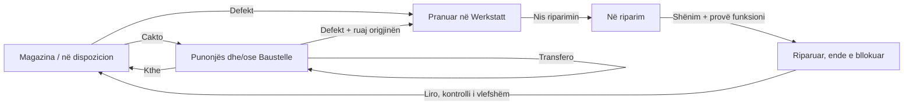

# BaumdienstFlow: Werkstatt-Demo und UX-Abgleich

Stand: 5. November 2026. **Verbundenes Inventar der Baumdienst-Musterfirma online.** Runtime `aaa5afcf9d837ed62055a1478ec56080337ddec0`, Branch `feat/baumdienst-inventory-flow-20261105`, [Draft PR 54](https://github.com/IamRedi/redionflow/pull/54). Kein Pilot-/Main-Merge. Die früheren Releases `61dc1b5` und `a919133` bleiben unten als Historie erhalten.

## Veröffentlichungsnachweis: verbundenes Inventar

Railway-Deployment `ca3927e6-0327-429e-91a5-68b5787f675a` ist seit 5. November 2026, 13:32:41 UTC SUCCESS mit einer gesunden Replica. Geprüft und übernommen wurden genau zwei nicht destruktive Source-Felder des einen Baumdienst-Webdienstes: Branch und Commit-Pin. Keine Variablen, Datenbank-/Reset-Dienste, Domains oder Tarife wurden geändert. AL Steel behält seine unabhängige Pilot-Branch; während dieser Arbeit wurde dort unabhängig ein weiterer Pilot-Release veröffentlicht. Er ist kein Bestandteil dieses Patches.

Öffentliche API-Abnahme: Version 1/Revision 11 wurde zu Version 2/Revision 12. Alle vorherigen Geräte-/Auftrags-IDs, Dokumente, Fotos und Ereignisse einschließlich Zeit/Notiz blieben erhalten. Danach wurde der fiktive Laubbläser Jonas Becker und Stadtpark zugeordnet (Revision 13). Identische Receipt-Wiederholung erhöhte die Revision nicht; ein unabhängiger GET ohne Browserzustand zeigt dieselben beiden Beziehungen. Kein Live-Reset. Die Online-HTML-Seite und API sind erreichbar; neue UI-Abnahme bleibt **PENDING_RECHECK**, weil Computer Use die aktuelle Windows-Browser-URL nicht sicher bestimmen konnte und beendet wurde. Keine weitere Browsersteuerung wurde versucht. Die neue Aufnahme `docs/assets/screenshots/baum-inventory-local.png` stammt ausdrücklich aus dem lokal geprüften Produktionsbuild, nicht aus einer neuen Online-Aufnahme. Physische Kamera/NFC/Bildschirmtastatur sind ebenfalls nicht als abgenommen dargestellt.

### Folgeauftrag: ein Inventar für Geräte, Flotte und Baustellen

Der veröffentlichte Folgeauftrag liegt auf `feat/baumdienst-inventory-flow-20261105`. Das bestehende gemeinsame Werkstattmodell wird zum einzigen Geräte-Inventar dieser Musterfirma: vier Fahrzeuge und vier einzelne Werkzeuge, mit unveränderten IDs/Codes. Die Flottenansicht filtert dieselben Einträge. Der alte `Motorsägen-Set`-Datensatz ist eine Planungsgruppe und wird nicht als fünftes Fahrzeug oder zweite Motorsäge ausgegeben. Ersatzteile behalten ihr getrenntes Mengen-/Kostenbewegungsbuch. Operative CompanyInventory-/WorkerAsset-/Planungstabellen anderer Firmen werden nicht beschrieben.

Zuordnungen wählen einen bestehenden Mitarbeiter, eine aktive Baustelle oder beides. Der Server löst die stabilen Schlüssel ausschließlich im streng geprüften Musterfirmen-Verzeichnis auf; Namen, fremde Firmen-IDs und komplette Client-Zustände sind keine Schreibparameter. Aktuell nicht verfügbare Mitarbeiter werden ausgeschlossen. Jeder Geräte-Datensatz hat genau eine aktuelle Zuordnung; ein bewusstes Umsetzen protokolliert vorherigen und neuen Ort. Konkurrenz und wiederholte Requests verwenden weiterhin Zeilensperre, Revision und Receipt.

Baustellenkarte, Baustellendetail, Mitarbeiterprofil, Flotte und Inventar lesen denselben gemeinsamen Stand. Bei Defektannahme wird die aktuelle Ausgabe beendet und ihre Herkunft im Auftrag und Ereignisverlauf aufbewahrt. Das Gerät erscheint an der Herkunft weiter als in Werkstatt und bleibt gesperrt, auch nach Reparatur bis zur bewussten Freigabe. Freigabe stellt es ins Lager; eine erneute Baustellen-/Mitarbeiterzuordnung ist eine eigene Aktion. Frühere Orts-/Mitarbeiterhistorie bleibt nach Rücknahme, Transfer und Freigabe erreichbar. Nacht-Reset-IDs werden nicht als dauerhafte Zuordnung verwendet; aktuelle Links kommen aus dem Verzeichnis. Dessen Änderungen invalidieren den ETag unabhängig von der Werkstattrevision.

Ein Code identifiziert immer denselben Inventareintrag. Barcode-Etiketten verwenden das bestehende Code-39-SVG. Kamera, manuelle Eingabe/externes Lesegerät und lesbare NFC-NDEF-Text-/URL-Tags öffnen diesen Eintrag, ohne Ausgabe, Rücknahme oder Bestandsbuchung auszulösen. Unbekannte Codes und Links anderer Origins erzeugen keine Geräte. Kamera wird erst nach Klick geladen; NFC wird abgebrochen, wenn Dialog/Ansicht geschlossen wird. Keine automatische Tag-Programmierung und keine behauptete Unterstützung beliebiger NFC-UIDs. Grundlage: [Chrome Web NFC](https://developer.chrome.com/docs/capabilities/nfc) und vorhandene ZXing-Integration. Physische Kamera-/Tag-/Bildschirmtastaturabnahme bleibt separat; die NFC-Ereignisse wurden im Browser simuliert.

Der JSON-Zustand wechselt atomar von Version 1 auf 2, ohne vorhandene Geräte, Aufträge, Teile, Ereignisse, Dokumente, Datei-Bytes oder Receipt-IDs zu ersetzen. Genau ein Revisionsschritt wird für die einmalige Übernahme verwendet. Alte Version-1-Writer scheitern anschließend geschlossen, statt neue Zuordnungen stillschweigend zu entfernen. **Nach dieser Übernahme nur einen Version-2-kompatiblen Build als Rollback verwenden; der frühere 61dc-Build ist dann kein schreibfähiges Rollback-Ziel.** Es gibt keine neue SQL-Migration und keinen Reset.

Die Telefonansicht hat eine kompaktere Navigation und Einleitung, Suche und Geräteart statt zweier überlappender Gerätefilter, sowie mindestens 44px große Hauptaktionen. Die Inventarkarte ersetzt im Muster-Mitarbeiterprofil die leere alte Inventartabelle. Das bisherige Layout anderer Profile bleibt der Default. Natürlicher Footer, Produktmaterialien, SVG-Familie, Sprachen und Reduced Motion bleiben erhalten. Native Information wurde auf die neue Inventar-/Scan-Fähigkeit abgestimmt; der begrenzte öffentliche Rollout ist oben dokumentiert, die neue visuelle Online-Abnahme bleibt separat offen.

Lokale Prüfbasis: vollständige Unit-Suite 600 PASS / ein bestehender Skip; vollständige 16 Browserfälle PASS, danach sechs finale betroffene Browserprüfungen nach Korrektur der Telefonfilter PASS. Enthalten sind Mehrgeräte-Zuordnung, Herkunft/Retoure/Reparatur/Freigabe, konkurrierende Zuordnungen, NFC-/Barcode-Auflösung ohne Mutation, Upgrade mit erhaltenen Dateien, Verzeichnis-ETag, alle sechs Sprachen, Themes und natürlicher Footer. Vollständiges Lint ohne Fehler; explizites Demo-Lint hat keine neuen Fehler, die bekannten fünf Hardcoded-Text-Warnungen der bestehenden DemoTopBar bleiben separat ausgewiesen. Der erste lokale Cache-Build scheiterte an vollem Datenträger; erfolgreicher Produktionsbuild nutzt `BDF_LOCAL_BUILD_NO_CACHE=1`, ausschließlich lokal. Ohne diese Variable besitzt die Next-Konfiguration keinen zusätzlichen Webpack-Hook; Provider-Build, Abhängigkeiten und Tarif bleiben unverändert.

## Logjika e inventarit dhe Werkstatt-it — referencë e plotë

Kjo pjesë dokumenton sjelljen aktuale të template-it publik Musterfirma. Burimi i së vërtetës është serveri; kartelat, flota, Baustelle dhe profili i punonjësit janë pamje të të njëjtit inventar. Nuk ka kopje të pajisjes për secilin modul. Katër automjete dhe katër vegla identifikohen nga ID/kodi i pandryshuar; pjesët rezervë janë stok sasior, jo pajisje individuale.

### Gjendjet dhe veprimet

| Veprimi | Kushti dhe rezultati |
| --- | --- |
| Cakto / ndrysho caktimin | Zgjidhet të paktën një punonjës ose Baustelle ekzistuese. Serveri zgjidh emrat nga çelësat e lejuar; refuzon punonjësin pa status AVAILABLE, Baustelle joaktive ose çelës të huaj. Nuk lejohet pajisje në Werkstatt ose me kontroll të skaduar. Ka vetëm një caktim aktual; transferimi ruan vendin e vjetër → të ri. Caktimi identik refuzohet. |
| Kthe në magazinë | Kërkohet caktim/mbajtës aktual. Regjistrohet kthimi, pastrohet caktimi dhe vendndodhja bëhet Lager. Nuk fshihet historiku. |
| Prano defekt | Nuk lejohet porosi tjetër e paliruar për të njëjtën pajisje. Kërkohet përshkrim; ruhen prioriteti/përgjegjësi dhe snapshot-i i origjinës. Caktimi përfundon, pajisja kalon në Werkstatt dhe krijohen ngjarjet e kthimit/pranimit. |
| Nis riparimin | Lejohet vetëm nga Pranuar, me përgjegjës jo bosh. |
| Përfundo riparimin | Lejohet vetëm nga Në riparim, me përshkrim të punës dhe provë funksioni të konfirmuar. Ruhet koha e përfundimit. Pajisja ende nuk është e disponueshme. |
| Liro për punë | Kërkohet Riparuar, provë funksioni, porosi ende e paliruar dhe kontroll jo i skaduar. Ruhet koha e lirimit dhe pajisja kthehet në Lager. Caktimi i origjinës nuk rikthehet automatikisht. |
| Regjistro kontroll | Data duhet të jetë sot ose në të ardhmen, me shënim. Përditëson afatin dhe shton ngjarje; nuk riparon ose liron automatikisht pajisjen. |
| Përdor pjesë | Vetëm gjatë riparimit; sasi e plotë 1–10000 dhe stok i mjaftueshëm. Ulet stoku, ruhet lëvizja dhe sasia/emri/çmimi i atëhershëm në porosi. Kostoja është shuma e këtyre rreshtave. |
| Plotëso stokun | Sasi e plotë 1–10000; stoku përfundimtar maksimumi 100000. Ruhet lëvizje e veçantë. |

Disponueshmëria kontrollohet me këtë përparësi: porosi e paliruar → Werkstatt; ndryshe kontroll i skaduar → bllokim; ndryshe caktim/mbajtës → në përdorim; përndryshe në dispozicion. Datat e kontrollit dhe paraqitja e kohës përdorin Europe/Berlin. Aktori i historikut është Demo: ky template publik nuk identifikon një operator real.

### Lidhjet dhe historiku

Baustelle/punonjësi shfaqin caktimin aktual ose origjinën e porosisë aktive. Pas lirimit pajisja largohet nga lista aktive e origjinës; historiku dhe dokumentet mbeten të arritshme me filtrat e origjinës. Kartela e pajisjes hap porosinë aktive me veprim të veçantë. Flota filtron vetëm automjetet e inventarit; grupi i vjetër i planifikimit Motorsägen-Set nuk bëhet automjet i pestë.

Çelësi i Baustelle-s rrjedh nga emri/adresa dhe ai i punonjësit nga emri/mbiemri, me SHA-256 të shkurtuar. ID-të aktuale të DB-së përdoren vetëm për lidhjet. Kështu reset-i që rikrijon ID-të ruan marrëdhëniet kur identiteti i të dhënave bazë mbetet i njëjtë. Riemërtimi ndryshon çelësin; nuk bëhet bashkim me hamendje. Origjina/emrat historikë ruhen. Dy identitete me të njëjtin çelës bllokojnë leximin e direktoriumit (503), në vend të lidhjes së gabuar.

### Skanimi, ruajtja dhe gabimet

Barkodi është Code 39 SVG. Teksti manual/lexuesi si tastierë, kamera ZXing dhe NFC NDEF zgjidhin të njëjtin kod. Pranohet edhe URL e të njëjtit origin në /demo/workshop me asset të njohur. Kodet tekst normalizohen me trim/uppercase; kod bosh, i gjatë mbi 2048, i panjohur, i dykuptimtë ose URL e huaj nuk krijon pajisje. Skanimi nuk bën caktim, kthim ose konsum. NFC lexon tekst/URL, nuk shkruan tag dhe nuk lidh UID të çfarëdoshëm. Kamera ngarkohet pas veprimit të përdoruesit; burimet ndërpriten kur dialogu/faqja mbyllet ose fshihet. Lejet dhe pajisjet fizike mbeten provë e veçantë.

Klienti dërgon vetëm komandën e lejuar, UUID të kërkesës dhe revision aktual. Serveri merr row lock për workspace-in, kontrollon receipt-in/fingerprint-in, revision-in dhe kushtet, pastaj ruan gjendjen + receipt + versionin e ri në një transaksion. Kërkesa identike e përsëritur nuk regjistrohet dy herë. E njëjta UUID me përmbajtje tjetër ose version i vjetër jep 409; klienti rifreskon gjendjen. Pas përgjigjes së humbur mbahet kërkesa e pakonfirmuar për riprovim me të njëjtën UUID. Nuk ka ruajtje offline/localStorage të versionit të ri dhe provat e vjetra lokale nuk importohen vetë.

Ka një cache të përbashkët në faqe, rifreskim çdo 8 sekonda vetëm kur faqja duket, si dhe në focus/online. ETag përfshin revision-in dhe hash-in e direktoriumit. Loading/pending/connection tregohen dhe veprimet e shkrimit bllokohen gjatë pritjes ose pa lidhje. 400 tregon veprim/të dhëna të pavlefshme; 404 modul/objekt të palejuar; 409 konflikt; 413 madhësi/kuotë; 429 ngarkesë; 503 lidhje ose direktorium i paqartë. Ndryshimet kontrollohen për të njëjtin origin dhe JSON pranohet deri në 12000 byte. Kufiri është 80 mutacione/minutë për workspace, gjendje JSON deri 4 MB dhe transaksion deri 15 sekonda. Ky mekanizëm nuk zëvendëson autentikimin e një firme reale.

### Dokumentet, fotot dhe izolimi

Dokumenti lidhet me pajisjen dhe opsionalisht me porosinë e saj; serveri kontrollon që lidhja përputhet. Fotoja lidhet me pajisjen ose me çelësin e Baustelle-s; foto pajisjeje mund të lidhet edhe me porosinë. Skedarët/byte-t ruhen në DB-në e demos me ID/URL të qëndrueshme. Emrat pastrohen. PDF/TXT deri 1 MB kontrollohen për format/UTF-8; JPEG/PNG/WebP deri 12 MB dekodohen me kufi 24 megapikselë, orientohen, hiqen EXIF/GPS dhe zvogëlohen në WebP deri 180 KB. SVG dhe animacionet nuk pranohen si foto. Maksimumi dy konvertime njëherësh, 160 skedarë/22 MB gjithsej; dokumentet kanë edhe kufirin 80/10 MB. Kuota, skedari, ngjarja dhe revision ruhen atomikisht: dështimi nuk lë regjistrim të pjesshëm.

Moduli kërkon shprehimisht profilin baumdienst-workshop në demo, SaaS joaktiv dhe saktësisht një firmë me emrin Baumdienst Musterstadt GmbH e mode baumdienst. Jashtë këtij kombinimi UI/API/files kthejnë 404. Nuk shkruhen tabelat operative të inventarit, CompanyInventory/WorkerAsset, AL Steel, BauFlow ose shërbimet e reset-it. Tabelat e workspace-it nuk kanë FK me firmën bazë që rikrijohet natën. Upgrade-i v1→v2 bëhet vetëm një herë nën lock, ruan gjendjen/skedarët/receipts dhe rrit një revision; rollback duhet të jetë v2-compatible.

### Vendimet e ndërfaqes dhe provat

Ngjyrat, tipografia, sipërfaqet dhe SVG-të ekzistuese ruhen. Ka një scroll kryesor, dialog të kufizuar nga viewport-i, veprime kryesore të paktën 44px, fokus të dukshëm, lëvizje Reduced Motion dhe footer natyral me ligjore + një by RediON. Korrigjimi vizual i këtij vijimi kufizohet te skrollet që ndjekin temën, filtri aktiv që kalon në rresht tjetër kur kërkimi do të ngushtohej nën 140px, dhe treguesi SVG i hapjes/mbylljes së barkodit; përdoret native details/summary që punon edhe me Enter/Space. Nuk ndryshon komandat ose skemën.

Burimet zbatuese: src/lib/workshop/demo-model.ts, inventory-flow.ts, shared-contract.ts, shared-store.ts, shared-files.ts; src/components/demo/workshop/use-workshop-demo.ts, inventory-scanner.tsx, inventory-scope.tsx dhe workshop-demo.tsx; src/app/api/demo/baumdienst. Provat ekzistuese mbulojnë tranzicionet, konkurrencën/riprovimin, skedarët/kuotat, upgrade/reset, gjuhët/temat dhe rrjedhën në telefon. Pranimi i ri online dhe identiteti i deployment-it regjistrohen sipër pas publikimit; prova fizike NFC/kamera/tastierë nuk deklarohet nga një viewport telefoni në desktop.

## Vorheriger gemeinsamer Release: 61dc1b5

[Werkstatt online](https://redionflow-production.up.railway.app/demo/workshop). Railway-Deployment `2cffb9f3-63a8-4115-a512-78c20a940455` war seit 5. November 2026, 11:09:12 UTC **SUCCESS**, eine gesunde Replica. Nur der vorhandene Baumdienst-Webdienst `c5ba03e9-2e72-48a7-bd24-262a8d1b322a` wurde damals auf die geprüfte Branch/Revision gesetzt. Die bestehende Demo-Profilkonfiguration blieb erhalten. Die additive Migration wurde erfolgreich angewendet; vorhandene Basisdaten wurden nicht zurückgesetzt. Spätere Dokumentations-/Mediencommits verändern den Runtime-Pin nicht.

Im tatsächlichen öffentlichen Browser geprüft: einen ausdrücklich fiktiven Kran-LKW-Auftrag annehmen, Reparatur starten, eine Arbeitsleuchte verwenden (Bestand 4 → 3), öffentliche DEMO-Grafik und TXT-Protokoll hochladen, Funktionskontrolle dokumentieren, reparieren und bewusst freigeben. Eine weitere DEMO-Grafik wurde an der Baustelle Stadtpark gespeichert. Ein Reload und eine unabhängige HTTP-Abfrage ohne Browserzustand zeigen denselben freigegebenen Auftrag, das Dokument, beide Foto-URLs und den verminderten Bestand (Revision 8). Die Werkstatt-Galerie decodiert das tatsächliche hochgeladene WebP mit 512px. Die fiktiven Testvorgänge bleiben nachvollziehbar erhalten; kein öffentlicher Reset wurde durchgeführt. Online-Ansichten wurden bei 1440×900 und 390×844 geprüft. Aufnahme: `docs/assets/screenshots/baum-workshop-shared-online.jpg`. Die zusätzlichen unabhängigen Desktop-/Telefon-Kontexte und tatsächlichen Datei-Downloads wurden lokal gegen dieselbe Release-Revision geprüft.

Provider-Readback: AL Steel behält Branch `claude/project-thread-an04j1` und Deployment `dca7ccaf-26c7-4320-971e-8bc6f1a4b808`; BauFlow behält `f829b6a0-7ac5-45d3-adb9-7b50854e4edf`. Beide Reset-Dienste und beide Demo-Datenbankdienste behalten ebenfalls ihre vorher erfassten Deployment-IDs. Keine fremden Variablen, Quellkonfigurationen, Domains, Cron-Regeln oder Tarife wurden geändert; kein offener Provider-Patch. Alle drei Health-Endpunkte antworten HTTP 200. Die neue Werkstatt-API und UI sind nur bei Baumdienst HTTP 200; bei AL Steel und BauFlow HTTP 404.

Die tatsächlich laufende Reset-Revision `ce13ead44842715a071fd8e702c023e3c4223e51` verwendet eine feste Liste bestehender Tabellen; die drei neuen Tabellen fehlen darin und haben keine kaskadierende Company-/Site-Verknüpfung. Der Erhalt wurde zusätzlich im isolierten Transaktionstest geprüft. Der frühere Web-Release `854f2d12-fb2a-40f4-99b1-29c27a616a91` / `a919133` bleibt als Rollback-Nachweis erhalten. Ein Rollback der App löscht die additiven gemeinsamen Tabellen nicht.

Abnahme: **596 Unit-Tests bestanden, 1 bestehender Skip; 12 Browser-Tests bestanden**, Produktionsbuild/TypeScript und vollständiges sowie explizites Demo-Lint ohne Fehler/Warnungen. Echte physische Telefonkamera und Bildschirmtastatur bleiben `PENDING_RECHECK`; Responsive-/Upload-/Mehrgeräteprüfungen ersetzen diese Hardwareabnahme nicht. README und [Portfolio-Draft PR 38](https://github.com/IamRedi/redion-portfolio-/pull/38) sind auf die verifizierte gemeinsame Demo abgestimmt; die Portfolio-Production wird durch diese Aufgabe nicht veröffentlicht. Produktreife und Repository-About bleiben unverändert.

## Gemeinsame Werkstatt, Dateien und Baumdienst-Gestaltung

Der Folgeauftrag ersetzt die browserlokale Probe durch eine auf allen Geräten gemeinsam nutzbare, öffentliche Baumdienst-Demo. Reparaturen, Werkzeugausgabe, Prüfungen, Freigaben, Dokumente und Teilebuchungen werden in der vorhandenen Baumdienst-Datenbank gespeichert. Kein neuer Provider, kein Tarifwechsel und keine neue Abhängigkeit. Die Bedienoberfläche verwendet die bestehende grün/cremefarbene Baumdienst-Identität, Lucide-SVG-Icons, eigene passende SVG-Szenen und Gerätezeichnungen, Prozesskarten und zurückhaltende Animationen mit Reduced-Motion-Unterstützung.

Das Opt-in `DEMO_PROFILE=baumdienst-workshop`, öffentlicher Demo-Modus und deaktivierter SaaS-Modus bleiben zwingend. Schreib- und Datei-Routen prüfen zusätzlich genau eine Firma mit Modus `baumdienst` und dem bestehenden fiktiven Namen `Baumdienst Musterstadt GmbH`. Die API nimmt keine Firmen-ID, Akteur-, Zeit- oder vollständigen Zustandsüberschreibungen an. Alle anderen Profile bleiben ausgeschlossen.

Die additive Migration `20261105100000_baumdienst_demo_workspace` erstellt ausschließlich `BaumdienstDemoWorkspace`, `BaumdienstDemoFile` und `BaumdienstDemoMutation`. Sie haben bewusst keine Fremdschlüssel zu den nachts zurückgesetzten Company-/Baustellen-Tabellen. Stabile logische Geräte- und Baustellenschlüssel erhalten die Zuordnung nach dem bestehenden Reset, ohne dessen Dienste oder Regeln zu verändern. RLS ist auf den neuen Tabellen aktiv; es gibt keine normalen Tenant-Policies darauf. Der dedizierte Demo-DB-Owner bedient ausschließlich die zusätzlich profilgeprüften Demo-Routen.

Typisierte Befehle werden serverseitig gegen die aktuellen Zustandsregeln geprüft. Eine Transaktion mit `FOR UPDATE` auf genau einer Profilzeile schützt Bestand, Verlauf, Dateien, Quoten und Request-Receipts gemeinsam. Eine veraltete Revision wird mit HTTP 409 abgewiesen und aktualisiert die Ansicht. Wiederholte identische Requests verwenden dieselbe Receipt-ID; auch eine verlorene Antwort darf kein Teil zweimal buchen. Akteur, Zeit und neue IDs kommen vom Server. Zu- und Abgänge behalten Menge, damaligen Stückpreis und Reparaturbezug im Lagerbewegungsbuch.

Neue Endpunkte: `GET|POST /api/demo/baumdienst/workshop`, `POST /api/demo/baumdienst/files`, `GET /api/demo/baumdienst/files/[id]`. Mutationen verlangen den exakten Origin. Die tatsächliche gestreamte Body-Größe ist begrenzt; Datei-Buffering und Bildkonvertierung sind pro Prozess begrenzt. Fotos werden durch den vorhandenen Rasterdecoder geprüft, ausgerichtet, von Metadaten befreit und auf höchstens 1024px/180KB WebP verkleinert. Eingabe: JPG/PNG/WebP bis 12MB, PDF/TXT bis 1MB. Dokumente werden als Download mit `nosniff` und Sandbox-CSP ausgeliefert. Lange Unicode-Dateinamen bleiben downloadfähig.

Maximal 160 hochgeladene Dateien und 22MB insgesamt; innerhalb des Werkstattzustands maximal 80 Dokumente/10MB und 4MB JSON. Die vorhandenen Modellgrenzen gelten weiter. Die Demo begrenzt neue Mutationen auf 80 pro Minute. Quoten-/Netzwerkfehler zeigen keinen vorgetäuschten Speichererfolg. Alle Uploads liegen als Bytes in derselben Demo-Datenbank; die Geräteabfrage überträgt nur Metadaten und Links. Aktive Geräte aktualisieren sich spätestens beim nächsten 8-Sekunden-Abgleich bzw. bei Fokus/Verbindungsrückkehr.

Baustellenkarten und Baustellendetails erhalten einen eigenen Demo-Fotoadapter. Geräte und Reparaturen haben Galerien, Vollbild-Link und Download. Die operativen AL-Steel-Fotoaktionen und AssetPhoto-Tabellen werden dabei nicht aufgerufen. Andere Produkte erhalten ohne Demo-Schlüssel ihre bisherige Darstellung. Werkstattverfügbarkeit wird weiterhin in der Demo-Flotte dargestellt; der echte serverseitige Tagesplan bleibt getrennt.

**Öffentliche Testdaten, kein privater Firmenbereich:** Alle Besucher dieser Demo sehen dieselben Notizen und Dateien. `/demo/privacy` erklärt diesen Umfang in allen sechs App-Sprachen. Die bestehende Produkt-Impressumsadresse wurde geprüft; die separate Website-Datenschutzerklärung gilt ausdrücklich nicht als Datenschutzhinweis dieser App. Alte Browser-Proben bleiben im bisherigen Local-Storage-Schlüssel unangetastet und überschreiben die gemeinsame Demo nicht automatisch. Der JSON-Export enthält Historie und Dateilinks und ist keine vollständige Dateisicherung. Ein öffentlicher globaler Reset wurde entfernt.

Die jüngste Footer-Korrektur vom 5. November ist umgesetzt: ein primärer Workspace-Scroller, darunter am echten Inhaltsende die kompakte lokalisierte Impressum-/Datenschutzzeile und genau ein zentrierter `by RediON`-Link. Keine dauerhafte Footer-Zeile, kein fixiertes Branding und kein zusätzlicher äußerer Scrollbereich. Die native Präsentation verwendet denselben Footer; auf anderen Demo-Profilen wird die neue Vorlage nicht aktiviert.

Verifiziert: vollständige lokale Unit-Suite mit 596 bestandenen Tests und einem bereits vorhandenen Skip; Windows-Pfad-/Startquotierung in drei unveränderten fachlichen Testpaketen korrigiert, ohne Assertions zu entfernen. Produktionsbuild und TypeScript, vollständiges Lint sowie zusätzliches explizites Lint der sonst ausgeschlossenen Demo-Komponenten bestanden. Die Browser-Abnahme umfasst komplette Reparatur/Teile/Freigabe, unabhängige Desktop-/Telefon-Sessions, Dateien/Bilddecoder/EXIF-Grenzen, konkurrierende Buchungen, verlorene Antworten, Reset-Erhalt im zurückgerollten Fixture-Test, Unicode, alle sechs Sprachen, Themes, Reduced Motion, kurzen Bildschirm/Landscape/200% Text, Scrollposition und natürlichen Footer. Eine echte physische Bildschirmtastatur bleibt `PENDING_RECHECK`.

**ONLINE_VERIFIED / OWNER_UAT:** Der gemeinsame Release ist oben belegt und direkt testbar. Die folgenden Angaben beschreiben den früheren Browser-Release und gelten bei Speicher-/Footer-Fragen als Historie.

## Freigegebener, isolierter Demo-Release

Der Eigentümer hat am 5. November die Veröffentlichung ausschließlich in der bestehenden öffentlichen Baumdienst-Demo freigegeben. Dafür dient die eigene Deployment-Branch `demo/baumdienst-workshop-20261105`; weder `main` noch der verbundene AL-Steel-Pilotzweig werden bewegt. Ein Codebestand bleibt erhalten, mit expliziter Profilkonfiguration statt einer zweiten Produktkopie.

`DEMO_PROFILE=baumdienst-workshop` aktiviert die Vorlage nur zusammen mit `APP_ENV=demo|local`, deaktiviertem SaaS-Modus und Firmenmodus `baumdienst`. Ohne Opt-in, bei einem anderen Profil, in BauFlow oder im SaaS-/Produktivmodus sind Route, Einstieg, Werkstatt-Flotte und neue Workspace-Vorlage ausgeschlossen. Nur der Baumdienst-Webdienst erhält diese Konfiguration; BauFlow, AL Steel und beide nächtlichen Reset-Dienste bleiben unverändert. Die bestehende Baumdienst-Datenbank wurde separat vom BauFlow-Ziel verifiziert und enthält ausschließlich die bekannte fiktive Baumdienst-Musterfirma.

Release-Prüfung: Produktionsbuild/TypeScript, fokussiertes ESLint, 31 Unit-Tests einschließlich Profilgrenzen und Werkstattmodell, alle fünf Browser-Tests mit Online-Demo-Flags sowie drei negative HTTP-Profile. Die dynamische Workspace-Shell rendert keine zweite Kopie ihrer Formulare als Suspense-Fallback. `node tests/workshop/deployment-boundaries.cjs` prüft die ausgeschlossenen Profile lokal gegen ein vorhandenes fiktives Test-DB-Ziel.

Vorheriger verifizierter Runtime-Stand für Rollback: Deployment `820c0ff0-e184-4b66-b2b7-eb50c747fa3d`, Quellrevision `ce13ead44842715a071fd8e702c023e3c4223e51`. Die 49 vorhandenen Migrationen bleiben erhalten; die weiteren Migrationen entfernen keine Felder der bestehenden Demo-Baseline. Kein Datenbank-Reset ist Teil dieses Releases. Der optionale lokale Voll-Export wurde durch die automatische Sicherheitsprüfung abgewiesen; ein providerinterner Snapshot ist im bestehenden Plan nicht verfügbar (Pro erforderlich). Es wurde weder exportiert noch ein Tarif geändert. Die fiktive Demo ist getrennt vom echten Pilotbetrieb und kann weiterhin auf die vorherige App-Version zurückgestellt werden.

## Öffentliche Runtime-Abnahme

[Werkstatt online öffnen](https://redionflow-production.up.railway.app/demo/workshop). Am 5. November 2026 erfolgreich veröffentlicht: Railway-Deployment `854f2d12-fb2a-40f4-99b1-29c27a616a91`, fest auf Quellrevision `a91913321960d437ece1ec9eee2f21554f8c0f86` der eigenen Demo-Branch gesetzt. Nachfolgende Dokumentations- und Mediencommits ändern diese Runtime-Pin nicht.

Öffentlich im Browser geprüft: Defekt am fiktiven Kran-LKW melden, annehmen, Reparatur starten, ein Ersatzteil verbrauchen, erfolgreiche Funktionskontrolle dokumentieren, Reparatur abschließen und ausdrücklich freigeben. Ein Reload erhält den lokalen Auftrag. Danach nur die eigene Browserprobe auf den fiktiven Ausgangsstand zurückgesetzt. Desktop 1440×900 und Telefon 390×844 in beiden Themes visuell geprüft; tatsächliche Online-Aufnahme: `docs/assets/screenshots/baum-workshop-online.jpg`.

Provider-Readback nach Veröffentlichung: Nur der Baumdienst-Webdienst verwendet das neue Profil und den Release-Pin. AL-Steel-Pilot, BauFlow-Demo, beide Reset-Dienste und Datenbankdienste behalten ihre zuvor erfasste Konfiguration und Deployment-IDs. Health-Checks aller drei Apps: HTTP 200. Werkstatt: Baumdienst HTTP 200, BauFlow und AL Steel HTTP 404. Die bestehende fiktive Baumdienst-Firma blieb erhalten: 8 Mitarbeitende, 3 Baustellen, 5 Maschinen; 66 angewendete Migrationen. Kein Reset und kein Export von Daten.

Die nachstehenden ursprünglichen Kandidatenbefunde bleiben als Historie erhalten. **OWNER_UAT** ist jetzt direkt online möglich; gemeinsam gespeicherte betriebliche Werkstattaufträge sind damit weiterhin nicht implementiert.

## Auftrag und fachliche Übertragung

Der Eigentümer möchte die erprobte BauFlow-Oberfläche auf das fiktive Baumdienst-Demoprofil übertragen. An die Stelle der Fertigungsübersicht tritt die Werkstatt. Hier werden Fahrzeuge und einzelne Geräte mit Defekt angenommen, repariert und nach Prüfung wieder freigegeben. Die Baumdienst-Farben, bestehenden Karten, Schriften, Icons und Komponenten bleiben erhalten.

Die drei Reparaturzustände sind **Angenommen → In Reparatur → Repariert**. Eine erfolgreich dokumentierte Reparatur ist von der bewussten Freigabe für den nächsten Einsatz getrennt. Das ist eine Probe des Workflows, keine echte Prüfbescheinigung.

## Befunde und Änderungen

| Bereich | Befund im Ausgangsstand | Kandidat / verbleibende Grenze |
| --- | --- | --- |
| Einstieg und Team | Demo-Header mit passivem AI-Badge, mehrfacher Demo-Kennzeichnung, kleinen Navigationszielen | Team direkt neben dem Logo; klare Workzone-/Werkstatt-Navigation, Theme-Schalter und 44px-Ziele; Baumdienst bleibt grün/creme |
| Workzone | Kein Werkstatt-Einstieg; geöffnete Flottenleiste beansprucht auf dem Telefon viel Platz | Werkstattübersicht unter den Baustellen, analog zur Position der BauFlow-Fertigung; Desktop-Leiste zunächst geschlossen; Flotte auf schmalen Geräten in der Navigation |
| Defekte | Operative `machine-notes.ts` speichert höchstens fünf Defekte und kennt nur offen/erledigt | Eigenes Demo-Auftragsmodell mit Zustandsregeln und fortgeschriebener Historie. **Die alte operative Speicherung ist unverändert** und muss vor einem echten Werkstattbetrieb ersetzt werden |
| Flotte und Geräte | Technischer Aktiv-Status ist keine Reparaturfreigabe | Lokale Werkstatt-/Prüfsperre, explizite Freigabe, Kennzeichen/Inventarnummer und Verbindung zur lokalen Flottenansicht. Vorhandene Planungsdaten bleiben schreibgeschützt |
| Werkzeuglager | Keine gemeinsam testbare Annahme-/Ausgabeprobe | Einzelgeräte mit Empfänger, Ausgabe, Rücknahme, Prüfdatum und Ereignissen; Geräte in Reparatur oder mit überfälliger Prüfung lassen sich nicht ausgeben |
| Ersatzteile | Kein Werkstattverbrauch | Positive Ganzzahlen, Überziehungsprüfung, Abzug beim Verbrauch und gespeicherter damaliger Stückpreis im Auftrag; Nachfüllen als Demo. Lieferanten-, Einkaufs- und vollständiges Lagerbewegungsbuch sind nicht implementiert |
| Dokumente | Kein auftragsbezogener Werkstattbereich | Musterdateien an Gerät und optional Auftrag; Download und Speicherung nach Reload. Nur PDF/PNG/JPG/TXT, höchstens 256 KB je Datei und 1 MB insgesamt |
| Historie | Ein Defekt lässt sich bisher nicht durch Annahme und Reparatur verfolgen | Zeit, Demo-Akteur, Zustand, Reparaturtext, verwendete Teile, Prüfung, Freigabe und Ausgabe/Rückgabe bleiben erhalten; Export und bewusstes Zurücksetzen betreffen nur den eigenen Demo-Schlüssel |
| Darstellung | Potenziell widersprüchliche Verfügbarkeit; schwebende Flottentaste überdeckt auf dem Telefon Karten | Werkstattstatus wird in der Demo-Leiste berücksichtigt; der Telefon-Einstieg überdeckt keine Inhalte. Responsive Spalten, Suche und Filter; keine Drag-Pflicht |
| Arbeitsfläche und Autorenzeile | Die bisherige Demo nutzt einen begrenzten Dokumentbereich; Dashboard-Listen haben zusätzliche 340px-Scrollbereiche | Baumdienst-Demo als viewportabhängige Grid-Shell: Header, genau ein scrollender Hauptbereich und ein über die gesamte Breite zentrierter Autorenlink. Listen wachsen natürlich im Hauptbereich; kurze Bildschirme erhalten eine kompakte, horizontal erreichbare Navigation. Kleine Speichervorgänge behalten die Position; bewusste Navigation startet oben |
| Formulare | Frühe Klicks vor Hydration und unklare Select-Beschriftung wurden beim Browser-Test sichtbar | Mutationen erst nach Hydration; explizite Label-/ID-Verknüpfung, Dialog-Fokus und Escape-Rückkehr geprüft |
| Native Präsentation | Neue Demo-Fähigkeit fehlt; dekorative Nummern auf parallelen Vorschaukarten | Nur auf einer Baumdienst-Demo-Instanz ein deutlich begrenzter Werkstatt-Einstieg; Kartennummern entfernt. Fachliche Reihenfolgen bleiben erhalten |

## Daten- und Zugriffsgrenze

`/demo/workshop` setzt die bestehende Freigabe für öffentliche Demos (`APP_ENV=local|demo`, kein SaaS-Modus), den Firmenmodus `baumdienst` und das ausdrückliche Profil `DEMO_PROFILE=baumdienst-workshop` voraus. BauFlow und der echte SaaS-/Pilotbetrieb erhalten dadurch keine Werkstattaktion.

Alle Werkstattdaten sind fiktive Beispiele. Der versionierte, validierte Zustand liegt unter `redionflow:baumdienst:workshop-demo:v1` in `localStorage`. Kein Server-Action-/API-Schreibpfad, keine neue Migration, kein neuer Provider und keine neuen Abhängigkeiten. Aufträge und Dateiinhalte werden nicht an die Datenbank oder einen Storage-Anbieter übertragen. Es gibt weder Benutzerrollen noch Mehrbenutzer-Synchronisation für diese Probe; der Akteur heißt ausdrücklich Demo. Ein Browser-Export ist keine betriebliche Datensicherung. Bei defektem oder vollem Browserspeicher wird kein Speichern vorgetäuscht.

Das Modell begrenzt den Demo-Umfang auf 100 Geräte, 1.000 Aufträge und 40 Dateien. Es entfernt keine alten Reparaturen stillschweigend, um Platz zu schaffen. Historie und Dateien sind lokal und gehen beim Löschen des Browserspeichers verloren.

Die bestehenden schreibgeschützten Baustellen, Arbeitszeiten und Mitarbeiterprofile behalten ihre Datenquelle. Der neue Werkstattstatus ist keine serverseitige Sperre im echten Tagesplan, keine bestätigte GPS-Position und kein Nachweis einer echten HU/UVV-Prüfung.

## Ursprüngliche lokale Prüfung

- Lokaler PostgreSQL-16-Testbestand mit dem vorhandenen fiktiven Baumdienst-Seed; getrennt von gemeinsamem oder produktivem Datenbestand.
- Produktionsbuild mit Next.js 16.4.3 und TypeScript erfolgreich. Zwei vorhandene Page-Prop-Signaturen wurden an den generierten Next-Vertrag angepasst; der direkte Testaufruf übergibt jetzt ein leeres Props-Objekt. Keine Fachlogik geändert.
- 15 fokussierte Modelltests: Reihenfolge, doppelte Annahme, Prüfung/Freigabe, Ausgabe/Rücknahme, Bestandsgrenzen, Dokumentzuordnung und sieben Reparaturzyklen ohne Fünf-Einträge-Verlust.
- Chromium: vollständiger Reparatur-/Ersatzteil-/Freigabe-/Ausgabe-/Dokument-/Reload-/Export-/Reset-Ablauf; beschädigter Speicher; keine Page-Errors im geprüften Ablauf.
- Alle sechs UI-Sprachen; 1440/768/390/320px, hell/dunkel, alle Werkstattbereiche, kein horizontaler Seitenüberlauf; primäre Aktionen mindestens 44px, Textkontrast der primären Aktion mindestens 4,5:1, Dialog/Escape/Fokusrückkehr und ein Autorenlink geprüft.
- Native Präsentation in SQ/EN/DE/IT auf Desktop und Telefon; Workzone, Dashboard und Baustellendetail bei 1440/390px in beiden Themes geprüft. Vor-/Nachvergleich der nativen Karten und des geteilten Headers.
- Zusätzliche Shell-Prüfung: Desktop 1440×900, Telefon 390×844, Landscape 844×390 und tastaturähnlich verkleinerte Fläche 390×360; beide Themes, Workzone/Dashboard/Werkstatt, stationäre Autorenzeile, erster/letzter Inhalt, ein vertikaler Haupt-Scroller, 200% Textgröße und Position nach einer kleinen Lagerbuchung. Die relative Positionierung des Hauptbereichs verhindert, dass absolut platzierter Status-Text im kurzen Bildschirm einen äußeren Scrollbereich erzeugt.
- `interactive-widget=resizes-content` ist gesetzt. Eine echte Bildschirmtastatur auf einem physischen iOS-/Android-Gerät bleibt **PENDING_RECHECK**; die verkleinerte Browserfläche ist kein vollständiger Gerätetest.
- Keine Cloud-Actions gestartet. Frühere vollständige GPS-, OCR-, Backup-, Foto- und Stahlproduktionspakete wurden nicht erneut ausgeführt; ihre reale Abnahme bleibt getrennt.

Die Tests stehen unter `src/lib/workshop/demo-model.test.ts` und `tests/workshop/`. Die Browser-Suite verlangt eine bereits gestartete, fiktive Loopback-Demo und weist öffentliche/entfernte Targets ab. Lokale Befehle: `vitest run src/lib/workshop/demo-model.test.ts`, `playwright test -c tests/workshop/playwright.config.ts`, fokussiertes ESLint und `next build --webpack`.

## Nach der Demo-Probe

Vor einem echten Einsatz sind normalisierte, firmengebundene Werkstattaufträge und Ereignisse mit Migration, Rollen/RLS, unveränderlicher Historie und Konkurrenzschutz notwendig. Ein physisches Gerät benötigt eine eindeutige Identität; Gerätesets dürfen nicht mit einzeln ausgegebenen Werkzeugen oder Verbrauchsteilen vermischt werden. Teilebuchungen und Rücknahmen benötigen Transaktionen und ein Lagerbewegungsbuch. Dokumente benötigen privaten Storage, echte Inhaltsprüfung, Rechte und Lösch-/Aufbewahrungsregeln. Planung, Flotte, Mitarbeiterübergaben und Prüffristen müssen denselben serverseitigen Verfügbarkeitszustand verwenden.

GPS-Verlässlichkeit, Erinnerungen, Offline-Konflikte, echte Zertifikate und ein produktiver Werkstatt-Rollenablauf sind nicht durch diesen Prototypen abgenommen. Der sichtbare Kalender und die Baumlisten bleiben Baumdienst-spezifisch; Stahlgewichte und Fertigungsprozesse werden nicht in den Baumdienst kopiert.

## Lieferung und Präsentation vor der Online-Freigabe (Historie)

Die öffentliche Baumdienst-Demo und ihr nächtlicher Reset verwenden laut Provider-Readback weiterhin `main`; der reale Pilot verwendet seinen eigenen Zweig. Dieser Kandidat wird ausschließlich in einer getrennten Feature-PR vorbereitet. Ein Merge in den Railway-verbundenen Pilotzweig ist kein harmloser Weg, nur die Baumdienst-Demo zu veröffentlichen.

Native Information und README beschreiben die lokale Probe. Die Portfolio-Begleit-PR führt dieselben Grenzen in SQ/EN/DE/IT und echte synthetische Screenshots; bestehende Live-Links, About und Prod/90 bleiben unverändert. **PENDING_PUBLICATION / OWNER_UAT**: kein Merge, kein Deployment und keine Änderung an Firmen-, Provider-, GPS- oder Echtdaten. Nächster Punkt ist die Prüfung dieses konkreten lokalen Demo-Kandidaten; eine spätere Demo-Veröffentlichung braucht einen eigenen, auf Baumdienst begrenzten Release-Schritt.
