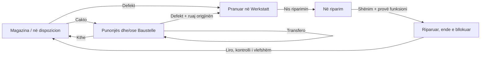

# BaumdienstFlow: Werkstatt-Demo und UX-Abgleich

## UI premium — shqyrtimi dhe plani i parë, 12 nëntor 2026

Kërkesa e re e pronarit autorizon përshtatjen e stilit aktual të AL Steel/BauFlow te Baumdienst, me ngjyrat dhe fushën e vet. Ky është redesign i kërkuar, jo ndryshim i firmës/pilotit. Burimi Baumdienst për këtë punë është ded02052d46a1d40fddfd36f7975d546a8ab9d79 (18 commit-e më i ri se kopja e mëparshme lokale, të ruajtura me fast-forward); është edhe source pin-i i demos së verifikuar. AL Steel është referencë read-only në degën claude/project-thread-an04j1, 42081ea32b2058888f7c3f814e99c0c007f929e6.

Avancimet e 10–12 nëntorit: Workzone me materiale stone/copper/crystal, hapësirë e saktë për ekipin, foto me kontrolle të qeta, site/process interiors, planifikim/dashboard (PR179), profile/notebooks/factory (PR180), magazina (PR182), flota/paneli (PR184) dhe Werkstatt-i clear glass me pak blur e pa korniza bosh (PR185). Arkitektura i mban materialet në steel-studio.css, primitives të përbashkëta dhe data-attributes të kufizuara; rrjedhat/role/tenant/read models mbeten veç stilit. Nuk kopjojmë module zyre ose logjikë prodhimi çeliku në Baumdienst.

RediON Connect u lexua nga burimi canonical plugin-source, përfshirë UI Identity Lock (12.11), ui-experience dhe workspace-lifecycle (11.11). Paketa e instaluar këtu është 0.10.29; burimi dhe ngarkimi në këtë sesion janë prova të veçanta nga shpërndarja te agjentët e tjerë. Nuk u kërkua reload/ndalim i ndonjë agjenti ose publikim i plugin-it.

### UI Identity — një burim për këtë produkt

Scope: vetëm template-i Baumdienst Musterfirma, data-demo-shell=muster, me data-baum-studio=forest-crystal-v1. Status: OWNER_REQUESTED_REDESIGN, kandidat në verifikim; nuk nënkupton miratim vizual përfundimtar. Materiali: clear forest crystal me blur 2px, rim/reflektim statik, sipërfaqe të qarta me kontrast dhe overlay më opak për dialogët. Ngjyrat janë jeshile pylli/petrol dhe neutral i ngrohtë; nuk merret portokallia industriale e AL Steel. Fonti/ikonat outline ekzistuese, StudioIcon/StudioArt dhe fotot origjinale ruhen. Token-at dhe variantet banojnë vetëm te src/components/demo/baumdienst-studio.css; shell-i merret me përmasat/scroll-in, jo me një stil të dytë kartash.

Primitives: Button/Card ekzistuese marrin vetëm metadata semantike për stilimin e kufizuar; jashtë Musterfirma-s nuk kanë ndryshim CSS/sjelljeje. Kartat ekzistuese përdorin të njëjtën familje përmes selector-ëve të kufizuar. Portalët e dialogëve marrin të njëjtat token-a vetëm kur shell-i Muster është në dokument. Grafikët, harta, foto/atlas dhe printimi janë përjashtime funksionale; ngjyrat status/danger nuk zëvendësohen me accent. Fallback për reduced transparency, forced colors dhe mungesë backdrop-filter është opak/i lexueshëm.

### Zhvillimi me radhë

- **Hapi i parë, tani:** themeli visual në Light/Dark, materiale të përbashkëta për karta/kontrolle/dialogë, navigim aktiv nga URL-ja ekzistuese, inventari i dukshëm, ekipi pa mbivendosje nga Më shumë, 44px veprime kryesore dhe prezencë e qetë pa lëkundje të kartave. Pa hequr funksione, ndryshuar përmasa kopertinash, të dhëna ose rrjedha. Testohen Workzone, Werkstatt/inventari, druri, paneli, dashboard-i dhe dialogët.
- **Pas këtij pranimi:** rafinim i përmbajtjes së kartave Baustelle/pemë dhe proceseve, grupim i detajeve sekondare me aksione të qëndrueshme; asnjë ndryshim i heshtur në inventar/riparime.
- **Më pas:** harmonizim i plotë i profileve/raporteve/planifikimit dhe app-experience: Auto/Light/Dark me preferencën ekzistuese, rendi locale/profile/browser dhe PWA e sigurt. Gjendja aktuale e Baumdienst ka toggle Light/Dark dhe browser locale fallback; Auto/profile cross-device/PWA mbeten PENDING_RECHECK, jo pretendim ALREADY_COMPLIANT. Nuk shtohet cache autentikimi ose preference store paralel.

Provat: fixture sintetike dhe ekzekutim me runner-in ekzistues në mini-PC, 4 CPU/4GiB dhe rezerva hosti; DB Docker e veçuar me CPU/RAM/port loopback të vet. Laptopi kishte rreth 41GiB të lira në preflight; nuk fshihen workspace të tjera ose ndalen shërbime/agjentë. Rruga e ruajtjes dhe rezultatet e sakta plotësohen pas kontrollit. Nuk gjenerohen foto me pagesë ose ndryshohen modele/provider/dependencies.

Verifikimi i hapit 1: commit b8a6bbc9bb872aae4db758aa958ac118d7fcda8c / PR187 draft. 689 unit PASS pa skip në mini-PC Linux, production build webpack / TypeScript / lint PASS; 38/38 rrjedha browser PASS, tri profile të përjashtuara PASS; Gitleaks dhe lint i shprehur i skedarëve të prekur PASS në laptop. Runtime/test sources u verifikuan me SHA256 kundrejt commit-it. Light/Dark, dialogë në portal me fokus, kontrast 4.5+, forced colors, 390/1440px, landscape/200% tekst, footer/fullscreen dhe rrjedhat ekzistuese u mbuluan. Kontrasti/opaciteti u rregulluan para setit final; një dështim nga media sintetike e mbetur në fixture u diagnostikua dhe seti i plotë kaloi në DB të pastër, pa ndryshuar assertions. OCR test-only u shpaketua brenda job-it; asnjë instalim global ose shërbim tjetër i ndalur.

PUBLIKIMI I MIRATUAR, POR I PAZBATUAR: pronari konfirmoi “Po, publiko vetëm te Musterfirma” për b8a6bbc / PR187. Patch-i 62c86c72-a48d-46de-859d-a44121350b76 u rilexua: vetëm source branch dhe pin-i i këtij shërbimi, pa variabla/DB/shërbime të tjera. Railway accept-deploy anuloi sërish veprimin, edhe me parametrat e saktë, me arsyen “Cancelled — the user did not approve this action. No changes were made.” Nuk u anashkalua kontrolli. Miratimi i pronarit është i regjistruar; pengesa mbetet konfirmimi i veprimit te mjeti Railway. Versioni LIVE mbetet ded02052d46a1d40fddfd36f7975d546a8ab9d79 / deployment 048b4885-b4e8-408b-b474-2ceb87b68a0f SUCCESS; dy ndryshimet mbeten STAGED. Asnjë merge në main/pilot, sekret, variabël, DB apo kuotë AI nuk u ndryshua. Readback online i përsëritur: revision 70→70, 10 pajisje, planet/druri identikë; 16 origjinale/skedarë me hash identik dhe 6 figura aktive të ruajtura.

Provat lokale janë te outputs/baum-crystal-tests (7 log-e/manifest kompakte) dhe pamjet outputs/baum-crystal-preview-*. Job-i përfundoi me exit_status=0; node_modules/.next e gjeneruar dhe DB Docker sintetike e identifikuar me ID/label u hoqën, burimi/provat/receipt u ruajtën dhe tuneli i këtij testi u mbyll. Përshkrimi funksional/URL/About i prezantimit mbetet i saktë; rifreskimi vizual/mediat mbeten PENDING_OWNER_REVIEW/PENDING_PUBLICATION gjatë HOLD-it, jo një PASS i sajuar. Një vazhdim: pas zgjidhjes së konfirmimit të mjetit Railway, rilexo patch-in dhe publiko versionin tashmë të autorizuar b8a6bbc, pastaj verifiko online. Hapi 2 ende nuk ka nisur. Auto/profile cross-device/PWA/telefon fizik mbeten të shënuara si të paverifikuara në plan.

Publikimi i portofolit mbetet OWNER_HOLD. AL Steel/piloti dhe demot e tjera janë jashtë shkrimit. Pamja native e prezantimit/README/portofoli shqyrtohen në mbyllje, me prova veçmas nga kodi dhe demoja. Ky seksion zëvendëson si pikë vazhdimi statusin historik më poshtë; nuk e shpall të gjithë UI-n të përfunduar.

## AKTUALE — korrigjimi i pronarit, 7 nëntor 2026

Dashboard view hap statistikat direkt në fullscreen nga klikimi i hyrjes. Nuk ka toolbar, kthim, ndërrues Workzone/Dashboard, rifreskim manual ose buton tjetër fullscreen brenda monitorit. Rifreskimi 60 sekonda vazhdon në prapavi. Kërkesa native kryhet gjatë klikimit dhe navigimi Next ruan të njëjtin dokument. URL direkte mbush viewport-in; shfletuesi kërkon gjest përdoruesi për fullscreen native. Rruga e zakonshme /demo/dashboard ruan funksionet ekzistuese.

Kopertinat e Baustelle-ve mbushin kornizën ekzistuese me object-cover. Nuk ndryshohen përmasat e kartave ose skedarët origjinalë. Pajisjet/logot mbeten të plota me contain.

Formati caktohet në server: kopertinë kantieri 1536×512 (3:1); fazë druri 1536×1024 (3:2); pajisje/logo 1024×1024 (1:1). Prompt-i dhe verifikimi i raportit ndjekin formatin. Cache përfshin formatin dhe ruan fallback për figurat e mëparshme. Fotot e ngarkuara kanë përparësi; kompresimi, modeli, provider-i dhe stili petrol mbeten ekzistues; nuk ka retry automatik me pagesë.

Kuota Baumdienst është 20 tentativa gjenerimi/ditë UTC, e përbashkët për pajisje, kopertina, logo dhe faza. Ky vendim i ri zëvendëson 5/ditë dhe tavanin e vjetër provë 50 gjithsej. Dështimet numërohen; cache dhe ngarkimet nuk shpenzojnë gjenerim. Ledger-i nuk zerohet.

Përjashtimi i vetëm i autorizuar për AL Steel është kuota e figurave: 20/kompani dhe 20/përdorues në ditë UTC; kompania mbetet tavani i përbashkët. Kufijtë 2/kompani dhe 1/përdorues për dritare 10-minutëshe, autentikimi/tenant-i dhe asistenti tekstual nuk ndryshojnë. Ndryshimi përgatitet veçmas nga Baumdienst. Tre teste ekzistuese marrin vetëm portabilitet të rrugëve/quoting për Windows, duke ruajtur assertions.

Nuk bëhen gjenerime me pagesë për këto prova. Verifikimi përdor provider sintetik, PostgreSQL lokal të izoluar dhe pamje desktop/telefon. Vetëm Musterfirma merr UI-n e ndryshuar. Demot e tjera nuk preken. Portofoli PR53 mbetet OWNER_HOLD; vlerësimi i prezantimit është NO_CONTENT_CHANGE për këtë korrigjim. Seksioni historik më poshtë nuk është logjika aktuale.

Verifikim lokal në laptopin Windows, 07.11.2026: 688 unit PASS, 1 skip ekzistues; 14 integrime PASS në PostgreSQL të izoluar (përfshirë 20/ditë, tentativa e 21-të, dita pasuese, arkivi pa tavan 50 dhe ruajtja e fotove); 35/35 rrjedha shfletuesi PASS, duke përfshirë hyrjen reale fullscreen pa butona, kopertinat cover, telefon/desktop/landscape/200% tekst, inventar/Werkstatt, planet dhe historikun. TypeScript, production build me webpack, ESLint dhe Gitleaks i staged diff PASS. Prova fillestare lokale u ndal dhe u përsërit me APP_BASE_URL të saktë loopback; kontrollet same-origin nuk u dobësuan. Build-i standard Turbopack nuk zgjidh junction-in lokal node_modules; webpack është rruga lokale e verifikuar, pa ndryshim konfigurimi/lockfile në produkt. Publikimi dhe kontrolli vizual online regjistrohen veçmas më poshtë.

Publikim dhe readback online: Baumdienst SHA `f2bbe984b097a9935dd79a7c1b0b93d3fcb5df2f`, deployment `1a5571c5-4520-4588-b027-455521976ad0` SUCCESS; health 200. Pamjet reale 1440×1000 dhe 390×844 konfirmuan cover në të tre kopertinat, skedarë të ngarkuar dhe pa overflow; përmasat desktop para/pas identike 238.67×79.33 CSS px në canvas. Monitori online ka 0 butona dhe 0 nav. Screenshot-et: `outputs/correction-workzone-online-desktop.png`, `correction-workzone-online-phone.png`, `correction-dashboard-online-desktop.png`, `correction-dashboard-online-phone.png`. Fullscreen native u verifikua nga testi real lokal Playwright; URL direkte ka kufirin e gjestit të shfletuesit të shpjeguar më sipër.

Ruajtja pas rollout-it: revision 64 → 64; inventari me 10 pajisje, planet dhe përpunimi i drurit të pandryshuar; 15 skedarë/origjinale me SHA256 identik; 5 figura të gjeneruara aktive të ruajtura. `outputs/correction-preservation-after.json` është evidenca e leximit pa shkrime testuese online.

AL Steel u publikua veçmas nga PR76: merge `e1c6f40114faced73c17b10dde3970cb8197ca1a`, deployment `f8f018a5-a7fc-4a91-b486-7762d8f5eb57` SUCCESS, health 200. Kuota e figurave 20/ditë është delta e vetme e sjelljes; tri teste Windows dhe dy nënshkrime page props plus thirrja e testit janë korrigjime kompatibiliteti pa ndryshim UI/rrjedhash. 1087 unit PASS / 1 skip ekzistues, 18 integrime PASS, TypeScript/build webpack/lint/Gitleaks PASS. Dega/konfigurimi i shërbimit dhe emrat e 28 variablave mbetën identikë. Nuk u lexuan sekrete ose shkruan të dhëna biznesi për testim.

Shënimi aktual u shtua në Google Doc-in ekzistues me revision guard dhe seksioni i mëparshëm u shënua historik; tabela native 10×2 ruhet. PR75 mbetet draft për rishikim, jo merge në main/pilot; PR53 i portofolit u verifikua OPEN/draft/pa merge në OWNER_HOLD. Ky korrigjim nuk e shpall platformën gati. Pikë vazhdimi: pronari rishikon korrigjimin, pa rigjenerime, seed ose publikim promocional.

Burime zyrtare të lexuara: MDN Element.requestFullscreen/Fullscreen API për aktivizimin e përdoruesit; OpenAI Images API për formatet. Rezultatet dhe SHA e publikimit plotësohen pas verifikimit.

## Historik — figurat, kopertinat dhe Dashboard view — 7 nëntor 2026

**Vetëm Musterfirma; portofoli PR53 mbetet OWNER_HOLD.** Korrigjimi i ri i pronarit zëvendëson kërkesën e mëparshme për dy hyrje Dashboard/TV: mbetet një buton **Dashboard view**, që hap `/demo/tv?view=dashboard` në skedë tjetër. Brenda ruhen statistikat, Workzone, rifreskimi, fullscreen dhe kthimi. `/demo/dashboard` mbetet rrugë e vlefshme për pajtueshmërinë; nuk ka dy hyrje të njëjta në menu/panel. Paneli i kontrollit, plani/harta/kalendari, ekipi, inventari dhe të dyja punëtoritë mbeten.

### Një familje figurash

`baumdienst-studio-petrol-v2` ruan adapterin OpenAI, modelin ekzistues `gpt-image-2.6-flare` dhe parametrat e kufizuar. Pajisje reale në formë/proporcione, jeshile pylli, metale/gomë natyrale, detaje portokalli dhe sfond studio petrol `#0c2b35`; pa tekst ose logo të shpikura mbi pajisje. Ndryshimi i versionit të stilit ndan cache-in e ri nga pesë figurat e vjetra me sfond të bardhë. Lexuesi ruan fallback të lexueshëm për V1 deri te krijimi i V2; origjinalet V1 nuk fshihen. Parametrat dhe çmimi për thirrje nuk rriten. U lexua dokumentacioni zyrtar i Images API më 07.11.2026; nuk u zgjodh provider/model tjetër dhe nuk u shtua varësi aplikacioni.

Etiketa e mbivendosur “AI” hiqet nga kartat dhe miniaturat. Prejardhja mbetet në galeri dhe në ledger-in e gjenerimit. Ilustrimi nuk bëhet foto e njësisë reale ose provë riparimi. Fotot reale të ngarkuara kanë përparësi dhe ruhen pa editim gjenerativ.

“Krijo me AI” është veprim i shprehur i shefit në galerinë e pajisjes, kopertinën e kantierit, logon/emblemën e Musterfirma-s te paneli dhe figurën e fazës së drurit. Emblema përdor një target të rezervuar, jo një pajisje ose firmë të dytë; header-i lexon të njëjtën zgjedhje. Dërgohen vetëm përshkruesit vizualë të lejuar; kantieri përdor emrin fiktiv, jo adresë/shënime/ekip. Kopertinat dhe emblema përdorin të njëjtin adapter, lease dhe ledger **5 tentativa/ditë UTC, 50 gjithsej** me pajisjet/fazat. Dështimet mbeten të numëruara. Nuk ka gjenerim në refresh ose retry automatik me pagesë. Cache-i ripërdor të njëjtin subjekt; një figurë e hequr mund të rikthehet pa pagesë. Ngarkimet aktive bllokojnë gjenerimin, përfshirë një foto të mbërritur gjatë tij.

### Menaxhimi dhe ruajtja

Galeritë kanë **Vendos si kopertinë**, **Hiq figurën** dhe **Rikthe figurën**. E njëjta zgjedhje përdoret në inventar, miniaturat e riparimeve, kantier, header-in e logos dhe fazat/porositë/hyrjet e drurit. “Hiq” e largon figurën nga pamja aktive, ndërsa origjinali mbetet te “Figurat e hequra”; është rikthim brenda produktit, jo fshirje e pakthyeshme. URL-të/origjinalet dhe historiku nuk fshihen. Kuotat e skedarëve/AI nuk zerohet duke hequr një figurë. Preferencat kanë kufij 500 targete, 200 referenca të fshehura/target dhe 2000 ngjarje; tejkalimi dështon atomikisht.

Përdoret modeli ekzistues PostgreSQL `BaumdienstDemoWorkspace`, me një rresht të versionuar **`baumdienst-media:v1`** vetëm për referenca pamjeje, kopertinën, figurat e fshehura dhe auditin person/kohë/veprim. Nuk ka bazë/shërbim të ri, migrim Prisma, kopje inventari ose rrjedhë të dytë biznesi. Inventari mbetet V4. Shkruesit e mëparshëm të inventarit nuk i heqin preferencat, sepse nuk rishkruajnë rreshtin e pamjes. GET nuk krijon këtë rresht. Reset-i ekzistues i të dhënave bazë nuk e prek.

Shkrimet përdorin kyçjen ekzistuese të inventarit, revision, UUID dhe receipt me aktor/përmbajtje. Ngarkimet e drurit mbajnë të njëjtin rend kyçjesh me inventarin. Ndryshimi i pamjes përditëson revision-in e inventarit për ETag/polling; sasia, pronari, riparimet, planet dhe historiku i përpunimit nuk ndryshojnë. Pajisje, kantier dhe porosi riparimi kanë targete të ndara; fotot e një riparimi nuk kthehen pa dashje në kopertinë të pajisjes. Të gjithë targetet/ID-të verifikohen në server; nuk pranohen URL arbitrare ose referenca të firmave të tjera. Menaxhimi i figurave është veprim shefi; ngarkimet ruajnë lejet ekzistuese. Në TV nuk ka këto veprime shkrimi.

Një ngarkim i ri zgjedh foton e vet si kopertinë. E njëjta foto e përpunuar, me të njëjtin target dhe SHA-256, ripërdoret edhe kur riemërtohet; nuk shton skedar, foto-event ose pajisje të dyfishtë. Zgjedhja/rikthimi auditohen. Ngarkimi në një target tjetër mbetet veprim i veçantë. JPG/PNG/WebP vazhdojnë validimin dhe heqjen e metadatave, 12 MB input dhe 1024px/180KB output. Dokumentet ruajnë rrjedhën e tyre dhe nuk fshihen nga ky kontroll.

### Pranimi i korrigjimit

Kontroll lokal në laptopin Windows: 685 unit PASS / një skip ekzistues; 14 integrime PostgreSQL PASS, plus katër integrimet e prekura të ripërsëritura pas filtrit përfundimtar të targetit. Build/TypeScript dhe lint i plotë/i shprehur për skedarët demo PASS. Tri profile jashtë scope-it kthejnë 404, edhe për POST `/api/demo/baumdienst/media`. Provat e gjenerimit përdorin provider të simuluar; nuk shpenzojnë kuotë reale.

Prova fillestare unit nën ngarkesë pati dy timeout-e; seti i plotë me ngarkesë të kufizuar kaloi pa ndryshuar timeout/assertions. Provat e reja UI u përshtatën me tekstin real gjerman dhe me Radix që fsheh sfondin nga lexuesi gjatë modalit; logoja verifikohet pasi mbyllet modali. Galeria ekzistuese ruan provën e prejardhjes me etiketat e reja, dhe kontrollon mungesën e badge-it mbi imazh. Refuzimi automatik i ndryshimit të kredencialit të fixture-it nuk u aplikua; provat u kryen me rolin/autentikimin ekzistues, pa ndryshim aksesi.

**Pranimi i shfletuesit:** 34 PASS në setin e plotë dhe rasti i figurës së gjeneruar PASS në riprova pas përshtatjes së dy teksteve të galerisë. 35 rastet mbulojnë ruajtjen në pajisje të pavarura, kopertinë/heqje/rikthim, mosduplikimin, logon, fazat e drurit, gjashtë gjuhë, të dyja temat, desktop/telefon/landscape/tekst 200%, role, Barcode/NFC, riparime, plan/hartë, stok dhe skedarë. Assertions për origjinalet, përparësinë e fotos dhe prejardhjen nuk u hoqën. Telefon fizik/NFC/kamera/printeri mbeten provë më vete.

**Publikuar dhe kontrolluar online më 07.11.2026:** commit `3c86921d2676cba1ff5e9ed0b6e58b2bbccb00b4`, Railway `3f22a254-7986-46b7-8e98-a2836b43577a` SUCCESS. Ndryshoi vetëm pin-i i source commit-it te shërbimi ekzistues Musterfirma; staged changes pas publikimit: zero. Emrat e 19 variablave mbetën të njëjtë, pa shkrim në vlerat/sekretet e tyre. Asnjë shërbim, degë piloti, main ose demo tjetër nuk u ndryshua nga kjo punë. PR75 mbetet draft mbi PR72; PR53 në portofol mbetet HOLD, draft dhe pa merge.

U krijuan **saktësisht pesë variante reale V2**, nga një për Akku-Heckenschere, Akku-Freischneider, Motorsäge, Stangensäge dhe Laubbläser. Pesë kërkesa me receipt unik, pesë ready/HTTP 200, pa prova me pagesë ose retry. Ruhen në databazën e demos dhe shihen nga pajisjet e tjera. Origjinalet V1 ruhen dhe URL-të e tyre vazhdojnë të shërbehen. Kufijtë 5/ditë UTC dhe 50 gjithsej kontrollohen nga i njëjti ledger; nuk u resetua kuota. Për Kran-LKW u zgjodh shprehimisht si kopertinë figura e saktë ekzistuese `equipment-crane`, sepse ngarkimi ishte një logo e palidhur me mjetin. Origjinali i ngarkuar mbetet në galeri; kjo zgjedhje e auditueshme nuk kushtoi gjenerim. Përparësia automatike e fotos ka këtë përjashtim të qëllimshëm kur shefi zgjedh një kopertinë tjetër.

Krahasimi i pavarur para/pas publikimit: V4/r49 → V4/r49, inventari/planet/druri identikë dhe **15 skedarë origjinalë byte-identikë**. Pas pesë gjenerimeve dhe një zgjedhjeje kopertine: V4/r60, e njëjta gjendje biznesi dhe 15 hash-et identike. Rritja e revision-it është dy faza ledger-i për çdo gjenerim + një zgjedhje kopertine. Janë pesë figura aktive V2 dhe zero fallback aktive V1. Nuk u shtua pajisje, riparim, dokument, ngjarje pune ose sasi stoku.

Kontrolli online konfirmoi kartat, stilin petrol, mungesën e badge-ve, galerinë me veprimet e reja, menunë me një Dashboard view dhe përmasat 1440×1000 / 390×844 pa overflow horizontal ose scroll të dokumentit të jashtëm. Pamjet ruhen lokalisht te `outputs/media-inventory-online-desktop.png` dhe `outputs/media-inventory-online-phone.png`; receipt-et dhe hash-et te `media-petrol-generation-receipts.json` / `media-preservation-final.json`. Nuk u publikua media në portofol.

Përmbledhja e këtij korrigjimi u ruajt dhe u lexua mbrapsht në Google Doc-in ekzistues: teksti i ri aktual u verifikua, seksioni i mëparshëm u shënua historik dhe tabela native 10×2 mbeti e pandryshuar.

**Pikë e vetme vazhdimi:** pronari rishikon këtë korrigjim në Musterfirma. Mos përsërit gjenerimet, seed-in ose zgjedhjen e kopertinës së Kran-LKW. Dokumenti Google ekzistues merr të njëjtën përmbledhje dhe readback; nuk krijohet dokument tjetër. Vetëm korrigjimi i kësaj kërkese; demoja mbetet në rishikim. Portofoli dhe niveli i gatishmërisë nuk rriten. Vlerësim prezantimi: NO_CONTENT_CHANGE për faqen native dhe portofolin gjatë këtij korrigjimi; mesazhet ekzistuese për Musterfirma/AI mbeten të sakta, ndërsa publikimi promocional është në HOLD të pronarit.

## Historike — korrigjimi i navigimit dhe targës, 6 nëntor 2026

**Korrigjimi është online vetëm te Musterfirma; demoja mbetet në rishikim nga pronari dhe portofoli në HOLD.** Pronari kërkoi të mos publikohet prezantimi në portofol, sepse demoja ende nuk është në nivelin e kërkuar. PR53 shoqëruese është shënuar HOLD dhe nuk është bashkuar/publikuar. Miratimi i vjetër për PR38 nuk vlen për PR53. Pretendimi i mëparshëm “demo DONE” zëvendësohet nga ky kontroll i rihapur; mbetet në vlerësim nga pronari.

Korrigjimi: optimizimi duhet të ruajë hyrjet dhe rrjedhat, jo t'i fshehë. Dashboard është përsëri buton më vete; Paneli i kontrollit dhe Hap në TV janë të dukshme jashtë menusë More. More mban vetëm përzgjedhjen e rolit demo, gjuhën, temën dhe hyrjen ekzistuese KiDraht. Nuk hiqen fusha/harta, plani, kalendari, profili i punonjësit, flota, inventari, riparimet ose punëtoria e drurit.

### Hyrjet dhe burimi i logjikës

| Hyrja | Sjellja në Musterfirma |
| --- | --- |
| Dashboard | I njëjti `/demo/dashboard`, me statistikat dhe progresin ekzistues të pemëve. |
| Paneli i kontrollit | `/demo/control` lidh drejtpërdrejt rrjedhat ekzistuese: Workzone, Dashboard, plan/kalendari, të dyja punëtoritë, flotë, vegla, pjesë, dokumente/histori dhe po ato profile punonjësish/kantieresh. Nuk ka databazë, punonjës ose inventar të dytë. Cilësimi i dorëzimeve hap kontrollin ekzistues me të njëjtat leje. |
| Hap në TV | `/demo/tv` hapet në skedë të veçantë. Workzone dhe Dashboard lexohen nga implementimet ekzistuese, jo nga llogaritje të kopjuara. Përzgjedhje pamjeje, rifreskim manual/çdo 60 sekonda kur skeda është e dukshme dhe ekran i plotë. Header-i operacional dhe flota lundruese fshihen vetëm në TV; karta, navigimi i hartës dhe footer-i natyral ruhen. Në TV nuk riorganizohet/tërhiqet fusha dhe nuk shfaqet krijimi i planit. Dalja kthen te Workzone. |
| Hyrjet e tjera | Ruajnë rrugët, identitetet, rolet dhe veprimet ekzistuese; kontrolli i ri nuk lidhet me `/app` ose `/display` të pilotit dhe nuk anashkalon hyrjen e firmave reale. |

Krahasimi është bërë me burimin origjinal Workzone/FlowTopBar, navigimin e administrimit dhe kontrollin TV të AL Steel. Dega e pilotit në kontrollin read-only mbeti `claude/project-thread-an04j1`, HEAD `cc386f5`. Ky korrigjim nuk deklaron se financat, administrimi i klientëve ose çdo modul i firmës reale është kopjuar në demo. Këto kërkojnë vlerësim të mëtejshëm të pronarit; nuk zëvendësohen me butona pa funksion.

### Targa dhe barkodi opsional

Mjetet me targa identifikohen me **targën**. `plate` është fusha e dukshme e mjetit; `barcode` është etiketë shtesë opsionale. Veglat vazhdojnë të përdorin kodin/barkodin ekzistues. ID e regjistrimit, riparimet, dokumentet, fotografitë, dorëzimet dhe lidhjet e punës mbeten të njëjta. Fusha `code` e regjistrimeve ekzistuese mbetet çelës teknik për pajtueshmërinë dhe lidhjen e flotës; nuk printohet automatikisht si barkod për mjetet.

Regjistrimi i mjetit kërkon targë. Nuk krijon barkod automatik. Shefi mund ta shtojë/gjenerojë shprehimisht një kod shtesë ose ta heqë atë në editim. Targa nuk pranohet si barkodi i vetvetes. Kërkimi dhe leximi i etiketës hapin të njëjtin asset ID; normalizohen germat/hapësirat dhe refuzohen përplasjet mes targave, barkodeve të veglave dhe etiketave shtesë. Ndryshimi i targës ka audit para/pas dhe nuk e kthen targën e vjetër në identifikim të ri aktiv. Shënimet/specifikimet nuk futen të plota në audit të dyfishuar; nuk tejkalohet kufiri i historikut.

Karta e mjetit shfaq Targa dhe, vetëm nëse ka, Barkod opsional. Pa etiketë shtesë, faqja e printimit kthen 404; nuk prodhon barkod nga targa. Veglat ruajnë printimin dhe rrjedhën Barcode/NFC. Lista e flotës, plani, punëtoria dhe lidhjet e pajisjes përdorin të njëjtin identifikim të dukshëm. Fotografitë e ngarkuara dhe gjenerimet e ruajtura nuk preken.

Formati JSON i inventarit kalon në **V4** me të njëjtin rresht `baumdienst-workshop:v1`. Për një V3 të vlefshëm, tranzicioni ruan përmbajtjen dhe ndryshon vetëm versionin, me një revision shtesë; kryhet nën kyçjen ekzistuese dhe është idempotent. Nuk ka migrim Prisma ose seed/reset. Versionet e vjetra me parser V3 e refuzojnë V4, që një shkrues i vjetër të mos heqë fushat e targës/barkodit gjatë një ruajtjeje tjetër. Rollback përdor build të pajtueshëm me V4 ose migrim të shprehur, jo ulje të heshtur të versionit. Rreshtat e planeve dhe të drurit nuk migrohen.

### Pranimi i këtij korrigjimi

Pranimi lokal i build-it V4: **685 unit PASS / një skip ekzistues, 10 integrime Postgres PASS dhe 32 rrjedha shfletuesi PASS**. Build/TypeScript, lint i plotë, lint i shprehur për skedarët demo dhe tri profilet e përjashtuara: PASS. Katër rrjedhat e reja verifikojnë hyrjet e dukshme, TV pa ndryshim gjendjeje, targën pa etiketë automatike dhe regjistrimin/shtimin e shprehur të barkodit në formularin touch. Prova e migrimit kontrollon përmbajtjen e plotë dhe revision-in vetëm një herë. Provat ekzistuese ruajnë dorëzimet, rolet, skanimin, pemët, hartën, planin, drurin, fotot dhe dokumentet.

Prova e parë e tri rrjedhave të reja u ndal nga guard-i i fixture-it: procesi i testit nuk kishte DATABASE_URL të bazës së izoluar; nuk u krye reset në një bazë tjetër. Mungonte edhe çelësi kalimtar lokal i nënshkrimit të rolit; u gjenerua vetëm në memorien e procesit të provës, pa lehtësuar asnjë kontroll ose ndryshuar sekretet online. Një pritje e vjetër e testit për “version i panjohur 4” u zhvendos te versioni i panjohur 5, duke ruajtur refuzimin. Gabimi real në tekst 200% ishte header-i që konsumonte viewport-in: kontrollet ruajnë përmasa CSS 44px dhe navigimi mund të scroll-ojë vetëm kur tejkalon 48dvh, ndërsa përmbajtja mbetet zona kryesore. More i hapur nuk pritet nga ky kufi. U përsërit i gjithë seti dhe kaloi pa hequr assertions ose rritur timeout-et.

Miratimi automatik i origjinës lokale dështoi teknikisht (`Bad Request`); pronari autorizoi më pas shprehimisht `http://127.0.0.1:8765`. Kontrolli vizual lokal u krye pas këtij miratimi. Telefon 390/320px, desktop 1440px, landscape, tekst 200%, tema, fokus dhe footer natyral janë pjesë e pranimit. Telefoni fizik/NFC/kamera/printeri mbeten provë më vete. Editimi i metadatave nuk e ka gjenerimin AI të përzgjedhur si parazgjedhje; regjistrimet e reja ruajnë zgjedhjen ekzistuese. Nuk bëhet publikim në portofol ose gjenerim me pagesë për këtë korrigjim.

Pas setit të plotë u përfundua një korrigjim i kufizuar për galerinë TV: fotot hapen/shkarkohen, por kamera, input-et e ngarkimit dhe gjenerimi nuk shfaqen atje. `demoPhotoReadOnly` ka parazgjedhje false dhe aktivizohet vetëm nga Musterfirma në monitor; ngarkimi në Workzone normale ruhet. Build/TypeScript dhe lint i skedarëve të prekur PASS. Tri rrjedhat e prekura (TV me galeri vetëm shikim, fusha/harta normale dhe foto/dokumente ndërmjet dy shfletuesve) u përsëritën dhe kaluan. Nuk u përsëritën teste të tjera pa ndryshime përkatëse.

Publikimi i parë i korrigjimit `be11f6f5e74a386f49983de474fbf659a4ce8f3f`, Railway `54699ad2-e8fc-4102-a6d0-44f088bd7e8c`, ishte SUCCESS. Kontrolli online konfirmoi V3→V4 dhe revision 45→46, me të gjithë inventarin identik përveç versionit; 14 hash-e skedarësh identike, planet revision 1 dhe druri revision 2 të pandryshuar. Përfshin katër fotot e ngarkuara, dokumentin binar, pesë figurat e ruajtura AI dhe katër figurat e drurit. Dokumenti tjetër inline mbulohet nga krahasimi i plotë i JSON-it. U kontrolluan online butonat e dukshëm dhe karta me targë në desktop/telefon.

**Readback përfundimtar, 7 nëntor 2026:** runtime i pin-uar `146cb4c2f2b3bd30ba6b42d576e2518952018095`, Railway `b8665f62-08dc-4981-abf6-6571b2a20687` SUCCESS. I njëjti krahasim i pavarur kaloi sërish: V4/r46, inventari i ruajtur, 14 hash-et identike, planet dhe druri të pandryshuar. Në TV galeria e Stadtpark-ut ruajti tri foto/shkarkime, me vetëm butonin Mbyll dhe zero input-e ngarkimi. Hyrjet Dashboard/Panel/TV dhe targa me barkod opsional janë të dukshme online. Nuk u krye mutacion prove online, gjenerim me pagesë, shkrim në AL Steel ose në demo tjetër. Source pin-i ishte i vetmi ndryshim Railway; variablat/sekretet nuk ndryshuan. Commit-et e mëvonshme vetëm të dokumentimit nuk publikohen automatikisht.

**Pikë e vetme vazhdimi:** pronari rishikon Musterfirma-n dhe përcakton korrigjimet e tjera. PR75 mbetet draft mbi PR72, pa merge në main/pilot. Portofoli PR53 mbetet OWNER_HOLD; nuk vazhdohet automatikisht me publikim. Përmbledhja, korrigjimi i pronarit dhe ky readback u ruajtën në Google Doc-in ekzistues, duke ruajtur tabelën native 10×2. Mos përsërit seed-in/gjenerimet ose klikime që krijojnë historik të ri vetëm për të riprodhuar këtë provë. Rollback i UI-së te `be11f6f` ruan pajtueshmërinë V4; nuk rikthehet pa migrim një shkrues V3.

## Punëtoria e drurit dhe ekipi — 6 nëntor 2026

**Publikuar dhe kontrolluar online vetëm te Musterfirma.** Runtime `b894b20c8313abca956fa505d885ab0ff08820c0`, Railway `a53e6bf6-db80-4080-bfe1-49f67f274330` SUCCESS, [Draft PR75](https://github.com/IamRedi/redionflow/pull/75) mbi PR72. [Punëtoria online](https://redionflow-production.up.railway.app/demo/wood). Vetëm Musterfirma fiktive `Baumdienst Musterstadt GmbH`. AL Steel është referencë vetëm për lexim; nuk bashkohet kodi i pilotit dhe nuk kopjohen punonjës, klientë apo adresa reale.

### Krahasimi me AL Steel dhe kufiri i përshtatjes

Burimi i lexuar: dega aktive e AL Steel `claude/project-thread-an04j1`, runtime/source `d6289f218422f7301d2782592ab8c4d11cce90dc` (header-i kompakt, PR71). Worktree referencë detached, pa shkrime. U kontrollua edhe Workzone-ja reale për strukturën vizuale; përmbajtja private nuk hyn në media/dokumentet publike.

| Rrjedha e referencës | Përshtatja në Musterfirma |
| --- | --- |
| Header kompakt dhe WorkerIconStrip | Rikthehet komponenti ekzistues i ekipit, me profile `/demo/workers`, kontrolle 44px dhe gjendjet e disponueshmërisë. Role, gjuhë e temë grupohen te menuja More. Hiqet blloku i madh prezantues i Workzone-s. |
| Fusha e lirë, harta, plani dhe kalendari | Ruhet integrimi i PR72, pa një sistem të dytë planifikimi. |
| Fabrika / përmbledhja e prodhimit | `Holzwerkstatt` / Punëtoria e drurit në `/demo/wood` dhe përmbledhje në Workzone. Oficina ekzistuese e riparimeve mbetet veçmas. |
| Katalogu i përbashkët i punëve/fazave | Një katalog për përpunimin e drurit dhe punët e kantierit. Shto/ndrysho emër, udhëzime dhe ikonë; arkivo në vend të fshirjes. Emrat e barabartë pas normalizimit nuk regjistrohen dy herë, as kur janë arkivuar. |
| Zgjedhja dhe renditja e proceseve | Çdo porosi zgjedh e rendit deri në 20 faza. Ruhet një snapshot i përkufizimeve, jo një listë që ndryshon kur redaktohet katalogu. |
| Motorri i fazave të fabrikës | Ripërdoret funksioni ekzistues `applyStepCommand`: pritje, në punim, kryer, problem. Nuk kopjohen fazat e çelikut, kg apo tonët. |
| Materiali i lidhur me kantierin | Ngarkesa e drurit lidhet me identitetin e qëndrueshëm të Baustelle-s ose me një burim tjetër të emërtuar; nuk krijohet Baustelle e dytë për punëtorinë. |
| Foto, figurë AI dhe ikonë e procesit | Foto e ngarkuar → figurë AI e ruajtur → figurë editoriale e kuruar → SVG. Nuk kryhet gjenerim gjatë hapjes së faqes. |

Kjo është përshtatje e rrjedhave për Baumdienst, jo deklarim se të gjitha modulet administrative/financiare të AL Steel janë kopjuar.

### Identitetet dhe modeli i ruajtjes

Moduli ruhet në rreshtin e veçantë `baumdienst-wood:v1` të tabelës ekzistuese `BaumdienstDemoWorkspace`. Nuk ndryshohet skema Prisma, V3 i inventarit, rreshti i planeve apo reset-i i natës. Rreshti nuk ka FK me punonjësit/kantieret që rikrijohen nga seed-i; lidhjet përdorin `demoSiteKey`/`demoWorkerKey` ekzistues. Pajisja mbetet po ai asset ID i inventarit, me po atë barkod/NFC dhe histori dorëzimi. Druri, ngarkesat, porositë, paketat dhe daljet kanë identitete materiale të veçanta dhe nuk shndërrohen në pajisje.

GET inicializon vetëm një herë shembujt fiktivë: një ngarkesë, dy porosi druri, një proces kantieri, tre paketa shembull dhe një dalje shembull. Asnjë gjendje e ruajtur nuk zëvendësohet në hapje apo deploy. Shembujt kanë aktor/kohë dhe shënim të dallueshëm fiktiv. Nuk futen pajisje të dyfishta.

Çdo mutacion ka UUID kërkese, revision optimist dhe receipt të qëndrueshëm. Riprovimi i së njëjtës kërkesë nuk krijon ngarkesë, dalje, stok apo foto tjetër; ripërdorimi me përmbajtje/aktor tjetër refuzohet. Kur humbet përgjigjja, klienti ruan kërkesën/UUID-n origjinale në memorie dhe e ripërdor në riprovimin manual, përfshirë foton me fingerprint të përmbajtjes. Nuk deklarohet pa konfirmim se ruajtja dështoi; para veprimit tjetër sqarohet kërkesa e pasigurt. Rreshti i punëtorisë dhe V3 i inventarit kyçen në rend të qëndrueshëm gjatë kontrollit/shkrimit. Revision i vjetër kthen 409 dhe UI ngarkon gjendjen e fundit pa bërë mbishkrim të heshtur. Kufij: 80 shkrime/minutë, JSON 4 MB, katalog 160, ngarkesa/porosi/dalje prodhimi nga 1000, dalje stoku 4000 dhe histori 12000 ngjarje. Kufiri nuk pret historikun fshehurazi; shkrimi refuzohet.

### Pranimi → prodhimi → paketimi → dalja

1. Shefi regjistron llojin e drurit, origjinën, sasinë e matur dhe njësinë; shënimi/fotoja janë plotësuese.
2. Një porosi rezervon sasi nga ngarkesa. Sasia e lirë është pranimi minus rezervimet aktive. Nuk lejohet tejkalim, sasi negative apo rezervim i dyfishtë nga kërkesa konkurruese. Anulimi lejohet vetëm pa nisur asnjë fazë dhe e liron rezervimin; regjistrimi/historiku nuk fshihen.
3. Shefi zgjedh/rendit fazat dhe ekipin/pajisjet. Parazgjedhja përfundon me paketimin; përgatitja për ngarkim mbetet fazë zgjedhore. Vetë një fazë nuk e zbret stokun. Lëvizja fizike për shitje/dërgesë regjistrohet te dalja e stokut.
4. Punonjësi i caktuar ose shefi nis/përfundon fazën e radhës. Nuk anashkalohen fazat e mëparshme. Një problem kërkon shënim dhe zgjidhje të shprehur para vazhdimit. Rihapet vetëm faza e fundit e përfunduar pa punë të prekur më tej. Çdo veprim ruan aktorin, kohën, fazën dhe shënimin.
5. Pas përfundimit të të gjitha fazave, shefi regjistron produktin, numrin e paketave dhe vëllimin e matur për paketë. Dalja e prodhimit regjistrohet një herë. Ajo e kyç rrjedhën e përfunduar, që rihapja të mos krijojë stok të dytë ose të ndryshojë historikun e materialit.
6. Shitja ose dërgesa zbret paketa të plota nga ai output ID, me marrës/referencë, aktor dhe kohë. Nuk lejohet stok negativ. Nuk ka faturim, çmim, TVSH ose regjistrim pagese në këtë modul.

Vëllimet ruhen si numra të plotë në të mijtat e njësisë. Fm, Rm dhe Srm janë tri baza matjeje të ndryshme: masë e plotë druri, dru i stivuar me boshllëqe dhe dru i hedhur lirshëm me boshllëqe. Nuk mbledhen si një total i vetëm dhe nuk konvertohen me faktor të fshehtë. Dalja e matur veçmas nuk është konvertim automatik i hyrjes. Burim: [Bayerische Landesanstalt für Wald und Forstwirtschaft – Bereitstellung und Verkauf von Scheitholz](https://lwf.bayern.de/forsttechnik-holz/holzverwendung/051664/index.php).

### Lidhjet me njerëzit, inventarin dhe pemët

Porosia dhe profili i punonjësit kanë lidhje kthimi te e njëjta punë; po kështu karta e pajisjes dhe procesi që e përdor. Karta e Baustelle-s përmbledh proceset dhe ngarkesat që vijnë prej saj. Shefi mund ta ndryshojë ekipin me histori para/pas. Pajisjet ndryshohen vetëm kur nuk ka fazë aktive; përfundimi i bllokuar/raportuar ruan provën e veprimit.

Zgjedhja në porosi është referencë planifikimi, jo dorëzim pajisjeje. Para nisjes/vazhdimit/përfundimit kontrollohet sërish që pajisja nuk është në riparim, nuk ka kontroll të skaduar, nuk po përdoret në fazë aktive të një porosie tjetër dhe nuk ka dorëzim të pakonfirmuar. Duhet t’i jetë dorëzuar një anëtari të ekipit ose të jetë caktuar në atë kantier. Në magazinë ose te një ekip tjetër, përdoret rrjedha ekzistuese e skanimit/dorëzimit me konfirmime. Hapja e kartës ose zgjedhja e pajisjes nuk e kalon pronësinë automatikisht.

Fazat e kantierit mund të kërkojnë përfundimin e të gjitha pemëve. Ky kusht është aktiv për shembujt e kujdesit/prerjes/Hecke-s dhe kontrollon TreeItem + mbivendosjen V3 ekzistuese. Nuk krijohet një flamur i dytë “pema u krye”. Konfirmimi i fazës është ngjarje historike; nëse më pas rihapet një pemë, UI shfaq sërish paralajmërimin dhe historiku i mëparshëm nuk rishkruhet.

### Foto, AI, ikona dhe privatësi

Katër figura të reja origjinale: ambienti i përpunimit, sharra e mbrojtur, çarësi hidraulik dhe paleta e paketuar. Stili vazhdon familjen ekzistuese Baumdienst/KiDraht: petrol, jeshile pylli, dru natyral, materiale mat dhe dritë studio. Manifesti `assets/baumdienst-wood/v1/manifest.json` ruan promptet dhe SHA-256 të PNG/WebP. Origjinalet PNG ruhen veçmas; konvertimi vetëm optimizon formatin WebP, pa ndryshime krijuese. Mjeti i integruar nuk ekspozon zgjedhje modeli, prandaj nuk i atribuohet një model i caktuar API.

Nëntë simbole SVG të reja vazhdojnë familjen vendore me viewBox/stroke të njëjtë. Figurat janë referenca ilustruese, jo fotografi të punës së kryer dhe jo udhëzime sigurie të certifikuara. Fotografitë reale të ngarkuara kanë përparësi; nuk mbishkruhen nga AI.

Gjenerimi i fazave përdor të njëjtin adapter/provider dhe **të njëjtin ledger 5 tentativa/ditë UTC, 50 gjithsej**, bashkë me pajisjet. Dështimet numërohen; cache dhe lease parandalojnë pagesa të përsëritura; nuk ka retry automatik me pagesë. Nuk krijohet çelës i dytë, provider i ri apo kuotë e dytë. Jashtë aplikacionit dërgohen vetëm emri/kategoria/ikona e fazës, jo shënime, klientë, punonjës, inventar ose adresa. Janë të dhëna të pasigurta brenda promptit dhe nuk trajtohen si udhëzime. Gjenerimi aktivizohet shprehimisht nga shefi.

Foto JPG/PNG/WebP kalojnë përmes validimit/stripimit të metadatave ekzistues, me kufi hyrjeje 12 MB dhe konvertim të kufizuar në proces. Ruhen në workspace-in e drurit me target të emërtuar `phase:`, `job:` ose `intake:` dhe shërbehen vetëm nga rruga e tij; lloji teknik raster ekzistues mbetet `asset`, pa migrim/check-constraint të ri. Kufij: 160 foto / 22 MB për këtë modul. Galeria e porosisë ruan fotot e mëparshme.

### Siguria dhe pranimi

Të gjitha UI/API/art/files kërkojnë kombinimin e njëjtë demo + profil opt-in + SaaS joaktiv + saktësisht një firmë fiktive. Komandat nuk pranojnë kompani, aktor, kohë apo gjendje të plotë nga klienti. Shkrimet kontrollojnë same-origin, trup të kufizuar dhe skemë strikte. Shefi menaxhon katalogun, hyrjet, rezervimet, stokun dhe ekipin; punonjësi i caktuar konfirmon punën dhe ngarkon foto të porosisë. Role-demo nuk është autentikim i punonjësve realë.

Gjendja e biznesit ruhet në server dhe UI rifreskohet ndërmjet pajisjeve; nuk mbështetet në localStorage. Pozicionet e fushës së Workzone-s mbeten preferencë e shfletuesit si më parë. Header/footer, modalet dhe scroll-i ruajnë kontratën e mëparshme: një zonë kryesore vertikale, footer në fund të përmbajtjes, 44px për prekje, tastierë/fokus dhe tema të lexueshme. Përkthime të reja pune DE/SQ/EN; prezantimi i ri DE/SQ/EN/IT. Gjuhët e tjera përdorin fallback të shënuar, jo pretendim për përkthim të plotë.

Pranimi lokal në laptopin Windows: **679 unit PASS / 1 skip ekzistues, 9 integrime Postgres PASS dhe 28 prova shfletuesi PASS** në build-in Production. U ruajtën kontrollet e riparimeve, dokumenteve, skanimit, etiketave, konfirmimeve, planit, hartës, atlasit, temave/gjuhëve dhe ruajtjes në disa pajisje. Provat e drurit shtojnë paketimin/daljen, katalogun, rolet, pemët dhe një përgjigje të humbur pas commit-it me vetëm një ngarkesë të krijuar. Një nisje nën ngarkesë shkaktoi timeout në provën ekzistuese të zonave kohore; i gjithë seti u përsërit pa ndryshuar timeout/assertions dhe kaloi. Katër selektorë të testeve u përshtatën për menunë e grupuar. Zilja e njoftimeve mbetet e dukshme me badge; roli/gjuha/tema janë në More.

U kontrolluan desktop 1440px, telefon 390/320px, landscape 740×360, tekst 200%, të dyja temat, fokus, footer natyral dhe mungesa e scroll-it horizontal. Rregullimi përfundimtar i fushës e pret gjerësinë e matur para montimit të kartave Musterfirma, që hapja e parë të mos i animojë nga një grumbull në kënd; hartë→fushë rilidh matjen. Sjellja pa `demoPhotoKey` ruhet. Faqja ekzistuese e privatësisë përshkruan tani edhe drurin dhe përshkruesit e fazës që dërgohen në AI, në gjashtë gjuhët e saj.

Build/TypeScript dhe lint i plotë dhe i shprehur për demo: PASS; Gitleaks pa gjetje. Profilet pa opt-in, profil tjetër dhe SaaS: 404 edhe për wood API/art/files/images. Pas dy korrigjimeve të fundit të kufizuara u përsëritën build-i, dy prova të prekura të shfletuesit (PASS), kufijtë e tri profileve dhe kontrolli vizual i privatësisë në desktop/telefon. Kamera/NFC/tastiera fizike në telefon nuk deklarohen nga një viewport desktop.

**Prova online:** në 1440×1000 dhe 390×844 u kontrolluan ekipi, header-i/zilja, porositë, rrjedha me katër faza dhe pamja e procesit. Te porosia fiktive `wood-sample-active` u konfirmua Spalten dhe u rihap; API e pavarur konfirmon revision 2 dhe dy ngjarje, me statusin fillestar aktiv të rikthyer. Nuk u krijua sasi prodhimi/dalje shtesë dhe nuk u fshi historiku. Pas rifreskimit në pamjen telefon të dhënat dalin sërish nga serveri. Të katër WebP-të online përputhen byte për byte me SHA-256 të manifestit. Nuk u përdor gjenerim prove me pagesë në API-n e demos.

**Ruajtja e gjendjes:** V3 mbeti revision **45 → 45**, me dhjetë pajisje, gjashtë riparime dhe dy dokumente; JSON identik. Katër fotot e ngarkuara, dokumenti binar dhe pesë figurat AI japin dhjetë hash-e identike para/pas; dokumenti tjetër inline mbulohet nga krahasimi i JSON-it. Plani mbeti revision 1, me të njëjtën përmbajtje. Konfigurimi i Railway ndryshoi vetëm degën dhe pin-in e commit-it të shërbimit Musterfirma. Asnjë variabël/sekret, shërbim tjetër, bazë të dhënash apo reset nuk u ndryshua.

**Referenca AL Steel:** gjatë kësaj pune rrjedha e veçantë e pilotit publikoi vetë runtime `cc386f508340cf3229e7e6a69294b032bfc1ec1d`, deployment `2a606edd-6ac2-4aa6-b0ff-f0e46d292dbe`. Dega e tij mbeti `claude/project-thread-an04j1`; në këtë punë nuk u kryen shkrime në atë shërbim/dege. Kjo lëvizje e jashtme regjistrohet veçmas nga prova e ruajtjes së Musterfirma-s dhe nuk u kthye mbrapsht.

**Prezantimi:** seksioni vendor i Holzwerkstatt-it është online në katër gjuhë. README-t përditësohen në PR75 me pamjen reale online. About/website/topics dhe maturiteti i përgjithshëm i repos mbeten të saktë (NO_CONTENT_CHANGE); moduli i drurit mbetet shembull fiktiv, pa pretendim përdorimi nga klient real. [PR53 shoqëruese e portofolit](https://github.com/IamRedi/redion-portfolio-/pull/53), source `9a50ee6e10af201d90893f22828e3a41a65c1f49`, ruan PR52 të publikuar ndërkohë. Lint, TypeScript, testet e plota të përmbajtjes/prezantimeve, build/SSR/izolimi publik, GitHub sync dhe Gitleaks PASS. Karta SQ/EN dhe galeria u kontrolluan në desktop/telefon. Production i portofolit mbetet **PENDING_PUBLICATION**, pa merge të ri. Biblioteka ka 41 figura të mëparshme plus katër të drurit: 45 gjithsej.

**Pikë vazhdimi:** puna e demos është e publikuar dhe e verifikuar; mos e përsërit seed-in, gjenerimet ose klikimet e provës. PR75/PR72 janë të hapura, të grumbulluara dhe pa merge në main. Hapi i mbetur i prezantimit është miratimi/merge i PR53 dhe kontrolli i Production pas atij publikimi. Pranimi në telefon fizik me NFC/kamerë/printer mbetet PENDING_RECHECK veçmas nga responsive viewport. Përmbledhja dhe kjo pikë vazhdimi ruhen në Google Doc-in ekzistues të projektit; logjika e plotë teknike mbetet këtu.

## Workzone, harta dhe plani — 6 nëntor 2026

**Publikuar dhe kontrolluar online vetëm te Musterfirma.** Runtime `8527efcf7d12ce8475f8ea66f814e5e72e2e5282`, Railway `d7abd753-d944-4175-9338-ee3c4f0bf7c0` SUCCESS, [Draft PR72](https://github.com/IamRedi/redionflow/pull/72) mbi PR63. Pa merge në main/pilot dhe pa shkrim në shërbime të tjera.

Rikthim vetëm te template-i Baumdienst Musterfirma, dega `fix/baumdienst-workzone-plan-20261106`, mbi PR63. Paneli i kartave të zakonshme kishte zëvendësuar gabimisht `WorkzoneMissionControl`; tani përdoret sërish komponenti origjinal, me fushën e lirë, tërheqjen e kartave, riorganizimin, kalimin fushë/hartë dhe indeksin e kantiereve në hartë. Lidhjet e detajeve mbeten në `/demo/baustellen`. Fotografitë, identiteti i inventarit dhe progresi i pemëve lexohen nga i njëjti profil i përbashkët. Vetëm kartat me identitetin e Musterfirma-s marrin përmasat responsive dhe kontrollet 44 px; parametrat e parazgjedhur operacionalë ruhen. Vetëm vendosja e lirë e kartave ruhet në shfletues sipas pamjes desktop/telefon; planet dhe historiku ruhen në server.

**Rrjedha e planit:** ikona e planit hap `/demo/plan`; ikona e kalendarit hap datën dhe versionet. Shefi shtyp “Bëj planin”, zgjedh punonjësin/pajisjen dhe pastaj kantierin, ose përdor tërheqjen ekzistuese. Një element caktohet vetëm një herë për ditë; zhvendosja e heq nga kantieri i mëparshëm. Dita e re mund të marrë draftin e ditës së mëparshme, duke ruajtur identitetet e qëndrueshme. Shënimet janë për kantier dhe ditë. “Ruaj planin” krijon version vetëm kur përmbajtja ndryshon. Pastrimi heq draftin dhe ruan versionet e mëparshme. Kalendari i shfaq si karta. Punonjësi lexon versionet e ruajtura; shkrimi kontrollohet në server vetëm për rolin Shefi. Përmbledhja e planit të ruajtur shfaqet në kartën përkatëse të Workzone-s, e dalluar nga punëtorët live.

**Lidhja me inventarin:** pajisjet vijnë nga regjistri i inventarit, me të njëjtën ID/kod, jo si kopje të flotës. Një riparim i hapur ose kontroll i skaduar bllokon caktimin dhe ruajtjen; kontrollohet përsëri në transaksion kur ruhet plani. Punonjësi jo në dispozicion ose me pushim kërkon konfirmim të shprehur, si në bordin origjinal. Lejet dhe kërkesat e automjeteve lexohen nga të dhënat e kompanisë. Një plan nuk ndryshon dorëzimin, konfirmimet, vendndodhjen reale, stokun, punën e pemëve apo provat e riparimit. Për marrjen reale vazhdon rrjedha ekzistuese e inventarit.

**Ruajtja dhe izolimi:** përdoret një rresht i veçantë `baumdienst-plans:v1` në tabelën ekzistuese të demos, pa migrim dhe pa ndryshuar JSON-in V3 të Werkstatt-it. Rreshti mbijeton reset-in e të dhënave bazë; kantieret dhe punonjësit përdorin çelësat e qëndrueshëm të regjistrit. Endpoint-i `/api/demo/baumdienst/plans` përdor të njëjtin kontroll të mbyllur të profilit/kompanisë, origjinën e njëjtë, trup të kufizuar, revision optimist, receipt idempotent, 80 shkrime/minutë dhe cache private/no-store. Plani dhe Werkstatt-i kyçen gjatë shkrimit për të shmangur garën me raportimin e defektit. Kufij prove: 90 ditë plani, 20 versione për ditë dhe 2 MB; kur plotësohen refuzohet shkrimi, nuk fshihet historiku. Refresh-i nuk gjeneron figura AI dhe kufijtë ekzistues AI mbeten të pandryshuar.

**Verifikimi përfundimtar:** build/TypeScript, lint, kontrolli i detyruar i komponentëve demo dhe Gitleaks PASS; 665 unit PASS dhe një skip ekzistues, me 10 raste të reja të planit. Të 24 rrjedhat e shfletuesit në Production-build PASS. Pas ndryshimit të navigimit të datës, kontrastit dhe paletës u përsëritën vetëm dy rrjedhat e prekura, me kontrolle të reja për lartësinë 44 px. Tri konfigurimet e përjashtuara kthejnë 404 edhe për planin. Në online u verifikuan fusha/harta me pllaka harte të ngarkuara, desktopi dhe madhësia e telefonit. Plani bosh i sotëm u përgatit dhe mbeti i ruajtur pas rifreskimit: revision 1, një ditë, zero caktime. V3 revision 45, 10 pajisje, 6 riparime, të katër hash-et e fotove të ngarkuara dhe figurat AI ekzistuese mbetën identike me bazën para publikimit. Butonat e fushës kanë kontrast sipas temës; paletat kanë rreshta 44 px dhe hapësirë 8 px, pa mbivendosjen që u pa në planin bosh. Madhësitë lokale 1440/390/320, të dyja temat, kalendari gjatë ndryshimit të datës, roli vetëm lexim, konflikti dhe retry idempotent u verifikuan. Pranimi në telefon fizik/NFC/kamerë/printer mbetet i ndarë.

**Prezantimi dhe portofoli:** README-t përditësohen në këtë PR. Prezantimi vendor dhe karta e publikuar në portofol mbeten të sakta për aftësitë e platformës, atlasin dhe historikun e përbashkët; rikthehet një rrjedhë ekzistuese, pa ndryshim identiteti ose pretendim të ri për firmë reale (NO_CONTENT_CHANGE për këto sipërfaqe dhe GitHub About). PR38 i portofolit u publikua me miratim të pronarit më 6 nëntor 2026; nuk kërkohet një publikim tjetër i portofolit për këtë rikthim të kufizuar.

## Ausgangsstand — Artenatlas

Stand: 6. November 2026. **Artenatlas und 41 kuratierte Originalillustrationen ausschließlich in der Musterfirma online.** Runtime `2d7c645ce0dcf49aff9fd02831cc1a1ac814aff0`, Railway `ff77b18b-ba22-41b4-b065-a09e1c84b1c6` SUCCESS, [Draft PR63](https://github.com/IamRedi/redionflow/pull/63), gestapelt auf PR61. Kein Main-/Pilot-Merge.

Verifiziert: 15 fokussierte Unit-Fälle, zwei Studio-Browserfälle am Production-Build, drei ausgeschlossene Profile, Build/TypeScript/lint/Gitleaks. Nach der letzten Galerievereinfachung wurde nur deren betroffener Browserfall auf beiden Viewports wiederholt. Tatsächliche Online-Ansichten bei 390×844 und 1440×1000, lokale helle/dunkle und kurze Querformatansicht, Zoom-Ausschnitte und Fokusrückgabe geprüft. Nativer Browser-Textzoom blieb NOT_VERIFIED; physische Kamera/NFC/Druck-Abnahme bleibt separat. V3/r43 blieb identisch: zehn Geräte, sechs Aufträge, zwei Dokumente, drei hochgeladene Foto-Hashes und fünf gespeicherte KI-Gerätebilder unverändert. Der online gelieferte Lärchen-WebP entspricht bytegenau dem gebauten Asset. Andere Servicequellen und Deployments wurden nur gelesen; keine Schreiboperation außerhalb der Musterfirma.

Die native Musterfirma-Präsentation und README/English README beschreiben den Atlas. GitHub About, bestehende Projektlinks und Produktreife bleiben inhaltlich korrekt (NO_CONTENT_CHANGE). Der Portfolio-Begleitstand wurde am 6. November 2026 nach ausdrücklicher Eigentümerbestätigung über PR38 veröffentlicht; Production-Commit `84f929cc9b79dc701b585cda6d634d0df76b24f9`.

## Atlasi me lupë dhe biblioteka editoriale — 6 nëntor 2026

Vetëm template-i fiktiv Baumdienst Musterfirma. AL Steel, SaaS dhe demot e tjera nuk marrin këtë ndërfaqe. Nuk ka ndryshim skeme, migrim, reset inventari, konfigurim çelësi apo ndryshim kufijsh të gjenerimit.

**Biblioteka e përfunduar:** 41 figura origjinale të krijuara me mjetin e integruar image_gen: 26 pllaka botanike, shtatë motive për Werkstatt/Inventar/Baustelle/Flotte/pjesë/dokumente/ekip dhe tetë kategori pajisjesh. KiDraht u lexua vetëm si referencë stili: editorial 3D realist, materiale mat, petrol/navy, dritë e butë dhe thekse portokalli. Baumdienst ruan jeshilen e pyllit, sipërfaqet, tipografinë dhe komponentët e vet. Skedarët përfundimtarë WebP 1536×1024 zënë 11.13 MB gjithsej; një pllakë ngarkohet kur hapet referenca. PNG-të burim mbeten të paprekura. `assets/baumdienst-studio/v1/manifest.json` ruan promptin, emrin e origjinalit, dimensionet dhe SHA-256 për çdo figurë. Një korrigjim i vetëm i synuar rregulloi strukturat e polenit të Eibe-s; nuk u bënë gjenerime provë në endpoint-in publik.

**Pema dhe lupa:** kartat mbajnë dy kolona në telefon dhe gjashtë në laptop. Pema dhe gjethja SVG u zmadhuan; Lärche merr halat në tufa dhe paletën e verdhë të vjeshtës, në vend të figurës së përgjithshme. Prekja hap po ato veprime U krye/Raporto; mbajtja ose menuja hap detajet. Lupa e vogël në krye ka objektiv prekjeje 44×44 dhe hap kartën informuese të llojit. Mbyllja kthen fokusin te lupa dhe ruan pemën e hapur.

**Atlasi:** pamja Blueprint tregon formën e plotë, gjethen/halat, lëvoren dhe lulet/frutat ose boçet. Katër butona hapin zmadhimin përkatës nga i njëjti origjinal. Ndarjet reale të secilës pllakë u matën dhe ruhen në `atlas-crops.ts`, që zmadhimi të mos kapë panelin fqinj dhe të mos shtrembërojë formën. “Më shumë për këtë lloj” hap dallimet specifike, çfarë të krahasosh në terren dhe burimin botanik. Shpjegimet janë në DE/SQ/EN/IT/PL/RO. Kurora e krasitur si Hecke dallohet nga specia; lulet ose frutat mund të mungojnë pas krasitjes. Pllakat ilustrojnë struktura nga stinë të ndryshme dhe nuk identifikojnë pemën reale nga foto.

**Zgjedhja sipas emrit:** `resolveAtlas` përdor lista emrash të kontrolluar, jo hamendësim AI gjatë hapjes. Mbulohet i gjithë katalogu dhe të gjitha llojet e tre Baustelle-ve ekzistuese, përfshirë Winterlinde/Sommerlinde, Spitzahorn/Bergahorn dhe Lärche. Një emër grupi si Linde, Birke apo Kiefer shënohet shprehimisht si shembull; emra të tjerë të saktë si Acer palmatum ose Salix caprea, Kirschlorbeer, Hecke dhe emra të panjohur nuk marrin pllakën e një specieje tjetër. Skica e përgjithshme dhe shpjegimi i mungesës mbeten të përdorshëm.

**Identiteti i pajisjes dhe fotot:** përparësia është foto e ngarkuar → figura AI ekzistuese e pajisjes → ilustrimi i kuruar i kategorisë → SVG. Fotoja e ngarkuar nuk mbishkruhet dhe asnjë ilustrim katalogu nuk regjistrohet si foto reale apo provë riparimi. Kartat dhe dialogu i porosisë përdorin të njëjtin identitet të pajisjes; fotoja e porosisë ka përparësi, më pas pamja e pajisjes. Fotot e raportit mbeten të lidhura me porosinë e tyre. Pajisjet e plota përdorin object-contain që kamioni, platforma ose vegla të mos priten në kartat e ngushta. Ngarkimi i fotos, barkodet, NFC, konfirmimet dhe historiku nuk ndryshojnë.

**Ruajtja dhe kufijtë:** biblioteka statike versionohet bashkë me aplikacionin dhe shërbehet nga `/api/demo/baumdienst/art/[id]`, vetëm pas kontrollit të profilit demo dhe kompanisë së vetme Baumdienst Musterstadt GmbH. ID-të janë një allowlist; nuk lexohen rrugë të dhëna nga përdoruesi. Përgjigjet janë WebP me nosniff, CORP same-origin dhe cache private. Nuk ka gjenerim AI gjatë GET, hapjes së lupës, sezonit apo zmadhimit. Gjeneruesi publik i pajisjeve vazhdon me konfigurimin ekzistues dhe 5 tentativa/ditë UTC, 50 gjithsej; krijimi i kësaj biblioteke të kuruar nuk përdori ose anashkaloi atë endpoint. Të dhënat e inventarit dhe fotot e ngarkuara mbeten në ruajtjen e përbashkët ekzistuese.

**Kontrolli vizual dhe korrigjimet:** ndërfaqja ruan temën Baumdienst, veprimet touch, ikonat SVG origjinale dhe footer-in ekzistues. Galeria e katalogut fsheh edhe kutinë e zbrazët “Ende pa foto”, ndërsa galeria e fotove të porosisë dhe e Baustelle-s ruan dallimin e fotove reale. U korrigjuan lartësia zero e figurave rezervë dhe prerja e panelit fqinj në zmadhim. Në versionin për publikim u gjet një import i hartës që kërkonte window gjatë hapjes së drejtpërdrejtë të Baustelle-s; vetëm komponenti MusterSite tani e ngarkon hartën në klient kur hapet seksioni. Komponenti operacional i hartës nuk u ndryshua.

Burimet botanike lidhen në secilën kartë: Woodland Trust, RHS, Kew, European Commission JRC dhe burime universitare të dendrologjisë. Figurat janë origjinale të gjeneruara, jo riprodhime të fotografive të burimeve.

Historischer Stand: 5. November 2026. **AI-Studiobilder und botanische Referenzen der Musterfirma online.** Runtime `dbf58ce63c3ba62fd8afcea1f963dc2c361c7fa1`, Branch `feat/baumdienst-ai-botanical-studio-20261105`, [Draft PR61](https://github.com/IamRedi/redionflow/pull/61), gestapelt auf PR56. Railway `6ef59b42-73eb-4ede-880e-7bdc395d4d66`: SUCCESS seit 20:49:43 UTC, eine Replica. Kein Main-/Pilot-Merge. Der vorherige Runtime-Stand `4ac289f` lieferte die erste tatsächlich generierte und gespeicherte Geräteillustration; frühere Releases sind unten als Historie erhalten.

## Studio AI dhe referencat botanike — 5 nëntor 2026

Ky zgjerim zbatohet vetëm te profili `baumdienst-workshop` me një kompani të vetme `Baumdienst Musterstadt GmbH`. AL Steel është referencë vetëm për mënyrën e ruajtjes së figurave dhe përparësinë e fotos; nuk kopjohen paleta industriale, të dhënat apo rrjedhat e pilotit. Modeli i inventarit V3, barkodi, konfirmimet, origjina e riparimit dhe dokumentet ekzistuese ruhen pa reset.

**Pajisja regjistrohet përpara figurës.** Formulari i shefit ka opsionin aktiv si parazgjedhje për të krijuar figurën kur nuk ngarkohet foto. Krijimi vazhdon veçmas, pa bllokuar skanimin, lëvizjet ose riparimet. Për pajisjet ekzistuese shefi hap kamerën/fotot dhe zgjedh figurën studio. Hapja e faqeve, polling-u dhe vizitorët nuk nisin gjenerime automatike; nuk ka backfill masiv. Dështimi i AI nuk humbet pajisjen e regjistruar.

**AI e vërtetë për rasterin, SVG të kontrolluara për botanikën.** Pajisjet përdorin OpenAI Images API, model të fiksuar `gpt-image-2.6-flare`, një figurë 1024×1024, cilësi medium, kompleksitet low dhe dalje WebP. Stili `baumdienst-studio-v1`: objekt i plotë, kënd treçerekësh, materiale reale, detaje jeshile të përmbajtura, metal/gomë, sfond studio i çelët dhe dritë e butë; pa tekst, njerëz ose logo të shpikura. Kontrata aktuale u kontrollua te [OpenAI Images](https://developers.openai.com/api/reference/resources/images/methods/generate), [modeli](https://developers.openai.com/api/docs/models/gpt-image-2.6-flare) dhe [çmimet](https://developers.openai.com/api/docs/pricing). Pagesa reale varet nga tokenët; kufijtë më poshtë janë tentativa, jo një garanci monetare.

**Privatësia dhe përparësia.** Dërgohen vetëm emri, kategoria, prodhuesi dhe modeli i pajisjes. Seriali, barkodi, shënimet, punonjësit, Baustelle-t, historiku dhe fotot e ngarkuara nuk i dërgohen këtij funksioni. Emrat trajtohen si të dhëna, jo udhëzime. Ilustrimi shënohet si AI dhe nuk pretendohet si foto e njësisë reale. Fotoja e përdoruesit ka gjithmonë përparësi, përfshirë kur ngarkohet gjatë gjenerimit. Ndryshimi i emrit/modelit krijon identitet të ri pamor pa fshirë figurën ose fotot e vjetra.

**Cache dhe regjistri i pagesës.** Identiteti përbëhet nga emri/kategoria/prodhuesi/modeli i normalizuar + versioni i stilit + modeli AI. Figurat me identitet të njëjtë ripërdoren në inventar, flotë dhe Werkstatt. Tabela e re `BaumdienstDemoImageGeneration` ruan fingerprint, ID të kërkesës, pajisjen nismëtare, aktorin, modelin/stilin, kohët, gjendjen, kodin e sigurt të gabimit dhe rasterin. Nuk ndryshohen tabelat operative ose skedarët ekzistues. RLS aktiv, pa policy për role të zakonshme të tenantëve. Shtesa nuk ndryshon JSON V3 dhe mbijeton reset-in e kompanisë bazë.

**Kufij të miratuar:** maksimumi 5 tentativa për ditë UTC dhe 50 gjithsej në këtë workspace, përfshirë dështimet. Kufijtë janë server-side, të përbashkët për çdo shfletues/rol dhe nuk mund të rriten nga klienti. Vetëm një gjenerim aktiv; rezervimi i tentativës bëhet nën të njëjtën row-lock të workspace-it përpara thirrjes së ofruesit. ID-ja e përsëritur kthen të njëjtën tentativë dhe nuk paguan përsëri. Nuk ka retry automatik të thirrjes me pagesë. Timeout 90 sekonda, rezervimi vjetrohet pas 180 sekondash; një retry i ri i shprehur numërohet sërish. Shumë figura të njëjta përdorin cache pa pagesë. 50 rastere × 180KB kufizojnë këtë shtesë në maksimum rreth 9MB.

**Përpunimi dhe gabimet.** Pranohet vetëm një raster base64 nga endpoint-i fiks OpenAI; URL-të e jashtme, SVG/XML dhe rezultatet e shumëfishta nuk renderohen. Përgjigjja kufizohet në 8MB, dekodohet/rivlerësohet me Sharp dhe ruhet WebP deri 1024px/180KB pa EXIF/GPS. Ka kode të qarta për mungesë konfigurimi, kufi, zënie, dështim dhe timeout. As çelësi, as prompt-i i plotë, as trupi privat i gabimit të ofruesit nuk shkruhen në log. Leximi i imazhit ka `nosniff`, CSP restrictive dhe CORP same-origin. ETag përfshin edhe figurat dhe konfigurimin; pajisjet e tjera shohin të njëjtën figurë pas sinkronizimit. Çelësi i veçantë server-side `BAUMDIENST_IMAGE_OPENAI_API_KEY` nuk aktivizon asistentin e përgjithshëm; funksioni kërkon edhe `BAUMDIENST_IMAGE_AI_ENABLED=true`.

**Pemë dhe Hecke.** SVG-të origjinale ruajnë identitetin Baumdienst: formë e kurorës, trung/degë, masë gjethore me dritë/hije, gjethja/halat në afërsi dhe vula e vogël Musterfirma. Platane ndahet nga Ahorn; Hainbuche nga Buche; Eberesche nga Esche; Fichte/Tanne/Kiefer dhe Eibe/Thuja kanë forma të ndryshme halash/luspash. Rotbuche ka gjethe jeshile në verë; Blutbuche trajtohet veçmas. E kuqja e Photinia tregon filizat, ndërsa ngjyrat e vjeshtës zgjidhen shprehimisht dhe nuk nënkuptojnë gjendjen reale të bimës në kantier.

Studioja ka 24 referenca pemësh/gardhesh me emër gjerman dhe emër botanik, filtër pemë/Hecke, pamje të kurorës dhe gjethes dhe verë/vjeshtë. Hecke është formë mbajtjeje, jo specie. Emri i përgjithshëm “Hecke” jep formë gardhi me gjethe të papërcaktuara; emra të paqartë nuk marrin identifikim të rremë. Referencat janë orientuese sipas emrit të regjistruar, jo identifikim i një bime nga foto. Hapja e studios nuk shton pemë të shpikura në Baustelle dhe nuk ndryshon historikun.

Bazë botanike: [Woodland Trust — format dhe gjethet](https://www.woodlandtrust.org.uk/trees-woods-and-wildlife/british-trees/how-to-identify-trees/), [RHS — gjethet](https://www.rhs.org.uk/education-learning/school-gardening/resources/curriculum-linked/how-to-identify-trees-by-their-leaves), [RHS — gardhet](https://www.rhs.org.uk/plants/types/hedges/choosing), [RHS — Photinia](https://www.rhs.org.uk/plants/photinia/growing-guide). Skicat janë origjinale, jo kopje të fotove të këtyre burimeve.

**UI:** ruhen dy kolona në telefon dhe gjashtë në laptop, prekja për veprime dhe mbajtja/detajet për kartën e plotë. Referenca botanike qëndron e grupuar brenda detajeve; studioja hapet kur kërkohet. Foto/AI mbetet te i njëjti kontroll i kamerës. Ruhen theme-t, komponentët, fokusi, aksionet 44px, lëvizja e reduktuar dhe footer-i natyral. Privatësia dhe prezantimi vendor përditësohen në gjashtë/katër gjuhët ekzistuese.

**Prova dhe publikimi:** 652 teste unit kaluan, një skip i vjetër mbeti; katër teste me PostgreSQL lokal provuan rezervimin/parallelitetin, cache, kufijtë, fotot gjatë gjenerimit dhe lejet. Të 22 rastet e browser-it kaluan, përfshirë 2/6 kolona, gjashtë gjuhë, theme, 200% tekst, landscape, inventar/Werkstatt dhe dy shfletues të pavarur. Pas thjeshtimit të dialogut, të dy rastet e prekura dhe build/TypeScript/lint kaluan përsëri. Profilet e përjashtuara japin 404 edhe për endpoint-et e reja. Gitleaks pa sekrete. Nuk u nisën Actions në cloud.

Prova reale online regjistroi `DEMO · Akku-Heckenschere`, `BF-FCBA715C`, më 20:34:34 UTC. Ilustrimi ishte gati më 20:34:39 UTC dhe lexohet pa gjendje shfletuesi si WebP 1024×1024, 26634 bytes, pa EXIF. V3/r31 → r34 ruan të nëntë pajisjet ekzistuese dhe krejt historikun e dorëzimeve, gjashtë porositë, stokun, dy dokumentet dhe hash-et e dy fotove. Shtohet vetëm pajisja fiktive dhe figura e saj. Rollout-i i fundit ndryshoi vetëm commit-pin të të njëjtit web-service; figura mbeti pas rollout-it. Asnjë reset. Tabelat e reja/çelësi janë additive: rollback në e85/4ac mbetet i mundshëm pa fshirë ledger-in ose skedarët.

Pamjet reale online në `docs/assets/screenshots/baum-studio-equipment-online.jpg` dhe `baum-tree-grid-online.jpg` tregojnë pajisjen AI dhe pemët. U panë 390×844 dhe 1440×900/1000, dark/light; Hecke dhe gjethja u kontrolluan veçmas. Asnjë overflow horizontal apo scroll i dytë i jashtëm. Dialogu final u rifreskua online: rasteri ngarkohet, nuk ka mesazh bosh fotosh apo buton të përsëritur; konsola e kontrollit të ri është pa gabime. Provat janë responsive në shfletues, jo pranim i një telefoni fizik/NFC/printeri.

Çelësi i veçantë i Musterfirma-s u vendos vetëm pas miratimit të shprehur për kopjimin në memorie të lidhjes ekzistuese OpenAI. Nuk u ruajt në repo, artefakte ose chat. AL Steel u lexua si referencë, pa shkrim konfigurimi/sekreti/deploy. Disa deploy të pilotit nga puna paralele mbeten jashtë këtij rollout-i. Shërbimet e tjera demo/reset/DB ruajnë deployment-ID-të e kontrolluara. About-i ekzistues i repo-s mbetet i saktë: NO_CONTENT_CHANGE. README-t dhe prezantimi vendor përditësohen; përputhja e portofolit përgatitet në draft PR38, pa merge ose Production promotion. Seksionet e mëposhtme ruajnë historinë e release-ve të mëparshme; kufizimi i mëparshëm “AI jo e lidhur” zëvendësohet vetëm nga ky zgjerim i konfiguruar dhe prova reale e dokumentuar.

## Visuelle Online-Abnahme und begrenzte UI-Korrekturen

Der neue Auftrag schließt den früheren offenen Online-Rendernachweis. Runtime `23e8ea0a4af9dd949e214e876d82d03c2e062950`, Deployment `59bd090f-98a0-41e7-82b5-10238ec077f2`: SUCCESS. Zuvor veröffentlichte dieser Auftrag `3d33c746c1a6f087273abf6d04b14182d67641be` / `b36feaa0-9590-4cda-8ba1-f1acc14f66f3` für themed scrollbars und den Barcode-Disclosure. Beide überprüften Railway-Patches betrafen ausschließlich den Commit-Pin desselben Baumdienst-Webdienstes, jeweils genau ein nicht destruktives Feld. Branch, Flags, Datenbank-/Reset-Dienste, AL Steel/BauFlow, Domains und Tarife wurden nicht geändert. Kein Main-/Pilot-Merge.

Online geprüft wurden 1440×900 Desktop und 390×844 Telefon, helle/dunkle Materialien, fokussierbare Aktionen, Inventar/Flotte, Baustelle und Mitarbeiter sowie der Dialog mit Barcode. Der Linkkontrast im dunklen Dialog beträgt 4,54:1; Hauptaktionen sind mindestens 44px hoch. Kein horizontaler Overflow und kein zweiter äußerer Vertikal-Scroller. Das natürliche Seitenende zeigt eine legale Zeile und genau eine zentrierte 44px-Autorenverknüpfung. Die neue Aufnahme `docs/assets/screenshots/baum-inventory-online.jpg` ist eine tatsächliche Online-Aufnahme; weitere Telefon-, Filter- und Baustellenbilder liegen in den Task-Outputs. Die zuvor lokalen Bilder und der frühere Browser-Block bleiben unten als Historie erhalten.

Behoben: weiße native Scrollleisten im dunklen Template → lokale color-scheme-/Scrollbar-Token; nicht erkennbar aufklappbarer Barcode → native summary mit SVG-Chevron und Tastaturfokus; zu enges Suchfeld bei aktivem Asset-Filter → Umbruch der Filteraktion, Suchbreite online 190px bei 390px Viewport. Die Korrektur verwendet nur die vorhandenen Module/Materialien und verändert keine Serverkommandos oder Datenstrukturen.

Tatsächlicher fiktiver Ablauf: WG-103 aus Jonas Becker/Stadtpark wurde angenommen (r14), gestartet (r15), mit Arbeitsnotiz/Funktionsprüfung repariert und blieb gesperrt (r16), ausdrücklich nach Lager freigegeben (r17) und von der Baustelle erneut Jonas/Stadtpark zugeordnet (r18). Die Herkunft blieb im Auftrag erhalten; die aktive Baustellenliste war nach Freigabe leer. Unabhängiger GET ohne Browserzustand bestätigt r18, acht Geräte, fünf Aufträge, alle alten Dokument-/Foto-/Auftrags-IDs und unveränderten Ersatzteilbestand. Mitarbeiterprofil zeigt denselben Laubbläser; die Flotte enthält genau vier Fahrzeuge. Unbekannter Code meldet Fehler; `wg-103` öffnet dasselbe Gerät ohne Mutation. Die funktionalen Kommandos blieben dabei gegenüber `aaa5afc` unverändert; der finale Build wurde online erneut gelesen und visuell geprüft. Es wurde kein Testdatensatz zurückgesetzt oder gelöscht.

Neue Checks: Produktionsbuild/TypeScript nach beiden UI-Deltas, vollständiges und explizites Owned-Lint ohne Fehler/Warnungen, drei ausgeschlossene Runtime-Profile mit 404, Gitleaks ohne Funde, Vorher/Nachher-Render lokal und online. Die unveränderte fachliche Baseline bleibt 600 Unit PASS / ein bestehender Skip und 16 Browserfälle plus sechs finale Checks PASS; dies ist kein behaupteter neuer Gesamtlauf. Short/Landscape wurde am lokalen Build gesehen. Die zusätzliche lokale Workspace-Prüfung ist nun ebenfalls frisch PASS: 32 Kombinationen aus Seiten/Größen/Themes, 200% Textzoom, natürlicher Footer, Fokus und erhaltene kleine Save-Scrollposition (ein Test, 52,4 Sekunden). Der erste Versuch scheiterte vor Assertions am nicht mehr aktiven lokalen Fixture; ein neuer isolierter Cluster unter 127.0.0.1:55435/baumdemo_test wurde mit synthetischen Seeds aufgebaut und der unveränderte Test wiederholt. Die öffentliche Demo war dabei unerreichbares Testziel. Es wurde keine Assertion entfernt. Physische NFC-/Kamera-/Bildschirmtastaturabnahme bleibt ebenfalls separat. Transiente CUA-Selektor-/Reload-Timeouts wurden durch frische AX-Zustände und native Aktionen aufgelöst; sie waren kein nachgewiesener Anwendungsfehler. Die finale Inventarseite meldete keine Console-Warnungen/-Fehler.

Die vollständige Logik steht im folgenden albanischen Referenzabschnitt und im bestehenden Google Doc, einschließlich nativer Aktionstabelle. Native Präsentation: NO_CONTENT_CHANGE für Fähigkeiten/Identität; README und Portfolio-Draft PR38 erhalten die echte Online-Aufnahme und passenden viersprachigen Bildtexte. Kein Portfolio-Production-Push; dessen früheres separates React-#418-Thema bleibt offen. Aktueller Status dieses Moduls: ONLINE_VISUAL_VERIFIED für die genannten Viewports/Flows, physische Hardware separat ausstehend; der neue lokale 200%-Textlauf ist PASS.

## Früherer Inventar-Release: aaa5afc

Railway-Deployment `ca3927e6-0327-429e-91a5-68b5787f675a` ist seit 5. November 2026, 13:32:41 UTC SUCCESS mit einer gesunden Replica. Geprüft und übernommen wurden genau zwei nicht destruktive Source-Felder des einen Baumdienst-Webdienstes: Branch und Commit-Pin. Keine Variablen, Datenbank-/Reset-Dienste, Domains oder Tarife wurden geändert. AL Steel behält seine unabhängige Pilot-Branch; während dieser Arbeit wurde dort unabhängig ein weiterer Pilot-Release veröffentlicht. Er ist kein Bestandteil dieses Patches.

Öffentliche API-Abnahme: Version 1/Revision 11 wurde zu Version 2/Revision 12. Alle vorherigen Geräte-/Auftrags-IDs, Dokumente, Fotos und Ereignisse einschließlich Zeit/Notiz blieben erhalten. Danach wurde der fiktive Laubbläser Jonas Becker und Stadtpark zugeordnet (Revision 13). Identische Receipt-Wiederholung erhöhte die Revision nicht; ein unabhängiger GET ohne Browserzustand zeigt dieselben beiden Beziehungen. Kein Live-Reset. Die Online-HTML-Seite und API sind erreichbar; neue UI-Abnahme bleibt **PENDING_RECHECK**, weil Computer Use die aktuelle Windows-Browser-URL nicht sicher bestimmen konnte und beendet wurde. Keine weitere Browsersteuerung wurde versucht. Die neue Aufnahme `docs/assets/screenshots/baum-inventory-local.png` stammt ausdrücklich aus dem lokal geprüften Produktionsbuild, nicht aus einer neuen Online-Aufnahme. Physische Kamera/NFC/Bildschirmtastatur sind ebenfalls nicht als abgenommen dargestellt.

### Folgeauftrag: ein Inventar für Geräte, Flotte und Baustellen

Der veröffentlichte Folgeauftrag liegt auf `feat/baumdienst-inventory-flow-20261105`. Das bestehende gemeinsame Werkstattmodell wird zum einzigen Geräte-Inventar dieser Musterfirma: vier Fahrzeuge und vier einzelne Werkzeuge, mit unveränderten IDs/Codes. Die Flottenansicht filtert dieselben Einträge. Der alte `Motorsägen-Set`-Datensatz ist eine Planungsgruppe und wird nicht als fünftes Fahrzeug oder zweite Motorsäge ausgegeben. Ersatzteile behalten ihr getrenntes Mengen-/Kostenbewegungsbuch. Operative CompanyInventory-/WorkerAsset-/Planungstabellen anderer Firmen werden nicht beschrieben.

Zuordnungen wählen einen bestehenden Mitarbeiter, eine aktive Baustelle oder beides. Der Server löst die stabilen Schlüssel ausschließlich im streng geprüften Musterfirmen-Verzeichnis auf; Namen, fremde Firmen-IDs und komplette Client-Zustände sind keine Schreibparameter. Aktuell nicht verfügbare Mitarbeiter werden ausgeschlossen. Jeder Geräte-Datensatz hat genau eine aktuelle Zuordnung; ein bewusstes Umsetzen protokolliert vorherigen und neuen Ort. Konkurrenz und wiederholte Requests verwenden weiterhin Zeilensperre, Revision und Receipt.

Baustellenkarte, Baustellendetail, Mitarbeiterprofil, Flotte und Inventar lesen denselben gemeinsamen Stand. Bei Defektannahme wird die aktuelle Ausgabe beendet und ihre Herkunft im Auftrag und Ereignisverlauf aufbewahrt. Das Gerät erscheint an der Herkunft weiter als in Werkstatt und bleibt gesperrt, auch nach Reparatur bis zur bewussten Freigabe. Freigabe stellt es ins Lager; eine erneute Baustellen-/Mitarbeiterzuordnung ist eine eigene Aktion. Frühere Orts-/Mitarbeiterhistorie bleibt nach Rücknahme, Transfer und Freigabe erreichbar. Nacht-Reset-IDs werden nicht als dauerhafte Zuordnung verwendet; aktuelle Links kommen aus dem Verzeichnis. Dessen Änderungen invalidieren den ETag unabhängig von der Werkstattrevision.

Ein Code identifiziert immer denselben Inventareintrag. Barcode-Etiketten verwenden das bestehende Code-39-SVG. Kamera, manuelle Eingabe/externes Lesegerät und lesbare NFC-NDEF-Text-/URL-Tags öffnen diesen Eintrag, ohne Ausgabe, Rücknahme oder Bestandsbuchung auszulösen. Unbekannte Codes und Links anderer Origins erzeugen keine Geräte. Kamera wird erst nach Klick geladen; NFC wird abgebrochen, wenn Dialog/Ansicht geschlossen wird. Keine automatische Tag-Programmierung und keine behauptete Unterstützung beliebiger NFC-UIDs. Grundlage: [Chrome Web NFC](https://developer.chrome.com/docs/capabilities/nfc) und vorhandene ZXing-Integration. Physische Kamera-/Tag-/Bildschirmtastaturabnahme bleibt separat; die NFC-Ereignisse wurden im Browser simuliert.

Der JSON-Zustand wechselt atomar von Version 1 auf 2, ohne vorhandene Geräte, Aufträge, Teile, Ereignisse, Dokumente, Datei-Bytes oder Receipt-IDs zu ersetzen. Genau ein Revisionsschritt wird für die einmalige Übernahme verwendet. Alte Version-1-Writer scheitern anschließend geschlossen, statt neue Zuordnungen stillschweigend zu entfernen. **Nach dieser Übernahme nur einen Version-2-kompatiblen Build als Rollback verwenden; der frühere 61dc-Build ist dann kein schreibfähiges Rollback-Ziel.** Es gibt keine neue SQL-Migration und keinen Reset.

Die Telefonansicht hat eine kompaktere Navigation und Einleitung, Suche und Geräteart statt zweier überlappender Gerätefilter, sowie mindestens 44px große Hauptaktionen. Die Inventarkarte ersetzt im Muster-Mitarbeiterprofil die leere alte Inventartabelle. Das bisherige Layout anderer Profile bleibt der Default. Natürlicher Footer, Produktmaterialien, SVG-Familie, Sprachen und Reduced Motion bleiben erhalten. Native Information wurde auf die neue Inventar-/Scan-Fähigkeit abgestimmt; der begrenzte öffentliche Rollout ist oben dokumentiert, die neue visuelle Online-Abnahme bleibt separat offen.

Lokale Prüfbasis: vollständige Unit-Suite 600 PASS / ein bestehender Skip; vollständige 16 Browserfälle PASS, danach sechs finale betroffene Browserprüfungen nach Korrektur der Telefonfilter PASS. Enthalten sind Mehrgeräte-Zuordnung, Herkunft/Retoure/Reparatur/Freigabe, konkurrierende Zuordnungen, NFC-/Barcode-Auflösung ohne Mutation, Upgrade mit erhaltenen Dateien, Verzeichnis-ETag, alle sechs Sprachen, Themes und natürlicher Footer. Vollständiges Lint ohne Fehler; explizites Demo-Lint hat keine neuen Fehler, die bekannten fünf Hardcoded-Text-Warnungen der bestehenden DemoTopBar bleiben separat ausgewiesen. Der erste lokale Cache-Build scheiterte an vollem Datenträger; erfolgreicher Produktionsbuild nutzt `BDF_LOCAL_BUILD_NO_CACHE=1`, ausschließlich lokal. Ohne diese Variable besitzt die Next-Konfiguration keinen zusätzlichen Webpack-Hook; Provider-Build, Abhängigkeiten und Tarif bleiben unverändert.

## Logjika e inventarit dhe Werkstatt-it — referencë e plotë

Kjo pjesë dokumenton sjelljen aktuale të template-it publik Musterfirma. Burimi i së vërtetës është serveri; kartelat, flota, Baustelle dhe profili i punonjësit janë pamje të të njëjtit inventar. Nuk ka kopje të pajisjes për secilin modul. Katër automjete dhe katër vegla identifikohen nga ID/kodi i pandryshuar; pjesët rezervë janë stok sasior, jo pajisje individuale.

### Gjendjet dhe veprimet

| Veprimi | Kushti dhe rezultati |
| --- | --- |
| Cakto / ndrysho caktimin | Zgjidhet të paktën një punonjës ose Baustelle ekzistuese. Serveri zgjidh emrat nga çelësat e lejuar; refuzon punonjësin pa status AVAILABLE, Baustelle joaktive ose çelës të huaj. Nuk lejohet pajisje në Werkstatt ose me kontroll të skaduar. Ka vetëm një caktim aktual; transferimi ruan vendin e vjetër → të ri. Caktimi identik refuzohet. |
| Kthe në magazinë | Kërkohet caktim/mbajtës aktual. Regjistrohet kthimi, pastrohet caktimi dhe vendndodhja bëhet Lager. Nuk fshihet historiku. |
| Prano defekt | Nuk lejohet porosi tjetër e paliruar për të njëjtën pajisje. Kërkohet përshkrim; ruhen prioriteti/përgjegjësi dhe snapshot-i i origjinës. Caktimi përfundon, pajisja kalon në Werkstatt dhe krijohen ngjarjet e kthimit/pranimit. |
| Nis riparimin | Lejohet vetëm nga Pranuar, me përgjegjës jo bosh. |
| Përfundo riparimin | Lejohet vetëm nga Në riparim, me përshkrim të punës dhe provë funksioni të konfirmuar. Ruhet koha e përfundimit. Pajisja ende nuk është e disponueshme. |
| Liro për punë | Kërkohet Riparuar, provë funksioni, porosi ende e paliruar dhe kontroll jo i skaduar. Ruhet koha e lirimit dhe pajisja kthehet në Lager. Caktimi i origjinës nuk rikthehet automatikisht. |
| Regjistro kontroll | Data duhet të jetë sot ose në të ardhmen, me shënim. Përditëson afatin dhe shton ngjarje; nuk riparon ose liron automatikisht pajisjen. |
| Përdor pjesë | Vetëm gjatë riparimit; sasi e plotë 1–10000 dhe stok i mjaftueshëm. Ulet stoku, ruhet lëvizja dhe sasia/emri/çmimi i atëhershëm në porosi. Kostoja është shuma e këtyre rreshtave. |
| Plotëso stokun | Sasi e plotë 1–10000; stoku përfundimtar maksimumi 100000. Ruhet lëvizje e veçantë. |

Disponueshmëria kontrollohet me këtë përparësi: porosi e paliruar → Werkstatt; ndryshe kontroll i skaduar → bllokim; ndryshe caktim/mbajtës → në përdorim; përndryshe në dispozicion. Datat e kontrollit dhe paraqitja e kohës përdorin Europe/Berlin. Aktori i historikut është Demo: ky template publik nuk identifikon një operator real.

### Lidhjet dhe historiku

Baustelle/punonjësi shfaqin caktimin aktual ose origjinën e porosisë aktive. Pas lirimit pajisja largohet nga lista aktive e origjinës; historiku dhe dokumentet mbeten të arritshme me filtrat e origjinës. Kartela e pajisjes hap porosinë aktive me veprim të veçantë. Flota filtron vetëm automjetet e inventarit; grupi i vjetër i planifikimit Motorsägen-Set nuk bëhet automjet i pestë.

Çelësi i Baustelle-s rrjedh nga emri/adresa dhe ai i punonjësit nga emri/mbiemri, me SHA-256 të shkurtuar. ID-të aktuale të DB-së përdoren vetëm për lidhjet. Kështu reset-i që rikrijon ID-të ruan marrëdhëniet kur identiteti i të dhënave bazë mbetet i njëjtë. Riemërtimi ndryshon çelësin; nuk bëhet bashkim me hamendje. Origjina/emrat historikë ruhen. Dy identitete me të njëjtin çelës bllokojnë leximin e direktoriumit (503), në vend të lidhjes së gabuar.

### Skanimi, ruajtja dhe gabimet

Barkodi është Code 39 SVG. Teksti manual/lexuesi si tastierë, kamera ZXing dhe NFC NDEF zgjidhin të njëjtin kod. Pranohet edhe URL e të njëjtit origin në /demo/workshop me asset të njohur. Kodet tekst normalizohen me trim/uppercase; kod bosh, i gjatë mbi 2048, i panjohur, i dykuptimtë ose URL e huaj nuk krijon pajisje. Skanimi nuk bën caktim, kthim ose konsum. NFC lexon tekst/URL, nuk shkruan tag dhe nuk lidh UID të çfarëdoshëm. Kamera ngarkohet pas veprimit të përdoruesit; burimet ndërpriten kur dialogu/faqja mbyllet ose fshihet. Lejet dhe pajisjet fizike mbeten provë e veçantë.

Klienti dërgon vetëm komandën e lejuar, UUID të kërkesës dhe revision aktual. Serveri merr row lock për workspace-in, kontrollon receipt-in/fingerprint-in, revision-in dhe kushtet, pastaj ruan gjendjen + receipt + versionin e ri në një transaksion. Kërkesa identike e përsëritur nuk regjistrohet dy herë. E njëjta UUID me përmbajtje tjetër ose version i vjetër jep 409; klienti rifreskon gjendjen. Pas përgjigjes së humbur mbahet kërkesa e pakonfirmuar për riprovim me të njëjtën UUID. Nuk ka ruajtje offline/localStorage të versionit të ri dhe provat e vjetra lokale nuk importohen vetë.

Ka një cache të përbashkët në faqe, rifreskim çdo 8 sekonda vetëm kur faqja duket, si dhe në focus/online. ETag përfshin revision-in dhe hash-in e direktoriumit. Loading/pending/connection tregohen dhe veprimet e shkrimit bllokohen gjatë pritjes ose pa lidhje. 400 tregon veprim/të dhëna të pavlefshme; 404 modul/objekt të palejuar; 409 konflikt; 413 madhësi/kuotë; 429 ngarkesë; 503 lidhje ose direktorium i paqartë. Ndryshimet kontrollohen për të njëjtin origin dhe JSON pranohet deri në 12000 byte. Kufiri është 80 mutacione/minutë për workspace, gjendje JSON deri 4 MB dhe transaksion deri 15 sekonda. Ky mekanizëm nuk zëvendëson autentikimin e një firme reale.

### Dokumentet, fotot dhe izolimi

Dokumenti lidhet me pajisjen dhe opsionalisht me porosinë e saj; serveri kontrollon që lidhja përputhet. Fotoja lidhet me pajisjen ose me çelësin e Baustelle-s; foto pajisjeje mund të lidhet edhe me porosinë. Skedarët/byte-t ruhen në DB-në e demos me ID/URL të qëndrueshme. Emrat pastrohen. PDF/TXT deri 1 MB kontrollohen për format/UTF-8; JPEG/PNG/WebP deri 12 MB dekodohen me kufi 24 megapikselë, orientohen, hiqen EXIF/GPS dhe zvogëlohen në WebP deri 180 KB. SVG dhe animacionet nuk pranohen si foto. Maksimumi dy konvertime njëherësh, 160 skedarë/22 MB gjithsej; dokumentet kanë edhe kufirin 80/10 MB. Kuota, skedari, ngjarja dhe revision ruhen atomikisht: dështimi nuk lë regjistrim të pjesshëm.

Moduli kërkon shprehimisht profilin baumdienst-workshop në demo, SaaS joaktiv dhe saktësisht një firmë me emrin Baumdienst Musterstadt GmbH e mode baumdienst. Jashtë këtij kombinimi UI/API/files kthejnë 404. Nuk shkruhen tabelat operative të inventarit, CompanyInventory/WorkerAsset, AL Steel, BauFlow ose shërbimet e reset-it. Tabelat e workspace-it nuk kanë FK me firmën bazë që rikrijohet natën. Upgrade-i v1→v2 bëhet vetëm një herë nën lock, ruan gjendjen/skedarët/receipts dhe rrit një revision; rollback duhet të jetë v2-compatible.

### Vendimet e ndërfaqes dhe provat

Ngjyrat, tipografia, sipërfaqet dhe SVG-të ekzistuese ruhen. Ka një scroll kryesor, dialog të kufizuar nga viewport-i, veprime kryesore të paktën 44px, fokus të dukshëm, lëvizje Reduced Motion dhe footer natyral me ligjore + një by RediON. Korrigjimi vizual i këtij vijimi kufizohet te skrollet që ndjekin temën, filtri aktiv që kalon në rresht tjetër kur kërkimi do të ngushtohej nën 140px, dhe treguesi SVG i hapjes/mbylljes së barkodit; përdoret native details/summary që punon edhe me Enter/Space. Nuk ndryshon komandat ose skemën.

Burimet zbatuese: src/lib/workshop/demo-model.ts, inventory-flow.ts, shared-contract.ts, shared-store.ts, shared-files.ts; src/components/demo/workshop/use-workshop-demo.ts, inventory-scanner.tsx, inventory-scope.tsx dhe workshop-demo.tsx; src/app/api/demo/baumdienst. Provat ekzistuese mbulojnë tranzicionet, konkurrencën/riprovimin, skedarët/kuotat, upgrade/reset, gjuhët/temat dhe rrjedhën në telefon. Pranimi i ri online dhe identiteti i deployment-it janë regjistruar sipër; prova fizike NFC/kamera/tastierë nuk deklarohet nga një viewport telefoni në desktop.

## Vorheriger gemeinsamer Release: 61dc1b5

[Werkstatt online](https://redionflow-production.up.railway.app/demo/workshop). Railway-Deployment `2cffb9f3-63a8-4115-a512-78c20a940455` war seit 5. November 2026, 11:09:12 UTC **SUCCESS**, eine gesunde Replica. Nur der vorhandene Baumdienst-Webdienst `c5ba03e9-2e72-48a7-bd24-262a8d1b322a` wurde damals auf die geprüfte Branch/Revision gesetzt. Die bestehende Demo-Profilkonfiguration blieb erhalten. Die additive Migration wurde erfolgreich angewendet; vorhandene Basisdaten wurden nicht zurückgesetzt. Spätere Dokumentations-/Mediencommits verändern den Runtime-Pin nicht.

Im tatsächlichen öffentlichen Browser geprüft: einen ausdrücklich fiktiven Kran-LKW-Auftrag annehmen, Reparatur starten, eine Arbeitsleuchte verwenden (Bestand 4 → 3), öffentliche DEMO-Grafik und TXT-Protokoll hochladen, Funktionskontrolle dokumentieren, reparieren und bewusst freigeben. Eine weitere DEMO-Grafik wurde an der Baustelle Stadtpark gespeichert. Ein Reload und eine unabhängige HTTP-Abfrage ohne Browserzustand zeigen denselben freigegebenen Auftrag, das Dokument, beide Foto-URLs und den verminderten Bestand (Revision 8). Die Werkstatt-Galerie decodiert das tatsächliche hochgeladene WebP mit 512px. Die fiktiven Testvorgänge bleiben nachvollziehbar erhalten; kein öffentlicher Reset wurde durchgeführt. Online-Ansichten wurden bei 1440×900 und 390×844 geprüft. Aufnahme: `docs/assets/screenshots/baum-workshop-shared-online.jpg`. Die zusätzlichen unabhängigen Desktop-/Telefon-Kontexte und tatsächlichen Datei-Downloads wurden lokal gegen dieselbe Release-Revision geprüft.

Provider-Readback: AL Steel behält Branch `claude/project-thread-an04j1` und Deployment `dca7ccaf-26c7-4320-971e-8bc6f1a4b808`; BauFlow behält `f829b6a0-7ac5-45d3-adb9-7b50854e4edf`. Beide Reset-Dienste und beide Demo-Datenbankdienste behalten ebenfalls ihre vorher erfassten Deployment-IDs. Keine fremden Variablen, Quellkonfigurationen, Domains, Cron-Regeln oder Tarife wurden geändert; kein offener Provider-Patch. Alle drei Health-Endpunkte antworten HTTP 200. Die neue Werkstatt-API und UI sind nur bei Baumdienst HTTP 200; bei AL Steel und BauFlow HTTP 404.

Die tatsächlich laufende Reset-Revision `ce13ead44842715a071fd8e702c023e3c4223e51` verwendet eine feste Liste bestehender Tabellen; die drei neuen Tabellen fehlen darin und haben keine kaskadierende Company-/Site-Verknüpfung. Der Erhalt wurde zusätzlich im isolierten Transaktionstest geprüft. Der frühere Web-Release `854f2d12-fb2a-40f4-99b1-29c27a616a91` / `a919133` bleibt als Rollback-Nachweis erhalten. Ein Rollback der App löscht die additiven gemeinsamen Tabellen nicht.

Abnahme: **596 Unit-Tests bestanden, 1 bestehender Skip; 12 Browser-Tests bestanden**, Produktionsbuild/TypeScript und vollständiges sowie explizites Demo-Lint ohne Fehler/Warnungen. Echte physische Telefonkamera und Bildschirmtastatur bleiben `PENDING_RECHECK`; Responsive-/Upload-/Mehrgeräteprüfungen ersetzen diese Hardwareabnahme nicht. README und [Portfolio-Draft PR 38](https://github.com/IamRedi/redion-portfolio-/pull/38) sind auf die verifizierte gemeinsame Demo abgestimmt; die Portfolio-Production wird durch diese Aufgabe nicht veröffentlicht. Produktreife und Repository-About bleiben unverändert.

## Gemeinsame Werkstatt, Dateien und Baumdienst-Gestaltung

Der Folgeauftrag ersetzt die browserlokale Probe durch eine auf allen Geräten gemeinsam nutzbare, öffentliche Baumdienst-Demo. Reparaturen, Werkzeugausgabe, Prüfungen, Freigaben, Dokumente und Teilebuchungen werden in der vorhandenen Baumdienst-Datenbank gespeichert. Kein neuer Provider, kein Tarifwechsel und keine neue Abhängigkeit. Die Bedienoberfläche verwendet die bestehende grün/cremefarbene Baumdienst-Identität, Lucide-SVG-Icons, eigene passende SVG-Szenen und Gerätezeichnungen, Prozesskarten und zurückhaltende Animationen mit Reduced-Motion-Unterstützung.

Das Opt-in `DEMO_PROFILE=baumdienst-workshop`, öffentlicher Demo-Modus und deaktivierter SaaS-Modus bleiben zwingend. Schreib- und Datei-Routen prüfen zusätzlich genau eine Firma mit Modus `baumdienst` und dem bestehenden fiktiven Namen `Baumdienst Musterstadt GmbH`. Die API nimmt keine Firmen-ID, Akteur-, Zeit- oder vollständigen Zustandsüberschreibungen an. Alle anderen Profile bleiben ausgeschlossen.

Die additive Migration `20261105100000_baumdienst_demo_workspace` erstellt ausschließlich `BaumdienstDemoWorkspace`, `BaumdienstDemoFile` und `BaumdienstDemoMutation`. Sie haben bewusst keine Fremdschlüssel zu den nachts zurückgesetzten Company-/Baustellen-Tabellen. Stabile logische Geräte- und Baustellenschlüssel erhalten die Zuordnung nach dem bestehenden Reset, ohne dessen Dienste oder Regeln zu verändern. RLS ist auf den neuen Tabellen aktiv; es gibt keine normalen Tenant-Policies darauf. Der dedizierte Demo-DB-Owner bedient ausschließlich die zusätzlich profilgeprüften Demo-Routen.

Typisierte Befehle werden serverseitig gegen die aktuellen Zustandsregeln geprüft. Eine Transaktion mit `FOR UPDATE` auf genau einer Profilzeile schützt Bestand, Verlauf, Dateien, Quoten und Request-Receipts gemeinsam. Eine veraltete Revision wird mit HTTP 409 abgewiesen und aktualisiert die Ansicht. Wiederholte identische Requests verwenden dieselbe Receipt-ID; auch eine verlorene Antwort darf kein Teil zweimal buchen. Akteur, Zeit und neue IDs kommen vom Server. Zu- und Abgänge behalten Menge, damaligen Stückpreis und Reparaturbezug im Lagerbewegungsbuch.

Neue Endpunkte: `GET|POST /api/demo/baumdienst/workshop`, `POST /api/demo/baumdienst/files`, `GET /api/demo/baumdienst/files/[id]`. Mutationen verlangen den exakten Origin. Die tatsächliche gestreamte Body-Größe ist begrenzt; Datei-Buffering und Bildkonvertierung sind pro Prozess begrenzt. Fotos werden durch den vorhandenen Rasterdecoder geprüft, ausgerichtet, von Metadaten befreit und auf höchstens 1024px/180KB WebP verkleinert. Eingabe: JPG/PNG/WebP bis 12MB, PDF/TXT bis 1MB. Dokumente werden als Download mit `nosniff` und Sandbox-CSP ausgeliefert. Lange Unicode-Dateinamen bleiben downloadfähig.

Maximal 160 hochgeladene Dateien und 22MB insgesamt; innerhalb des Werkstattzustands maximal 80 Dokumente/10MB und 4MB JSON. Die vorhandenen Modellgrenzen gelten weiter. Die Demo begrenzt neue Mutationen auf 80 pro Minute. Quoten-/Netzwerkfehler zeigen keinen vorgetäuschten Speichererfolg. Alle Uploads liegen als Bytes in derselben Demo-Datenbank; die Geräteabfrage überträgt nur Metadaten und Links. Aktive Geräte aktualisieren sich spätestens beim nächsten 8-Sekunden-Abgleich bzw. bei Fokus/Verbindungsrückkehr.

Baustellenkarten und Baustellendetails erhalten einen eigenen Demo-Fotoadapter. Geräte und Reparaturen haben Galerien, Vollbild-Link und Download. Die operativen AL-Steel-Fotoaktionen und AssetPhoto-Tabellen werden dabei nicht aufgerufen. Andere Produkte erhalten ohne Demo-Schlüssel ihre bisherige Darstellung. Werkstattverfügbarkeit wird weiterhin in der Demo-Flotte dargestellt; der echte serverseitige Tagesplan bleibt getrennt.

**Öffentliche Testdaten, kein privater Firmenbereich:** Alle Besucher dieser Demo sehen dieselben Notizen und Dateien. `/demo/privacy` erklärt diesen Umfang in allen sechs App-Sprachen. Die bestehende Produkt-Impressumsadresse wurde geprüft; die separate Website-Datenschutzerklärung gilt ausdrücklich nicht als Datenschutzhinweis dieser App. Alte Browser-Proben bleiben im bisherigen Local-Storage-Schlüssel unangetastet und überschreiben die gemeinsame Demo nicht automatisch. Der JSON-Export enthält Historie und Dateilinks und ist keine vollständige Dateisicherung. Ein öffentlicher globaler Reset wurde entfernt.

Die jüngste Footer-Korrektur vom 5. November ist umgesetzt: ein primärer Workspace-Scroller, darunter am echten Inhaltsende die kompakte lokalisierte Impressum-/Datenschutzzeile und genau ein zentrierter `by RediON`-Link. Keine dauerhafte Footer-Zeile, kein fixiertes Branding und kein zusätzlicher äußerer Scrollbereich. Die native Präsentation verwendet denselben Footer; auf anderen Demo-Profilen wird die neue Vorlage nicht aktiviert.

Verifiziert: vollständige lokale Unit-Suite mit 596 bestandenen Tests und einem bereits vorhandenen Skip; Windows-Pfad-/Startquotierung in drei unveränderten fachlichen Testpaketen korrigiert, ohne Assertions zu entfernen. Produktionsbuild und TypeScript, vollständiges Lint sowie zusätzliches explizites Lint der sonst ausgeschlossenen Demo-Komponenten bestanden. Die Browser-Abnahme umfasst komplette Reparatur/Teile/Freigabe, unabhängige Desktop-/Telefon-Sessions, Dateien/Bilddecoder/EXIF-Grenzen, konkurrierende Buchungen, verlorene Antworten, Reset-Erhalt im zurückgerollten Fixture-Test, Unicode, alle sechs Sprachen, Themes, Reduced Motion, kurzen Bildschirm/Landscape/200% Text, Scrollposition und natürlichen Footer. Eine echte physische Bildschirmtastatur bleibt `PENDING_RECHECK`.

**ONLINE_VERIFIED / OWNER_UAT:** Der gemeinsame Release ist oben belegt und direkt testbar. Die folgenden Angaben beschreiben den früheren Browser-Release und gelten bei Speicher-/Footer-Fragen als Historie.

## Freigegebener, isolierter Demo-Release

Der Eigentümer hat am 5. November die Veröffentlichung ausschließlich in der bestehenden öffentlichen Baumdienst-Demo freigegeben. Dafür dient die eigene Deployment-Branch `demo/baumdienst-workshop-20261105`; weder `main` noch der verbundene AL-Steel-Pilotzweig werden bewegt. Ein Codebestand bleibt erhalten, mit expliziter Profilkonfiguration statt einer zweiten Produktkopie.

`DEMO_PROFILE=baumdienst-workshop` aktiviert die Vorlage nur zusammen mit `APP_ENV=demo|local`, deaktiviertem SaaS-Modus und Firmenmodus `baumdienst`. Ohne Opt-in, bei einem anderen Profil, in BauFlow oder im SaaS-/Produktivmodus sind Route, Einstieg, Werkstatt-Flotte und neue Workspace-Vorlage ausgeschlossen. Nur der Baumdienst-Webdienst erhält diese Konfiguration; BauFlow, AL Steel und beide nächtlichen Reset-Dienste bleiben unverändert. Die bestehende Baumdienst-Datenbank wurde separat vom BauFlow-Ziel verifiziert und enthält ausschließlich die bekannte fiktive Baumdienst-Musterfirma.

Release-Prüfung: Produktionsbuild/TypeScript, fokussiertes ESLint, 31 Unit-Tests einschließlich Profilgrenzen und Werkstattmodell, alle fünf Browser-Tests mit Online-Demo-Flags sowie drei negative HTTP-Profile. Die dynamische Workspace-Shell rendert keine zweite Kopie ihrer Formulare als Suspense-Fallback. `node tests/workshop/deployment-boundaries.cjs` prüft die ausgeschlossenen Profile lokal gegen ein vorhandenes fiktives Test-DB-Ziel.

Vorheriger verifizierter Runtime-Stand für Rollback: Deployment `820c0ff0-e184-4b66-b2b7-eb50c747fa3d`, Quellrevision `ce13ead44842715a071fd8e702c023e3c4223e51`. Die 49 vorhandenen Migrationen bleiben erhalten; die weiteren Migrationen entfernen keine Felder der bestehenden Demo-Baseline. Kein Datenbank-Reset ist Teil dieses Releases. Der optionale lokale Voll-Export wurde durch die automatische Sicherheitsprüfung abgewiesen; ein providerinterner Snapshot ist im bestehenden Plan nicht verfügbar (Pro erforderlich). Es wurde weder exportiert noch ein Tarif geändert. Die fiktive Demo ist getrennt vom echten Pilotbetrieb und kann weiterhin auf die vorherige App-Version zurückgestellt werden.

## Öffentliche Runtime-Abnahme

[Werkstatt online öffnen](https://redionflow-production.up.railway.app/demo/workshop). Am 5. November 2026 erfolgreich veröffentlicht: Railway-Deployment `854f2d12-fb2a-40f4-99b1-29c27a616a91`, fest auf Quellrevision `a91913321960d437ece1ec9eee2f21554f8c0f86` der eigenen Demo-Branch gesetzt. Nachfolgende Dokumentations- und Mediencommits ändern diese Runtime-Pin nicht.

Öffentlich im Browser geprüft: Defekt am fiktiven Kran-LKW melden, annehmen, Reparatur starten, ein Ersatzteil verbrauchen, erfolgreiche Funktionskontrolle dokumentieren, Reparatur abschließen und ausdrücklich freigeben. Ein Reload erhält den lokalen Auftrag. Danach nur die eigene Browserprobe auf den fiktiven Ausgangsstand zurückgesetzt. Desktop 1440×900 und Telefon 390×844 in beiden Themes visuell geprüft; tatsächliche Online-Aufnahme: `docs/assets/screenshots/baum-workshop-online.jpg`.

Provider-Readback nach Veröffentlichung: Nur der Baumdienst-Webdienst verwendet das neue Profil und den Release-Pin. AL-Steel-Pilot, BauFlow-Demo, beide Reset-Dienste und Datenbankdienste behalten ihre zuvor erfasste Konfiguration und Deployment-IDs. Health-Checks aller drei Apps: HTTP 200. Werkstatt: Baumdienst HTTP 200, BauFlow und AL Steel HTTP 404. Die bestehende fiktive Baumdienst-Firma blieb erhalten: 8 Mitarbeitende, 3 Baustellen, 5 Maschinen; 66 angewendete Migrationen. Kein Reset und kein Export von Daten.

Die nachstehenden ursprünglichen Kandidatenbefunde bleiben als Historie erhalten. **OWNER_UAT** ist jetzt direkt online möglich; gemeinsam gespeicherte betriebliche Werkstattaufträge sind damit weiterhin nicht implementiert.

## Auftrag und fachliche Übertragung

Der Eigentümer möchte die erprobte BauFlow-Oberfläche auf das fiktive Baumdienst-Demoprofil übertragen. An die Stelle der Fertigungsübersicht tritt die Werkstatt. Hier werden Fahrzeuge und einzelne Geräte mit Defekt angenommen, repariert und nach Prüfung wieder freigegeben. Die Baumdienst-Farben, bestehenden Karten, Schriften, Icons und Komponenten bleiben erhalten.

Die drei Reparaturzustände sind **Angenommen → In Reparatur → Repariert**. Eine erfolgreich dokumentierte Reparatur ist von der bewussten Freigabe für den nächsten Einsatz getrennt. Das ist eine Probe des Workflows, keine echte Prüfbescheinigung.

## Befunde und Änderungen

| Bereich | Befund im Ausgangsstand | Kandidat / verbleibende Grenze |
| --- | --- | --- |
| Einstieg und Team | Demo-Header mit passivem AI-Badge, mehrfacher Demo-Kennzeichnung, kleinen Navigationszielen | Team direkt neben dem Logo; klare Workzone-/Werkstatt-Navigation, Theme-Schalter und 44px-Ziele; Baumdienst bleibt grün/creme |
| Workzone | Kein Werkstatt-Einstieg; geöffnete Flottenleiste beansprucht auf dem Telefon viel Platz | Werkstattübersicht unter den Baustellen, analog zur Position der BauFlow-Fertigung; Desktop-Leiste zunächst geschlossen; Flotte auf schmalen Geräten in der Navigation |
| Defekte | Operative `machine-notes.ts` speichert höchstens fünf Defekte und kennt nur offen/erledigt | Eigenes Demo-Auftragsmodell mit Zustandsregeln und fortgeschriebener Historie. **Die alte operative Speicherung ist unverändert** und muss vor einem echten Werkstattbetrieb ersetzt werden |
| Flotte und Geräte | Technischer Aktiv-Status ist keine Reparaturfreigabe | Lokale Werkstatt-/Prüfsperre, explizite Freigabe, Kennzeichen/Inventarnummer und Verbindung zur lokalen Flottenansicht. Vorhandene Planungsdaten bleiben schreibgeschützt |
| Werkzeuglager | Keine gemeinsam testbare Annahme-/Ausgabeprobe | Einzelgeräte mit Empfänger, Ausgabe, Rücknahme, Prüfdatum und Ereignissen; Geräte in Reparatur oder mit überfälliger Prüfung lassen sich nicht ausgeben |
| Ersatzteile | Kein Werkstattverbrauch | Positive Ganzzahlen, Überziehungsprüfung, Abzug beim Verbrauch und gespeicherter damaliger Stückpreis im Auftrag; Nachfüllen als Demo. Lieferanten-, Einkaufs- und vollständiges Lagerbewegungsbuch sind nicht implementiert |
| Dokumente | Kein auftragsbezogener Werkstattbereich | Musterdateien an Gerät und optional Auftrag; Download und Speicherung nach Reload. Nur PDF/PNG/JPG/TXT, höchstens 256 KB je Datei und 1 MB insgesamt |
| Historie | Ein Defekt lässt sich bisher nicht durch Annahme und Reparatur verfolgen | Zeit, Demo-Akteur, Zustand, Reparaturtext, verwendete Teile, Prüfung, Freigabe und Ausgabe/Rückgabe bleiben erhalten; Export und bewusstes Zurücksetzen betreffen nur den eigenen Demo-Schlüssel |
| Darstellung | Potenziell widersprüchliche Verfügbarkeit; schwebende Flottentaste überdeckt auf dem Telefon Karten | Werkstattstatus wird in der Demo-Leiste berücksichtigt; der Telefon-Einstieg überdeckt keine Inhalte. Responsive Spalten, Suche und Filter; keine Drag-Pflicht |
| Arbeitsfläche und Autorenzeile | Die bisherige Demo nutzt einen begrenzten Dokumentbereich; Dashboard-Listen haben zusätzliche 340px-Scrollbereiche | Baumdienst-Demo als viewportabhängige Grid-Shell: Header, genau ein scrollender Hauptbereich und ein über die gesamte Breite zentrierter Autorenlink. Listen wachsen natürlich im Hauptbereich; kurze Bildschirme erhalten eine kompakte, horizontal erreichbare Navigation. Kleine Speichervorgänge behalten die Position; bewusste Navigation startet oben |
| Formulare | Frühe Klicks vor Hydration und unklare Select-Beschriftung wurden beim Browser-Test sichtbar | Mutationen erst nach Hydration; explizite Label-/ID-Verknüpfung, Dialog-Fokus und Escape-Rückkehr geprüft |
| Native Präsentation | Neue Demo-Fähigkeit fehlt; dekorative Nummern auf parallelen Vorschaukarten | Nur auf einer Baumdienst-Demo-Instanz ein deutlich begrenzter Werkstatt-Einstieg; Kartennummern entfernt. Fachliche Reihenfolgen bleiben erhalten |

## Daten- und Zugriffsgrenze

`/demo/workshop` setzt die bestehende Freigabe für öffentliche Demos (`APP_ENV=local|demo`, kein SaaS-Modus), den Firmenmodus `baumdienst` und das ausdrückliche Profil `DEMO_PROFILE=baumdienst-workshop` voraus. BauFlow und der echte SaaS-/Pilotbetrieb erhalten dadurch keine Werkstattaktion.

Alle Werkstattdaten sind fiktive Beispiele. Der versionierte, validierte Zustand liegt unter `redionflow:baumdienst:workshop-demo:v1` in `localStorage`. Kein Server-Action-/API-Schreibpfad, keine neue Migration, kein neuer Provider und keine neuen Abhängigkeiten. Aufträge und Dateiinhalte werden nicht an die Datenbank oder einen Storage-Anbieter übertragen. Es gibt weder Benutzerrollen noch Mehrbenutzer-Synchronisation für diese Probe; der Akteur heißt ausdrücklich Demo. Ein Browser-Export ist keine betriebliche Datensicherung. Bei defektem oder vollem Browserspeicher wird kein Speichern vorgetäuscht.

Das Modell begrenzt den Demo-Umfang auf 100 Geräte, 1.000 Aufträge und 40 Dateien. Es entfernt keine alten Reparaturen stillschweigend, um Platz zu schaffen. Historie und Dateien sind lokal und gehen beim Löschen des Browserspeichers verloren.

Die bestehenden schreibgeschützten Baustellen, Arbeitszeiten und Mitarbeiterprofile behalten ihre Datenquelle. Der neue Werkstattstatus ist keine serverseitige Sperre im echten Tagesplan, keine bestätigte GPS-Position und kein Nachweis einer echten HU/UVV-Prüfung.

## Ursprüngliche lokale Prüfung

- Lokaler PostgreSQL-16-Testbestand mit dem vorhandenen fiktiven Baumdienst-Seed; getrennt von gemeinsamem oder produktivem Datenbestand.
- Produktionsbuild mit Next.js 16.4.3 und TypeScript erfolgreich. Zwei vorhandene Page-Prop-Signaturen wurden an den generierten Next-Vertrag angepasst; der direkte Testaufruf übergibt jetzt ein leeres Props-Objekt. Keine Fachlogik geändert.
- 15 fokussierte Modelltests: Reihenfolge, doppelte Annahme, Prüfung/Freigabe, Ausgabe/Rücknahme, Bestandsgrenzen, Dokumentzuordnung und sieben Reparaturzyklen ohne Fünf-Einträge-Verlust.
- Chromium: vollständiger Reparatur-/Ersatzteil-/Freigabe-/Ausgabe-/Dokument-/Reload-/Export-/Reset-Ablauf; beschädigter Speicher; keine Page-Errors im geprüften Ablauf.
- Alle sechs UI-Sprachen; 1440/768/390/320px, hell/dunkel, alle Werkstattbereiche, kein horizontaler Seitenüberlauf; primäre Aktionen mindestens 44px, Textkontrast der primären Aktion mindestens 4,5:1, Dialog/Escape/Fokusrückkehr und ein Autorenlink geprüft.
- Native Präsentation in SQ/EN/DE/IT auf Desktop und Telefon; Workzone, Dashboard und Baustellendetail bei 1440/390px in beiden Themes geprüft. Vor-/Nachvergleich der nativen Karten und des geteilten Headers.
- Zusätzliche Shell-Prüfung: Desktop 1440×900, Telefon 390×844, Landscape 844×390 und tastaturähnlich verkleinerte Fläche 390×360; beide Themes, Workzone/Dashboard/Werkstatt, stationäre Autorenzeile, erster/letzter Inhalt, ein vertikaler Haupt-Scroller, 200% Textgröße und Position nach einer kleinen Lagerbuchung. Die relative Positionierung des Hauptbereichs verhindert, dass absolut platzierter Status-Text im kurzen Bildschirm einen äußeren Scrollbereich erzeugt.
- `interactive-widget=resizes-content` ist gesetzt. Eine echte Bildschirmtastatur auf einem physischen iOS-/Android-Gerät bleibt **PENDING_RECHECK**; die verkleinerte Browserfläche ist kein vollständiger Gerätetest.
- Keine Cloud-Actions gestartet. Frühere vollständige GPS-, OCR-, Backup-, Foto- und Stahlproduktionspakete wurden nicht erneut ausgeführt; ihre reale Abnahme bleibt getrennt.

Die Tests stehen unter `src/lib/workshop/demo-model.test.ts` und `tests/workshop/`. Die Browser-Suite verlangt eine bereits gestartete, fiktive Loopback-Demo und weist öffentliche/entfernte Targets ab. Lokale Befehle: `vitest run src/lib/workshop/demo-model.test.ts`, `playwright test -c tests/workshop/playwright.config.ts`, fokussiertes ESLint und `next build --webpack`.

## Nach der Demo-Probe

Vor einem echten Einsatz sind normalisierte, firmengebundene Werkstattaufträge und Ereignisse mit Migration, Rollen/RLS, unveränderlicher Historie und Konkurrenzschutz notwendig. Ein physisches Gerät benötigt eine eindeutige Identität; Gerätesets dürfen nicht mit einzeln ausgegebenen Werkzeugen oder Verbrauchsteilen vermischt werden. Teilebuchungen und Rücknahmen benötigen Transaktionen und ein Lagerbewegungsbuch. Dokumente benötigen privaten Storage, echte Inhaltsprüfung, Rechte und Lösch-/Aufbewahrungsregeln. Planung, Flotte, Mitarbeiterübergaben und Prüffristen müssen denselben serverseitigen Verfügbarkeitszustand verwenden.

GPS-Verlässlichkeit, Erinnerungen, Offline-Konflikte, echte Zertifikate und ein produktiver Werkstatt-Rollenablauf sind nicht durch diesen Prototypen abgenommen. Der sichtbare Kalender und die Baumlisten bleiben Baumdienst-spezifisch; Stahlgewichte und Fertigungsprozesse werden nicht in den Baumdienst kopiert.

## Lieferung und Präsentation vor der Online-Freigabe (Historie)

Die öffentliche Baumdienst-Demo und ihr nächtlicher Reset verwenden laut Provider-Readback weiterhin `main`; der reale Pilot verwendet seinen eigenen Zweig. Dieser Kandidat wird ausschließlich in einer getrennten Feature-PR vorbereitet. Ein Merge in den Railway-verbundenen Pilotzweig ist kein harmloser Weg, nur die Baumdienst-Demo zu veröffentlichen.

Native Information und README beschreiben die lokale Probe. Die Portfolio-Begleit-PR führt dieselben Grenzen in SQ/EN/DE/IT und echte synthetische Screenshots; bestehende Live-Links, About und Prod/90 bleiben unverändert. **PENDING_PUBLICATION / OWNER_UAT**: kein Merge, kein Deployment und keine Änderung an Firmen-, Provider-, GPS- oder Echtdaten. Nächster Punkt ist die Prüfung dieses konkreten lokalen Demo-Kandidaten; eine spätere Demo-Veröffentlichung braucht einen eigenen, auf Baumdienst begrenzten Release-Schritt.

## Individuelle Geräte, bestätigte Übergaben und Baumkarten (5. November 2026)

Geltungsbereich: ausschließlich `baumdienst-workshop`, APP_ENV Demo, SaaS aus und genau eine Firma `Baumdienst Musterstadt GmbH`. Diese fiktionale Simulation personalisiert das gemeinsame Template. Sie ist keine Anmeldung realer Mitarbeitender. AL Steel, andere Demos, echte Betriebsdaten, Provider, Abrechnung und Main bleiben außerhalb dieser Änderung.

### Identität und Erfassung

Der Chef erfasst ein einzelnes physisches Gerät/Fahrzeug/PSA oder eine einzeln verfolgte Baustellenausrüstung im Inventar. Er scannt einen vorhandenen Code oder lässt das Feld leer. Ein leerer Code erzeugt `BF-` plus acht Zeichen der einmalig im Formular erzeugten UUID. Die UUID bleibt über Speichern, Foto-Upload und Wiederholung stabil; niemals wird das zuletzt angelegte Gerät als Fotoziel geraten. Bestehende Codes werden getrimmt und großgeschrieben; doppelte Codes und IDs werden serverseitig abgewiesen. Das Etikett verwendet vorhandenes Code39, keine neue Barcode-Bibliothek. Die Druckansicht zeigt Namen, Code und optionale Seriennummer; erst die bewusste Druckaktion öffnet den Browserdruck.

Pflicht: Bezeichnung, Art und nächster Prüftermin. Optionale Angaben liegen in einer aufklappbaren Gruppe: Hersteller, Modell, Seriennummer, Notiz und Foto. Bearbeiten ändert die Geräte-ID und den Barcode nicht. Ein Foto-Fehler nach erfolgreicher Erfassung belässt das Gerät im Inventar; Wiederholen lädt das Foto an dieselbe ID und erzeugt kein zweites Gerät.

Ohne Foto wählt eine deterministische Namens-/Art-Zuordnung ein eigenes SVG (Säge, Stangensäge, Bläser, Freischneider, Spaten, Helm, Gurt, Fahrzeug oder Werkzeugkoffer). Stilvertrag: `baumdienst-forest-v1`, bestehende Wald-/Metall-/Glasfarben und kleines Musterfirma-Blattsiegel. Es ist kein angebundener generativer KI-Bilddienst. Echte Fotos können die Illustration ersetzen. Eine spätere KI-Anbindung muss denselben Stilvertrag, Kosten-/Datenschutz- und Freigabegrenzen einhalten.

Ein Barcode/NFC-Text oder eine passende Inventar-URL derselben Origin identifiziert genau eine Gerätekarte. Scannen allein ändert weder Besitzer noch Lagerbestand. Unbekannte, mehrdeutige oder fremde URLs öffnen kein fremdes Gerät. Nur der Chef kann einen unbekannten geeigneten Code anschließend bewusst registrieren. NFC lesen und Kamera-Decodierung verwenden die vorhandenen Browserintegrationen; es werden keine NFC-Tags automatisch beschrieben.

### Übergabe-Regeln

| Vorgang | Erforderliche Bestätigungen | Zeitpunkt der Bestandsänderung |
| --- | --- | --- |
| Mitarbeitender nimmt aus dem Lager | Mitarbeitender + Chef; auslösender Klick ist seine ausdrückliche Bestätigung | Erst nach beiden Bestätigungen |
| Chef gibt an Mitarbeitenden | Chef + gewählter Mitarbeitender; der Chef bestätigt mit dem Senden | Erst nach beiden Bestätigungen |
| Rückgabe ins Lager | Aktueller Mitarbeitender + Chef | Erst nach beiden Bestätigungen |
| Kollegentransfer A → B | Immer A + B, auch wenn der Chef die Anfrage anlegt | Erst nach beiden ausdrücklichen Bestätigungen; niemals automatisch |
| Gleiches Gerät/gleiche Person, anderer Einsatzort | Chef + diese Person | Bestätigte neue Zuordnung; keine zweite Gerätekopie |
| Automatik für Lagerübergaben | Vom Chef bewusst aktivierte Regel; auslösende Person ausdrücklich, weitere Bestätigung als `policy` mit auslösender Person/Zeit protokolliert | Sofortiger Abschluss unter der gespeicherten Regel; nie beim Kollegentransfer |

Standard ist Automatik aus. Eine Regeländerung protokolliert Chef, Zeit und Wert; eine bereits laufende Anfrage behält ihre beim Anlegen erfasste Regel. Pro Gerät gibt es höchstens eine offene Anfrage. Sie reserviert das Gerät, während die Karte weiterhin den tatsächlichen aktuellen Besitzer zeigt. Ablehnen oder Abbrechen ändert die aktuelle Zuordnung nicht. Ersteller oder Chef dürfen abbrechen, nur erforderliche Personen dürfen bestätigen/ablehnen. Eine Chef-Anfrage für A → B enthält zunächst keine Mitarbeiterbestätigung.

Beim Abschluss werden bisheriger Besitzer und Einsatzort erneut verglichen. Zielperson muss weiterhin verfügbar und Zielbaustelle aktiv sein; Werkstatt- und Prüfblockaden werden erneut geprüft. Ein überfälliges Gerät darf zurück ins Lager, bleibt aber für erneute Ausgabe gesperrt. Ein historischer Besitzer ohne eindeutigen Mitarbeiterbezug wird nicht überschrieben: zuerst bewusste Rücknahme durch den Chef. Serverdaten bestimmen die Namen; vom Client gelieferte Personennamen/Firmen-Overrides werden nicht angenommen.

Mitteilungen bleiben innerhalb der Demo: Empfänger, Anfrage, Gerät, Art, Zeit und persönlicher Lesestatus werden gespeichert. Die Glocke zeigt nur Mitteilungen der gewählten fiktiven Person. Ein zweiter Browser/ein Telefon wählt unabhängig seine Demo-Rolle und sieht denselben gespeicherten Bestand. Kein Versand von E-Mail, SMS, Betriebssystem-Push oder FCM. Die Rollenauswahl verwendet ein signiertes, HttpOnly/SameSite-Cookie für die Demo-API; sie ist ausdrücklich keine produktive Identitätsprüfung.

### Werkstatt, Flotte, Profile und Dateien

Alle Module zeigen dasselbe Gerät. Der aktuelle Besitzer oder Chef kann einen Defekt annehmen. Dabei wird eine offene Übergabe mit Grund Werkstatt abgebrochen und protokolliert; eine spätere Bestätigung dieser Anfrage kann das Gerät nicht mehr verschieben. Der tatsächliche vorherige Besitzer/Einsatzort bleibt als Reparaturherkunft erhalten und erscheint in Baustellen- und Mitarbeiteransichten als Werkstattbezug.

Ablauf: angenommen → in Reparatur → repariert mit Arbeitsnotiz und erfolgreicher Funktionsprüfung → gesonderte Freigabe durch den Chef. Repariert ist noch nicht verfügbar. Die Freigabe verlangt eine gültige Prüfung und bringt das Gerät ins Lager, ohne automatische Rückgabe an den früheren Besitzer. Eine neue Ausgabe ist eine neue bestätigte Übergabe. Werkstattstatus und Teile-/Prüfaktionen sind Chef-Aktionen. Ersatzteile bleiben separater Mengenbestand; eine Buchung konsumiert den vorhandenen Bestand atomar und hält Menge, Preis-Snapshot, Auftrag und Person fest. Sie erzeugt kein Inventargerät. Sicherheitsmaterialmengen am Baum sind Einsatzangaben, keine stillen Abzüge des Ersatzteillagers.

Dokumente/Originalfotos bleiben im vorhandenen PostgreSQL-Demospeicher mit Geräte-ID, optionaler Auftrags-ID oder stabiler Baustellenidentität. Neu protokollierte Dateiaktionen halten Person/Zeit/Ziel fest. Mitarbeitende laden für ihr aktuelles Gerät bzw. ihre eigene Reparaturherkunft hoch; Baustellenfotos bleiben im Demo-Team zugänglich. Andere Personen können vorhandene Geräteinformationen lesen, aber keine fremde Übergabe bestätigen. Fotoverarbeitung entfernt Metadaten und erzeugt maximal 1024px/180KB WebP. 12MB Bild-Eingabe, 1MB PDF/TXT, 160 Dateien/22MB Gesamt und zwei gleichzeitige Uploads pro Replica bleiben begrenzt.

### Baumkarten und einfache Arbeitsoberfläche

Die Baumliste wird im Musterfirma-Template zu einer stabilen Kartenrasteransicht: zwei Spalten am Telefon, drei ab kleinem Tablet und sechs ab Laptopbreite. Eigene kleine SVG-Silhouetten erkennen deutsche/lateinische Artennamen (Eiche, Ahorn/Platane, Birke, Buche, Esche, Linde, Nadelbaum, Weide, Obstbaum; sonst allgemeiner Laubbaum). Name und Baumcode stehen unter dem Symbol. Der Code bleibt die Identität und wird durch eine Artänderung nicht neu vergeben.

Antippen: Erledigt oder Problem melden; erledigte Bäume: wieder in Bearbeitung oder Problem melden. Halten (550ms) öffnet Details. Zeigerbewegung/Abbruch beendet das Halten; ein ausdrücklicher 44px-Detailsknopf und Tastatur bleiben gleichwertig verfügbar. Die volle Karte enthält Notiz, Durchmesser, Art, Sicherheitsmengen/Halteverbot, Bearbeitung und Historie. Meldungen verlangen Text und blockieren Erledigen, bis der Chef den Baum wieder öffnet. Mitarbeitende dürfen arbeiten/melden/Sicherheitsangaben setzen; nur der Chef ändert Stammdetails oder hebt die Meldesperre auf. Jeder Vorgang speichert Person, Zeit, Aktion und Notiz.

Baumänderungen liegen als Overlay unter stabiler Baustellenidentität + Baumcode im gleichen Demo-Workspace; Quell-Importlisten und andere Firmen werden nicht geändert. Workzone-Karten verwenden dieselben Overlays für Fortschritt und offene Meldungen; das Dashboard übernimmt sie bei erneutem Laden. Karte/Map übernimmt gespeicherte Baumzustände; die Map wird erst beim Öffnen montiert. Profile zeigen das verbundene Inventar vorn; weitere persönliche/zeitbezogene Demodetails liegen in einer aufklappbaren Gruppe. Inventar-Karten sind am Telefon kompakt, sekundäre technische Daten, Barcode und Historie gezielt aufklappbar.

### Speicherung, Parallelität und Grenzen

JSON-Version 3 erweitert den bestehenden Workspace unter unverändertem Schlüssel `baumdienst-workshop:v1`. Version 1/2 wird unter Zeilensperre additiv aktualisiert; Geräte-IDs, Aufträge, Dokumente/Dateibytes, Fotos, Teile und vorhandene Ereignisse bleiben erhalten. Alte V2-Schreiber scheitern danach geschlossen. Nach der Aktualisierung ist nur eine V3-kompatible Revision als Rollback geeignet; niemals alte JSON-Daten über neue Übergaben schreiben oder den Demo-Workspace zum Rollback löschen.

Jede Änderung verlangt exakte Origin, begrenzte/streng validierte Nutzlast, Revision und einmalige Request-ID. Zeilensperre + Revision verhindern konkurrierende Zuordnungen. Derselbe Request/Person/Inhalt wird nur einmal gebucht; abweichender Inhalt/Person mit derselben ID wird abgewiesen. Ein verlorener Antwortkörper wird mit derselben ID wiederholt. Der Client übernimmt keine ältere Revision und verwirft Rollen-GETs einer vorherigen Wechselgeneration. GET-ETags berücksichtigen Directory und Rolle; Polling (8 Sekunden), Fokus, Online und manuelles Aktualisieren gleichen unabhängige Geräte ab. Kein Browser-localStorage schreibt diesen Bestand.

Erhaltene Schutzgrenzen: 100 Geräte, 1000 Aufträge/Übergaben, 2000 Mitteilungen, 10000 Baumereignisse, 1000 Regeländerungen, 80 Dokumenteinträge, 4MB Workspace und 80 Mutationen/Minute. Überschreitung scheitert atomar ohne Teilbuchung. Diese öffentliche Musterfirma ist eine gemeinsame Demo und kein privater Mandant; ausschließlich fiktive Angaben hochladen. Physische Kamera-/NFC-/Drucker- und Bildschirmtastaturabnahme bleibt getrennt von Responsive-/Browser-/Upload-Simulationen. Generative Bild-KI und produktive Mitarbeiteranmeldung wurden nicht angeschlossen.

Abnahme dieser Erweiterung auf dem Windows-Laptop: 629 Unit-Tests PASS, ein bestehender Skip; vollständige Demo-Browsersuite 19 PASS; anschließend zwei gezielte Browserprüfungen PASS für das gültige HTML-Code39-Muster und das Mitarbeiterprofil bei 320/390px, Landscape und 200% Text. Die drei ausgeschlossenen Profile (ohne Opt-in, andere Firma, SaaS) liefern weiterhin 404, einschließlich Rollenwechsel und Druckansicht. Produktionsbuild/TypeScript, vollständiges Lint, explizites Demo-Lint und die gezielte Prüfung der letzten Änderungen bestehen. Gitleaks ohne Fund. Kein GitHub-Actions-Dispatch. Bestehende Tests wurden auf die neue bestätigte Übergabe und V3 erweitert; keine Assertions für Isolation/Parallelität/Dateierhalt entfernt. Online-Veröffentlichung und konkrete Runtime-Revision werden nach der gesonderten Abnahme ergänzt.

### Abschließende Online-Abnahme dieser Erweiterung

Der vorhandene Baumdienst-Webdienst wurde zunächst auf V3 `7dc93f0` und anschließend ausschließlich für den geprüften Profil-/Kontrastabschluss auf `e85f38536aed3713621266d91039770b6c3a4ad5` gepinnt. Keine Variablen, Migrationen, Datenbankdienste, Reset-Dienste, anderen Demos, Secrets oder Tarife wurden geändert. Das Nachfolge-Deployment `ce964774-242e-490f-a536-cbd4c92c1401` ist SUCCESS. Nachfolgende Dokumentations-/Mediencommits lösen wegen des Pins kein weiteres Runtime-Deployment aus. AL Steel wurde von dieser Arbeit nicht verändert; dessen eigene Pilot-Branch hatte im Beobachtungszeitraum einen separaten neuen Deploy. Es wird daher keine eingefrorene Pilot-Deployment-ID behauptet.

Vorher: V2/r19, acht Geräte, sechs Aufträge, zwei Dokumente, zwei Fotos. Upgrade: V3/r20 mit allen vorherigen IDs erhalten. Online-Probe nur an einem neuen fiktionalen Gerät `DEMO · Akku-Freischneider`, Code `BF-A15A318C`: Erfassung → Chef-Anfrage an Jonas/Stadtpark (Besitzer bleibt Lager) → Bestätigung durch Jonas → Jonas-Anfrage an Arben (Besitzer bleibt Jonas) → Bestätigung durch Arben. Beide Übergaben enthalten zwei ausdrückliche Bestätigungen, die Kollegenübergabe keine Automatik. Neue Mitteilungen und persönlicher Lesestatus wurden in der UI geprüft. Baum SP-017 wurde erledigt, nach Neuladen als erledigt wieder geöffnet und in Arbeit zurückgesetzt; ursprünglicher Baumstatus ist wiederhergestellt, zwei Ereignisse bleiben erhalten. Abschließend V3/r29: neun Geräte, sechs Aufträge, zwei Dokumente, zwei Fotos, zwei abgeschlossene und keine offenen Übergaben. Alle vorherigen Aufträge/Dateien/Geräte bleiben erhalten.

Aktuelle Online-Aufnahmen: 390×844 und 1440×900, hell/dunkel; 2/6 Baumspalten, Inventarkarten, Mitarbeiter mit demselben Gerät und saubere Profilüberschrift. Ein bei der Sichtprüfung aufgefallener schmaler Profilname wurde durch einen eigenen Musterfirma-Header ersetzt; der verfügbare Status verwendet die korrekte gemeinsame Übersetzung. Touch/Landscape/200%-Text-Prüfung erneut PASS; ergänzend sechs Sprachen und Desktop/Telefon in beiden Themes erneut PASS (zwei gezielte Tests, 1,3 Minuten). Der dunkle Primärtext verwendet die etablierte helle Smaragdvariante nur im opt-in Workspace; Demo-Badge nach Alpha-Komposition 10,35:1. Neue Online-Konsole ohne Fehler. Vorherige vollständige 19er-Browsersuite und 629 Units/1 bestehender Skip bleiben getrennte Nachweise; kein neuer vollständiger Lauf wird für den reinen visuellen Nachtrag behauptet.

Scan/selection protokolliert den gemeldeten Eingabeweg, keinen kryptografischen Nachweis eines physischen Scans. Die Rollenauswahl ist weiterhin eine öffentliche fiktionale Simulation. Physische NFC-/Kamera-/Drucker-/Telefon-Tastaturabnahme bleibt PENDING_RECHECK.
